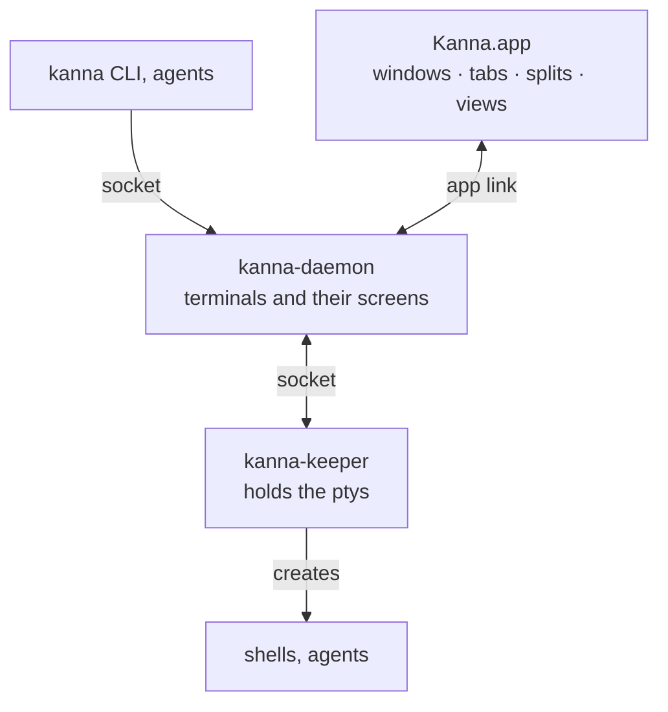

# Kanna

Kanna is a terminal multiplexer for macOS whose terminals outlive the app. Quit or crash Kanna.app, or upgrade its daemon, and every shell and agent keeps running with its screen intact. It has windows, tabs and splits with terminal, web, markdown (with mermaid diagrams) and iOS Simulator panes, and the `kanna` CLI drives all of it.

[kmux](https://github.com/tampopogk/kmux) is the reference model: Kanna.app does what kmux does, the same way, and the `kanna` CLI matches kmux's command for command. See [docs/kanna-spec.md](docs/kanna-spec.md) for the design, [docs/plans/mux-build.md](docs/plans/mux-build.md) for how it was built, and [docs/roadmap.md](docs/roadmap.md) for what comes next.



- **Kanna.app** (`apps/kanna`, Swift) draws the panes with Ghostty and owns the layout. It starts the daemon if none is running.
- **kanna-daemon** (`crates/kanna-daemon`, Rust) runs Kanna's mux core (`crates/kanna-mux`, a port of kmux's) and keeps every terminal's screen.
- **kanna-keeper** (`crates/kanna-keeper`, Rust) holds the ptys, so the programs survive the daemon restarting.
- **kanna** (`crates/kanna`, Rust) is the CLI.

## Download

[Download Kanna](https://github.com/tampopogk/kanna/releases/latest): `Kanna-X.Y.Z-arm64.dmg` for Apple silicon, `Kanna-X.Y.Z-x86_64.dmg` for Intel. Open it and drag Kanna to Applications. Releases are cut with `scripts/release.sh` ([release](docs/specs/release.md)).

## Build

Kanna builds against Ghostty from the `kanna4` branch of [jemdiggity/ghostty](https://github.com/jemdiggity/ghostty/tree/kanna4), which the scripts clone and pin (`scripts/env.sh`). `kanna4` follows Ghostty's `main` by merging it ([Ghostty fork](docs/specs/ghostty-fork.md)).

```sh
scripts/build.sh                  # everything, on a fresh clone or worktree: target/Kanna.app and the CLI, daemon and keeper
scripts/build.sh production       # the same, as the production channel (also staging; dev is the default)
```

Every build is one of three channels, each a separate app with its own name, bundle ID and folders, so all of them run at once: **production** (Kanna, for /Applications), **staging** (Kanna Staging) and **dev** (Kanna Dev). A dev build made in a git worktree is an app of its own, named after the worktree (Kanna Dev task-3f9a1c2e, with its own daemon, terminals and layout), so each task can build and run its Kanna beside the one it's working in. See [build channels](docs/specs/build-channels.md).

It runs these in order, each of which also works on its own:

```sh
scripts/build-ghostty-vt.sh       # libghostty-vt for the daemon (build.sh skips it when it's already the pinned Ghostty)
scripts/build-ghosttykit.sh       # GhosttyKit for the app (likewise)
cargo build --workspace --release # CLI, daemon, keeper, and libkanna_ffi (layout, highlighting, diagrams) for the app
scripts/build-kanna-app.sh        # the Swift app and target/Kanna.app, with the daemon and keeper inside (takes the channel too)
```

A bare `cargo build` or `swift build` misses steps, so start with `scripts/build.sh`. A second run is quick: Ghostty is skipped and the rest is cargo's and SwiftPM's incremental builds. The first build compiles Ghostty with Zig (downloaded if the right version isn't installed), which takes a while. A git worktree of this repo (a Kanna task's, say) reuses the main checkout's Ghostty builds when they're the pinned commit, linking them into its own `target/`, and starts from clones of its cargo dependencies and Swift packages, so its first build takes about 20s. Dev builds compile the Swift app in debug; production and staging in release. See [build speed](docs/specs/build-speed.md).

## Use

```sh
scripts/run-kanna.sh              # open this checkout's Kanna (in a worktree, that worktree's own Kanna Dev)
scripts/run-kanna.sh list         # its CLI against it, even from a terminal in another Kanna
kanna open --name server --cmd "npm run dev" --split right --size 1/3
kanna open md docs/kanna-spec.md --tab
kanna list
kanna help
```

`kanna` starts Kanna.app if it isn't running. In a Kanna terminal it talks to that terminal's Kanna, whatever its channel. `--mux kmux` drives a kmux you run instead, and `--instance NAME` runs a separate Kanna with its own app, daemon and terminals. `kanna instances` lists the running Kannas of every channel, and `kanna instances prune` deletes the folders of dev builds whose worktree is gone.

## Test

Some tests check Kanna against kmux, the reference model, using kmux's source and tests in `references/kmux` (a git subtree).

```sh
cargo test --workspace
swift test --package-path apps/kanna --scratch-path target/kanna-build   # the Swift tests, after scripts/build.sh (they link target/release/libkanna_ffi.a)
scripts/e2e-kanna.sh              # private instances on their own sockets; never touches yours
```

Change kmux there and push it upstream as a kmux PR, then pull when it merges ([kmux subtree](docs/specs/kmux-subtree.md)):

```sh
git subtree push --prefix=references/kmux --rejoin --squash https://github.com/tampopogk/kmux.git BRANCH
git subtree pull --prefix=references/kmux https://github.com/tampopogk/kmux.git main --squash
```

## Skills

The agent skills this project uses (`.claude/skills`, `.agents/skills`) are links into `.agents/kanna-skills`, a git subtree of [jemdiggity/kanna-skills](https://github.com/jemdiggity/kanna-skills). Change them here or there, and sync:

```sh
git subtree pull --prefix=.agents/kanna-skills https://github.com/jemdiggity/kanna-skills.git main --squash
git subtree push --prefix=.agents/kanna-skills https://github.com/jemdiggity/kanna-skills.git main
```

## License

[FSL-1.1-MIT](LICENSE): source-available; each release becomes MIT two years after it is published. kmux and Ghostty are MIT; [NOTICE](NOTICE) lists the code derived from them.
