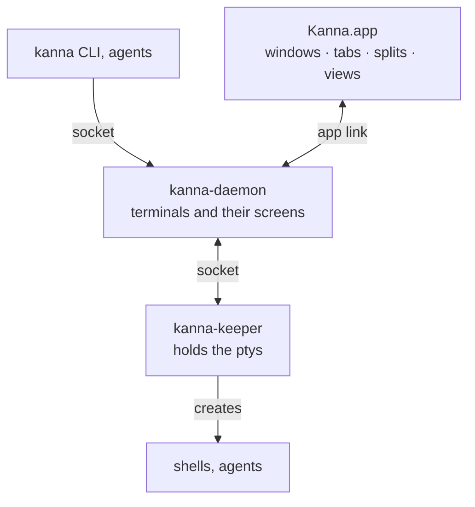

# Kanna

Kanna is a terminal multiplexer for macOS whose terminals outlive the app. Quit or crash Kanna.app, or upgrade its daemon, and every shell and agent keeps running with its screen intact. It has windows, tabs and splits with terminal, web, markdown (with mermaid diagrams) and iOS Simulator panes, and the `kanna` CLI drives all of it.

[kmux](https://github.com/tampopogk/kmux) is the reference model: Kanna.app does what kmux does, the same way, and the `kanna` CLI matches kmux's command for command. See [docs/kanna-spec.md](docs/kanna-spec.md) for the design, [docs/plans/mux-build.md](docs/plans/mux-build.md) for how it was built, and [docs/roadmap.md](docs/roadmap.md) for what comes next.



- **Kanna.app** (`apps/kanna`, Swift) draws the panes with Ghostty and owns the layout. It starts the daemon if none is running.
- **kanna-daemon** (`crates/kanna-daemon`, Rust) runs Kanna's mux core (`crates/kanna-mux`, a port of kmux's) and keeps every terminal's screen.
- **kanna-keeper** (`crates/kanna-keeper`, Rust) holds the ptys, so the programs survive the daemon restarting.
- **kanna** (`crates/kanna`, Rust) is the CLI.

## Build

Kanna builds against Ghostty from the `kanna4` branch of [jemdiggity/ghostty](https://github.com/jemdiggity/ghostty/tree/kanna4), which the scripts clone and pin (`scripts/env.sh`).

```sh
scripts/build.sh                  # everything: libghostty-vt, the daemon, keeper and CLI, and target/Kanna.app
```

It runs these, which also work on their own:

```sh
scripts/build-ghostty-vt.sh       # libghostty-vt for the daemon (skipped when it's already the pinned Ghostty)
cargo build --workspace --release # daemon, keeper, CLI
scripts/build-kanna-app.sh        # target/Kanna.app, with the daemon and keeper inside
```

The first build compiles Ghostty with Zig (downloaded if the right version isn't installed), which takes a while. A git worktree of this repo (a Kanna task's, say) reuses the main checkout's Ghostty builds when they're the pinned commit, linking them into its own `target/`, so building there skips Ghostty.

## Use

```sh
open target/Kanna.app
kanna open --name server --cmd "npm run dev" --split right --size 1/3
kanna open md docs/kanna-spec.md --tab
kanna list
kanna help
```

`kanna` starts Kanna.app if it isn't running. `--mux kmux` drives a kmux you run instead, and `--instance NAME` runs a separate Kanna with its own app, daemon and terminals.

## Test

Some tests check Kanna against kmux, the reference model, using kmux's source and tests in `references/kmux` (a git subtree).

```sh
cargo test --workspace
swift test --package-path apps/kanna -c release --scratch-path target/kanna-build
scripts/e2e-kanna.sh              # private instances on their own sockets; never touches yours
```

## Skills

The agent skills this project uses (`.claude/skills`, `.agents/skills`) are links into `.agents/kanna-skills`, a git subtree of [jemdiggity/kanna-skills](https://github.com/jemdiggity/kanna-skills). Change them here or there, and sync:

```sh
git subtree pull --prefix=.agents/kanna-skills https://github.com/jemdiggity/kanna-skills.git main --squash
git subtree push --prefix=.agents/kanna-skills https://github.com/jemdiggity/kanna-skills.git main
```

## License

[FSL-1.1-MIT](LICENSE): source-available; each release becomes MIT two years after it is published. kmux and Ghostty are MIT; [NOTICE](NOTICE) lists the code derived from them.
