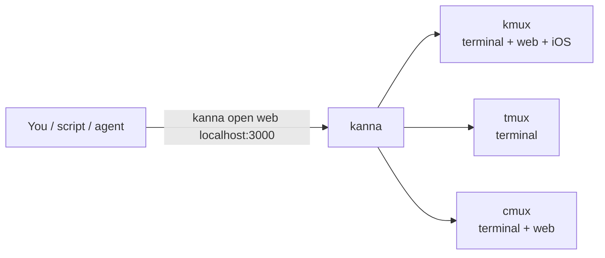
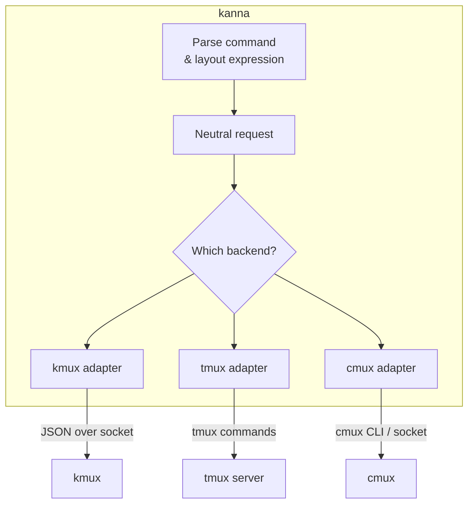
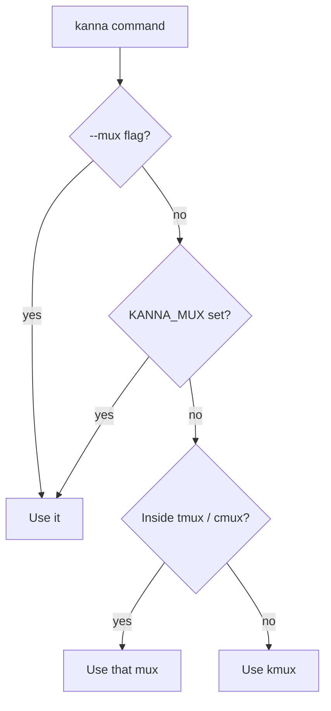
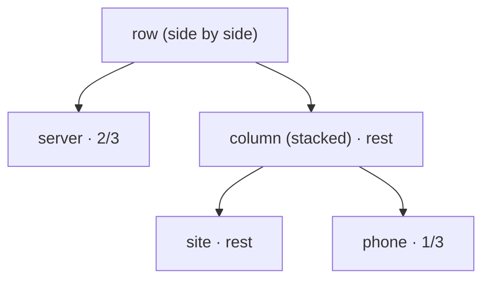
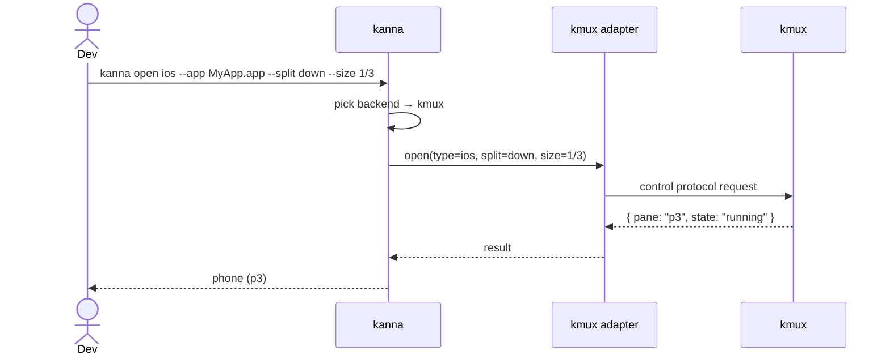

# kanna — Specification

> **Status:** Draft v0.3 · **Last updated:** 2026-10-08
>
> Items marked **[Assumption]** are guesses made to fill gaps. Confirm or correct them, and see [Open Questions](#10-open-questions).
>
> **Related:** [kmux spec](../../kmux/docs/kmux-spec.md) (separate kmux repo, checked out next to this one), Kanna's own mux and kanna's most capable backend.

## Table of Contents

1. [Summary](#1-summary)
2. [Goals and Non-Goals](#2-goals-and-non-goals)
3. [How It Fits Together](#3-how-it-fits-together)
4. [Mux Backends](#4-mux-backends)
   - 4.1 [What Each Backend Supports](#41-what-each-backend-supports)
   - 4.2 [Choosing a Backend](#42-choosing-a-backend)
   - 4.3 [Adapter Interface](#43-adapter-interface)
5. [Commands](#5-commands)
6. [Sizing and Arranging Panes](#6-sizing-and-arranging-panes)
   - 6.1 [One Pane at a Time](#61-one-pane-at-a-time)
   - 6.2 [The Layout Expression](#62-the-layout-expression)
   - 6.3 [Layout Files](#63-layout-files)
   - 6.4 [How Sizes Map to Each Backend](#64-how-sizes-map-to-each-backend)
7. [Example Session](#7-example-session)
8. [Output, Errors and Exit Codes](#8-output-errors-and-exit-codes)
9. [Platform Requirements](#9-platform-requirements)
10. [Open Questions](#10-open-questions)
11. [Glossary](#11-glossary)

---

## 1. Summary

`kanna` is a command-line tool that controls a **mux**, an app that shows several things side by side. A single command can open a terminal, show a web app or launch an iOS app in the simulator.

kanna isn't tied to one mux. Its commands work the same way with **kmux** (Kanna's own desktop mux), **tmux** or **cmux**. Each mux supports whatever pane types it can show.



---

## 2. Goals and Non-Goals

### Goals

| # | Goal |
|---|------|
| G1 | The same commands work with every supported mux. |
| G2 | Make sizing panes simple by default, with more control available when you ask for it. |
| G3 | Make it easy to script: predictable output, JSON output and clear exit codes. |
| G4 | Open a whole dev setup (server, web preview, iOS app) with one command. |

### Non-Goals (for now)

- Showing panes itself. That is the mux's job.
- Pixel-exact sizing. Sizes are fractions of the available space.
- Controlling muxes on other machines. **[Assumption]**

---

## 3. How It Fits Together

kanna turns each command into a backend-neutral request and passes it to an **adapter**. There is one adapter per mux, and each adapter talks to its mux in that mux's own way.



- **kanna stores nothing between commands.** The mux owns all the state.
- **kanna parses layout expressions itself**, so every adapter receives the same tree.

---

## 4. Mux Backends

### 4.1 What Each Backend Supports

| Capability | kmux | tmux | cmux |
|------------|:----:|:----:|:----:|
| Terminal panes | ✅ | ✅ | ✅ |
| Web panes | ✅ | ❌ | ✅ **[Assumption]** |
| iOS Simulator panes | ✅ | ❌ | ❌ |
| Fractional sizing | ✅ | ✅ | ✅ **[Assumption]** |
| Named panes | ✅ | ✅ (kanna stores the name as a pane option) | **[Assumption]** |
| Pane states | Full ([kmux lifecycle](../../kmux/docs/kmux-spec.md#43-lifecycle)) | Running / exited only | **[Assumption]** |

`kanna mux` prints this table for the backend in use.

### 4.2 Choosing a Backend

kanna picks the first match in this order:

1. The `--mux kmux|tmux|cmux` flag.
2. The `$KANNA_MUX` environment variable.
3. **Auto-detect:** if kanna is running inside tmux (`$TMUX` is set), it uses tmux. If it's running inside cmux, it uses cmux.
4. Otherwise kmux, which kanna starts if it isn't already running.



### 4.3 Adapter Interface

Every adapter implements the same operations. Adding a new mux means writing a new adapter.

| Operation | Purpose |
|-----------|---------|
| `capabilities()` | Report the supported pane types and features. |
| `open(type, options, placement)` | Create a pane. `placement` holds the split direction and size. |
| `arrange(layoutTree)` | Apply a parsed layout. |
| `resize(pane, fraction)` | Change a pane's size. |
| `list()`, `focus()`, `close()`, `restart()` | Manage panes. |
| `send(pane, text)`, `navigate(pane, url)` | Act on a pane's contents. |

The kmux adapter maps these one-to-one onto the [kmux control protocol](../../kmux/docs/kmux-spec.md#7-control-protocol).

---

## 5. Commands

| Command | What it does |
|---------|--------------|
| `kanna open term [--cmd CMD] [--cwd DIR]` | Open a terminal pane. |
| `kanna open web URL [--history]` | Open a web pane; `--history` gives it back/forward. |
| `kanna open md FILE` | Show a markdown file, rendered natively with mermaid diagrams; it reloads when the file changes. |
| `kanna open ios --app APP [--device NAME]` | Launch an iOS app in a simulator pane. |
| `kanna arrange LAYOUT` | Rearrange existing panes in one go ([6.2](#62-the-layout-expression)). |
| `kanna resize PANE SIZE` | Change one pane's size. |
| `kanna up [FILE]` | Open a whole setup from a file, `kanna.yaml` by default ([6.3](#63-layout-files)). |
| `kanna list` | List panes with their names, IDs, types and states. |
| `kanna focus PANE` | Bring a pane to the front. |
| `kanna close PANE` | Close a pane. |
| `kanna restart PANE` | Restart what's inside a pane. |
| `kanna send PANE TEXT` | Type text into a terminal pane. |
| `kanna navigate PANE URL\|FILE\|--back\|--forward` | Point a web pane at a new URL (or move through its history), or a markdown pane at another `.md` file. |
| `kanna mux` | Show the backend in use and what it supports. |

`PANE` can be a name (`site`) or an ID (`p2`).

Options for `open`:

| Option | Meaning |
|--------|---------|
| `--name NAME` | A stable name to use in later commands. |
| `--split [right\|down]` | Where to put the new pane relative to the focused one. |
| `--size FRACTION` | How much of the split space the new pane gets, e.g. `1/3`. |
| `--tab` | Open in a new tab instead of splitting. |
| `--no-wait` | Return as soon as the pane is created, without waiting until it's running. |

Global options: `--mux NAME`, `--json`.

---

## 6. Sizing and Arranging Panes

Sizes are **fractions** like `1/2`, `1/3` or `2/3`, never pixels. You only add detail when you care about it.

| Level | You write | You get |
|:-----:|-----------|---------|
| 0 | `kanna open web URL` | Splits the focused pane in half along its longer side. |
| 1 | `--split right` or `--split down` | You choose the direction. The pane is still half-size. |
| 2 | `--split right --size 1/3` | The new pane gets 1/3 and the old pane keeps 2/3. |
| 3 | `kanna arrange 'server \| (site / phone)'` | Arranges several panes at once. |
| 4 | `kanna up` | Opens and arranges a whole setup from a file. |

### 6.1 One Pane at a Time

`--size` is the new pane's share of the space being split. The existing pane gets the rest.

```text
kanna open web URL          --split right            --split down --size 1/3
┌──────────┬──────────┐     ┌──────────┬──────────┐  ┌─────────────────────┐
│          │          │     │          │          │  │       focused       │
│ focused  │   new    │     │ focused  │   new    │  │        (2/3)        │
│          │          │     │          │          │  ├─────────────────────┤
└──────────┴──────────┘     └──────────┴──────────┘  │     new (1/3)       │
 (wide pane → side by side)                          └─────────────────────┘
```

`kanna resize PANE 1/4` changes an existing pane's share of its split. Its neighbours share the difference.

### 6.2 The Layout Expression

`kanna arrange` takes a short expression describing several named panes:

| Symbol | Meaning | Example |
|--------|---------|---------|
| `\|` | Side by side (left to right) | `a \| b` |
| `/` | Stacked (top to bottom) | `a / b` |
| `( )` | Group | `a \| (b / c)` |
| `:FRACTION` | Size within its group | `a:1/4 \| b` |

The rules:

1. **No sizes means equal shares.** `a | b | c` gives each pane 1/3.
2. **Panes without a size share whatever is left.** `a:1/4 | b:1/2 | c` gives `c` the remaining 1/4.
3. **Sizes in a group can't add up to more than 1.** If they do, kanna rejects the expression and explains why.
4. **`/` binds tighter than `|`.** So `a | b / c` means `a | (b / c)`. Use parentheses when in doubt.

```sh
kanna arrange 'server | site | phone'              # three equal columns
kanna arrange 'site:1/4 | server:1/2 | phone'       # 1/4, 1/2, 1/4
kanna arrange 'server:2/3 | (site / phone:1/3)'     # big terminal, web over a small sim
```

The last example produces:

```text
┌─────────────────────────────┬──────────────┐
│                             │     site     │
│        server (2/3)         │    (2/3)     │
│                             ├──────────────┤
│                             │ phone (1/3)  │
└─────────────────────────────┴──────────────┘
```

kanna parses the expression into a tree and hands the tree to the adapter:



### 6.3 Layout Files

A `kanna.yaml` file defines the panes and uses the same layout expression:

```yaml
mux: kmux            # optional; otherwise the usual selection rules apply
layout: "server:2/3 | (site / phone:1/3)"
panes:
  server: { type: term, cmd: "npm run dev", cwd: "~/code/myapp" }
  site:   { type: web,  url: "http://localhost:3000" }
  phone:  { type: ios,  app: "./build/MyApp.app", device: "iPhone 16" }
```

`kanna up` opens the panes in the order listed and then applies the layout. If the backend can't show one of the pane types, kanna stops before opening anything.

### 6.4 How Sizes Map to Each Backend

| Backend | How a fraction is applied |
|---------|---------------------------|
| kmux | Stored as-is. Proportions stay the same when the window is resized. |
| tmux | Converted to a percentage (`split-window -l 33%`, `resize-pane`). |
| cmux | **[Assumption]** Converted to whatever its API accepts, rounded if needed. |

---

## 7. Example Session

```sh
kanna open term --name server --cmd "npm run dev"
kanna open web http://localhost:3000 --name site --split right --size 1/3
kanna open ios --name phone --app ./build/MyApp.app --split down --size 1/3
```



---

## 8. Output, Errors and Exit Codes

- `open` prints the new pane's name or ID. Other commands print short human-readable text.
- `--json` prints one JSON object per command.
- `open` waits until the pane is running or has failed, unless `--no-wait` is given.

| Exit code | Meaning |
|-----------|---------|
| 0 | Success |
| 1 | The command failed (for example, the pane failed to start) |
| 2 | Bad usage (unknown flag, invalid layout expression) |
| 3 | The mux isn't running and couldn't be started |
| 4 | Pane not found |
| 5 | Not supported by this backend |

| Situation | Behaviour |
|-----------|-----------|
| Pane type not supported by the backend | Exits 5, e.g. "tmux can't show web panes. Try `--mux kmux`." |
| Layout sizes add up to more than 1 | Exits 2 and shows which group is over. |
| `arrange` names a pane that doesn't exist | Exits 4. Nothing is changed. |
| Pane too small after rounding (tmux) | The size is raised to the backend's minimum and a warning is printed. |
| Two panes given the same name | The second `open` exits 1. |

---

## 9. Platform Requirements

| Requirement | Why |
|-------------|-----|
| macOS | Needed for kmux and iOS panes. **[Assumption]** kanna with tmux could also run on Linux. |
| The chosen mux | kmux, tmux or cmux must be installed. |

---

## 10. Open Questions

1. **Unsupported pane types:** for example, should `web` on tmux fall back to opening the system browser, or always fail?
2. **cmux:** confirm what its API supports (web panes, sizing, naming).
3. **Mixed backends:** should one `kanna.yaml` be able to use several muxes, for example terminals in tmux and web panes in kmux?
4. **Agent use:** should kanna expose pane contents (terminal text, screenshots) where the backend supports it?
5. **Targeting:** how does kanna choose which window or tab (or tmux session) to act on?

---

## 11. Glossary

| Term | Meaning |
|------|---------|
| **Mux (multiplexer)** | An app that shows several separate sessions in one window. |
| **kmux** | Kanna's own desktop mux. It can show terminal, web and iOS panes. See the [kmux spec](../../kmux/docs/kmux-spec.md). |
| **tmux** | A widely used terminal multiplexer that runs inside a terminal. It shows terminal panes only. |
| **cmux** | A third-party macOS terminal app with panes, used here as a backend. |
| **Backend** | The mux that kanna is currently controlling. |
| **Adapter** | The part of kanna that translates its commands for one specific backend. |
| **Pane** | One rectangular area in a mux showing one thing. |
| **Split** | Dividing a space into panes side by side or stacked. |
| **Layout expression** | kanna's short notation for arranging panes, e.g. `a:2/3 \| (b / c)`. |
| **Layout tree** | The parsed form of a layout expression that kanna passes to adapters. |
