# kanna — Specification

> **Status:** Draft v0.8 · **Last updated:** 2026-10-09
>
> Items marked **[Assumption]** are guesses made to fill gaps. Confirm or correct them, and see [Open Questions](#11-open-questions).
>
> **Related:** [kmux spec](https://github.com/tampopogk/kmux/blob/main/docs/kmux-spec.md) (the separate, public kmux repo), Kanna's own mux and kanna's most capable backend.

## Table of Contents

1. [Summary](#1-summary)
2. [Goals and Non-Goals](#2-goals-and-non-goals)
3. [How It Fits Together](#3-how-it-fits-together)
4. [Kanna.app](#4-kannaapp)
   - 4.1 [Layers and Processes](#41-layers-and-processes)
   - 4.2 [What the Daemon Keeps, What the App Keeps](#42-what-the-daemon-keeps-what-the-app-keeps)
   - 4.3 [kmux Is the Reference Model](#43-kmux-is-the-reference-model)
   - 4.4 [Languages and Platforms](#44-languages-and-platforms)
   - 4.5 [The App Link](#45-the-app-link)
   - 4.6 [The App's Terminal Views](#46-the-apps-terminal-views)
   - 4.7 [The Layout](#47-the-layout)
   - 4.8 [Restarting the Daemon](#48-restarting-the-daemon)
   - 4.9 [Web, Markdown and iOS Panes](#49-web-markdown-and-ios-panes)
   - 4.10 [Windows, Tabs and Splits](#410-windows-tabs-and-splits)
   - 4.11 [The kanna CLI](#411-the-kanna-cli)
   - 4.12 [Terminal Behaviour](#412-terminal-behaviour)
   - 4.13 [Doc Markup](#413-doc-markup)
   - 4.14 [Markdown Pane Keys](#414-markdown-pane-keys)
   - 4.15 [Desk](#415-desk)
   - 4.16 [Docked Pane](#416-docked-pane)
   - 4.17 [Agent Status](#417-agent-status)
   - 4.18 [Tab Completion](#418-tab-completion)
   - 4.19 [Code Viewer](#419-code-viewer)
   - 4.20 [Code Tour](#420-code-tour)
   - 4.21 [The Build](#421-the-build)
   - 4.22 [Quiz](#422-quiz)
   - 4.23 [The Database](#423-the-database)
5. [Mux Backends](#5-mux-backends)
   - 5.1 [What Each Backend Supports](#51-what-each-backend-supports)
   - 5.2 [Choosing a Backend](#52-choosing-a-backend)
   - 5.3 [Adapter Interface](#53-adapter-interface)
6. [Commands](#6-commands)
7. [Sizing and Arranging Panes](#7-sizing-and-arranging-panes)
   - 7.1 [One Pane at a Time](#71-one-pane-at-a-time)
   - 7.2 [The Layout Expression](#72-the-layout-expression)
   - 7.3 [Layout Files](#73-layout-files)
   - 7.4 [How Sizes Map to Each Backend](#74-how-sizes-map-to-each-backend)
8. [Example Session](#8-example-session)
9. [Output, Errors and Exit Codes](#9-output-errors-and-exit-codes)
10. [Platform Requirements](#10-platform-requirements)
11. [Open Questions](#11-open-questions)
12. [Glossary](#12-glossary)

---

## 1. Summary

`kanna` is a command-line tool that controls a **mux**, an app that shows several things side by side. A single command can open a terminal, show a web app or launch an iOS app in the simulator.

kanna isn't tied to one mux. Its commands work the same way with **kmux**, **tmux** or **cmux**. Each mux supports whatever pane types it can show.

**Kanna ships its own mux, Kanna.app** ([4](#4-kannaapp)): its terminals live in a background daemon, so they survive the app quitting. It does what [kmux](https://github.com/tampopogk/kmux) does, keeps its files and sockets in `~/Library/Application Support/kanna-dev/`, and gives its terminals `KANNA_SOCKET`, `KANNA_PANE` and `KANNA_INSTANCE`, so it never meets a kmux the user runs. It's kanna's default backend.

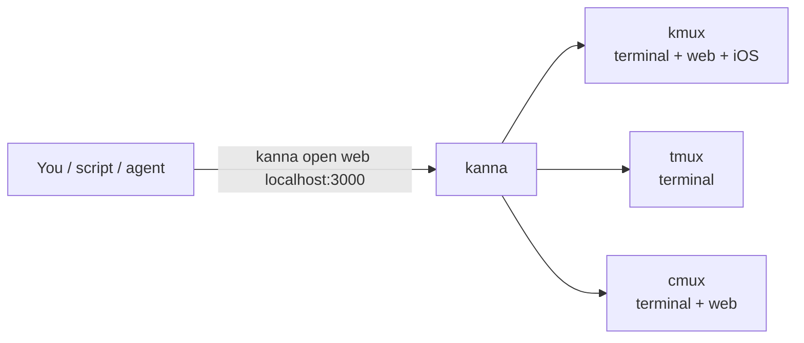

---

## 2. Goals and Non-Goals

### Goals

| # | Goal |
|---|------|
| G1 | The same commands work with every supported mux. |
| G2 | Make sizing panes simple by default, with more control available when you ask for it. |
| G3 | Make it easy to script: predictable output, JSON output and clear exit codes. |
| G4 | Open a whole dev setup (server, web preview, iOS app) with one command. |

### Non-Goals (for now)

- Showing panes itself. That is the mux's job.
- Pixel-exact sizing. Sizes are fractions of the available space.
- Controlling muxes on other machines. **[Assumption]**

---

## 3. How It Fits Together

kanna turns each command into a backend-neutral request and passes it to an **adapter**. There is one adapter per mux, and each adapter talks to its mux in that mux's own way.

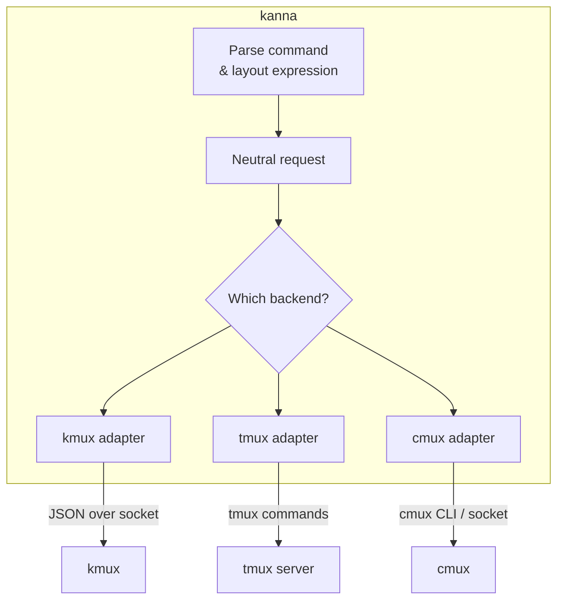

- **kanna stores nothing between commands.** The mux owns all the state.
- **kanna parses layout expressions itself**, so every adapter receives the same tree.

---

## 4. Kanna.app

Built in milestones M0–M4 — see [the build plan](plans/mux-build.md) and [the architecture research](research/mux-architecture.md).

Kanna.app is kanna's own mux: a desktop app, a background **daemon** and a **keeper**. Terminals live in the daemon, so quitting or crashing the app loses nothing, and the keeper holds the terminals open, so even restarting the daemon loses nothing. It shows the same panes as kmux (terminal, web, markdown, iOS) and answers the same commands.

### 4.1 Layers and Processes

Read the stack top to bottom, like the OSI model: each layer uses the ones below it. The outer boxes are processes.

**Colours:** green is Kanna's own, blue is Kanna's code that follows kmux (the reference), purple is kmux itself, grey is macOS, orange is the CLIs.

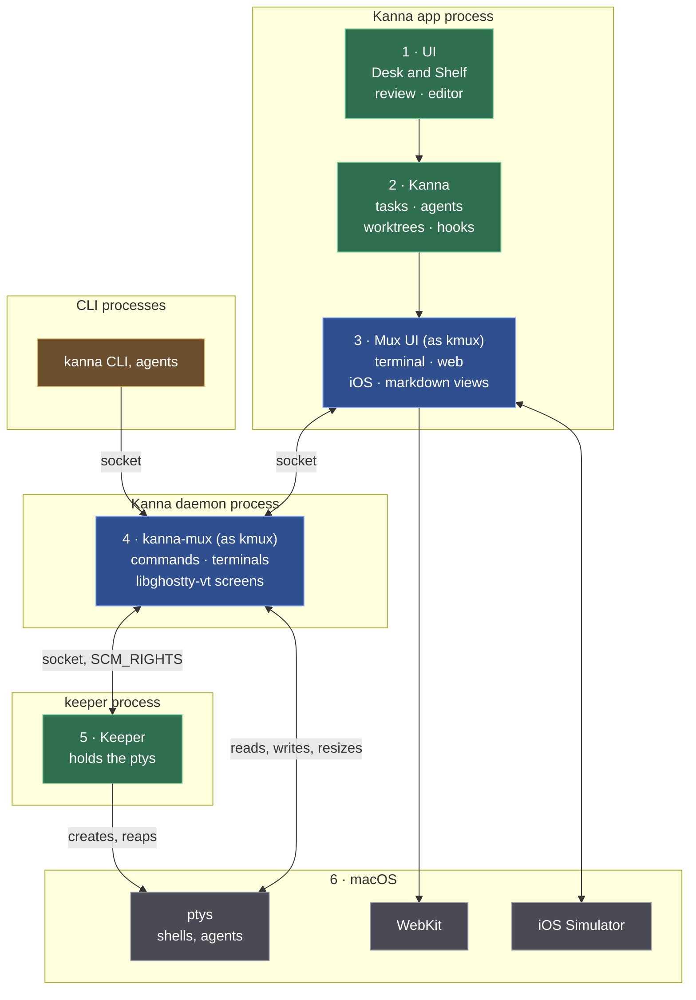

| Layer | What's in it | Process |
|---|---|---|
| 1 · UI | Desk and Shelf, markdown review, code editor | app |
| 2 · Kanna | tasks, agents, worktrees, hooks | app |
| 3 · Mux UI | the pane views (terminal, web, iOS, markdown) and their layout state; Swift, started from kmux's views | app |
| 4 · kanna-mux | the commands (kmux's protocol) and the terminals, each with its screen kept by libghostty-vt; Rust | daemon |
| 5 · Keeper | creates the ptys and holds a copy of each; Rust | keeper |
| 6 · macOS | ptys and shells, WebKit, iOS Simulator devices | — |

- **The CLI is a client, not a layer:** like the app, it calls down into the daemon. Neither serves the other.
- **The keeper isn't in the path of any byte:** it hands each pty to the daemon, which reads and writes it.
- **How a terminal starts:** the daemon asks the keeper of its state folder (`keeper.sock`, started as `$KANNA_KEEPER` or the `kanna-keeper` beside the daemon if none runs) to spawn the program; the keeper answers with the pid and the pty's master (`SCM_RIGHTS`), and later with the exit code, which the daemon records and acknowledges. `close` and `restart` end the program through the keeper; the daemon sets the size itself (`TIOCSWINSZ`). If the keeper goes away the daemon logs it and stops ([keeper spec](keeper.md)). Stopping or crashing the daemon ends no terminal: the keeper keeps them, and the next daemon takes them back ([4.8](#48-restarting-the-daemon)).
- **What a terminal's environment is:** the session's, not whoever started the keeper. The keeper keeps only session-wide variables from its own environment (`HOME`, `USER`, `LOGNAME`, `SHELL`, `TMPDIR`, `LANG`, `LC_*`, `__CF_USER_TEXT_ENCODING`, `SSH_AUTH_SOCK`, and on Linux `DISPLAY`, `WAYLAND_DISPLAY`, `XDG_RUNTIME_DIR`, `XDG_SESSION_TYPE`, `DBUS_SESSION_BUS_ADDRESS`), sets `PATH` to the login default (`/usr/bin:/bin:/usr/sbin:/sbin`), adds Ghostty's variables (`TERM=xterm-ghostty`, `TERMINFO`, `COLORTERM`, shell integration) and the daemon's (`KANNA_SOCKET`, `KANNA_PANE`, `KANNA_INSTANCE`). The shell is a login shell and an interactive one, so the user's profile and rc files (`.zprofile`, `.zshrc`) build the rest, as when Ghostty or kmux is opened from the Dock. Why: the keeper is started by the first daemon, which may have been started from a terminal (by the CLI or `open`), and that terminal's variables would otherwise leak into every pane for as long as the keeper lives; `EDITOR=nvim` alone puts zsh in vi mode, where Ctrl-A and Ctrl-K insert themselves.
- **The shell and commands:** the shell is `$SHELL`, else the account's login shell, else `/bin/sh` (Ghostty's order). A command (`open --cmd`, a task's agent) runs in an interactive login shell, so it starts with the same setup as a terminal tab: [specs/command-shell.md](specs/command-shell.md).
- **The app draws terminals from the daemon** through a forked Ghostty whose surfaces take their output from outside instead of a pty ("external I/O").

### 4.2 What the Daemon Keeps, What the App Keeps

**Only terminals live in the daemon.** Everything else a pane shows is layout state, kept and saved by the app.

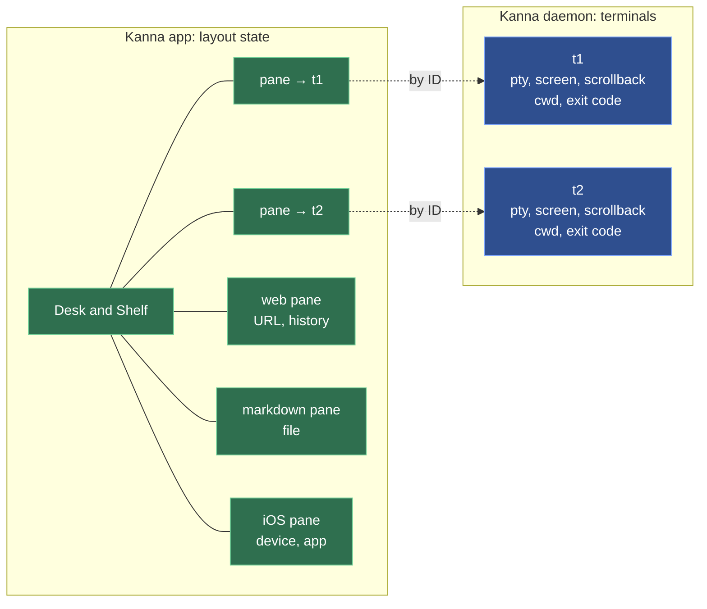

| | What it is | Kept by | After the app restarts |
|---|---|---|---|
| **Terminal** | a pty, its screen and scrollback, cwd, exit code | the daemon | exactly as it was, still running |
| **Layout state** | where panes are; a web pane's URL and history, a markdown pane's file, an iOS pane's device and app | the app | reopened: pages reload at their URL, files reopen, simulators never stopped |

Terminal commands (`list`, `send`, `send-key`, `read`, `close`, `restart`, and `open` without a placement) work with the app closed. Layout, web, markdown and iOS commands are passed to the app; with the app closed, kanna starts it or fails clearly ([4.7](#47-the-layout)).

### 4.3 kmux Is the Reference Model

kmux stays as it is. It's the model Kanna's mux is checked against, not a library Kanna builds on.

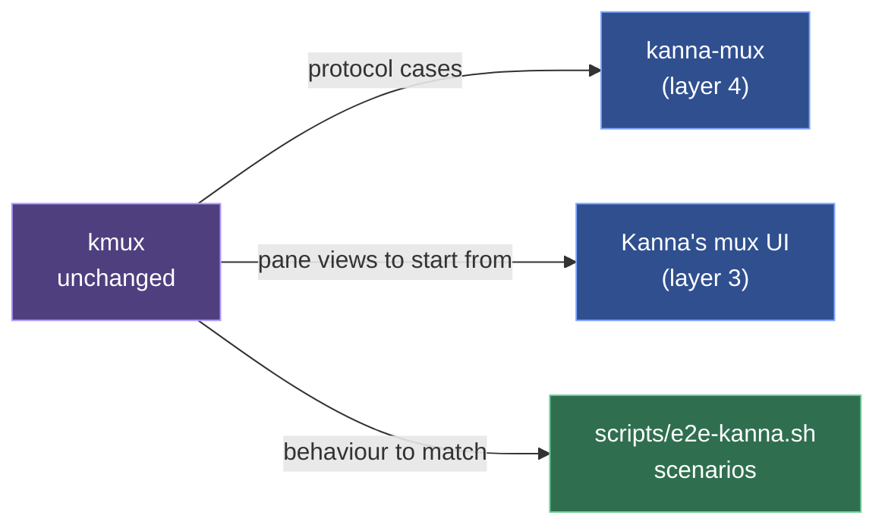

- **kmux's source and tests live in `references/kmux`**, a git subtree of kmux (squashed, at 6fb9364). `kanna-mux` and the daemon run kmux's own protocol cases from `references/kmux/tests/kmux-protocol/cases`, but those Kanna decided to differ from, which the runner skips by name and fails on once kmux drops them. To follow kmux: `git subtree pull --prefix=references/kmux https://github.com/tampopogk/kmux.git main --squash`, then port what Kanna should follow until the checks pass. Nothing in `references/kmux` is edited by hand.
- **What kmux is the reference for:** the mux core and its control protocol, the CLI, and the mux UI (windows, tabs, splits, pane views). Kanna's own layers on top (Desk and Shelf, tasks, agents) have no kmux counterpart.
- **Building doesn't need kmux; checking does.** Kanna builds from its own sources, including its copies of kmux's socket client (`crates/kanna-client`) and mermaid bridge (`crates/kanna-merman`). The tests that compare Kanna with kmux read `references/kmux` (or `$KMUX_DIR`, to check against another kmux): the protocol cases, and the CLI check that compiles kmux's `commands.rs` and `output.rs`. If it's missing they fail and say so, rather than pass without checking.
- Where Kanna and kmux behave differently, Kanna is wrong unless we decided otherwise.
- Nothing changes in kmux for Kanna's sake.

### 4.4 Languages and Platforms

| Part | Language | Runs on |
|---|---|---|
| Kanna.app (layers 1–3) | Swift (AppKit) | macOS |
| Daemon and `kanna-mux` (layer 4) | Rust | macOS and Linux |
| Keeper (layer 5) | Rust | macOS and Linux |
| `kanna` CLI | Rust | macOS and Linux |

The daemon has to run on Linux too, so everything below the app is Rust. A Linux UI would be its own, on the same daemon.

**The app's Rust is one static library, `crates/kanna-ffi`.** The app calls three Rust crates through C headers: `kanna-layout` (the layout), `kanna-syntax` (code highlighting) and `kanna-merman` (diagrams). Each is an rlib, and `kanna-ffi` links them into `libkanna_ffi.a`, the only Rust library the app and its Swift tests link. Each Rust static library carries its own copy of Rust's std, so linking two of them can fail with duplicate symbols (`rust_eh_personality`), as the Swift test bundle did; one library links std once. Each crate keeps its own C header and Swift module (`KannaLayoutC`, `KannaSyntaxC`, `KannaMerman`).

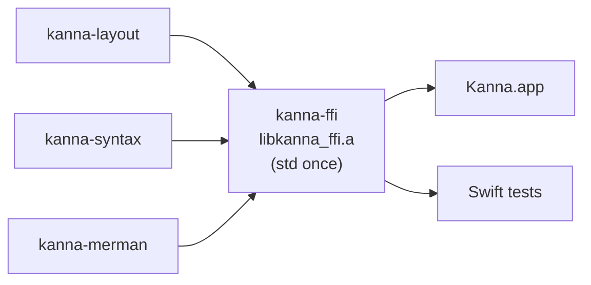

### 4.5 The App Link

The app is a client of the daemon, like the CLI, but it stays connected: it shows the daemon's terminals, types into them, and answers the requests only the app can (the layout, its web, markdown and iOS panes, `debug.*`). The **app link** is that one connection, on the daemon's own socket (`$KANNA_SOCKET`).

**The same wire as the control protocol.** One JSON object per line, both ways. A message with `cmd` is a request, shaped `{"id", "cmd", "args"}` as in the control protocol; with an `id` it wants a reply, `{"id", "ok": true, …}` or `{"id", "ok": false, "error": {"code", "message"}}`, and without one it's a notice that gets none. Each side numbers its own requests, and a reply goes to the side that asked. Terminal bytes are base64 in a `data` field.

**Saying it's the app.** The app's first line is `{"id": 0, "cmd": "app.hello", "args": {"pid": …, "build": …}}`. The daemon answers `{"id": 0, "ok": true, "daemon": {"pid": …, "build": …}, "panes": [{"id", "name", "type"}, …]}`, listing every terminal it has, and the connection is the app link from then on. One app at a time: a second gets `ok: false` (`app_attached`) and is closed. If the daemon goes away, the app keeps trying to connect, and on reconnecting says hello and attaches its terminals again.

**The daemon follows the app's build** ([daemon build](specs/daemon-build.md)). `build` is the SHA-256 of the daemon binary: the app hashes the `kanna-daemon` it carries, the daemon its own executable at start. When no app is attached and a hello's `build` differs from the daemon's, the daemon answers `ok: false` (`other_build`) and stops as on SIGTERM ([4.8](#48-restarting-the-daemon)); the app then starts its own daemon at once, which adopts every terminal. A hello without `build` is accepted. The CLI never stops a daemon; when a command fails against one of another build (`capabilities` answers `build`), it adds a line saying so and to relaunch Kanna.app.

**The app starts the daemon.** Kanna.app carries the daemon, the keeper and the `kanna` CLI in `Contents/Helpers`, and nothing else has to be run first:

- **When:** at launch, as soon as nothing answers on the daemon socket; after losing a daemon it has been attached to, once nothing has answered for 2 s (so a daemon being restarted on purpose gets there first). At most one start every 10 s. The daemon's lock ([4.8](#48-restarting-the-daemon)) makes a race harmless: a second daemon on the folder exits.
- **How:** in its own session (`setsid`), so it outlives the app; signals back to their defaults; no descriptors of the app's; stdin from `/dev/null`, stdout and stderr appended to `daemon.log` in the state folder. It gets the app's environment without `KANNA_*` and `KMUX_*` (only `KANNA_STATE_DIR` and `KANNA_DEBUG` pass), plus `KANNA_SOCKET` (the app's daemon socket) and `KANNA_KEEPER` (the bundled keeper). The daemon then starts the keeper as before.
- **Quitting the app** leaves the daemon and its terminals running; the next launch attaches to it if it's the same build, and replaces it if not (above).
- **Why the app and not launchd:** the daemon is needed only when the app or the CLI is, and the app knows the socket and state folder it uses. A launch agent would add install steps and a second definition of both. On Linux, which has no app yet, the daemon is started by hand.

**The first terminal.** When the first attach after launch leaves the layout empty (nothing saved, or nothing left of it), the app opens a terminal, as kmux opens a window. Reopening the app from the Dock with nothing open does the same. `KANNA_NO_INITIAL_WINDOW=1` turns it off (the e2e scenarios set it).

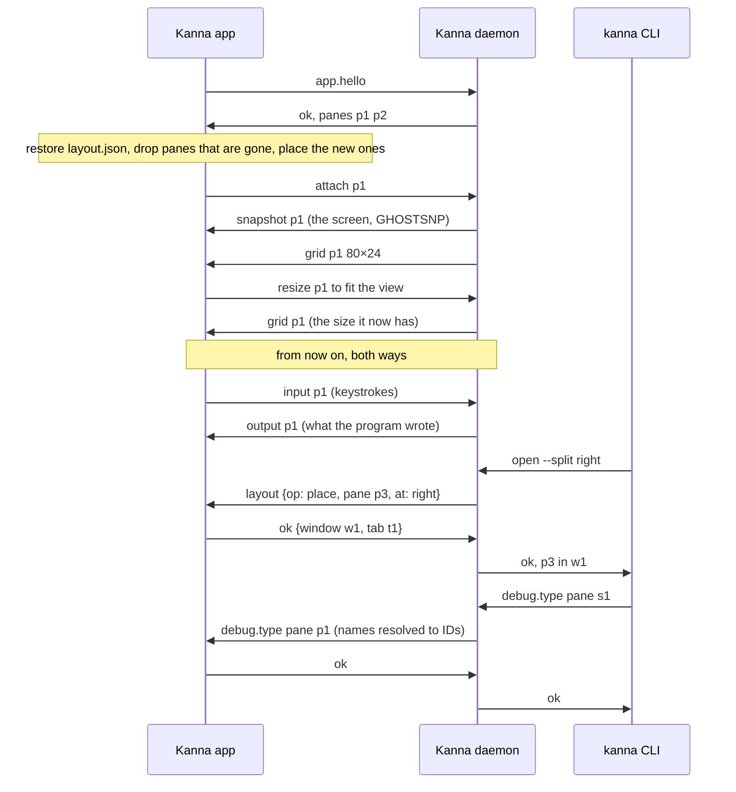

| Message | From | What it says |
|---|---|---|
| `app.hello {pid, build}` | app | I'm the app, of this build; the reply accepts or refuses it (`app_attached`, `other_build`) and lists the daemon's terminals (`panes`) |
| `layout {op, …, panes}` (with an `id`) | daemon | one step of a command on the layout ([4.7](#47-the-layout)); the app's reply is the step's answer |
| `attach {pane}` / `detach {pane}` | app | I show (or no longer show) this terminal |
| `snapshot {pane, data}` | daemon | the terminal's whole screen (grid, scrollback, modes, colors, an unfinished sequence) as a GHOSTSNP snapshot; sent on attach, before anything else for that pane |
| `grid {pane, cols, rows}` | daemon | the terminal's size, after a snapshot or a resize |
| `output {pane, data}` | daemon | bytes the program wrote since the snapshot |
| `exited {pane, code}` | daemon | the program ended |
| `status {pane, status}` | daemon | an agent pane's status changed (`working`, `needs-you`, `idle`), or a terminal ended (`exited`), or `null` when it's no longer an agent; for every terminal, shown or not, and once per pane after `app.hello` ([4.17](#417-agent-status)) |
| `input {pane, data}` | app | bytes the view wrote: keys, paste, mouse and focus reports |
| `resize {pane, cols, rows, width, height}` | app | the view now fits this many cells (and pixels), after a view or font size change |
| `settings {foreground, background, cursor, palette, scheme, cursorStyle, cursorBlink, graphemes}` | app | the terminal settings from the app's Ghostty config, sent before any attach and again when the config or the light/dark appearance changes ([4.12](#412-terminal-behaviour)) |
| `debug.*` (with an `id`) | daemon | a request from a client, passed on; the app's reply is the client's |
| `start`, `stop`, `pane`; `update`; the app's own requests | both | web, markdown and iOS panes ([4.9](#49-web-markdown-and-ios-panes)) |

- **Requests from the daemon are answered in order.** The app answers `layout` on its main thread as the message arrives, before anything after it; `debug.*` may answer later.

- **The daemon decides a terminal's size.** The view asks with `resize`; the daemon sets the pty's size, and the view takes the size `grid` gives it, in order with the output.
- **Requests for the app** (every `debug.*` command the core doesn't answer itself: `debug.app`, `debug.type`, `debug.key`, `debug.text`, `debug.snapshot`, `debug.web`, `debug.md`, `debug.ios`, and kmux's UI commands `debug.click`, `debug.drag`, `debug.menu`, `debug.pinch`, `debug.stats`, [4.10](#410-windows-tabs-and-splits)) can come from any client. The daemon turns a pane name into its ID, passes the request on and returns the app's reply. With no app attached they fail with `no_app`; if the app goes away first, with `app_gone`. If the app doesn't answer within 10 s they fail with `timeout`.
- **`screenshot` is passed on the same way**, but isn't a debug command, so the app always answers it ([screenshot](specs/screenshot.md)).
- **Debug commands are off by default.** The app answers `debug.*` only when started with `KANNA_DEBUG=1` (the test scripts set it). `debug.snapshot` takes a plain file name and writes a new file in `$KANNA_STATE_DIR` (or `$TMPDIR`); it never overwrites one.
- **Limits:** a resize beyond 1000 cells a side is refused; a line over 16 MiB drops the app; an app that falls 16 MiB behind on output stops getting it and starts its terminals over (snapshot, grid) once it has caught up, and one 64 MiB behind is dropped.
- **The layout is the app's** ([4.7](#47-the-layout)): the daemon keeps none and asks the app for every layout step. M0's `layout` notice, which mirrored a layout the daemon kept, is gone.
- **Screens:** the daemon keeps each terminal's screen with libghostty-vt (`crates/kanna-vt`), fed from the pty: up to 10 MB of scrollback ([4.12](#412-terminal-behaviour)). `read` answers from it, so it works with the app closed.
- **Queries are answered once, by the daemon.** The program's queries (cursor position, device status and attributes, modes, size reports, XTVERSION) are answered by the daemon's screen, written back to the pty as they're parsed, whether or not the app is attached. The app's surfaces parse the same output but drop their replies (the Ghostty fork's external backend), so the program never gets two. Colour queries (OSC 4, 10, 11, 12) and colour-scheme reports are answered from the theme the app sends in `settings` ([4.12](#412-terminal-behaviour)).
- **Attaching:** the daemon takes the snapshot on its main loop under the same lock the pty reader feeds the screen and the outbox with, and empties the outbox as it does: what the snapshot has isn't sent again, and every later byte follows as `output`. The app loads the snapshot (`ghostty_surface_load_snapshot`), then applies the `grid` that follows, since a snapshot carries its own grid; both go through the same queue as output, in order. A restarted terminal is attached the same way.
- **When a snapshot fails:** inside some unfinished sequences (an APC holding a C1 byte) libghostty-vt can't encode one. The daemon then sends nothing for that pane and tries again after the terminal's next output (which is all that can change it), or when it exits. If the app's surface refuses a snapshot (a full mailbox), it retries every 2 ms; after 250 refusals it gives up on it and goes on with the live output.

### 4.6 The App's Terminal Views

- **Typed text goes out as key events.** Committed text is sent as the key event's text, as Ghostty's app does; `ghostty_surface_text` is the paste path and would wrap every keystroke in bracketed-paste markers. A lone control character is reported without Control, function-key private-use characters aren't text, and text starting with a control character or DEL is dropped so the encoder works from the key code (Shift+Return reaches kitty-keyboard programs as `CSI 13;2u`).
- **The clipboard follows Ghostty's rules**, not kmux's: a paste, and an OSC 52 read or write, go through Ghostty's `clipboard-read` (default: ask) and `clipboard-write` (default: allow) settings and its unsafe-paste check; the app only supplies the clipboard and the confirmation sheet ([4.12](#412-terminal-behaviour)).
- **Focus follows the first responder**, not key-window status, so a pane keeps its focused cursor across reparenting. `ghostty_surface_set_occlusion` takes visibility: false stops the renderer updating at all, so `KANNA_IGNORE_OCCLUSION=1` (the test scripts) keeps hidden windows drawing.
- **`screenshot` and `debug.snapshot` capture with `CGWindowListCreateImage`**, drawing terminals hidden from Ghostty first, so an occluded window's come out legible ([screenshot](specs/screenshot.md#3-how-its-built)).

### 4.7 The Layout

The app owns the layout (windows, tabs, splits, focus, zoom; later Desk and Shelf) and saves it; the daemon owns the terminals.

**Design: one layout model, in Rust, run by the app.** The layout logic is `kanna-mux`'s model (ported from kmux, checked with kmux's protocol cases); there is no second copy in Swift. The app links it as a static library (`crates/kanna-layout`, a small C interface taking and returning JSON, linked through `kanna-ffi`, [4.4](#44-languages-and-platforms)) and is the only process that holds a layout: it applies layout commands to it, draws it, and saves it. The daemon's `kanna-mux` core keeps the protocol and the panes, and reaches the layout through an asynchronous seam, `LayoutLink`; in the daemon that link is the app link, so each layout step is a request to the app. Why this and not kmux's Swift model copied into the app:

- **One implementation.** A Swift copy would be a second layout model to keep in step with the Rust one that `kanna-mux` (and its tests) needs anyway; every kmux change would be ported twice.
- **Conformance is checked on what runs.** kmux's protocol cases run against `kanna-mux` twice: with the model in-process, and with the model behind the same JSON requests the app answers (`LayoutOwner`, the code the app runs), its answers arriving later as they do over the app link.
- **Linux.** A Linux UI gets the same layout by linking the same library.
- **The app knows the views.** Choices only a UI can make (which way an `auto` split goes, window frames) are made where the views are.

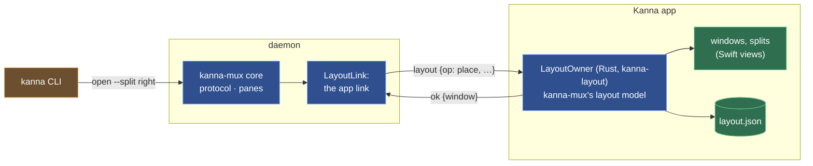

**Layout steps.** `kanna-mux`'s core turns each command into steps on the layout and sends them through its `LayoutLink`; in-process (kmux's own shape, and `kanna-mux`'s tests) they run at once, in the daemon each is a `layout` request on the app link that the app answers with `LayoutOwner`. Every step carries the daemon's pane table (`panes: [{id, name, type}]`), so the app resolves names and labels as the daemon would. A command's steps and its changes to the panes run one command at a time (the core takes turns), so pane IDs and layout changes happen in kmux's order however slowly the app answers.

| Step (`op`) | Used by | The app answers | With no app attached, the daemon answers |
|---|---|---|---|
| `place {pane, at}` | `open` (`at` holds only the `split`, `size`, `tab`, `window`, `dock` given) | places it: `{window, tab}`, and `dock` (its edge) for a docked pane, whose `tab` is null | with no `at`: `{window: null, tab: null}`, the pane is opened unplaced; with one: `no_app` |
| `location {pane}` | `open`, once the pane has started; `close` of a pane, which a docked one refuses ([4.16](#416-docked-pane)) | `{window, tab}`, and `dock` as `place` | `{window: null, tab: null}` |
| `command {cmd, args}` | `focus`, `zoom`, `rename-tab`, `move`, `move-tab`, `resize`, `arrange` | the command's reply, as kmux | `no_app` |
| `panes-in {tab}` / `{window}` | `close --tab`, `close --window` | the panes there | `no_app` |
| `remove {ids, tidy}` | `close`, `debug.restoreState` | removes them (and closes emptied tabs and windows) | nothing to do |
| `windows` | `list`, `debug.restoreState` | kmux's `windows` | `[]` |
| `export`, `check {state, ids}`, `install {state, ids}` | `debug.saveState`, `debug.restoreState` | as kmux | `no_app` |

- **With the app attached** every layout command is the app's; `close` closes the terminals in the daemon and then has the app remove them.
- **With the app closed**, terminals keep working: `list`, `send`, `send-key`, `read`, `close`, `restart`, and `open` without a placement (the pane is placed when the app next opens). Commands that need the layout fail with `no_app`: "… needs Kanna.app, and none is attached to this daemon".
- **If the app goes away mid-step**, the step gets the no-app answer: an unplaced `open` still opens its terminal, a placed one fails.
- **`list`** answers `panes` from the daemon and `windows` from the app; with no app, `windows` is `[]` (no last-known layout: the app's file is the only copy, and it may be stale) and each pane's window shows as `-`.

**Saving.** The app saves its layout in kmux's state file format (`kmux: "state"`, `version: 1`, windows with their frames, tabs, splits, focus, zoom, the panes it places by ID, name and type) to `layout.json` in its state folder: `$KANNA_STATE_DIR`, or the daemon socket's folder. As kmux: half a second after a change and on quit, only when something changed, written atomically (a new file, then renamed) with mode 0600; `--fresh` (or `KANNA_FRESH=1`) starts without it, `KANNA_NO_STATE=1` neither reads nor writes one.

**Restoring.** On launch the app reads the file (one it can't trust, or of another version, is moved aside as `layout.json.bad`). When the daemon accepts it, the hello reply lists the daemon's terminals; the app drops from the layout every pane the daemon no longer has (closing emptied splits, tabs and windows), places every terminal it doesn't know as `open` would (beside the focused pane), opens every window where it was ([4.10](#410-windows-tabs-and-splits)), and attaches each terminal it shows. A reconnect to a restarted daemon does the same with the layout in memory. Nothing is saved until the saved layout has been installed, so an app that never reached its daemon doesn't overwrite it.

```mermaid
sequenceDiagram
    participant A as Kanna app
    participant D as Kanna daemon
    participant C as kanna CLI
    Note over A: closed
    C->>D: open --name logs
    D->>C: ok, p3, window null
    C->>D: open --split right
    D->>C: no_app
    C->>A: start (open -a $KANNA_APP)
    Note over A: read layout.json (p1, p2)
    A->>D: app.hello
    D->>A: ok, panes p1 p2 p3
    Note over A: p1, p2 where they were; p3 placed
    C->>D: open --split right (again)
    D->>A: layout {op: place, pane p4, at: right}
    A->>D: ok {window w1, tab t1}
    D->>C: ok, p4
```

**The CLI starts the app** ([plan](plans/mux-build.md) steps 1.4 and B.6). When the daemon answers a command with `no_app` and `KANNA_SOCKET` isn't set, `kanna` starts Kanna.app (`open -n -a $KANNA_APP`; else, for a dev build, its checkout's `target/Kanna.app`; else by its channel's bundle ID, `dev.kanna.app` or `dev.kanna.app.staging`; never the branded kmux `dev.kanna.kanna`; with `KANNA_SOCKET` and `KANNA_STATE_DIR` passed on, in the background with `--bg` or `KANNA_BG=1`), retries the command every 200 ms until the app has attached (a `no_app` answer changes nothing, so the retry is safe), and gives up after 20 s with exit 6. With `KANNA_SOCKET` set (a test, a script, a terminal inside Kanna) it never starts an app: it exits 6 with the daemon's message and "KANNA_SOCKET is set, so kanna doesn't start Kanna.app for it". Without `KANNA_SOCKET`, kanna talks to the daemon of its instance (its build's default, such as `kanna-dev/kanna.sock` in the app support folder; [build channels](specs/build-channels.md)), and when nothing answers there it starts Kanna.app, which starts the daemon ([4.5](#45-the-app-link)), as kmux's CLI starts kmux; the CLI itself never starts a daemon ([4.11](#411-the-kanna-cli)).

**Conformance.** kmux's 46 protocol cases pass three ways: against `kanna-mux` with the model in-process; with the model behind `LayoutOwner`, every step sent as JSON and answered on a later turn (`crates/kanna-mux/tests/protocol_cases.rs`); and through a running daemon, keeper and app link, with a test app answering through `LayoutOwner` (`crates/kanna-daemon/tests/protocol_cases.rs`: all of them since M3, the 13 of docked panes since 4.16, [4.9](#49-web-markdown-and-ios-panes)). The app's own glue is checked by S5 and S9 of `scripts/e2e-kanna.sh` and by `crates/kanna-layout/tests`.

### 4.8 Restarting the Daemon

The daemon can stop, crash or be upgraded without losing a terminal ([plan](plans/mux-build.md) M2). The keeper holds every pty, so the programs keep running and their output waits in the pty's kernel buffer; the daemon keeps its terminals on disk, so the next one knows their IDs, names and screens; on start it takes every pty back from the keeper (`adopt`) and rebuilds its terminals from both.

**Files on disk.** In `$KANNA_STATE_DIR/terminals/` (0700; a symlink there is refused), each written atomically (a new file, then renamed), mode 0600:

| File | What it holds | Written |
|---|---|---|
| `terminals.json` | `{kanna: "terminals", version: 1, counters: {pane}, terminals: [{id, name, type, cmd, cwd, state, exitCode, pid, keeper}]}`: each terminal's pane record (`state` is `running` or `exited`, `keeper` the id the keeper knows its pty by) and the pane counter | on every change (open, close, restart, start, exit), from the daemon's main loop; an exit before the daemon acknowledges it to the keeper |
| `<pane>.snap` | the terminal's screen as a GHOSTSNP snapshot (kanna-vt), as `attach` sends it | by a saver thread, at most once a second per terminal and only after its screen changed; all of them on a clean stop |

- **Snapshots** are taken under the same lock the pty reader feeds the screen with, without touching what the app is sent. If one can't be encoded (inside some unfinished sequences, as on attach), the last good file stays and the saver tries again a second later; one over 16 MiB isn't written (the screen keeps at most 10 MB of scrollback, so this shouldn't happen) and the last good one stays. A failed write is tried again a second later.
- **Bounded:** a snapshot file is at most 16 MiB, `terminals.json` is refused past 4 MiB when read; there is one snapshot per terminal, and the keeper holds at most 256 ptys. Snapshots of terminals that are gone are deleted when they close, and at start.
- **A file it can't trust** (bad JSON, another version, two terminals with one ID, keeper id or name) is moved aside as `terminals.json.bad`, and the daemon starts as if it had none (it still takes back every pty the keeper has, below).
- **One daemon per folder:** the daemon holds `flock` on `daemon.lock` there while it runs; a second one waits 5 s for it, then exits 1 ("another daemon (pid …) uses …"). Its keeper is the keeper of that folder only, so no daemon ever adopts or closes another's terminals.

**Stopping.** On SIGTERM, SIGINT or SIGHUP the daemon stops reading every pty (whatever is unread stays in the kernel buffer for the next daemon), writes `terminals.json`, saves every screen that changed since its last save, and exits; its terminals keep running in the keeper. A crash (SIGKILL) skips that: up to a second of screen changes before it are lost from the saved screens, and a full-screen program redraws them when it gets SIGWINCH.

**Starting.** The daemon connects to the keeper (pending exits arrive as events), adopts every pty it holds, and matches them with `terminals.json` by keeper id:

```mermaid
sequenceDiagram
    participant D1 as old daemon
    participant K as keeper
    participant S as shell
    participant D2 as new daemon
    participant A as Kanna app
    Note over D1: SIGTERM: stops reading, saves terminals.json and the screens<br/>(SIGKILL: what it saved up to a second before)
    D1--xA: link closes; the app keeps trying to reconnect
    S->>S: output waits in the pty buffer
    D2->>D2: flock daemon.lock
    D2->>K: connect, hello (unacknowledged exits arrive as events)
    D2->>K: adopt
    K->>D2: each pty: {id, pid, cmd, cwd, exit?} + master
    D2->>D2: read terminals.json: same IDs, names, cmd, cwd; counter continues
    D2->>D2: each screen from <pane>.snap (if the pid matches), sized to the pty (TIOCGWINSZ)
    D2->>S: TIOCSWINSZ, then SIGWINCH to the pty's foreground group
    D2->>S: reads what waited in the buffer into the screen, then carries on
    D2->>K: ack exits that happened meanwhile (after saving them)
    A->>D2: app.hello
    D2->>A: ok, panes (the same IDs: layout.json still matches)
    A->>D2: attach p1
    D2->>A: snapshot p1, grid p1, then output
```

| The keeper has the pty | `terminals.json` has it | The daemon |
|---|---|---|
| yes, running | yes | takes it back: same ID, name, command, pid; its saved screen (a blank one if the file is missing or unreadable, or the record's pid isn't the pty's); the waiting output; SIGWINCH |
| yes, exited meanwhile (unacknowledged) | yes | as above, then reads its last output, records the exit code, acknowledges it: `list` shows `exited` with the program's own code |
| yes | no (a crash before the record was written, or the file lost) | **takes it back** with a blank screen, no name, its command (from the keeper's `/bin/sh -c CMD`, else none: a shell) and cwd, under the keeper's id if that's a pane ID not in use, else a new one; the app places it as a new pane |
| no | yes, `exited` | keeps it as an exited terminal with its saved screen and exit code, as before the restart, until it's closed or restarted |
| no | yes, `running` | drops it (its program ended and the keeper lost its exit: the keeper stopped, or idled out) and logs it |

- **Why adopt the unknown ones rather than close them:** a pty the keeper holds is a program the user started (perhaps an agent mid-task); closing it would lose work the daemon could keep. It costs only a pane without a name, which the user can close. Closing was M0's behaviour (until 2.2 a starting daemon closed whatever the keeper had) and is gone.
- **Pane IDs never repeat:** the counter continues from the larger of the saved counter and every ID on disk and in the keeper. Only losing `terminals.json` while the keeper has also lost the newest terminals can bring an old ID back.
- **Exit codes** come from the keeper, the process's parent, so an exit while no daemon runs keeps its code (`exit 7` → `exitCode: 7` after the restart). On macOS a program can't finish exiting while its last output is unread; the new daemon reads it, and the exit arrives then. That holds for `sh` and `bash`; zsh exits without waiting, so output a zsh program wrote while no daemon was running, just before it exited, is lost (its exit code is not).
- **Sizes:** the pty keeps the size the last daemon set; the new daemon sizes each screen to it and sets it again, and the app resizes once it attaches.
- **Upgrades:** a relaunched app of another build makes the daemon stop as on SIGTERM (`other_build`, [4.5](#45-the-app-link)) and starts its own, which takes everything back as above; a rebuild that didn't change the daemon keeps it running ([daemon build](specs/daemon-build.md)).
- **The app** sees its link close, keeps trying to reconnect, and on reconnecting says hello and attaches again ([4.5](#45-the-app-link)); the hello reply lists the same IDs, so its layout (in memory and in `layout.json`) still matches and nothing moves ([4.7](#47-the-layout)).

**Checked by** `crates/kanna-daemon/tests/restart.rs` (a running shell keeps its pid and screen, output written while the daemon was down appears, and the app gets all of it on attach; a full-screen program redraws once after SIGWINCH; exits while the daemon is down, with their codes; a SIGKILLed daemon's screens, including output written just before the kill; IDs don't repeat; a pty the disk doesn't know is taken back and a record the keeper doesn't know dropped; a second daemon on the folder is refused; an app of another build stops the daemon and the next keeps its terminals), the store's unit tests, S6 of `scripts/e2e-kanna.sh` (with the app attached: same PIDs, screen and layout, output written meanwhile, the app's view) and S61 (an app replacing a daemon of another build).

### 4.9 Web, Markdown and iOS Panes

A web, markdown or iOS pane is a view in the app and a record in its layout: a web pane's URL (and whether it keeps history), a markdown pane's file and zoom, whether either is open for comments (`kanna markup`), the agent pane that opened a markdown file or a page for comments ([doc markup](specs/doc-markup.md)), an iOS pane's app and device, saved in `layout.json` in kmux's state file format. The daemon runs none of them ([4.2](#42-what-the-daemon-keeps-what-the-app-keeps)), but its `kanna-mux` core still gives them their IDs, checks and answers every command about them as kmux does (`open`, `navigate` with its history, `close`, `restart`, `list`), and passes them to the app to show ([plan](plans/mux-build.md) M3). A markdown file's front matter, the `---` block at its top, shows as a YAML code block on the same lines.

**Design: the app's panes are lent to the daemon while it's attached.** The app owns the records and saves them; on hello it hands them to the daemon, whose core holds them beside its terminals for as long as the link lasts, so kmux's core logic runs unchanged on one pane table; when the app goes, so do they. Why not keep them in the daemon: they'd outlive the app with nothing to show them, and `list` would report pages no view has; and why not answer their commands in the app: the core (IDs, names, history, errors) would be split in two. Every change to a record goes through the daemon's core and comes back to the app, so there is one writer.

| Message (app link) | From | What it says |
|---|---|---|
| `app.hello {pid, panes}` | app | `panes`: the app's web, markdown and iOS panes (records, with each view's `state`). The daemon takes each whose ID and name no terminal has (the others are dropped and logged), continues its pane counter past them, and lists them in the reply's `panes` with its terminals |
| pane tables (`panes` in the hello reply and every `layout` step) | daemon | records now: `{id, name, type}` plus the state file's fields (`url`, `history`; `path`, `zoom`, `agent` (the pane that ran `kanna open md`, where its comments go); `app`, `device`; `cmd`, `cwd` for terminals); the app's layout keeps and saves them |
| `start {pane: record}` | daemon | show this pane (`open`, `restart`, `navigate`, `debug.restoreState`), replacing any view it had |
| `stop {pane}` | daemon | the pane closed, or is about to start again |
| `update {pane, state?, error?, url?, device?, zoom?}` | app | the view is `running` or `failed` (with `error`); the page moved (`url`, applied as kmux's page moves, history included); the simulator chosen (`device`); the markdown zoom |
| `pane {pane: record}` | daemon | the record after an `update`, for the app's layout |
| requests (`{id, cmd, args}`) | app | `navigate` from the views (the URL editor, a markdown link, back and forward), answered as any client's |
| `debug.web`, `debug.md`, `debug.ios` (with an `id`) | daemon | kmux's commands for these panes (the page's URL and text; the rendered markdown; a tap or Home on the simulator), passed on like `debug.text` |

- **Starting:** a web pane reports `running` as soon as its view loads the URL (a server that isn't up yet shows a notice and is retried, as kmux); a markdown pane once the file is read (`failed`: "No such file"); an iOS pane once the simulator is booted, the app launched and the screen attached (up to 180 s). `open` waits for that, as kmux.
- **With the app closed** the daemon knows only terminals: `list` shows terminals and `windows: []`. `open web|md|ios` fails with `no_app` (the CLI starts the app, [4.7](#47-the-layout)); so does any command naming a pane the daemon doesn't know (it may be one of the app's), except `send`, `send-key` and `read`, which only work on terminals and answer `not_found`. `navigate` and `debug.web|md|ios` reach the app or fail with `no_app`.
- **When the app goes away** its panes leave the daemon's table; an `open` still waiting for one fails (`start_failed`, "Kanna.app went away").
- **After a relaunch** the app reads `layout.json`, says hello with its panes and shows them: pages load at their URL (cookies and logins stay in WebKit's store; the back and forward lists aren't kept, as kmux), files reopen at their zoom, iOS panes find their device (still booted) and attach to its screen, launching the app only if it isn't running. After a daemon restart the app's views are untouched: the hello hands the same records back.
- **kmux's commands for these panes are kmux's:** there is no `web.*` namespace in kmux; `debug.web` (URL and page text), `debug.md` and `debug.ios` are its, and Kanna follows it.
- **The iOS screen** comes straight from the simulator (Xcode's private CoreSimulator and SimulatorKit frameworks, as kmux); `simctl` boots, installs and launches. A simulator is never shut down by Kanna.

**Conformance.** With this, all of kmux's protocol cases (31 then) also pass through the daemon and the app link (the test app reports every pane running at once). `crates/kanna-daemon/tests/panes.rs` checks lending, clashes, updates, the app's requests, an app that goes away and the answers with no app; S8 of `scripts/e2e-kanna.sh` checks the real views: a page and a markdown file open, `navigate` with history, `list` and `no_app` (exit 6) with the app closed, both back after a relaunch and untouched by a daemon restart, and, when an iPhone simulator is already booted, an iOS pane (Settings) running and reattached after a relaunch.

### 4.10 Windows, Tabs and Splits

Kanna.app's windows behave as kmux's: any number of windows, each with a tab bar and the active tab's splits; menus, shortcuts, clicks and drags as in [kmux's spec](https://github.com/tampopogk/kmux/blob/main/docs/kmux-spec.md) §3–§6 ([plan](plans/mux-build.md) M4, track A). The views are ported from kmux's app (`WindowController`, `TabBar`, `PaneView`, `Dragging`, `Shortcuts`); what changes is where they get the layout from and where their actions go.

**Design: the views draw the layout model's view; actions go where their state lives.** The layout is `kanna-mux`'s model in the app ([4.7](#47-the-layout)), and the views never keep a copy of it. After every change the app asks the model for a `view` of every window and draws it; a user action is one of three kinds:

| Kind | Examples | Goes to |
|---|---|---|
| **Layout only** | select, rename, reorder or tear off a tab; focus, zoom, next or previous pane, tab or window; move a pane (Move Pane to New Window, a drag) | the app's own layout model, as the same `command` step the daemon would send (`focus`, `zoom`, `rename-tab`, `move`, `move-tab`) |
| **A pane starts or ends** | Split Right / Down, New Tab, New Window, new web, markdown and iOS panes, Close Pane, × on a tab, Close Window, the red button | the daemon, as a client's request (`open`, `close`), which then sends its layout steps back |
| **What only the app knows** | a click focusing a pane, a divider dragged, a window moved, which panes are wide | the model's app-only calls (below) |

Why layout-only actions don't go through the daemon: the app owns the layout and is its only writer; a round trip would make every tab click wait on the daemon (and fail while it restarts) and give the same answer. Why opening and closing do: panes are the daemon's ([4.2](#42-what-the-daemon-keeps-what-the-app-keeps)); its core gives the IDs, starts and stops terminals, and places the pane through the same steps as a CLI `open`.

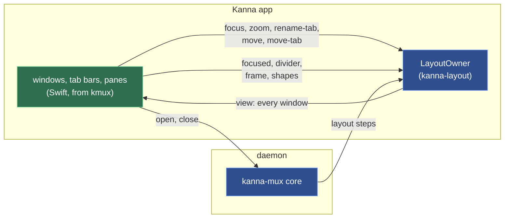

**The model's app-only calls** (through `kanna_layout_call`, besides `serve`, `attach`, `save` and the rest of [4.7](#47-the-layout)):

| Call | Does | Why it isn't a protocol command |
|---|---|---|
| `view` | `{key, windows: [{id, frame, title, tab, tabs: [{id, title, panes}], focused, zoomed, root, dock}]}`: every window, its tabs with the panes in each, the tree on screen (the zoomed pane alone when zoomed; nothing when the docked pane is), with exact sizes and pane types, and its docked pane (`{pane, type, edge, width}`, or null) | it's what to draw, not what a client sees (`list` shows names and fractions) |
| `focused {pane}` | a click: the pane's window remembers it as focused (and its tab as last focused), without making the window key or unzooming; answers whether it changed | kmux's app does the same outside its core (`AppController.focused`); `focus` would also make the window key |
| `divider {tab, path, index, share}` | a dragged divider: the two panes on either side of it share what they had, the first getting `share` | `resize` gives one pane a fraction and rescales all its siblings; a divider moves only its two neighbours |
| `frame {window, frame}` | a window moved or was resized; saved with the window | frames are the app's |
| `shapes {panes: {id: wide}}` | which panes on screen are at least as wide as tall; sent before every `place` and `attach` | `auto` splits a wide pane sideways and a tall one down, and only the app knows sizes |
| `resolve {pane}` | a pane name to its ID, for the debug commands | — |

**Windows.** Each window of the model is an `NSWindow` with a `WindowController`; windows that leave the model close, new ones open cascading from the frontmost one, and a saved window goes back to its frame if that is still on a screen (AppKit may move it to keep its title bar visible). The window title is the active tab's: `Tab 1 — w1`. When a window becomes key, it becomes the model's key window (`focus {window}`); when the model's key window changes (a new pane, ⌘\`, `kanna focus`), it's brought forward, or with `--bg` just behind the front app's window. The red button closes the window and its panes. The app stays open with no windows (kmux's `applicationShouldTerminateAfterLastWindowClosed` is false), and the Dock icon then opens a terminal in a new window. Quitting leaves every terminal running ([4.5](#45-the-app-link)).

**Tabs.** The tab bar shows each tab's title, the active one underlined, × and +. A click selects (a move of 5 pt first starts a drag), a double-click renames (Enter or clicking away saves, Escape cancels; keyboard focus stays in the field while it's open), a drag drops the tab at a gap in any window's tab bar or, outside every window, into a new window where it was dropped. Right-click: Move Tab to New Window, Close Tab.

**Panes and splits.** A pane has no chrome: a 2 pt accent outline when focused (only in the key window, and only with more than one pane in the tab), the exit code (`exited (3)`) or failure (`failed: …`) at its bottom, and the ⋯ grip at its top, drawn only under the mouse. Splits are separated by 1 pt dividers; dragging one snaps to ¼ ⅓ ½ ⅔ ¾ within 1.5 %, keeps both panes at least 80 px, and shows both shares (`1/4 | 3/4`). Dragging the grip docks the pane on the nearest edge of another pane, swaps it with one (the middle 40 %), moves it into a tab or onto + (a new tab), or, outside every window, into a new window there, with kmux's hints. A click focuses the pane under it; keyboard input follows the model's focused pane.

```mermaid
sequenceDiagram
    participant U as user
    participant W as window
    participant O as LayoutOwner
    participant D as daemon
    U->>W: ⌘D
    W->>D: open {type: term, split: right, window: w1}
    D->>O: layout {op: place, pane p4, at: right}
    Note over O: shapes first (auto only)
    O->>D: ok {window w1, tab t1}
    Note over W: view → draw w1; p4 attached
    U->>W: ⌘] (next pane)
    W->>O: command focus {pane p1}
    Note over W: view → draw, p1 first responder
    U->>W: drag the divider
    W->>O: divider {tab t1, path [], index 0, share 1/3}
    Note over W: view → draw, saved ½ s later
```

**Light and dark.** The window's own parts (the tab bar, the gaps between panes, an empty slot, the focus outline) follow the app's appearance as it changes: a colour given to a layer is resolved for the view's current appearance and given again when it changes, since a layer keeps the colour it was handed. `debug.snapshot` reports the tab bar's drawn colour, and S36 checks it in dark, light and dark again.

**Terminal views.** A terminal's surface is made the first time its pane is on screen, and stays (attached to the daemon, drawing its output) until the pane leaves the layout, so switching tabs shows a live screen at once; a terminal in a tab never shown since launch keeps the size its pty has. Web, markdown and iOS views start when the daemon says `start` ([4.9](#49-web-markdown-and-ios-panes)) and are placed when shown.

**Menus and shortcuts:** the menu bar, Ghostty keybindings and the pane's right-click menu are in [menus](specs/menus.md).

**Debug commands** (with `KANNA_DEBUG=1`; the daemon passes them to the app, turning a top-level `pane` name into its ID; nested ones are resolved by the app):

| Command | Does |
|---|---|
| `debug.key {key, pane?}` | a key press (`cmd+shift+d`, `cmd+]`, `return`, `left`, a letter) in the key window, or in `pane`'s terminal: with ⌘, ⌃ or ⌥ the window and then the main menu get it as a key equivalent first, as AppKit does; otherwise (or if nothing takes it) the window's first responder |
| `debug.click {tab, clicks?}`, `{pane, at?: [x, y]}`, `{…, button}` | clicks a tab (2 clicks: rename) or a point in a pane (from its top left). The window isn't key in a `--bg` app, where AppKit would only activate it, so the click goes to the view under the point as it would in the key window. `button` 3 or 4 is the mouse's back or forward button; `button: 1` doesn't open the right-click menu (it would block) but answers its items: `{menu: [titles]}` |
| `debug.drag {pane, to}`, `{tab, to}`, `{divider: pane, at}` | kmux's: a drag replayed along scripted points, with no hint shown; `to` is `{pane, x, y}` (fractions from the top left), `{tab}`, `{plus: window}` or `{outside: true}`; `divider` is the divider after that pane, moved to `at` of the pair |
| `debug.menu` | every menu item: `{menu, item, shortcut}` |
| `debug.pinch {pane, steps?}` | a trackpad pinch over a markdown pane; the zoom after each step |
| `debug.drop {pane, files \| image \| text}` | a drop on a terminal: file paths, a PNG or TIFF file's data, or text, as a drag would bring them |
| `debug.stats` | the app's pid and memory footprint |
| `debug.snapshot {window?, path?, marker?}` | any window (default: the key one), with each pane's `notice` and the window's tab titles |
| `debug.text {pane?}` | also the surface's `columns` and `rows` |

**Checked by** `crates/kanna-mux` owner tests (`view`, `focused`, `divider`, `frame`, `shapes`) and S11–S13 of `scripts/e2e-kanna.sh`: menus and shortcuts split, tab, zoom, cycle and close; clicks select, rename and focus; dividers snap; `auto` follows the pane's shape; Ghostty's split navigation and font size; frames come back; the app outlives its last window; panes and tabs dragged everywhere; the tab and pane menus; every window drawn with its tab bar and dividers (`debug.snapshot`).

### 4.11 The kanna CLI

`kanna` is kmux's command line for Kanna: every command, option, help text, output, error and exit code of kmux's `kmux` (kmux's `crates/kmux`, at a759abd), branded kanna, plus a few additions of Kanna's. It sends kmux's control protocol to Kanna's daemon over its socket (or, with `--mux kmux`, to a kmux), through `crates/kanna-client`, a copy of kmux's `kmux-client` ([plan](plans/mux-build.md) track B).

**Design: a port of kmux's CLI, checked against kmux's own source.** kmux's CLI is one table of commands (name, group, summary, usage, options, notes, examples, how its arguments become a request, how its reply prints); help, `commands --json`, parsing and output all come from it. `kanna` has the same table, ported into `crates/kanna/src/commands.rs` (with `output.rs`, and `lib.rs` for help, `commands`, `instances`, `raw` and errors; provenance in NOTICE), and `crates/kanna/tests/kmux_reference.rs` compiles kmux's own `commands.rs` and `output.rs`, unchanged, beside it and checks one against the other.

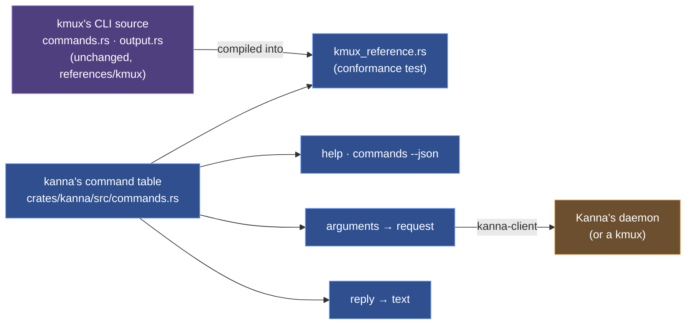

Why this and not:

| Option | Why not |
|---|---|
| Depend on kmux's CLI crate as a library | it's a binary with no library and kmux's name in every string; giving it one, with a brand, would change kmux, which stays as it is ([4.3](#43-kmux-is-the-reference-model)) |
| Build kmux's source files into `kanna` and rebrand the strings as it runs | a private file of kmux's would become kanna's API, so any refactor in kmux breaks kanna's build; replacing "kmux" in text gets some sentences wrong; and Kanna's additions (`read`, its notes) can't be added to kmux's fixed table |
| **Port it, and check the port against kmux's source** (chosen) | one source of truth for Kanna's commands, inside kanna; kmux stays the reference: when kmux's CLI changes and kanna hasn't followed, the test fails, as kmux's protocol cases do for the core |

**What the conformance test checks:** the same commands, groups and order as kmux (plus Kanna's: `read`, `send-key`, `screenshot`, …); every summary, usage, option, note and example is kmux's with "kmux" read as "kanna" (the notes of `open`, `send` and `list` may only add to kmux's); every kmux example and request line parses to the same request; every usage error has kmux's exit code and message; every reply prints as kmux prints it. kmux's own CLI tests (`every_documented_example_parses`, `requests`, `usage_errors_say_what_to_do`, `layouts_print_as_expressions`) are ported as kanna's unit tests.

**Commands** (`kanna help`, `kanna help COMMAND` or `kanna COMMAND --help`):

| Group | Commands |
|---|---|
| Panes | `open`, `close`, `focus`, `zoom`, `restart`, `send`, `send-key` (Kanna's), `read` (Kanna's), `screenshot` (Kanna's), `resize`, `move`, `navigate` |
| Tabs and windows | `arrange`, `rename-tab`, `move-tab` |
| Information | `list`, `capabilities` |
| More | `help [COMMAND\|instances\|raw]`, `commands [--json]`, `raw REQUEST`, `instances [--json]`, `instances prune` |

Global options, as kmux's: `--json` (the reply as one line of JSON), `--help`/`-h`, `--version`, `--instance NAME`, `--bg` (`KANNA_BG=1`), `--fresh` (`KANNA_FRESH=1`); and Kanna's `--mux kanna|kmux` (`KANNA_MUX`; `kanna-dev` is another name for `kanna`) and `--`. Exit codes are kmux's 0–5 and Kanna's 6 ([9](#9-output-errors-and-exit-codes)).

**Where kanna differs from kmux** (decided; everything else is kmux's):

| | kmux | kanna | Why |
|---|---|---|---|
| `read PANE [--lines N]` | — | prints a terminal's screen as text, scrollback with `--lines` | the daemon keeps every screen, with or without the app; agents read terminals |
| `screenshot [PANE \| --window WINDOW] [-o\|--out FILE] [--force]` | — | saves a PNG of a pane (cut from its window) or a window as it is drawn now, and prints its path ([screenshot](specs/screenshot.md)) | agents check their UI work (a diff, a web or markdown pane) by looking at it |
| `status explain PANE`, `status explain --file SCREEN --agent AGENT`, `status update`; `list`'s STATUS column and `status` field | — | agent status ([4.17](#417-agent-status)); the column shows only when a pane has a status, so a kmux reply prints as kmux prints it | the daemon judges agent panes; `capabilities` lists `status` |
| `send-key PANE KEY...` | — (`send` types a line and presses Return; `debug.key` goes through the app's window) | presses keys in a terminal, encoded for the program's current modes, without the app ([6](#6-commands)) | agents answer another agent's menu, interrupt a command or submit a prompt; kmux's research recommends cmux's `send-key`, and kmux gets it from this port |
| `--` | — (`--json` is taken from anywhere, so it can't be typed) | ends the options: `kanna send p1 -- --json` | text that looks like an option |
| `--mux`, `KANNA_MUX` | — | `kanna` (default) or `kmux` | kanna can drive a kmux too |
| `markup FILE.md\|FILE.html [--to PANE]`, `markup PANE [--to PANE \| --off]`, `markup comments\|show\|reply\|resolve\|reopen` | — | opens a doc with comments, or turns them on or off in a pane; `open` shows docs without them; the rest read and answer its threads, in the doc's thread file, without the daemon ([4.13](#413-doc-markup)) | review with an agent is opt-in |
| `rename-pane PANE NAME` | — (a name is set only by `open --name`) | names, renames or (with `""`) unnames a pane; no two panes share a name and a name can't be another pane's ID; the daemon keeps it, so it works with or without the app | names are how you refer to panes, and an agent may start one unnamed |
| `task new\|start\|list\|park\|pull\|defer\|name\|done`; `open` with no placement from a task's terminal | — | makes backlog tasks and starts them (the daemon's `backlog` command: a worktree `.kanna-worktrees/NAME` on branch NAME, NAME `task-` and a random UUID's first 32 bits in hex, on an empty branch in a repo with no commits yet; a folder that isn't a git repo is refused, and an agent docked onto the Shelf), lists, parks, pulls, moves back to the backlog (`defer`: parks the task's window marked as in the backlog, its panes still running and off the Shelf and the limit, until its start clears the mark), names or ends tasks; `done` is a `close` of the task's panes; `open` from a task's terminal opens a tab on its Desk, and from a terminal in a plain window splits beside that terminal, in its window, not the key window's focused pane; a fourth running task in one repo (a worktree counts as its main repo) is refused ([4.15](#415-desk), [tasks](specs/tasks.md)) | the Desk is Kanna's |
| `move PANE --dock` | docks any pane | moves only the docked pane (to the other edge or another window) unless it's frozen, as a task's agent is; any other pane is refused (`not_a_task`), and the three protocol cases that dock one are skipped by name | a docked pane is a running task, so docking one would start a task outside the backlog and the limit ([tasks](specs/tasks.md)) |
| `completions zsh\|bash`, `__complete` | — | tab completion from the command table, with live pane, tab and window names ([4.18](#418-tab-completion)) | the CLI is how you drive Kanna from a terminal |
| Exit 6 | — | the command needs Kanna.app, which isn't attached and wasn't started | terminals work without the app; layout commands don't ([4.7](#47-the-layout)) |
| Starting | starts the kmux app | starts this build's Kanna.app (`$KANNA_APP`, a dev build's `target/Kanna.app`, or its channel's bundle ID; never the branded `dev.kanna.kanna`), which starts the daemon; never with `KANNA_SOCKET` set | the app starts the daemon ([4.5](#45-the-app-link)) |
| The app closed | (the app is kmux) | `open` prints "opened p3 (logs), unplaced until Kanna.app opens"; `list` lists the terminals under "no windows: Kanna.app isn't open" | the terminals still run |
| An instance | an app with its own socket, `kmux-NAME.sock` | a folder, `kanna-dev-NAME` (below), in the build's channel | a daemon needs a folder of its own |
| Channels | one app | production, staging and dev builds are separate apps (Kanna, Kanna Staging, Kanna Dev), and a dev build in a worktree is one of its own whose default instance is the worktree's ([build channels](specs/build-channels.md)) | Kanna is developed inside Kanna |
| `instances` | the running instances | the running instances of every channel, with each one's channel and the worktree a dev build came from; `instances prune` deletes those whose worktree is gone | many dev builds come and go |
| `--version` | `kmux VERSION` | `kanna VERSION (APP)`, e.g. `(Kanna Dev task-3f9a1c2e)` | which build this CLI is |
| `kanna PATH` (a folder, not a command's name) | an unknown command | a new, empty Desk on PATH's project (`task desk`, which gives the window a `project`), docking nothing, so it uses none of the project's three running tasks: it shows its planning terminal (in PATH) beside the project's Shelf and backlog; its tabs, splits and tasks start in the project; a command's name wins over a folder of the same name (`kanna ./open`) | open Kanna on a project, as `code PATH` does |
| `open --cwd DIR` | sent as given | made absolute where kanna runs | the daemon's directory isn't yours |
| `open` a terminal without `--cwd` (and every new tab, split and window from the app) | starts in `$HOME` | starts in its task's folder: the folder the task's agent opened in (its worktree, or the repo for a task without one), the agent being the terminal it opens from or the docked pane of the window it opens in; the agent moving or printing another folder changes nothing; outside a task, a window from the app starts in the window's repo (a Desk with no task holds no tabs or splits) (the repo of the last task docked there, the key window's for a new window), and so does the window's planning terminal; else `$HOME` | a task's terminals work on the task |
| `capabilities` | kmux's fields | kmux's fields, Kanna's commands (`read`, `screenshot`, `status`, `backlog`) among the commands, and `app`: whether Kanna.app is attached (its own line in the text) | so a script can tell |
| `raw REQUEST` | sends it | sends it, and starts the app on `no_app` like any command | one way of reaching Kanna |
| `kanna mux` | — | gone (M0's): `capabilities` and `instances` say what it said | kmux has no such command |

**Instances.** Instances are a tool for developing and testing Kanna (dev builds, e2e runs, `kanna --instance`), not a user feature: the app offers none, and a user works on another project in a Desk (File → New Desk, `kanna PATH`). A Kanna instance is a whole Kanna: a daemon, its keeper, its terminals, a Kanna.app and its saved layout, all in one folder, since a daemon holds a lock on its folder and keeps its keeper, terminals and the app's `layout.json` there ([4.8](#48-restarting-the-daemon)). Its folder is in the application support folder (`$XDG_DATA_HOME` or `~/.local/share` on Linux), named for the build's channel ([build channels](specs/build-channels.md)): the default instance of a dev build is `kanna-dev` (production's `kanna-prod`, staging's `kanna-staging`); an instance named `work` uses `kanna-dev-work` beside it, so its socket is `kanna-dev-work/kanna.sock` (short enough for a Unix socket's 104 bytes with a 32-character name). kmux puts every instance's socket in one folder instead; Kanna can't, as two daemons can't share a folder.

```text
~/Library/Application Support/
├── kanna-dev/            the default instance (of a dev build)
│   ├── kanna.sock        its daemon (socket, daemon.lock, daemon.pid, daemon.log)
│   ├── keeper.sock …     its keeper
│   ├── terminals/        its terminals (4.8)
│   ├── layout.json       its app's layout (4.7)
│   ├── kanna.db          its tasks and their history (specs/database.md), with kanna.db.bak
│   └── instance.json     the build its daemon is: channel, app, checkout, worktree
├── kanna-dev-work/       the instance named work, the same inside
├── kanna-dev-task-3f9a1c2e/  the default instance of the dev build in worktree task-3f9a1c2e
└── kanna-prod/           production's default instance
```

- **Which instance a command goes to**, as kmux: `--instance NAME`; else `$KANNA_SOCKET` (set in Kanna's terminals, with `$KANNA_INSTANCE` and `$KANNA_PANE`, so kanna run in a pane reaches that pane's Kanna); else `$KANNA_INSTANCE`; else the build's default (`default`, or the worktree's name for a dev build in a worktree). A name is in the build's channel. Names are kmux's: letters, digits, `-` and `_`, up to 32; anything else is bad usage.
- **Starting one:** `kanna --instance work open` with nothing answering starts Kanna.app with `KANNA_SOCKET` set to `kanna-dev-work/kanna.sock`; the app keeps its layout in that folder and starts the daemon there.
- **The daemon names itself** from its folder (`kanna-dev-NAME`, `kanna-prod-NAME` or `kanna-staging-NAME` is NAME; anything else, such as a test's private folder, is `default`), reports it in `capabilities`, sets `KANNA_INSTANCE` in its terminals, and writes `instance.json` there.
- **`kanna instances`** lists the folders of every channel whose daemon answers, with each one's channel, windows, panes and (for a dev build in a worktree) worktree, `*` marking the one this shell's commands go to; `--json` as kmux, with `channel` and `worktree` added. **`kanna instances prune`** deletes the folders whose `instance.json` names a worktree that's gone, unless the daemon answers or the keeper runs.
- **Why not `kanna`:** the kmux-branded Kanna.app that came before used `kanna/kanna.sock`, and Kanna v3 uses `Kanna` (the same folder on a case-insensitive disk), and either may still be running; the channels' folders and bundle IDs are in one place, `crates/kanna-build`, which the CLI and the daemon use and which writes the app's Info.plist through `kanna-daemon --build`.

**Reaching Kanna:**

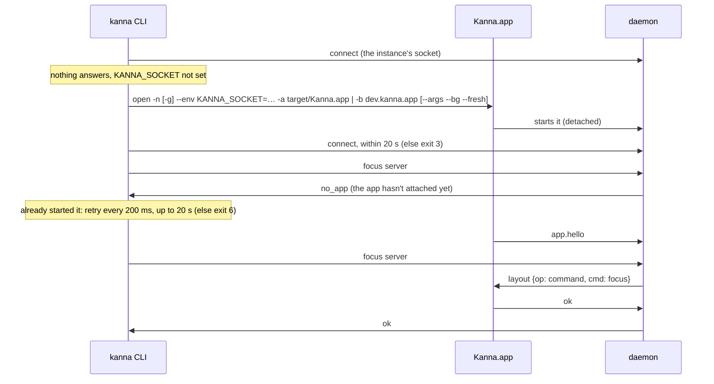

**With the app closed** the daemon answers what it can ([4.7](#47-the-layout)):

| Works | Needs the app (`no_app`: started, or exit 6 with `KANNA_SOCKET`) |
|---|---|
| `list` (terminals, no windows), `send`, `send-key`, `read`, `close PANE`, `restart`, `open` (a terminal, unplaced), `capabilities`, `raw` of these | `open` with `--split`, `--size`, `--tab` or `--window`; `open web\|md\|ios`; `focus`, `zoom`, `resize`, `move`, `arrange`, `rename-tab`, `move-tab`; `close --tab\|--window`; `navigate`; `screenshot`; every `debug.*` |

**`screenshot`** saves a PNG of a pane or a window as it's drawn now, without `KANNA_DEBUG`. Its own spec: [specs/screenshot.md](specs/screenshot.md).

**The app's `debug.*` commands** go through the daemon by name: every `debug.*` the core doesn't answer itself (only `debug.saveState` and `debug.restoreState`) is passed to the app with pane names turned into IDs, so a debug command the app adds (kmux's `debug.click`, `debug.drag`, `debug.menu`, …) needs no change in the daemon. The app answers one it doesn't know with kmux's `unknown command`.

**Checked by** `crates/kanna/tests/kmux_reference.rs` (against kmux's source), the unit tests in `crates/kanna/src` (kmux's CLI tests, ported; target and instance resolution; the app started), `crates/kanna/tests/cli.rs` (every command through a real daemon with a test app answering through `LayoutOwner`, and without it; help, marks and `commands --json`; errors and exit codes; instances; the kmux backend), `crates/kanna/tests/no_launch.rs` (nothing starts with `KANNA_SOCKET`; a missing app is exit 3), `crates/kanna-daemon/tests/app_link.rs` (`debug.*` and `capabilities`), and S20–S22 and S62 of `scripts/e2e-kanna.sh`: every command against the real app (S20), without it (S21), an instance started by `--instance` and listed by `instances` (S22), and `screenshot` (S62, [screenshot](specs/screenshot.md#3-how-its-built)).

### 4.12 Terminal Behaviour

Everything a terminal pane does in kmux works in Kanna.app, although the pty lives in the daemon and not in the app ([plan](plans/mux-build.md) track C). kmux's own handling is small: it loads Ghostty's config, keeps a shell's folder (OSC 7) as the pane's cwd, and leaves the rest to Ghostty. Kanna does the same, and where kmux does nothing (bells, notifications, cursor shapes, link checks) it does what Ghostty's macOS app does.

**Design: the program's state lives in the daemon, the user's in the app.** A terminal has two copies of its screen ([4.5](#45-the-app-link)): the daemon's (libghostty-vt, always there) and the app's surface (GhosttyKit, only while shown). Each behaviour belongs to the copy that is there when it's needed:

- **The daemon** answers the program and remembers what must outlive the app: queries (including colours), modes, the cwd, the scrollback, what `read` returns. So a program gets the same answers with the app closed, and a relaunched app gets the same screen back.
- **The app's surface** does what a person sees or touches: drawing, the selection, keys and IME, the mouse, the clipboard, links, the bell, notifications, progress. It runs Ghostty's own code for these, with Ghostty's rules, and its replies to the program are dropped (the daemon answered already), except for what only it can say: keys, paste, mouse and focus reports, and the answer to an OSC 52 read, which go to the pty as `input`.

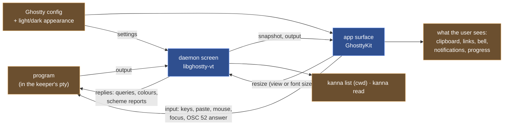

**The config.** The app loads Ghostty's config as kmux does (`ghostty_config_load_default_files`, then the files they include, then `finalize`), so a Kanna terminal looks and behaves as the user's Ghostty does. Ghostty's `reload_config` (⌘⇧, by default) reloads it; a conditional theme (`theme = light:…,dark:…`) follows the app's light/dark appearance: on a change the app tells Ghostty (`ghostty_app_set_color_scheme`), Ghostty applies the matching theme and reports the config it now uses (`CONFIG_CHANGE`), and the app sends the daemon what it needs from it:

```mermaid
sequenceDiagram
    participant M as macOS
    participant A as Kanna.app
    participant G as GhosttyKit
    participant D as daemon
    participant P as program
    P->>D: ESC[?2031h (report scheme changes)
    M->>A: appearance → dark
    A->>G: set color scheme dark (app and every surface)
    G->>A: CONFIG_CHANGE (the dark theme's config)
    A->>D: settings {foreground, background, palette, scheme: dark, …}
    D->>D: every screen: default colours, scheme
    D->>P: ESC[?997;1n (only to programs that asked)
    P->>D: OSC 11 ? (background colour)
    D->>P: OSC 11 ; rgb:… (from the dark theme)
```

**`settings`** ([4.5](#45-the-app-link)) carries the foreground, background, cursor colour, the 256-colour palette, the scheme, the cursor style and blink, and the grapheme width method. The daemon keeps the last one in `terminals/settings.json` (0600), so a restarted daemon answers colour queries the same way before the app is back, and applies it to every screen, new or restored (default colours, cursor and mode defaults, scrollback limit). The cursor colour isn't readable from a config, so the app takes it from a live surface's defaults.

**What each behaviour does:**

| Behaviour | kmux | Kanna | Checked by |
|---|---|---|---|
| Colour queries (OSC 4, 10, 11, 12), DECRQSS cursor style | Ghostty's pty answers from the theme | the daemon answers from `settings`, with or without the app | kanna-vt tests, `terminal_behaviour.rs`, S30 |
| Light/dark | Ghostty's theme switch | the same, and the daemon reports the scheme to programs that set mode 2031 | `terminal_behaviour.rs`, S30 (screenshots in both) |
| Shell folder (OSC 7) | the pane's cwd: `list`, restart, restore | the daemon parses it (`file://` on this host, or `kitty-shell-cwd://`) and sets the pane's cwd: `list`, `restart` | `terminal_behaviour.rs`, S31 |
| Title (OSC 0/2) | not shown | kept on the surface (`onTitle` for the tabs, should they want it); not shown | S31 |
| Copy, paste, selection, bracketed paste | Ghostty's | Ghostty's; ⌘C/⌘V, the selection clipboard is the app's own | S32 |
| OSC 52 | read only during input events (so in effect never), write allowed | Ghostty's rules: `clipboard-read` (ask), `clipboard-write` (allow), with a sheet when asked | S32 |
| Mouse reporting, selection, scrolling | Ghostty's | Ghostty's; reports go to the pty as `input` | S33 |
| Keys, IME, kitty keyboard | Ghostty's | Ghostty's ([4.6](#46-the-apps-terminal-views)); the program's keyboard mode is in the snapshot, so it survives a relaunch | S33 |
| Focus reporting (mode 1004) | Ghostty's | the surface reports focus in and out; the mode is in the snapshot | S33 |
| Cursor shapes, link hover | Ghostty's macOS app sets them; kmux doesn't | the app sets the mouse cursor Ghostty asks for and a pointer over a link | by hand (`debug.terminal` reports `hoveredLink`) |
| ⌘-click a link | Ghostty's fallback opener: anything | web, mail and plain documents only (below) | KannaLinks tests, S35 |
| Bell | nothing | Ghostty's `bell-features`: system beep, the Dock's attention request | S35 |
| Desktop notifications (OSC 9, OSC 777) | nothing | Ghostty's (`desktop-notifications`, its rate limit), posted with UserNotifications | S35 |
| Progress (OSC 9;4) | nothing | kept on the surface (`onProgress`) | S35 |
| Font size (⌘+, ⌘−, ⌘0) | the surface's grid changes, and its pty with it | the surface asks the daemon for the new grid (`resize`), as a view resize does | S12, S34 |
| Synchronized output (mode 2026) | Ghostty's | Ghostty's; a snapshot taken mid-update ends it after Ghostty's timeout | by hand |
| Scrollback | Ghostty's `scrollback-limit` (10 MB default) | the daemon keeps 10 MB, no line limit; `read --lines` | kanna-vt tests, S34 |
| Search | none | none, as kmux | — |
| Dropping files, images or text | Ghostty's: file paths, shell-escaped and space-separated, or the text, pasted | the same, plus what Ghostty drops: a file promise (a screenshot's thumbnail, Mail, Photos) is saved and an image with no file (a browser's) is written as a PNG, both in `$TMPDIR/kanna-drops`, and its path pasted, so an agent in the pane gets the image. A drop is a paste: it goes through Ghostty's paste, so bracketed paste and the unsafe-paste question apply as for ⌘V, and a path with a control character in its name (a newline, ESC) is written as `$'…'` with `\xHH` escapes, so no name can run a command | KannaDrop tests, S36 (`debug.drop`) |

**Links** come from terminal output, which any program (or a file being `cat`ed) writes, so a click on one is treated as untrusted. Ghostty opens a link only on a click with ⌘ held; the app then decides, in `KannaLinks` (`UntrustedURL`, started from Ghostty's macOS app's rules for OSC 8 links and made stricter):

| Target | Decision |
|---|---|
| `http`, `https` with a host; `mailto` with an address | opened |
| `file://` (empty host or `localhost`) or a plain absolute path, to a document or plain folder | opened, as the path it resolves to |
| anything that can run code or hand off to another target: an app or any other package or bundle, anything inside one, a script, an executable (by type or by its execute bit), a Finder alias, a symlink to any of these, `.command`, `.tool`, `.terminal`, `.webloc`, `.inetloc`, `.fileloc`, `.shortcut`, `.workflow`, `.pkg`, `.mobileconfig`, `.jar`, `.webarchive` and the rest of the list | refused |
| a document whose default app runs code: a terminal (Terminal, iTerm2, Ghostty, Kanna, …), Script Editor, Automator, Installer, Shortcuts, System Settings, Archive Utility, … | refused |
| any other scheme (`ssh`, `vscode`, `x-apple.systempreferences`, `javascript`, `smb`, …) | refused |
| invisible, control or line-breaking characters (bidi marks, zero-width and other blank characters), a `file://` with another host, a user, a port, a query or a fragment, a relative path, a missing file or a device | refused |

A refusal shows a sheet with the target, as it would resolve, and a Copy Link button. How the rules hold:

- **What is checked is what is opened.** The text is parsed once into a URL; a web or mail link opens that same URL object, and a file opens as the canonical path the checks were made on (`..`, `.` and symlinks resolved), so no second parser can read it differently. Percent-encoding (`run%2Ecommand`), case (`PAYLOAD.APP`) and a trailing `/` are judged after decoding.
- **Every part of the path counts**, not just the last: a file inside an `.app` (or any name with a refused extension) is refused, as Launch Services would treat the bundle.
- **Types and the execute bit as well as names:** the file's content type is checked against application, executable, script, bundle, package, alias, symlink, internet location and web archive, so a misleading name doesn't help.
- **Left:** the check and the open are a moment apart, so a program racing to swap the file between them could still win; the open is of the resolved path, right after the check, on the main thread.

Ghostty's app asks before opening other schemes and opens plain-text links (its link regex) with no check; Kanna refuses other schemes and checks plain-text links too, since both are written by the program. The screen file Ghostty's `write_screen_file` action writes (a keybinding, the user's own) opens as Ghostty's app opens it.

**Keeping the surface right across a snapshot** (the Ghostty fork, `kanna4`): loading a snapshot replaces the surface's terminal, so the fork keeps what belongs to the surface and not to the program: whether it's focused and visible (focus reports stay correct), the config's cursor style and colours (unless the program chose its own), and the image limits. A widening resize keeps the scrollback inside its byte limit, so a snapshot after it loads whole. A font size change asks the host for a new grid instead of resizing the surface's own terminal, which only the daemon's resize may do ([4.5](#45-the-app-link)).

**Debug mode** (`KANNA_DEBUG=1`) acts on nothing outside the app: the clipboard is a private pasteboard (`dev.kanna.debug.<pid>`), and links, bells and notifications are recorded, not opened, rung or posted; confirmation sheets are answered no. `debug.terminal {pane, clipboard?, action?, zoom?, click?, appearance?}` sets them up and reports the surface: grid and cell size, title, hovered link, selection, background colour, clipboard, links with their decisions, what was opened, bells, notifications, progress, settings and focus.

**Decided:**

| Decision | Chosen | Why |
|---|---|---|
| Who answers the program | the daemon, for everything it can; the surface only for keys, mouse, focus, paste and OSC 52 reads | one answer, the same with the app closed |
| Clipboard reads | Ghostty's `clipboard-read` (ask), not kmux's input-event check | kmux's check refuses every OSC 52 read; Ghostty's asks the user, and the config can allow or deny |
| Bell, notifications, cursor shapes, links | as Ghostty's macOS app | kmux does nothing for them; Ghostty's app is the reference for terminal behaviour |
| Links | web, mail and plain local documents; every other scheme, and anything that could run code, refused (Ghostty's app asks for other schemes) | terminal output is untrusted; a confirmation is one click from running a handler the program chose |
| Scrollback | 10 MB, no line limit (kmux: Ghostty's `scrollback-limit`) | the limit can't be read from a config through libghostty's API, and every snapshot crosses the app link and is saved; 10 MB is Ghostty's default |
| Titles | kept, not shown | kmux doesn't show them; the tabs can |
| Surfaces | made when a pane is first shown, kept while it's in the layout ([4.10](#410-windows-tabs-and-splits)) | focus, mouse and keyboard modes are the surface's, and a tab switch shows a live screen |

**Not done:** OSC 5522 (kitty's clipboard protocol) gets only part of its replies; kitty graphics aren't in a snapshot, so images go when the app relaunches; an empty OSC 7 is ignored; a title isn't shown again after a relaunch until the program sets it.

**Checked by** `crates/kanna-vt/tests/terminal.rs` (colour answers, scheme reports, cursor defaults, title and cwd changes, snapshots after widening), `crates/kanna-daemon/tests/terminal_behaviour.rs` (colour queries from the app's theme, also after a restart; scheme reports; the shell's folder in `list`), `apps/kanna/Tests/KannaLinksTests` (every link rule), `apps/kanna/Tests/KannaDropTests` (escaping dropped paths), and S30–S36 of `scripts/e2e-kanna.sh`: theme and light/dark with screenshots (S30), cwd and title (S31), paste, OSC 52 and selection (S32), kitty keys, mouse and focus reports after a relaunch (S33), font size and the pty, scrollback (S34), links, bell, notifications and progress (S35), dropped files and images (S36).

### 4.13 Doc Markup

**[Proposed]** Comment on a markdown file in its pane and have the agent beside it answer and resolve the comments, as in kanna v3. Its own spec: [specs/doc-markup.md](specs/doc-markup.md), with a mockup in [references/mockups/doc-markup.html](../references/mockups/doc-markup.html).

### 4.14 Markdown Pane Keys

**[Proposed]** Vim's scrolling and search keys in a focused markdown pane. Its own spec: [specs/markdown-keys.md](specs/markdown-keys.md).

### 4.15 Desk

**[Built]** A window that shows one task: its agent docked on the left as the single chat, everything else it opens as the window's tabs, every other task parked on the Shelf below with its agent still running; the look of kanna v3's Desk. Its own spec: [specs/desk.md](specs/desk.md), with its planning terminal in [specs/planning-agent.md](specs/planning-agent.md) (started by [specs/planner-script.md](specs/planner-script.md)) and Kanna's settings in [specs/settings.md](specs/settings.md), and a mockup in [references/mockups/desk.html](../references/mockups/desk.html).

### 4.16 Docked Pane

A window's one pane outside its tabs, along its left or right edge, shown whichever tab is active. A mux-layer primitive the Desk is built from (the agent docked, the docs as tabs); windows without one behave exactly as kmux. It needs no layout steps of its own: `open --dock` is a `place` with `dock`, docking, undocking and its width are `move` and `resize` commands ([4.7](#47-the-layout)). Its own spec: [specs/docked-pane.md](specs/docked-pane.md). Zooming it, or a tab's pane beside it: [specs/zoom.md](specs/zoom.md).

### 4.17 Agent Status

**[Built]** Working, needs you, idle or exited for agent panes, judged in the daemon from the bottom of the screen, the title and progress by per-agent rules kept as data and hot-loaded from a rules site, so an agent's new release needs no new Kanna. Its own spec: [specs/agent-status.md](specs/agent-status.md). In the daemon: `crates/kanna-detect` (the rules, their sources and the foreground program, from v3's `kanna3-detect`), `crates/kanna-daemon/src/status.rs` (one thread judging settled screens) and the `status` command; rule files and the corpus in `agent-rules/`. Checked by `cargo test -p kanna-detect` (the corpus and the rule store), `crates/kanna-daemon/tests/status.rs` and S40.


### 4.18 Tab Completion

**[Built]** Tab completes every `kanna` command, option and value in zsh and bash: pane names and IDs, tabs and windows from the running Kanna (never starting one), and only the files a command takes. On in Kanna's zsh and bash terminals with no setup (the daemon adds a step to the login shell's startup that hands over to yours). Generated from the CLI's command table, so a new command or option completes with no extra work. Its own spec: [specs/tab-completion.md](specs/tab-completion.md). In `crates/kanna/src/complete.rs` with the shell scripts beside it, and `crates/kanna-daemon/src/shell.rs`; checked by their unit tests and S41. The same startup step reports the shell's folder (OSC 7, at the first prompt and on every `cd`), since Ghostty's own shell integration doesn't run under Kanna's; a Desk's header and a task's repo follow it (S45).

### 4.19 Code Viewer

**[Built]** A read-only code pane, `kanna open code FILE[:LINE]`: the file highlighted with tree-sitter (Rust, Swift, TypeScript and JavaScript with React's JSX, Python, Go, C, C++, Shell, JSON, TOML, YAML, HTML, CSS, Vue, Svelte), opened at a line, following the file on disk, with sticky scope and indent guides. The first step towards the code tour, where the agent walks the user through code. Its own spec: [specs/code-viewer.md](specs/code-viewer.md); mockup `references/mockups/code-viewer.html`.

### 4.20 Code Tour

**[Built]** The agent comments on code as it explains it: `kanna comment FILE:LINE "text"` opens the file in a code tab, tints those lines (snapped to their tree-sitter scope), dims the rest and lists the comment beside the code, folding the earlier ones. Comments live on the code pane\'s record; the daemon asks the app to snap. How to give a tour is the `kanna-tour` skill. Its own spec: [specs/code-tour.md](specs/code-tour.md); mockup `references/mockups/code-tour.html`. In `crates/kanna-mux` (`comment`, the record), `crates/kanna` (the command, threads on docs), `apps/kanna/Sources/KannaCode` (the box, tint and dim) and `AppCommands.swift` (`app.snap`); checked by `crates/kanna-daemon/tests/panes.rs` and S50.

### 4.21 The Build

**What Kanna compiles is built for the app's macOS, set in one place; nothing it links is built for a newer one.** The app's minimum macOS is `MACOSX_DEPLOYMENT_TARGET` in `.cargo/config.toml` (`force = true`, so a shell's own value can't override it), which every cargo build reads: rustc links for it and the `cc` crate compiles the tree-sitter grammars' C for it. Without it, rustc builds for macOS 11 and `cc` for the SDK's version (26.5), and linking the app warns for every such object that it was built for a newer macOS than the app. `apps/kanna/Package.swift`'s `platforms` must say the same version; `kanna_macos_target` in `scripts/env.sh` reads both, and `scripts/build.sh` and `scripts/build-kanna-app.sh` stop if they differ. The app's `LSMinimumSystemVersion` comes from it too.

| Piece | Built by | Minimum macOS |
|---|---|---|
| `libkanna_ffi.a`, daemon, keeper, CLI | cargo (rustc, `cc`) | the app's (15.0) |
| Kanna.app | SwiftPM | the app's (15.0) |
| GhosttyKit, libghostty-vt | Zig, in Ghostty's build | 13.0, Ghostty's own floor |
| Rust's std, `compiler_builtins` (in `libkanna_ffi.a`) | prebuilt, shipped with the toolchain | 11.0, Rust's default |

Ghostty's `build.zig` sets its own minimum (13.0) and ignores the environment, and Rust's std comes prebuilt (rebuilding it needs nightly `-Zbuild-std`). A lower minimum than the app's is safe to link: those objects use nothing newer than their own minimum. A higher one is the bug the warning reports.

Changing the deployment target needs a clean cargo build. Cargo reruns the `cc` build scripts when the `[env]` value changes, but it doesn't recompile pure Rust crates, so their objects keep the old version. `kanna_cargo_release_for` (`scripts/env.sh`) keeps the version `target/release` was built for in `target/release/macos-deployment-target` and cleans `target/release` when it differs or is missing; the build scripts call it before cargo. Ghostty's builds are reused by commit (`ghostty.rev`, borrowed by worktrees through `kanna_borrow_built`), so a change to how Ghostty is built goes in the fork and the pinned commit, and the new pin makes every checkout rebuild them.

How a task's worktree builds quickly (clones of the main checkout's cargo dependencies and Swift packages, and dev's Swift app in debug), with timings: [specs/build-speed.md](specs/build-speed.md).

### 4.22 Quiz

**[Planned]** Five multiple-choice questions about what landed on main in the last day, asked by an agent in a Quiz window of its own, each answer explained and a miss opening the code with `kanna comment`. It's a skill only, `kanna-quiz`: the planning agent offers a round when something has merged and opens the window with `kanna open`, and the quiz agent writes the questions itself; nothing is kept between rounds yet. Its own spec: [specs/quiz.md](specs/quiz.md); mockup `references/mockups/quiz.html`.

### 4.23 The Database

**[Built]** The daemon keeps tasks and every change to them in one SQLite file, `kanna.db`. Its own spec: [specs/database.md](specs/database.md).

---

## 5. Mux Backends

### 5.1 What Each Backend Supports

| Capability | kmux | tmux | cmux |
|------------|:----:|:----:|:----:|
| Terminal panes | ✅ | ✅ | ✅ |
| Web panes | ✅ | ❌ | ✅ **[Assumption]** |
| iOS Simulator panes | ✅ | ❌ | ❌ |
| Fractional sizing | ✅ | ✅ | ✅ **[Assumption]** |
| Named panes | ✅ | ✅ (kanna stores the name as a pane option) | **[Assumption]** |
| Pane states | Full ([kmux lifecycle](https://github.com/tampopogk/kmux/blob/main/docs/kmux-spec.md#43-lifecycle)) | Running / exited only | **[Assumption]** |

`kanna mux` prints this table for the backend in use.

### 5.2 Choosing a Backend

kanna picks the first match in this order:

1. The `--mux kanna|kanna-dev|kmux|tmux|cmux` flag. `kanna` is Kanna.app; `kanna-dev` is Kanna's daemon, which the new Kanna.app attaches to, while the two are being built ([4.7](#47-the-layout)); `kmux` is a kmux the user runs.
2. The `$KANNA_MUX` environment variable.
3. **Auto-detect:** if kanna is running inside tmux (`$TMUX` is set), it uses tmux. If it's running inside cmux, it uses cmux. **[Not built yet]**
4. Otherwise Kanna.app, which kanna starts if it isn't already running. Inside a Kanna.app terminal, kanna talks to that instance (`$KANNA_SOCKET`).

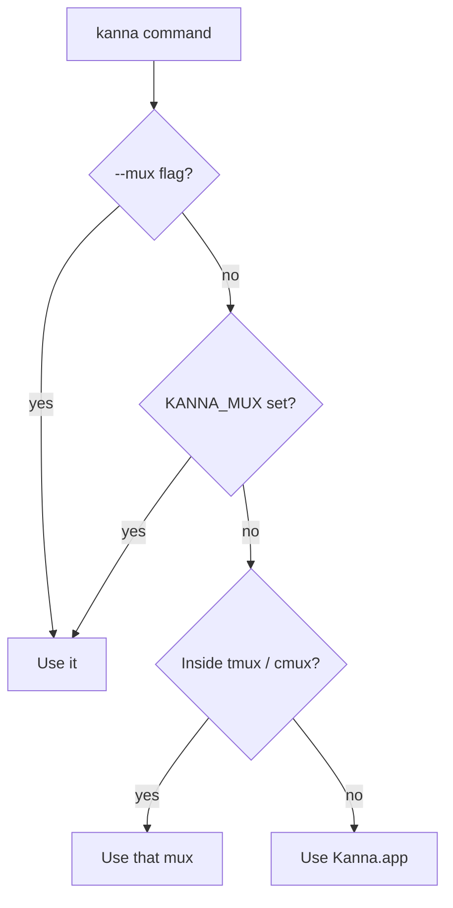

### 5.3 Adapter Interface

Every adapter implements the same operations. Adding a new mux means writing a new adapter.

| Operation | Purpose |
|-----------|---------|
| `capabilities()` | Report the supported pane types and features. |
| `open(type, options, placement)` | Create a pane. `placement` holds the split direction and size. |
| `arrange(layoutTree)` | Apply a parsed layout. |
| `resize(pane, fraction)` | Change a pane's size. |
| `list()`, `focus()`, `close()`, `restart()` | Manage panes. |
| `send(pane, text)`, `sendKey(pane, keys)`, `navigate(pane, url)` | Act on a pane's contents. |

The kmux adapter maps these one-to-one onto the [kmux control protocol](https://github.com/tampopogk/kmux/blob/main/docs/kmux-spec.md#7-control-protocol).

---

## 6. Commands

| Command | What it does |
|---------|--------------|
| `kanna open [term] [--cmd CMD] [--cwd DIR]` | Open a terminal pane (the default type, as in kmux). |
| `kanna open web URL [--history]` | Open a web pane; `--history` gives it back/forward. |
| `kanna open md FILE` | Show a markdown file, rendered natively with mermaid diagrams; it reloads when the file changes. |
| `kanna open ios --app APP [--device NAME]` | Launch an iOS app in a simulator pane. |
| `kanna arrange LAYOUT` | Rearrange existing panes in one go. Today LAYOUT is kmux's JSON tree ([4.11](#411-the-kanna-cli)); the expression of [7.2](#72-the-layout-expression) is planned. |
| `kanna resize PANE SIZE` | Change one pane's size. |
| `kanna up [FILE]` | Open a whole setup from a file, `kanna.yaml` by default ([7.3](#73-layout-files)). |
| `kanna list` | List panes with their names, IDs, types and states. |
| `kanna focus PANE` / `--tab TAB` / `--window WINDOW` | Bring a pane, tab or window to the front. |
| `kanna zoom PANE` | Toggle zoom: the pane fills its tab. |
| `kanna move PANE --to OTHER [--side SIDE]` / `--tab TAB\|new` / `--window WINDOW\|new` | Move a pane beside another, swap two, or move it to another tab or window. |
| `kanna rename-tab TAB TITLE` | Rename a tab. |
| `kanna move-tab TAB [--window WINDOW\|new] [--index N]` | Reorder a tab, or move it to another window. |
| `kanna close PANE` / `--tab TAB` / `--window WINDOW` | Close a pane, or a tab or window with everything in it. |
| `kanna restart PANE` | Restart what's inside a pane. |
| `kanna send PANE TEXT` | Type text into a terminal pane. |
| `kanna send-key PANE KEY...` | Press keys in a terminal pane: `kanna send-key agent down down return`, `kanna send-key server ctrl+c`. Kanna's (kmux has no `send-key` yet). |
| `kanna read PANE [--lines N]` | Print a terminal pane's screen as text; with `--lines`, its last N lines, counting scrollback. Kanna.app only (kmux has no `read` yet). |
| `kanna screenshot [PANE\|--window WINDOW] [-o FILE] [--force]` | Save a PNG of a pane or a window and print its path ([screenshot](specs/screenshot.md)). Kanna's. |
| `kanna navigate PANE URL\|FILE\|--back\|--forward` | Point a web pane at a new URL (or move through its history), or a markdown pane at another `.md` file. |
| `kanna capabilities` | Show what the running mux supports (and, for Kanna, whether the app is attached). |
| `kanna instances` | For developing Kanna: list the running instances of every channel ([4.11](#411-the-kanna-cli)). |
| `kanna instances prune` | For developing Kanna: delete the folders of dev instances whose worktree is gone ([build channels](specs/build-channels.md)). |
| `kanna help [COMMAND]`, `kanna commands [--json]`, `kanna raw REQUEST` | Help; every command, for scripts; one control-protocol request as JSON. |

`PANE` can be a name (`site`) or an ID (`p2`).

`--` ends the options: everything after it is text, so `kanna send p1 -- --json` types `--json`. **[Decided difference from kmux]**, whose CLI strips `--json` from anywhere in the arguments.

**Keys for `send-key`** (`{cmd: "send-key", args: {pane, keys: [...]}}`), `debug.key`'s names without ⌘:

| Key | Written |
|---|---|
| modifiers, held with the key | `ctrl+`, `alt+` (`opt+`, `option+`), `shift+`, combined: `ctrl+alt+a` |
| named keys | `return` (`enter`), `esc` (`escape`), `tab`, `space`, `backspace` and `delete` (⌫), `forward-delete` (⌦), `up`, `down`, `left`, `right`, `home`, `end`, `pageup`, `pagedown`, `insert`, `f1`–`f12` |
| a character | `a`, `A` (shift+a), `?`, `1`, `é`; on a US layout, so `shift+1` is `!` |
| refused | `cmd+…` (`super+…`): only Kanna.app has meaning for it; anything longer than a character that isn't a named key ("use kanna send") |

- **Encoded in the daemon, for the program's modes.** Each key goes through libghostty-vt's key encoder, set from the pane's screen as the daemon keeps it: application cursor and keypad keys, the kitty keyboard protocol's flags, modifyOtherKeys, alt sending ESC. So `up` is `ESC [ A` to a shell and `ESC O A` to a program that turned on application cursor keys, `esc` is `ESC [ 27 u` to one that asked for the kitty protocol, and the bytes match what Ghostty in the app would send (`ctrl+[` and `ctrl+shift+c` are CSI u, as Ghostty sends them).
- **One key at a time.** Keys are written in order, each its own write 50 ms after the one before, the first 50 ms after the command arrives, so a TUI reads separate key presses rather than a paste, even right after `kanna send`. Every key is checked first: if one isn't a key, or encodes to nothing in the current mode, nothing is sent. The reply comes after the last key is written, so a `read` after it sees its effect.
- **No app, no focus.** It works with the app closed and on a pane that isn't in front, like `send`.
- **Checked by** `crates/kanna-vt/tests/key.rs` (names, ctrl and alt, cursor key modes, kitty, modifyOtherKeys), `crates/kanna/tests/cli.rs` (the bytes a raw-mode program reads, ctrl+c interrupting a shell, the errors) and S56 of `scripts/e2e-kanna.sh` (the bytes, and the mock agent's menu, in application cursor mode, answered with `down return`).

Options for `open`:

| Option | Meaning |
|--------|---------|
| `--name NAME` | A stable name to use in later commands. |
| `--split [right\|down\|auto]` | Where to put the new pane relative to the focused one. |
| `--size FRACTION` | How much of the split space the new pane gets, e.g. `1/3`. |
| `--tab` | Open in a new tab instead of splitting. |
| `--window ID\|new` | Open in that window, or a new one. |
| `--no-wait` | Return as soon as the pane is created, without waiting until it's running. |

Global options: `--mux kanna|kmux`, `--instance NAME`, `--bg`, `--fresh`, `--json`, `--`. Every command, option, output and error is kmux's CLI's, except where [4.11](#411-the-kanna-cli) says otherwise.

---

## 7. Sizing and Arranging Panes

Sizes are **fractions** like `1/2`, `1/3` or `2/3`, never pixels. You only add detail when you care about it.

| Level | You write | You get |
|:-----:|-----------|---------|
| 0 | `kanna open web URL` | Splits the focused pane in half along its longer side. |
| 1 | `--split right` or `--split down` | You choose the direction. The pane is still half-size. |
| 2 | `--split right --size 1/3` | The new pane gets 1/3 and the old pane keeps 2/3. |
| 3 | `kanna arrange 'server \| (site / phone)'` | Arranges several panes at once. |
| 4 | `kanna up` | Opens and arranges a whole setup from a file. |

### 7.1 One Pane at a Time

`--size` is the new pane's share of the space being split. The existing pane gets the rest.

```text
kanna open web URL          --split right            --split down --size 1/3
┌──────────┬──────────┐     ┌──────────┬──────────┐  ┌─────────────────────┐
│          │          │     │          │          │  │       focused       │
│ focused  │   new    │     │ focused  │   new    │  │        (2/3)        │
│          │          │     │          │          │  ├─────────────────────┤
└──────────┴──────────┘     └──────────┴──────────┘  │     new (1/3)       │
 (wide pane → side by side)                          └─────────────────────┘
```

`kanna resize PANE 1/4` changes an existing pane's share of its split. Its neighbours share the difference.

### 7.2 The Layout Expression

`kanna arrange` takes a short expression describing several named panes:

| Symbol | Meaning | Example |
|--------|---------|---------|
| `\|` | Side by side (left to right) | `a \| b` |
| `/` | Stacked (top to bottom) | `a / b` |
| `( )` | Group | `a \| (b / c)` |
| `:FRACTION` | Size within its group | `a:1/4 \| b` |

The rules:

1. **No sizes means equal shares.** `a | b | c` gives each pane 1/3.
2. **Panes without a size share whatever is left.** `a:1/4 | b:1/2 | c` gives `c` the remaining 1/4.
3. **Sizes in a group can't add up to more than 1.** If they do, kanna rejects the expression and explains why.
4. **`/` binds tighter than `|`.** So `a | b / c` means `a | (b / c)`. Use parentheses when in doubt.

```sh
kanna arrange 'server | site | phone'              # three equal columns
kanna arrange 'site:1/4 | server:1/2 | phone'       # 1/4, 1/2, 1/4
kanna arrange 'server:2/3 | (site / phone:1/3)'     # big terminal, web over a small sim
```

The last example produces:

```text
┌─────────────────────────────┬──────────────┐
│                             │     site     │
│        server (2/3)         │    (2/3)     │
│                             ├──────────────┤
│                             │ phone (1/3)  │
└─────────────────────────────┴──────────────┘
```

kanna parses the expression into a tree and hands the tree to the adapter:

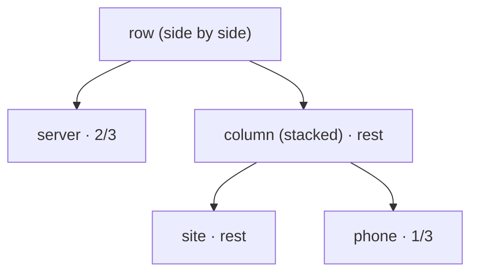

### 7.3 Layout Files

A `kanna.yaml` file defines the panes and uses the same layout expression:

```yaml
mux: kmux            # optional; otherwise the usual selection rules apply
layout: "server:2/3 | (site / phone:1/3)"
panes:
  server: { type: term, cmd: "npm run dev", cwd: "~/code/myapp" }
  site:   { type: web,  url: "http://localhost:3000" }
  phone:  { type: ios,  app: "./build/MyApp.app", device: "iPhone 16" }
```

`kanna up` opens the panes in the order listed and then applies the layout. If the backend can't show one of the pane types, kanna stops before opening anything.

### 7.4 How Sizes Map to Each Backend

| Backend | How a fraction is applied |
|---------|---------------------------|
| kmux | Stored as-is. Proportions stay the same when the window is resized. |
| tmux | Converted to a percentage (`split-window -l 33%`, `resize-pane`). |
| cmux | **[Assumption]** Converted to whatever its API accepts, rounded if needed. |

---

## 8. Example Session

```sh
kanna open term --name server --cmd "npm run dev"
kanna open web http://localhost:3000 --name site --split right --size 1/3
kanna open ios --name phone --app ./build/MyApp.app --split down --size 1/3
```

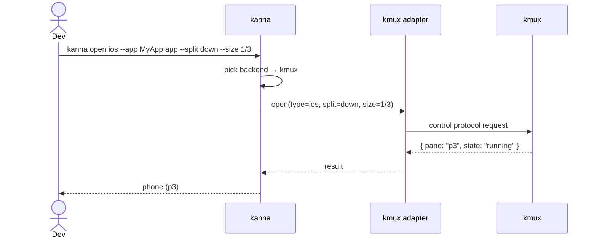

---

## 9. Output, Errors and Exit Codes

- `open` prints the new pane's ID, name, window, tab and state, as kmux's CLI (`opened p3 (logs) in window w1, tab t1: running`). Other commands print short human-readable text, as kmux's.
- `--json` prints one JSON object per command.
- `open` waits until the pane is running or has failed, unless `--no-wait` is given.

| Exit code | Meaning |
|-----------|---------|
| 0 | Success |
| 1 | The command failed (for example, the pane failed to start) |
| 2 | Bad usage (unknown flag, invalid layout expression) |
| 3 | The mux isn't running and couldn't be started (for Kanna: nothing answers, and Kanna.app couldn't be started or its daemon didn't answer within 20 s; or `KANNA_SOCKET` is set and nothing answers there) |
| 4 | Pane not found |
| 5 | Not supported by this backend |
| 6 | The command needs Kanna.app, which isn't attached and wasn't started (`KANNA_SOCKET` is set, or it didn't start or attach within 20 s) |

| Situation | Behaviour |
|-----------|-----------|
| Pane type not supported by the backend | Exits 5, e.g. "tmux can't show web panes. Try `--mux kmux`." |
| Layout sizes add up to more than 1 | Exits 2 and shows which group is over. |
| `arrange` names a pane that doesn't exist | Exits 4. Nothing is changed. |
| Pane too small after rounding (tmux) | The size is raised to the backend's minimum and a warning is printed. |
| Two panes given the same name | The second `open` exits 1. |
| `KANNA_SOCKET` is set and nothing answers there | Exits 3. kanna never starts an app for a socket it was pointed at. |
| A layout command (`open --split`, `focus`, `arrange`…) and Kanna.app isn't attached to the daemon | kanna starts Kanna.app and retries; with `KANNA_SOCKET` set, exits 6 (`no_app`) ([4.7](#47-the-layout)). |

---

## 10. Platform Requirements

| Requirement | Why |
|-------------|-----|
| macOS | Needed for Kanna.app, kmux and iOS panes. |
| Linux | The `kanna` CLI, Kanna's daemon and keeper run there too ([4.4](#44-languages-and-platforms)). **[Assumption]** kanna with tmux works there. |
| The chosen mux | kmux, tmux or cmux must be installed. |

---

## 11. Open Questions

1. **Unsupported pane types:** for example, should `web` on tmux fall back to opening the system browser, or always fail?
2. **cmux:** confirm what its API supports (web panes, sizing, naming).
3. **Mixed backends:** should one `kanna.yaml` be able to use several muxes, for example terminals in tmux and web panes in kmux?
4. **Agent use:** should kanna expose pane contents (terminal text, screenshots) where the backend supports it?
5. **Targeting:** how does kanna choose which window or tab (or tmux session) to act on?

---

## 12. Glossary

| Term | Meaning |
|------|---------|
| **Mux (multiplexer)** | An app that shows several separate sessions in one window. |
| **kmux** | A native macOS mux (MIT, public). It can show terminal, web, iOS and markdown panes. See the [kmux spec](https://github.com/tampopogk/kmux/blob/main/docs/kmux-spec.md). |
| **Kanna.app** | Kanna's own mux ([4](#4-kannaapp)): the app, with its daemon and keeper. |
| **Daemon** | Kanna's background process that keeps the terminals; it outlives the app. |
| **Keeper** | A tiny background process that creates the ptys and holds them open, so shells outlive the daemon too. |
| **kanna-mux** | Kanna's mux core (Rust): kmux's protocol and the terminals, in the daemon. |
| **Reference model** | What Kanna's mux is checked against: kmux, unchanged. |
| **Layout state** | Where panes are and what each non-terminal pane shows; kept by the app. |
| **External I/O** | A mode of Kanna's forked Ghostty where a terminal view draws output it's given instead of running its own pty. |
| **libghostty-vt** | Ghostty's terminal engine as a library, without drawing; the daemon's copy of each screen. |
| **pty** | Pseudo-terminal: what a shell talks to as if it were a real terminal. |
| **tmux** | A widely used terminal multiplexer that runs inside a terminal. It shows terminal panes only. |
| **cmux** | A third-party macOS terminal app with panes, used here as a backend. |
| **Backend** | The mux that kanna is currently controlling. |
| **Adapter** | The part of kanna that translates its commands for one specific backend. |
| **Pane** | One rectangular area in a mux showing one thing. |
| **Split** | Dividing a space into panes side by side or stacked. |
| **Layout expression** | kanna's short notation for arranging panes, e.g. `a:2/3 \| (b / c)`. |
| **Layout tree** | The parsed form of a layout expression that kanna passes to adapters. |
| **Key window** | The window shortcuts, menus and requests without a `window` act on; in Kanna.app the layout model's and AppKit's follow each other ([4.10](#410-windows-tabs-and-splits)). |
| **Tab bar** | The row of tabs under the title bar of each Kanna.app window: titles, the active one underlined, × and +. |
| **Divider** | The 1 pt line between two panes of a split; dragging it moves the split between them. |
| **Grip** | The ⋯ handle at the top of a pane, seen only under the mouse; dragging it moves the pane. |
| **Drop hint** | The highlight showing where a dragged pane or tab will land. |
| **Surface** | One terminal view's Ghostty terminal in the app (GhosttyKit): it draws the screen and handles keys, mouse, selection and clipboard ([4.12](#412-terminal-behaviour)). |
| **Snapshot** | A terminal's whole screen (grid, scrollback, modes, colours) as bytes (GHOSTSNP), sent on attach and saved on disk. |
| **Settings (terminal)** | What the app's Ghostty config says about colours, scheme, cursor and graphemes, sent to the daemon so it can answer programs ([4.12](#412-terminal-behaviour)). |
| **OSC** | Operating System Command: an escape sequence a program writes to set or ask for something (title, folder, colours, clipboard, links, notifications). |
| **OSC 52** | The escape sequence a program uses to read or write the clipboard. |
| **OSC 8 link** | A hyperlink a program writes into the terminal; its text and target can differ. |
| **Light/dark scheme** | Which of a conditional theme's two halves applies; follows the app's appearance and is reported to programs that ask (mode 2031). |
| **View (of the layout)** | What the app draws: every window with its tabs and the tree on screen, from the layout model ([4.10](#410-windows-tabs-and-splits)). |
