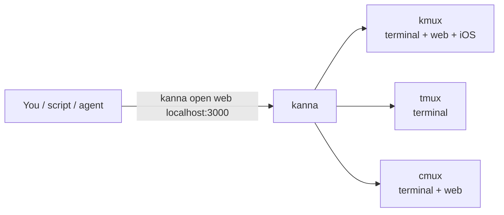
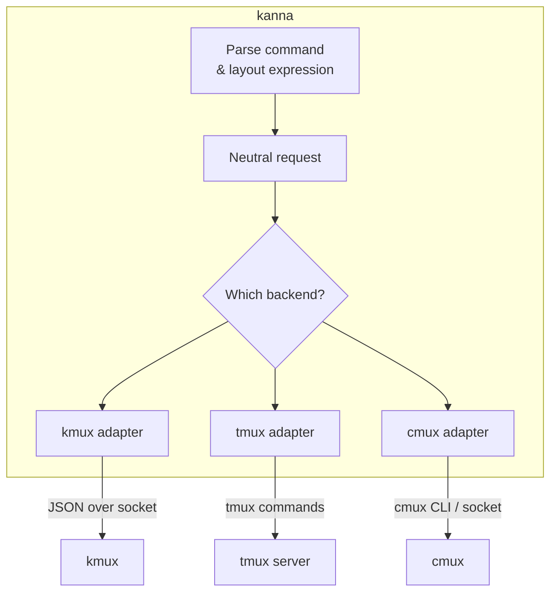
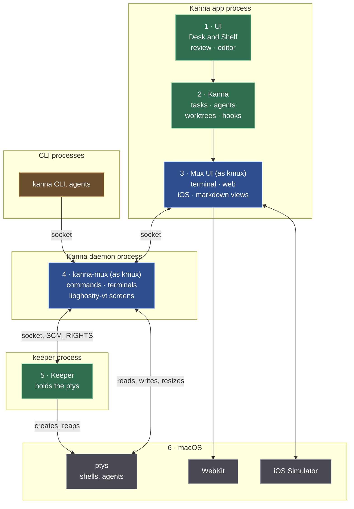
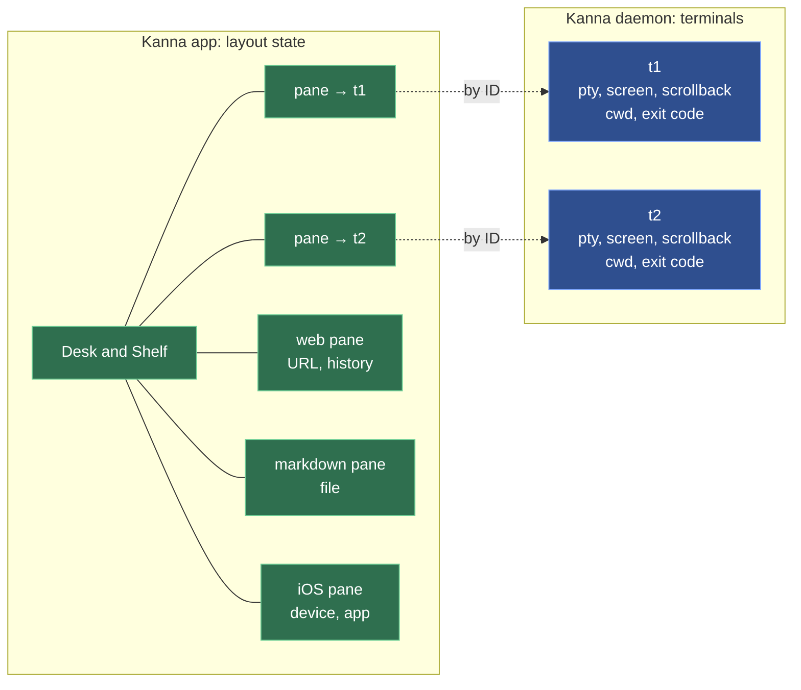
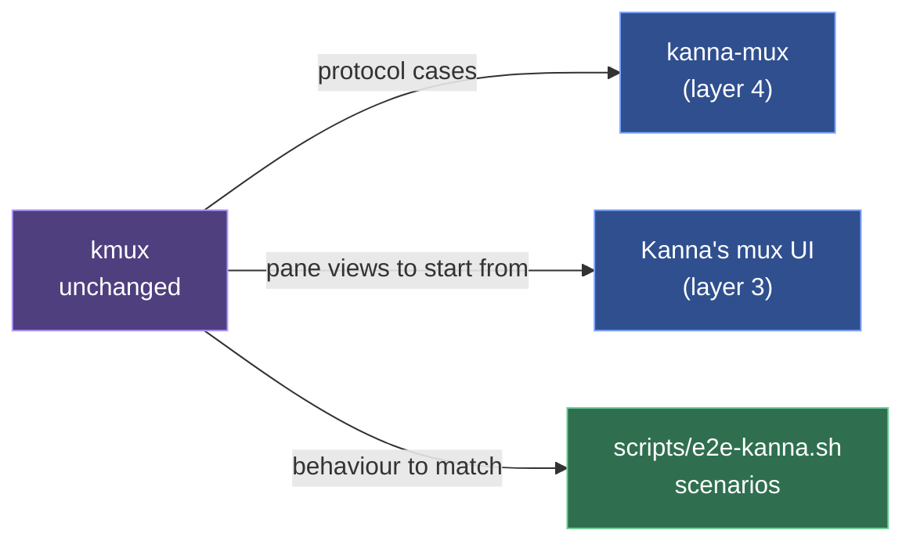
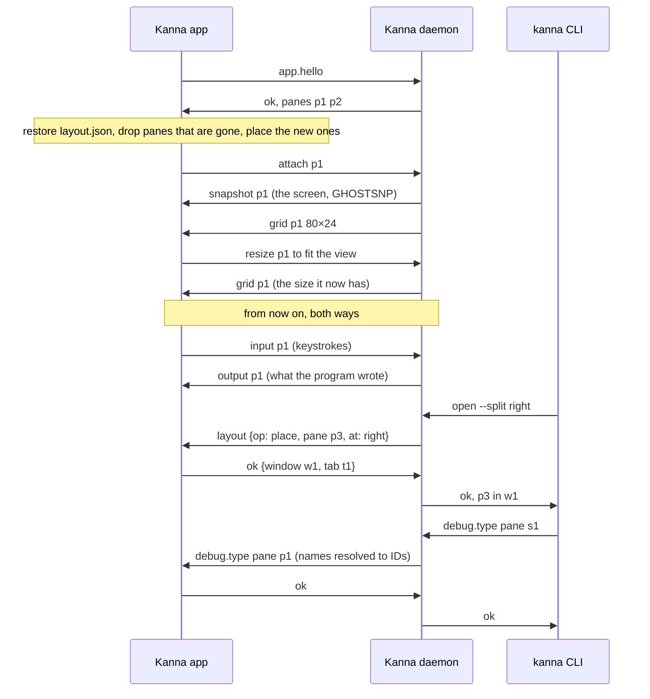
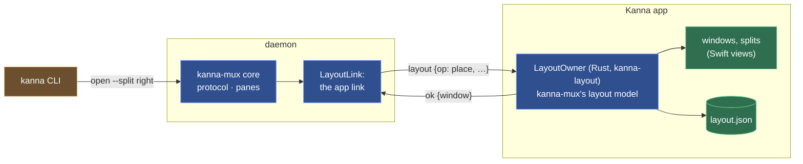
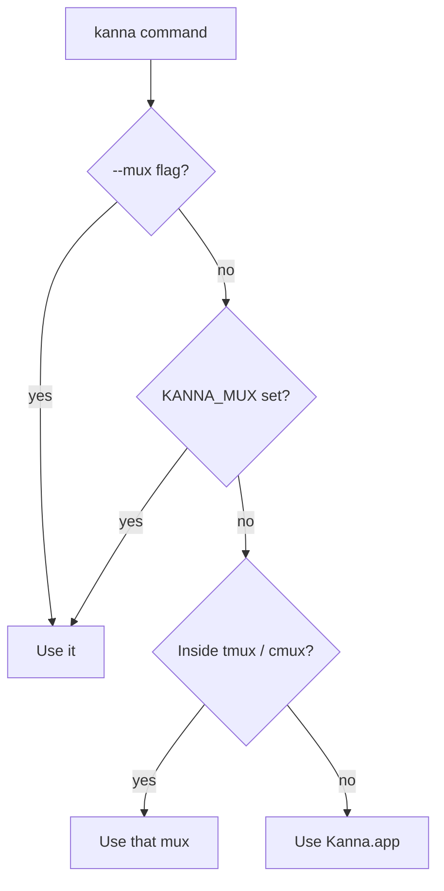
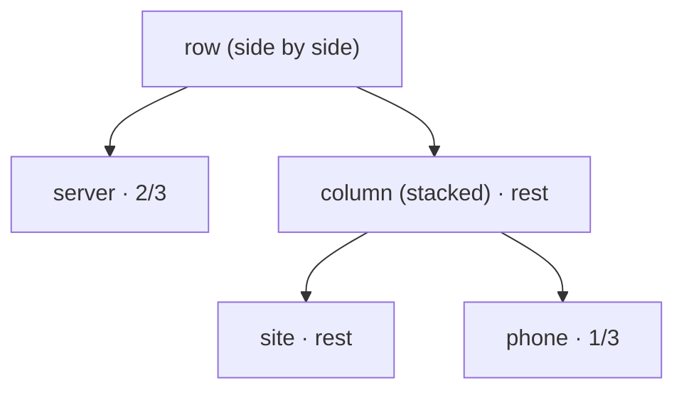
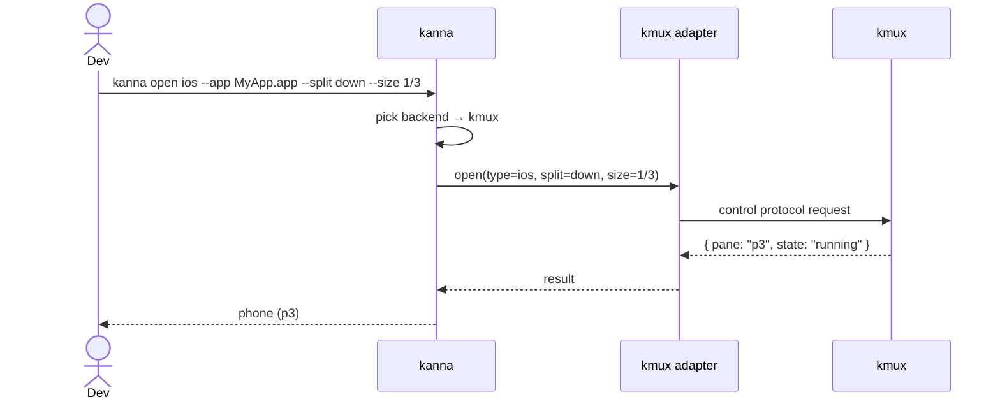

# kanna — Specification

> **Status:** Draft v0.7 · **Last updated:** 2026-10-09
>
> Items marked **[Assumption]** are guesses made to fill gaps. Confirm or correct them, and see [Open Questions](#11-open-questions).
>
> **Related:** [kmux spec](https://github.com/tampopogk/kmux/blob/main/docs/kmux-spec.md) (the separate, public kmux repo), Kanna's own mux and kanna's most capable backend.

## Table of Contents

1. [Summary](#1-summary)
2. [Goals and Non-Goals](#2-goals-and-non-goals)
3. [How It Fits Together](#3-how-it-fits-together)
4. [Kanna.app](#4-kannaapp)
   - 4.1 [Layers and Processes](#41-layers-and-processes)
   - 4.2 [What the Daemon Keeps, What the App Keeps](#42-what-the-daemon-keeps-what-the-app-keeps)
   - 4.3 [kmux Is the Reference Model](#43-kmux-is-the-reference-model)
   - 4.4 [Languages and Platforms](#44-languages-and-platforms)
   - 4.5 [The App Link](#45-the-app-link)
   - 4.6 [The App's Terminal Views](#46-the-apps-terminal-views)
   - 4.7 [The Layout](#47-the-layout)
5. [Mux Backends](#5-mux-backends)
   - 5.1 [What Each Backend Supports](#51-what-each-backend-supports)
   - 5.2 [Choosing a Backend](#52-choosing-a-backend)
   - 5.3 [Adapter Interface](#53-adapter-interface)
6. [Commands](#6-commands)
7. [Sizing and Arranging Panes](#7-sizing-and-arranging-panes)
   - 7.1 [One Pane at a Time](#71-one-pane-at-a-time)
   - 7.2 [The Layout Expression](#72-the-layout-expression)
   - 7.3 [Layout Files](#73-layout-files)
   - 7.4 [How Sizes Map to Each Backend](#74-how-sizes-map-to-each-backend)
8. [Example Session](#8-example-session)
9. [Output, Errors and Exit Codes](#9-output-errors-and-exit-codes)
10. [Platform Requirements](#10-platform-requirements)
11. [Open Questions](#11-open-questions)
12. [Glossary](#12-glossary)

---

## 1. Summary

`kanna` is a command-line tool that controls a **mux**, an app that shows several things side by side. A single command can open a terminal, show a web app or launch an iOS app in the simulator.

kanna isn't tied to one mux. Its commands work the same way with **kmux**, **tmux** or **cmux**. Each mux supports whatever pane types it can show.

**Kanna ships its own mux, Kanna.app** ([4](#4-kannaapp)): its terminals live in a background daemon, so they survive the app quitting. **[Being built]** Until then Kanna.app is a copy of kmux built from a [kmux](https://github.com/tampopogk/kmux) checkout beside this repo (`../kmux`, at the commit in `kmux.rev`), with Kanna's name and icon. It has its own sockets (`~/Library/Application Support/kanna/kanna.sock`) and gives its terminals `KANNA_SOCKET`, `KANNA_PANE` and `KANNA_INSTANCE`, so it never meets a kmux the user runs. It's kanna's default backend.



---

## 2. Goals and Non-Goals

### Goals

| # | Goal |
|---|------|
| G1 | The same commands work with every supported mux. |
| G2 | Make sizing panes simple by default, with more control available when you ask for it. |
| G3 | Make it easy to script: predictable output, JSON output and clear exit codes. |
| G4 | Open a whole dev setup (server, web preview, iOS app) with one command. |

### Non-Goals (for now)

- Showing panes itself. That is the mux's job.
- Pixel-exact sizing. Sizes are fractions of the available space.
- Controlling muxes on other machines. **[Assumption]**

---

## 3. How It Fits Together

kanna turns each command into a backend-neutral request and passes it to an **adapter**. There is one adapter per mux, and each adapter talks to its mux in that mux's own way.



- **kanna stores nothing between commands.** The mux owns all the state.
- **kanna parses layout expressions itself**, so every adapter receives the same tree.

---

## 4. Kanna.app

**[Being built]** — see [the build plan](plans/mux-build.md) and [the architecture research](research/mux-architecture.md).

Kanna.app is kanna's own mux: a desktop app, a background **daemon** and a **keeper**. Terminals live in the daemon, so quitting or crashing the app loses nothing, and the keeper holds the terminals open, so even restarting the daemon loses nothing. It shows the same panes as kmux (terminal, web, markdown, iOS) and answers the same commands.

### 4.1 Layers and Processes

Read the stack top to bottom, like the OSI model: each layer uses the ones below it. The outer boxes are processes.

**Colours:** green is Kanna's own, blue is Kanna's code that follows kmux (the reference), purple is kmux itself, grey is macOS, orange is the CLIs.



| Layer | What's in it | Process |
|---|---|---|
| 1 · UI | Desk and Shelf, markdown review, code editor | app |
| 2 · Kanna | tasks, agents, worktrees, hooks | app |
| 3 · Mux UI | the pane views (terminal, web, iOS, markdown) and their layout state; Swift, started from kmux's views | app |
| 4 · kanna-mux | the commands (kmux's protocol) and the terminals, each with its screen kept by libghostty-vt; Rust | daemon |
| 5 · Keeper | creates the ptys and holds a copy of each; Rust | keeper |
| 6 · macOS | ptys and shells, WebKit, iOS Simulator devices | — |

- **The CLI is a client, not a layer:** like the app, it calls down into the daemon. Neither serves the other.
- **The keeper isn't in the path of any byte:** it hands each pty to the daemon, which reads and writes it.
- **How a terminal starts:** the daemon asks the keeper of its state folder (`keeper.sock`, started as `$KANNA_KEEPER` or the `kanna-keeper` beside the daemon if none runs) to spawn the program; the keeper answers with the pid and the pty's master (`SCM_RIGHTS`), and later with the exit code, which the daemon records and acknowledges. `close` and `restart` end the program through the keeper; the daemon sets the size itself (`TIOCSWINSZ`). If the keeper goes away the daemon logs it and stops ([keeper spec](keeper.md)).
- **The app draws terminals from the daemon** through a forked Ghostty whose surfaces take their output from outside instead of a pty ("external I/O").

### 4.2 What the Daemon Keeps, What the App Keeps

**Only terminals live in the daemon.** Everything else a pane shows is layout state, kept and saved by the app.



| | What it is | Kept by | After the app restarts |
|---|---|---|---|
| **Terminal** | a pty, its screen and scrollback, cwd, exit code | the daemon | exactly as it was, still running |
| **Layout state** | where panes are; a web pane's URL and history, a markdown pane's file, an iOS pane's device and app | the app | reopened: pages reload at their URL, files reopen, simulators never stopped |

Terminal commands (`list`, `send`, `read`, `close`, `restart`, and `open` without a placement) work with the app closed. Layout, web, markdown and iOS commands are passed to the app; with the app closed, kanna starts it or fails clearly ([4.7](#47-the-layout)).

### 4.3 kmux Is the Reference Model

kmux stays as it is. It's the model Kanna's mux is checked against, not a library Kanna builds on.



- `kanna-mux` runs kmux's own protocol cases (`../kmux/tests/kmux-protocol/cases`).
- Where Kanna and kmux behave differently, Kanna is wrong unless we decided otherwise.
- `kmux.rev` records the kmux commit Kanna matches. When kmux changes and Kanna should follow, port the change and move `kmux.rev`.
- Nothing changes in kmux for Kanna's sake.

### 4.4 Languages and Platforms

| Part | Language | Runs on |
|---|---|---|
| Kanna.app (layers 1–3) | Swift (AppKit) | macOS |
| Daemon and `kanna-mux` (layer 4) | Rust | macOS and Linux |
| Keeper (layer 5) | Rust | macOS and Linux |
| `kanna` CLI | Rust | macOS and Linux |

The daemon has to run on Linux too, so everything below the app is Rust. A Linux UI would be its own, on the same daemon.

### 4.5 The App Link

The app is a client of the daemon, like the CLI, but it stays connected: it shows the daemon's terminals, types into them, and answers the requests only the app can (the layout and `debug.*` now; web and iOS commands later). The **app link** is that one connection, on the daemon's own socket (`$KANNA_SOCKET`).

**The same wire as the control protocol.** One JSON object per line, both ways. A message with `cmd` is a request, shaped `{"id", "cmd", "args"}` as in the control protocol; with an `id` it wants a reply, `{"id", "ok": true, …}` or `{"id", "ok": false, "error": {"code", "message"}}`, and without one it's a notice that gets none. Each side numbers its own requests, and a reply goes to the side that asked. Terminal bytes are base64 in a `data` field.

**Saying it's the app.** The app's first line is `{"id": 0, "cmd": "app.hello", "args": {"pid": …}}`. The daemon answers `{"id": 0, "ok": true, "daemon": {"pid": …}, "panes": [{"id", "name", "type"}, …]}`, listing every terminal it has, and the connection is the app link from then on. One app at a time: a second gets `ok: false` (`app_attached`) and is closed. If the daemon goes away, the app keeps trying to connect, and on reconnecting says hello and attaches its terminals again.



| Message | From | What it says |
|---|---|---|
| `app.hello {pid}` | app | I'm the app; the reply accepts or refuses it and lists the daemon's terminals (`panes`) |
| `layout {op, …, panes}` (with an `id`) | daemon | one step of a command on the layout ([4.7](#47-the-layout)); the app's reply is the step's answer |
| `attach {pane}` / `detach {pane}` | app | I show (or no longer show) this terminal |
| `snapshot {pane, data}` | daemon | the terminal's whole screen (grid, scrollback, modes, colors, an unfinished sequence) as a GHOSTSNP snapshot; sent on attach, before anything else for that pane |
| `grid {pane, cols, rows}` | daemon | the terminal's size, after a snapshot or a resize |
| `output {pane, data}` | daemon | bytes the program wrote since the snapshot |
| `exited {pane, code}` | daemon | the program ended |
| `input {pane, data}` | app | bytes the view wrote: keys, paste, mouse and focus reports |
| `resize {pane, cols, rows, width, height}` | app | the view now fits this many cells (and pixels) |
| `debug.*` (with an `id`) | daemon | a request from a client, passed on; the app's reply is the client's |

- **Requests from the daemon are answered in order.** The app answers `layout` on its main thread as the message arrives, before anything after it; `debug.*` may answer later.

- **The daemon decides a terminal's size.** The view asks with `resize`; the daemon sets the pty's size, and the view takes the size `grid` gives it, in order with the output.
- **Requests for the app** (`debug.app`, `debug.type`, `debug.key`, `debug.text`, `debug.snapshot`) can come from any client. The daemon turns a pane name into its ID, passes the request on and returns the app's reply. With no app attached they fail with `no_app`; if the app goes away first, with `app_gone`. If the app doesn't answer within 10 s they fail with `timeout`.
- **Debug commands are off by default.** The app answers `debug.*` only when started with `KANNA_DEBUG=1` (the test scripts set it). `debug.snapshot` takes a plain file name and writes a new file in `$KANNA_STATE_DIR` (or `$TMPDIR`); it never overwrites one.
- **Limits:** a resize beyond 1000 cells a side is refused; a line over 16 MiB drops the app; an app that falls 16 MiB behind on output stops getting it and starts its terminals over (snapshot, grid) once it has caught up, and one 64 MiB behind is dropped.
- **The layout is the app's** ([4.7](#47-the-layout)): the daemon keeps none and asks the app for every layout step. M0's `layout` notice, which mirrored a layout the daemon kept, is gone.
- **Screens:** the daemon keeps each terminal's screen with libghostty-vt (`crates/kanna-vt`), fed from the pty: up to 10,000 lines of scrollback, and no more than 10 MB. `read` answers from it, so it works with the app closed.
- **Queries are answered once, by the daemon.** The program's queries (cursor position, device status and attributes, modes, size reports, XTVERSION) are answered by the daemon's screen, written back to the pty as they're parsed, whether or not the app is attached. The app's surfaces parse the same output but drop their replies (the Ghostty fork's external backend), so the program never gets two. The daemon's screen has no theme colors, so OSC 10/11 color queries get no answer yet.
- **Attaching:** the daemon takes the snapshot on its main loop under the same lock the pty reader feeds the screen and the outbox with, and empties the outbox as it does: what the snapshot has isn't sent again, and every later byte follows as `output`. The app loads the snapshot (`ghostty_surface_load_snapshot`), then applies the `grid` that follows, since a snapshot carries its own grid; both go through the same queue as output, in order. A restarted terminal is attached the same way.
- **When a snapshot fails:** inside some unfinished sequences (an APC holding a C1 byte) libghostty-vt can't encode one. The daemon then sends nothing for that pane and tries again after the terminal's next output (which is all that can change it), or when it exits. If the app's surface refuses a snapshot (a full mailbox), it retries every 2 ms; after 250 refusals it gives up on it and goes on with the live output.

### 4.6 The App's Terminal Views

- **Typed text goes out as key events.** Committed text is sent as the key event's text, as Ghostty's app does; `ghostty_surface_text` is the paste path and would wrap every keystroke in bracketed-paste markers. A lone control character is reported without Control, function-key private-use characters aren't text, and text starting with a control character or DEL is dropped so the encoder works from the key code (Shift+Return reaches kitty-keyboard programs as `CSI 13;2u`).
- **Clipboard reads need a paste.** Only a user-initiated paste reads the clipboard; an OSC 52 read, which arrives with no input event in flight, is answered with nothing.
- **Focus follows the first responder**, not key-window status, so a pane keeps its focused cursor across reparenting. `ghostty_surface_set_occlusion` takes visibility: false stops the renderer updating at all, so `KANNA_IGNORE_OCCLUSION=1` (the test scripts) keeps hidden windows drawing.
- **`debug.snapshot` captures with `CGWindowListCreateImage`**, looked up at run time: it is obsoleted in the macOS 15 SDK but still exported, and an app may capture its own windows without the screen-recording permission ScreenCaptureKit needs.

### 4.7 The Layout

The app owns the layout (windows, tabs, splits, focus, zoom; later Desk and Shelf) and saves it; the daemon owns the terminals.

**Design: one layout model, in Rust, run by the app.** The layout logic is `kanna-mux`'s model (ported from kmux, checked with kmux's protocol cases); there is no second copy in Swift. The app links it as a static library (`crates/kanna-layout`, a small C interface taking and returning JSON) and is the only process that holds a layout: it applies layout commands to it, draws it, and saves it. The daemon's `kanna-mux` core keeps the protocol and the panes, and reaches the layout through an asynchronous seam, `LayoutLink`; in the daemon that link is the app link, so each layout step is a request to the app. Why this and not kmux's Swift model copied into the app:

- **One implementation.** A Swift copy would be a second layout model to keep in step with the Rust one that `kanna-mux` (and its tests) needs anyway; every kmux change would be ported twice.
- **Conformance is checked on what runs.** kmux's protocol cases run against `kanna-mux` twice: with the model in-process, and with the model behind the same JSON requests the app answers (`LayoutOwner`, the code the app runs), its answers arriving later as they do over the app link.
- **Linux.** A Linux UI gets the same layout by linking the same library.
- **The app knows the views.** Choices only a UI can make (which way an `auto` split goes, window frames) are made where the views are.



**Layout steps.** `kanna-mux`'s core turns each command into steps on the layout and sends them through its `LayoutLink`; in-process (kmux's own shape, and `kanna-mux`'s tests) they run at once, in the daemon each is a `layout` request on the app link that the app answers with `LayoutOwner`. Every step carries the daemon's pane table (`panes: [{id, name, type}]`), so the app resolves names and labels as the daemon would. A command's steps and its changes to the panes run one command at a time (the core takes turns), so pane IDs and layout changes happen in kmux's order however slowly the app answers.

| Step (`op`) | Used by | The app answers | With no app attached, the daemon answers |
|---|---|---|---|
| `place {pane, at}` | `open` (`at` holds only the `split`, `size`, `tab`, `window` given) | places it: `{window, tab}` | with no `at`: `{window: null, tab: null}`, the pane is opened unplaced; with one: `no_app` |
| `location {pane}` | `open`, once the pane has started | `{window, tab}` | `{window: null, tab: null}` |
| `command {cmd, args}` | `focus`, `zoom`, `rename-tab`, `move`, `move-tab`, `resize`, `arrange` | the command's reply, as kmux | `no_app` |
| `panes-in {tab}` / `{window}` | `close --tab`, `close --window` | the panes there | `no_app` |
| `remove {ids, tidy}` | `close`, `debug.restoreState` | removes them (and closes emptied tabs and windows) | nothing to do |
| `windows` | `list`, `debug.restoreState` | kmux's `windows` | `[]` |
| `export`, `check {state, ids}`, `install {state, ids}` | `debug.saveState`, `debug.restoreState` | as kmux | `no_app` |

- **With the app attached** every layout command is the app's; `close` closes the terminals in the daemon and then has the app remove them.
- **With the app closed**, terminals keep working: `list`, `send`, `read`, `close`, `restart`, and `open` without a placement (the pane is placed when the app next opens). Commands that need the layout fail with `no_app`: "… needs Kanna.app, and none is attached to this daemon".
- **If the app goes away mid-step**, the step gets the no-app answer: an unplaced `open` still opens its terminal, a placed one fails.
- **`list`** answers `panes` from the daemon and `windows` from the app; with no app, `windows` is `[]` (no last-known layout: the app's file is the only copy, and it may be stale) and each pane's window shows as `-`.

**Saving.** The app saves its layout in kmux's state file format (`kmux: "state"`, `version: 1`, windows, tabs, splits, focus, zoom, the panes it places by ID, name and type) to `layout.json` in its state folder: `$KANNA_STATE_DIR`, or the daemon socket's folder. As kmux: half a second after a change and on quit, only when something changed, written atomically (a new file, then renamed) with mode 0600; `--fresh` (or `KANNA_FRESH=1`) starts without it, `KANNA_NO_STATE=1` neither reads nor writes one.

**Restoring.** On launch the app reads the file (one it can't trust, or of another version, is moved aside as `layout.json.bad`). When the daemon accepts it, the hello reply lists the daemon's terminals; the app drops from the layout every pane the daemon no longer has (closing emptied splits, tabs and windows), places every terminal it doesn't know as `open` would (beside the focused pane), draws the key window's active tab, and attaches each terminal it shows. A reconnect to a restarted daemon does the same with the layout in memory. Nothing is saved until the saved layout has been installed, so an app that never reached its daemon doesn't overwrite it.

```mermaid
sequenceDiagram
    participant A as Kanna app
    participant D as Kanna daemon
    participant C as kanna CLI
    Note over A: closed
    C->>D: open --name logs
    D->>C: ok, p3, window null
    C->>D: open --split right
    D->>C: no_app
    C->>A: start (open -a $KANNA_APP)
    Note over A: read layout.json (p1, p2)
    A->>D: app.hello
    D->>A: ok, panes p1 p2 p3
    Note over A: p1, p2 where they were; p3 placed
    C->>D: open --split right (again)
    D->>A: layout {op: place, pane p4, at: right}
    A->>D: ok {window w1, tab t1}
    D->>C: ok, p4
```

**The CLI starts the app** ([plan](plans/mux-build.md) step 1.4). When the daemon answers a command with `no_app` and `KANNA_SOCKET` isn't set, `kanna` starts Kanna.app (`open -n -a $KANNA_APP`, or by bundle ID `dev.kanna.app.dev`, never the branded kmux `dev.kanna.kanna`; with `KANNA_SOCKET` and `KANNA_STATE_DIR` passed on, in the background with `KANNA_BG=1`), retries the command every 200 ms until the app has attached (a `no_app` answer changes nothing, so the retry is safe), and gives up after 20 s with exit 6. With `KANNA_SOCKET` set (a test, a script, a terminal inside Kanna) it never starts an app: it exits 6 with the daemon's message and "KANNA_SOCKET is set, so kanna doesn't start Kanna.app for it". Until the new app replaces the branded kmux one, the daemon is reached without `KANNA_SOCKET` as `--mux kanna-dev` (or `KANNA_MUX=kanna-dev`): the daemon's default socket, `kanna-dev/kanna.sock` in the app support folder; if nothing answers there kanna exits 3 (it doesn't start daemons).

**Conformance.** kmux's 31 protocol cases pass three ways: against `kanna-mux` with the model in-process; with the model behind `LayoutOwner`, every step sent as JSON and answered on a later turn (`crates/kanna-mux/tests/protocol_cases.rs`); and through a running daemon, keeper and app link, with a test app answering through `LayoutOwner` (`crates/kanna-daemon/tests/protocol_cases.rs`: the 24 cases that use only terminals; the rest need web, markdown or iOS panes, M3). The app's own glue is checked by S5 and S9 of `scripts/e2e-kanna.sh` and by `crates/kanna-layout/tests`.

---

## 5. Mux Backends

### 5.1 What Each Backend Supports

| Capability | kmux | tmux | cmux |
|------------|:----:|:----:|:----:|
| Terminal panes | ✅ | ✅ | ✅ |
| Web panes | ✅ | ❌ | ✅ **[Assumption]** |
| iOS Simulator panes | ✅ | ❌ | ❌ |
| Fractional sizing | ✅ | ✅ | ✅ **[Assumption]** |
| Named panes | ✅ | ✅ (kanna stores the name as a pane option) | **[Assumption]** |
| Pane states | Full ([kmux lifecycle](https://github.com/tampopogk/kmux/blob/main/docs/kmux-spec.md#43-lifecycle)) | Running / exited only | **[Assumption]** |

`kanna mux` prints this table for the backend in use.

### 5.2 Choosing a Backend

kanna picks the first match in this order:

1. The `--mux kanna|kanna-dev|kmux|tmux|cmux` flag. `kanna` is Kanna.app; `kanna-dev` is Kanna's daemon, which the new Kanna.app attaches to, while the two are being built ([4.7](#47-the-layout)); `kmux` is a kmux the user runs.
2. The `$KANNA_MUX` environment variable.
3. **Auto-detect:** if kanna is running inside tmux (`$TMUX` is set), it uses tmux. If it's running inside cmux, it uses cmux. **[Not built yet]**
4. Otherwise Kanna.app, which kanna starts if it isn't already running. Inside a Kanna.app terminal, kanna talks to that instance (`$KANNA_SOCKET`).



### 5.3 Adapter Interface

Every adapter implements the same operations. Adding a new mux means writing a new adapter.

| Operation | Purpose |
|-----------|---------|
| `capabilities()` | Report the supported pane types and features. |
| `open(type, options, placement)` | Create a pane. `placement` holds the split direction and size. |
| `arrange(layoutTree)` | Apply a parsed layout. |
| `resize(pane, fraction)` | Change a pane's size. |
| `list()`, `focus()`, `close()`, `restart()` | Manage panes. |
| `send(pane, text)`, `navigate(pane, url)` | Act on a pane's contents. |

The kmux adapter maps these one-to-one onto the [kmux control protocol](https://github.com/tampopogk/kmux/blob/main/docs/kmux-spec.md#7-control-protocol).

---

## 6. Commands

| Command | What it does |
|---------|--------------|
| `kanna open [term] [--cmd CMD] [--cwd DIR]` | Open a terminal pane (the default type, as in kmux). |
| `kanna open web URL [--history]` | Open a web pane; `--history` gives it back/forward. |
| `kanna open md FILE` | Show a markdown file, rendered natively with mermaid diagrams; it reloads when the file changes. |
| `kanna open ios --app APP [--device NAME]` | Launch an iOS app in a simulator pane. |
| `kanna arrange LAYOUT` | Rearrange existing panes in one go ([7.2](#72-the-layout-expression)). |
| `kanna resize PANE SIZE` | Change one pane's size. |
| `kanna up [FILE]` | Open a whole setup from a file, `kanna.yaml` by default ([7.3](#73-layout-files)). |
| `kanna list` | List panes with their names, IDs, types and states. |
| `kanna focus PANE` | Bring a pane to the front. |
| `kanna close PANE` | Close a pane. |
| `kanna restart PANE` | Restart what's inside a pane. |
| `kanna send PANE TEXT` | Type text into a terminal pane. |
| `kanna read PANE [--lines N]` | Print a terminal pane's screen as text; with `--lines`, its last N lines, counting scrollback. Kanna.app only (kmux has no `read` yet). |
| `kanna navigate PANE URL\|FILE\|--back\|--forward` | Point a web pane at a new URL (or move through its history), or a markdown pane at another `.md` file. |
| `kanna mux` | Show the backend in use and what it supports. |

`PANE` can be a name (`site`) or an ID (`p2`).

`--` ends the options: everything after it is text, so `kanna send p1 -- --json` types `--json`. **[Decided difference from kmux]**, whose CLI strips `--json` from anywhere in the arguments.

Options for `open`:

| Option | Meaning |
|--------|---------|
| `--name NAME` | A stable name to use in later commands. |
| `--split [right\|down]` | Where to put the new pane relative to the focused one. |
| `--size FRACTION` | How much of the split space the new pane gets, e.g. `1/3`. |
| `--tab` | Open in a new tab instead of splitting. |
| `--no-wait` | Return as soon as the pane is created, without waiting until it's running. |

Global options: `--mux NAME`, `--json`.

---

## 7. Sizing and Arranging Panes

Sizes are **fractions** like `1/2`, `1/3` or `2/3`, never pixels. You only add detail when you care about it.

| Level | You write | You get |
|:-----:|-----------|---------|
| 0 | `kanna open web URL` | Splits the focused pane in half along its longer side. |
| 1 | `--split right` or `--split down` | You choose the direction. The pane is still half-size. |
| 2 | `--split right --size 1/3` | The new pane gets 1/3 and the old pane keeps 2/3. |
| 3 | `kanna arrange 'server \| (site / phone)'` | Arranges several panes at once. |
| 4 | `kanna up` | Opens and arranges a whole setup from a file. |

### 7.1 One Pane at a Time

`--size` is the new pane's share of the space being split. The existing pane gets the rest.

```text
kanna open web URL          --split right            --split down --size 1/3
┌──────────┬──────────┐     ┌──────────┬──────────┐  ┌─────────────────────┐
│          │          │     │          │          │  │       focused       │
│ focused  │   new    │     │ focused  │   new    │  │        (2/3)        │
│          │          │     │          │          │  ├─────────────────────┤
└──────────┴──────────┘     └──────────┴──────────┘  │     new (1/3)       │
 (wide pane → side by side)                          └─────────────────────┘
```

`kanna resize PANE 1/4` changes an existing pane's share of its split. Its neighbours share the difference.

### 7.2 The Layout Expression

`kanna arrange` takes a short expression describing several named panes:

| Symbol | Meaning | Example |
|--------|---------|---------|
| `\|` | Side by side (left to right) | `a \| b` |
| `/` | Stacked (top to bottom) | `a / b` |
| `( )` | Group | `a \| (b / c)` |
| `:FRACTION` | Size within its group | `a:1/4 \| b` |

The rules:

1. **No sizes means equal shares.** `a | b | c` gives each pane 1/3.
2. **Panes without a size share whatever is left.** `a:1/4 | b:1/2 | c` gives `c` the remaining 1/4.
3. **Sizes in a group can't add up to more than 1.** If they do, kanna rejects the expression and explains why.
4. **`/` binds tighter than `|`.** So `a | b / c` means `a | (b / c)`. Use parentheses when in doubt.

```sh
kanna arrange 'server | site | phone'              # three equal columns
kanna arrange 'site:1/4 | server:1/2 | phone'       # 1/4, 1/2, 1/4
kanna arrange 'server:2/3 | (site / phone:1/3)'     # big terminal, web over a small sim
```

The last example produces:

```text
┌─────────────────────────────┬──────────────┐
│                             │     site     │
│        server (2/3)         │    (2/3)     │
│                             ├──────────────┤
│                             │ phone (1/3)  │
└─────────────────────────────┴──────────────┘
```

kanna parses the expression into a tree and hands the tree to the adapter:



### 7.3 Layout Files

A `kanna.yaml` file defines the panes and uses the same layout expression:

```yaml
mux: kmux            # optional; otherwise the usual selection rules apply
layout: "server:2/3 | (site / phone:1/3)"
panes:
  server: { type: term, cmd: "npm run dev", cwd: "~/code/myapp" }
  site:   { type: web,  url: "http://localhost:3000" }
  phone:  { type: ios,  app: "./build/MyApp.app", device: "iPhone 16" }
```

`kanna up` opens the panes in the order listed and then applies the layout. If the backend can't show one of the pane types, kanna stops before opening anything.

### 7.4 How Sizes Map to Each Backend

| Backend | How a fraction is applied |
|---------|---------------------------|
| kmux | Stored as-is. Proportions stay the same when the window is resized. |
| tmux | Converted to a percentage (`split-window -l 33%`, `resize-pane`). |
| cmux | **[Assumption]** Converted to whatever its API accepts, rounded if needed. |

---

## 8. Example Session

```sh
kanna open term --name server --cmd "npm run dev"
kanna open web http://localhost:3000 --name site --split right --size 1/3
kanna open ios --name phone --app ./build/MyApp.app --split down --size 1/3
```



---

## 9. Output, Errors and Exit Codes

- `open` prints the new pane's name or ID. Other commands print short human-readable text.
- `--json` prints one JSON object per command.
- `open` waits until the pane is running or has failed, unless `--no-wait` is given.

| Exit code | Meaning |
|-----------|---------|
| 0 | Success |
| 1 | The command failed (for example, the pane failed to start) |
| 2 | Bad usage (unknown flag, invalid layout expression) |
| 3 | The mux isn't running and couldn't be started |
| 4 | Pane not found |
| 5 | Not supported by this backend |
| 6 | The command needs Kanna.app, which isn't attached and wasn't started (`KANNA_SOCKET` is set, or it didn't start or attach within 20 s) |

| Situation | Behaviour |
|-----------|-----------|
| Pane type not supported by the backend | Exits 5, e.g. "tmux can't show web panes. Try `--mux kmux`." |
| Layout sizes add up to more than 1 | Exits 2 and shows which group is over. |
| `arrange` names a pane that doesn't exist | Exits 4. Nothing is changed. |
| Pane too small after rounding (tmux) | The size is raised to the backend's minimum and a warning is printed. |
| Two panes given the same name | The second `open` exits 1. |
| `KANNA_SOCKET` is set and nothing answers there | Exits 3. kanna never starts an app for a socket it was pointed at. |
| A layout command (`open --split`, `focus`, `arrange`…) and Kanna.app isn't attached to the daemon | kanna starts Kanna.app and retries; with `KANNA_SOCKET` set, exits 6 (`no_app`) ([4.7](#47-the-layout)). |

---

## 10. Platform Requirements

| Requirement | Why |
|-------------|-----|
| macOS | Needed for Kanna.app, kmux and iOS panes. |
| Linux | The `kanna` CLI, Kanna's daemon and keeper run there too ([4.4](#44-languages-and-platforms)). **[Assumption]** kanna with tmux works there. |
| The chosen mux | kmux, tmux or cmux must be installed. |

---

## 11. Open Questions

1. **Unsupported pane types:** for example, should `web` on tmux fall back to opening the system browser, or always fail?
2. **cmux:** confirm what its API supports (web panes, sizing, naming).
3. **Mixed backends:** should one `kanna.yaml` be able to use several muxes, for example terminals in tmux and web panes in kmux?
4. **Agent use:** should kanna expose pane contents (terminal text, screenshots) where the backend supports it?
5. **Targeting:** how does kanna choose which window or tab (or tmux session) to act on?

---

## 12. Glossary

| Term | Meaning |
|------|---------|
| **Mux (multiplexer)** | An app that shows several separate sessions in one window. |
| **kmux** | A native macOS mux (MIT, public). It can show terminal, web, iOS and markdown panes. See the [kmux spec](https://github.com/tampopogk/kmux/blob/main/docs/kmux-spec.md). |
| **Kanna.app** | Kanna's own mux ([4](#4-kannaapp)). Until it's built, a copy of kmux from `../kmux` with Kanna's name, icon and sockets. |
| **Daemon** | Kanna's background process that keeps the terminals; it outlives the app. |
| **Keeper** | A tiny background process that creates the ptys and holds them open, so shells outlive the daemon too. |
| **kanna-mux** | Kanna's mux core (Rust): kmux's protocol and the terminals, in the daemon. |
| **Reference model** | What Kanna's mux is checked against: kmux, unchanged. |
| **Layout state** | Where panes are and what each non-terminal pane shows; kept by the app. |
| **External I/O** | A mode of Kanna's forked Ghostty where a terminal view draws output it's given instead of running its own pty. |
| **libghostty-vt** | Ghostty's terminal engine as a library, without drawing; the daemon's copy of each screen. |
| **pty** | Pseudo-terminal: what a shell talks to as if it were a real terminal. |
| **tmux** | A widely used terminal multiplexer that runs inside a terminal. It shows terminal panes only. |
| **cmux** | A third-party macOS terminal app with panes, used here as a backend. |
| **Backend** | The mux that kanna is currently controlling. |
| **Adapter** | The part of kanna that translates its commands for one specific backend. |
| **Pane** | One rectangular area in a mux showing one thing. |
| **Split** | Dividing a space into panes side by side or stacked. |
| **Layout expression** | kanna's short notation for arranging panes, e.g. `a:2/3 \| (b / c)`. |
| **Layout tree** | The parsed form of a layout expression that kanna passes to adapters. |
