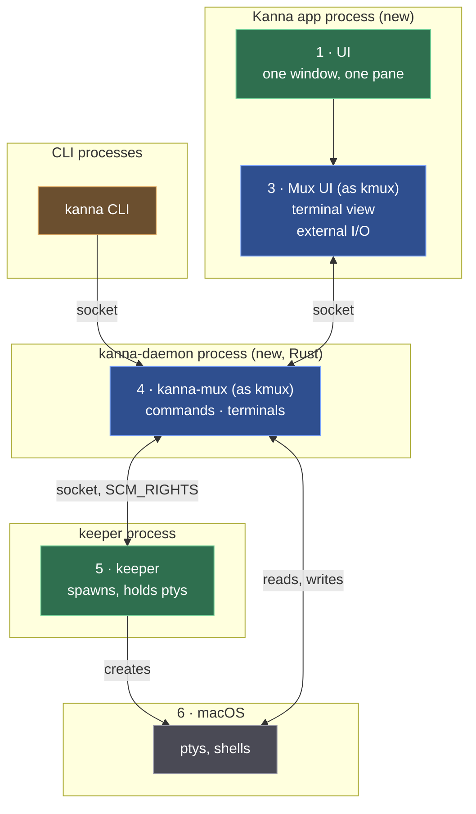

# Building Kanna's mux: plan

> 2026-10-09. Plan for building [the mux architecture](../research/mux-architecture.md). kmux stays as it is: it's the **reference model** for Kanna's mux and its CLI, and everything here is built in kanna-v4. Integration first: every box and every line in the architecture exists and works end to end in milestone 0, mostly as stubs; later milestones make the boxes real, one behaviour at a time, across all of them at once.

## Contents

1. [In short](#1-in-short)
2. [The reference: what "done" looks like](#2-the-reference-what-done-looks-like)
3. [Milestones](#3-milestones)
4. [M0 · Walking skeleton](#4-m0--walking-skeleton)
5. [M1 · The app can quit](#5-m1--the-app-can-quit)
6. [M2 · The daemon can restart](#6-m2--the-daemon-can-restart)
7. [M3 · Web, markdown and iOS panes](#7-m3--web-markdown-and-ios-panes)
8. [Clean-up](#8-clean-up)
9. [Decisions](#9-decisions)
10. [How we work](#10-how-we-work)
11. [Glossary](#11-glossary)

---

## 1. In short

| Milestone | You can… | Repos |
|---|---|---|
| **M0 · Walking skeleton** | open Kanna.app (its own app now, not branded kmux), type into a terminal that the daemon runs on a pty from the keeper, and drive it with the `kanna` CLI | kanna-v4 (+ Ghostty fork) |
| **M1 · The app can quit** | quit or crash Kanna.app, reopen it, and find every terminal still running with its screen exactly as it was | kanna-v4 (+ Ghostty fork) |
| **M2 · The daemon can restart** | kill or upgrade the daemon and lose nothing | kanna-v4 |
| **M3 · Web, markdown, iOS** | use every pane kmux has, with `kanna` commands passed to the app | kanna-v4 |
| **M4 · kmux parity** | use Kanna.app every day in place of kmux: every window, tab, split, menu, shortcut, mouse gesture, terminal behaviour and CLI command kmux has | kanna-v4 (+ Ghostty fork) |

After M4 Kanna's own layers (Desk and Shelf, tasks, agents) are built on top; they're not in this plan.

---

## 2. The reference: what "done" looks like

The reference has two parts:

- **kmux itself**, unchanged: how the mux and its CLI behave. `kanna-mux` runs kmux's own protocol cases (`../kmux/tests/kmux-protocol/cases`); where Kanna and kmux differ, Kanna is wrong unless we decided otherwise. `kmux.rev` records the kmux commit Kanna matches.
- **Scenarios** for what kmux doesn't do (terminals that outlive the app), written first as a script (`scripts/e2e-kanna.sh`) that fails, and kept passing from then on. Each one runs against a private Kanna instance in the background, never your own.

| # | Scenario | Passes in |
|---|---|---|
| S1 | `kanna open term`, type `echo hi`, `kanna read` shows `hi` | M0 |
| S2 | typing in the app's terminal reaches the shell, its output is drawn | M0 |
| S3 | `kanna list` and `kanna read` work with the app closed | M1 |
| S4 | run `top`; quit the app; relaunch: the same `top`, same PID, screen identical (compared as text) | M1 |
| S5 | the layout (splits, which pane where) comes back after a relaunch | M1 |
| S6 | kill the daemon; it comes back; shells have the same PIDs; output written meanwhile isn't lost; the app attaches again and its layout is unchanged | M2 |
| S7 | `exit 3` in a terminal; `kanna list` shows exit code 3 | M2 |
| S8 | web, markdown and iOS panes open, are restored after a relaunch, and answer `navigate` and kmux's `debug.web`, `debug.md`, `debug.ios` (kmux has no `web.*`) | M3 |
| S9 | with the app closed, `kanna open --split right` starts the app and the split lands; with `KANNA_SOCKET` set it exits 6 and starts nothing | M1 |
| S10 | with no daemon running, launching the app starts one from its bundle and opens a terminal; killing that daemon gets a new one, and quitting the app leaves it running | M3 |

---

## 3. Milestones

Each step below is one commit (or a few), with its tests, and leaves everything working.

---

## 4. M0 · Walking skeleton

Every box of the architecture, connected; the daemon and the app start as stubs and get real in the steps below.

| Step | Repo | What | Done when |
|---|---|---|---|
| **0.1** ✓ | kanna-v4 | `scripts/e2e-kanna.sh` with scenarios S1–S8, all failing; `--through M0` runs only what's due | it runs and reports |
| **0.2** ✓ | kanna-v4 | **`kanna-mux`**, Kanna's mux core in Rust, ported from kmux's KmuxCore: protocol, commands, panes, layout model with a `LayoutHost` seam, state file, socket server. Passes all 31 of kmux's protocol cases; builds for Linux. Still to port: kmux's other core tests (state file, core). | kmux's cases pass |
| **0.3** ✓ | kanna-v4 | **Kanna.app as its own app.** `apps/kanna`: a SwiftPM app. Its terminal view and `GhosttyRuntime` start from kmux's (copied at `kmux.rev`), with a `TerminalBackend` seam (from kmux's external-I/O spike). Built against GhosttyKit from the Ghostty fork, which kanna-v4 builds itself. One window, one terminal pane, a stub backend that echoes. Built by `scripts/build-kanna-app.sh` into `target/Kanna.app` (bundle ID `dev.kanna.app.dev`); checked by `scripts/check-kanna-app.sh`. `build-kanna.sh` keeps building the branded-kmux Kanna.app you use until the new one can replace it (end of M1). | Kanna.app opens and echoes typing |
| **0.4** ✓ | kanna-v4 | **kanna-daemon** (Rust) on `kanna-mux`, on Kanna's socket. Stub: it spawns the pty itself. The app's external-I/O backend attaches to it. The CLI gains `kanna read PANE` (the screen as text); the daemon passes the app's `debug.*` commands (`debug.app`, `debug.type`, `debug.text`, `debug.snapshot`) through to it. Built: `crates/kanna-daemon` (ptys behind a `Spawner`, a small vte text screen behind `Screen`, the app link of [spec §4.5](../kanna-spec.md#45-the-app-link)); Kanna.app's `DaemonLink` mirroring the daemon's first tab; `read` in kanna-mux and the CLI. | S1, S2 pass |
| **0.5** ✓ | kanna-v4 | **The keeper.** Trim `feat/keeper` to what the architecture needs: spawn a shell on a pty, keep a copy, hand the pty over (`SCM_RIGHTS`), report exits. The daemon asks it for ptys. Built: `crates/kanna-keeper` ([spec](../keeper.md)); the daemon's `Spawner` is the keeper (`crates/kanna-daemon/src/keeper.rs`): spawn, close, exit codes acknowledged, a lost keeper stops the daemon; until 2.2 a starting daemon closed what an earlier one left in the keeper. Panes list their `pid`. The CLI never starts an app when `KANNA_SOCKET` is set (exit 3). | S1, S2 pass through the keeper |

**M0 is complete:** every box and line of the architecture exists and works end to end; S1 and S2 pass through the keeper.

---

## 5. M1 · The app can quit

| Step | Repo | What | Done when |
|---|---|---|---|
| **1.1** ✓ | kanna-v4 | The daemon keeps a libghostty-vt screen per terminal (its C API, from Rust), fed from the pty. `kanna read` answers from it. Built: `kanna-vt` screens in the daemon (10,000 lines, 10 MB), replacing the vte one; the daemon answers queries (now including DA and size reports) and the app's surfaces drop theirs. | S3 passes |
| **1.2** ✓ | kanna-v4 | On attach the daemon sends the screen as a snapshot; the app loads it (`load_snapshot` in the Ghostty fork), then live output. Built: `snapshot` then `grid` on the app link ([spec §4.5](../kanna-spec.md#45-the-app-link)), taken in step with the outbox; a snapshot that fails mid-sequence is retried after more output; the replay buffer is gone. | S4 passes |
| **1.3** ✓ | kanna-v4 | The app saves its layout (`kanna-mux`'s state file format, in Kanna's folder), panes pointing at terminals by ID; reopens it on launch. Built ([spec §4.7](../kanna-spec.md#47-the-layout)): the app owns the layout through `kanna-mux`'s one model, linked as `crates/kanna-layout`; the daemon's core reaches it through an async `LayoutLink`, each step a `layout` request on the app link; with no app, terminals open unplaced and layout commands fail with `no_app`; the app saves `layout.json` (kmux's rules) and on attach drops gone panes and places new ones. kmux's cases pass in-process, through `LayoutOwner`, and through the daemon and app link. | S5 passes |
| **1.4** ✓ | kanna-v4 | The CLI starts the app when a layout command needs it, or fails clearly. Built: on `no_app` the CLI starts `$KANNA_APP` (or `dev.kanna.app.dev`, never the branded kmux) and retries; with `KANNA_SOCKET` set it exits 6; `--mux kanna-dev` reaches the daemon without it. | `kanna open --split` with the app closed works (S9) |

**M1 is complete:** S3, S4 and S5 pass (with S1, S7 and S9), three runs in a row.

---

## 6. M2 · The daemon can restart

| Step | Repo | What | Done when |
|---|---|---|---|
| **2.1** ✓ | kanna-v4 | The daemon writes terminals and screen snapshots to disk as they change. Built ([spec §4.8](../kanna-spec.md#48-restarting-the-daemon)): `$KANNA_STATE_DIR/terminals/`: `terminals.json` (each terminal's pane record and keeper id, the pane counter) on every change, and an exit before it's acknowledged; `<pane>.snap` (GHOSTSNP) by a saver thread at most once a second per changed screen; atomic, 0600, bounded (16 MiB a snapshot); a snapshot that can't be encoded keeps the last good one and is tried again. A clean stop stops reading the ptys and saves everything; it no longer closes the terminals. One daemon per folder (`daemon.lock`). | snapshots on disk match the screens |
| **2.2** ✓ | kanna-v4 | On start, the daemon adopts every live pty from the keeper, reloads screens, sends `SIGWINCH`. The app reconnects. Built: `adopt`, matched with `terminals.json` by keeper id: same IDs, names, pids; screens from the snapshots, sized to the pty; the output that waited in the buffer read into them; `SIGWINCH` to each pty's foreground group; the counter continues, so IDs don't repeat. A pty the disk doesn't know is taken back as an unnamed pane (not closed); a running record the keeper doesn't have is dropped, an exited one kept. The app reattaches by ID and its layout still matches. Replaces "close leftovers on start". | S6 passes |
| **2.3** ✓ | kanna-v4 | Exit codes from the keeper (it's the parent), not through `login(1)`, which always reports 0. Since 0.5 the daemon already lists `exitCode: 3` for `exit 3`; S7 reads `exitCode`, as the protocol (as kmux) calls it. Built: an exit while no daemon runs is applied after the restart with its own code (the keeper's unacknowledged exit, the last output read first), saved, then acknowledged; exited terminals keep their codes across restarts. | S7 passes |

**M2 is complete:** S6 and S7 pass (with S1, S3, S4, S5 and S9), three runs in a row; `crates/kanna-daemon/tests/restart.rs` covers a running shell, a full-screen redraw, exits during downtime, a crash, IDs and what only the keeper or only the disk knows.

---

## 7. M3 · Web, markdown and iOS panes

| Step | Repo | What | Done when |
|---|---|---|---|
| **3.1** ✓ | kanna-v4 | The app gets web, markdown and iOS views, ported from kmux's; their state (URL and history, file, device and app) is layout state. Built ([spec §4.9](../kanna-spec.md#49-web-markdown-and-ios-panes)): `WebPaneView`, `KannaMarkdown` and `KannaDiagram` (mermaid through merman, built from kmux's `crates/kmux-merman` by `scripts/build-merman.sh`), `IosPaneView` and `SimBridge`, copied from kmux without comments or its pane menu; `Contents` starts them as kmux's `ContentHost` does. The records (url, history on/off, path and zoom, app and device) are in the app's `layout.json`; after a relaunch pages reload, files reopen, iOS panes reattach without relaunching a running app. | they open and come back after a relaunch |
| **3.2** ✓ | kanna-v4 | The daemon passes non-terminal commands (`web.*`, `navigate`, iOS, pixel snapshots) to the app and returns the answer. Built: the app lends its panes to the daemon's core on hello (pane tables carry records), so `open`, `navigate`, `close`, `restart` and `list` run kmux's core unchanged; the daemon shows them with `start`/`stop`, the app reports with `update`; `debug.web`, `debug.md`, `debug.ios` (kmux's; kmux has no `web.*`) and `debug.snapshot` are passed to the app. With the app closed, `list` shows terminals only and the rest is `no_app`. kmux's 31 cases pass through the daemon. | S8 passes |
| **3.3** ✓ | kanna-v4 | The app starts its own daemon and opens a first terminal. Built ([spec §4.5](../kanna-spec.md#45-the-app-link)): the daemon and keeper ship in `Kanna.app/Contents/Helpers`; the app starts the daemon when nothing answers at launch, or 2 s after losing one, detached so it outlives the app; an empty layout after the first attach gets a terminal; Shell menu: Split Right ⌘D, Split Down ⇧⌘D, Close Pane ⌘W. | S10 passes |

**M3 is complete:** S8 passes (with S1, S3–S7 and S9), three runs in a row; kmux's 31 protocol cases pass in-process, through `LayoutOwner` and through the daemon and app link. S2's pixel check needs an unlocked screen.

---

## 7a. M4 · kmux parity

kmux is the reference: anything you can do in kmux you can do in Kanna.app, the same way. M4 is three tracks, built side by side; each lists its steps here as it goes.

### Track A · Windows, tabs and splits (the app's UI)

| Step | What | Checked by |
|---|---|---|

### Track B · The CLI

Every kmux CLI command, option and behaviour (kmux 1f05ccb, `crates/kmux`), and every control-protocol command kmux's core answers, in `kanna` and through the daemon, as [spec §4.11](../kanna-spec.md#411-the-kanna-cli) describes. ✓ when built and checked.

| Step | What | Checked by |
|---|---|---|
| **B.1** ✓ | This inventory | — |
| **B.2** ✓ | **One command table, ported from kmux's CLI** (`crates/kanna/src/{commands,output,lib}.rs`, provenance in NOTICE): help, `commands --json`, parsing and output all come from it. A conformance test compiles kmux's own `commands.rs` and `output.rs` and checks kanna against them | `crates/kanna/tests/kmux_reference.rs` |
| B.2a ✓ | Same commands, groups and order as kmux, plus `read`; `kanna mux` is gone (`capabilities` and `instances` say what it said) | kmux_reference |
| B.2b ✓ | Every summary, usage, option, note and example is kmux's, branded kanna; `open`, `send` and `list` notes add Kanna's differences | kmux_reference |
| B.2c ✓ | Every kmux example and request line parses to the same request; every usage error has kmux's exit code and text | kmux_reference; kmux's own CLI tests ported (`every_documented_example_parses`, `requests`, `usage_errors_say_what_to_do`, `layouts_print_as_expressions`) |
| B.2d ✓ | Every reply prints as kmux prints it (`open`, `close`, `focus`, `zoom`, `restart`, `send`, `resize`, `move`, `arrange`, `rename-tab`, `move-tab`, `navigate`, `list`, `capabilities`); with the app closed, `open` says the pane is unplaced and `list` lists terminals without windows | kmux_reference, unit tests |
| B.3 | **Global options**, as kmux: `--json` (the reply, one line), `--help`/`-h` and `COMMAND --help`, `help [COMMAND\|instances\|raw]`, `--version`, no command prints the overview, an unknown option before the command (exit 2 with the overview), an unknown command with "Did you mean", an unexpected argument (exit 2 with usage and `more:`), `--bg`/`KANNA_BG=1`, `--fresh`/`KANNA_FRESH=1`. Kanna's: `--mux kanna\|kmux` (`kanna-dev` an alias of kanna) and `KANNA_MUX`; `--` ends options | `tests/cli.rs`, S20 |
| B.4 | **Overview and `commands [--json]`**: groups, the "More" and "Referring to things" sections, marks for commands the running mux doesn't support, never starting anything; `--json` adds `--mux`, `--`, exit 6 | `tests/cli.rs` |
| B.5 | **Instances**: `--instance NAME` (checked: letters, digits, `-`, `_`, up to 32), then `KANNA_SOCKET`, then `KANNA_INSTANCE`, then default. Kanna's instance is a folder: `kanna-dev` (default) or `kanna-dev-NAME`, each with its own daemon, keeper, app and layout; `instances [--json]` lists the ones that answer, `*` the current one. The daemon names itself from its folder and sets `KANNA_INSTANCE` in its terminals; `capabilities` reports the name | target unit tests, `tests/cli.rs`, S22 |
| B.6 | **Starting Kanna**: nothing answering (no `KANNA_SOCKET`) starts Kanna.app (`$KANNA_APP` or `dev.kanna.app.dev`, never the branded `dev.kanna.kanna`; `-g --bg` with `--bg`, `--fresh` passed on), which starts its daemon; a command that gets `no_app` starts it the same way (once) and retries for 20 s; with `KANNA_SOCKET` set, exit 3 (nothing answers) or 6 (`no_app`) and nothing starts | target unit tests, `tests/no_launch.rs`, S9, S22 |
| B.7 | **Errors and exit codes** as kmux: `not_found` 4 with the `kanna list` hint, `bad_request`/`layout_invalid` 2 with usage, an unknown command (`bad_request` "unknown command") or `unsupported` 5 with what the running Kanna supports, everything else 1; `no_app` 6 | `tests/cli.rs`, S20, S21 |
| B.8 | **Every command through the daemon with the app attached**: `open` (term, web, md; placement `--split`, `--size`, `--tab`, `--window ID\|new`, `--no-wait`, `--name`, `--cwd`, `--cmd`), `close` (pane, `--tab`, `--window`), `focus` (pane, `--tab`, `--window`), `zoom`, `restart`, `send`, `read`, `resize`, `move` (`--to`/`--side`, `--tab`, `--window`), `arrange`, `rename-tab`, `move-tab`, `navigate` (URL, file, `--back`, `--forward`), `list`, `capabilities`, `raw` | `tests/cli.rs` (daemon and a test app), S20 (the real app) |
| B.9 | **Without the app**: `list`, `send`, `read`, `close PANE`, `restart`, `open` (unplaced), `capabilities`, `raw` work; `open --split/--size/--tab/--window`, `open web\|md\|ios`, `focus`, `zoom`, `resize`, `move`, `arrange`, `rename-tab`, `move-tab`, `close --tab/--window`, `navigate` and `debug.*` answer `no_app` (exit 6 with `KANNA_SOCKET`, else the app is started) | `tests/cli.rs`, S21 |
| B.10 | **`capabilities` tells the truth**: kmux's fields (`mux: kmux`, `instance`, `paneTypes`, `commands` with `read`, `features`), plus `app`: whether Kanna.app is attached | `crates/kanna-daemon/tests`, `tests/cli.rs` |
| B.11 | **`debug.*` reach the app**: every `debug.*` the core doesn't answer itself goes to the app (pane names resolved to IDs), so the app's own debug commands (kmux's `debug.click`, `debug.drag`, `debug.menu`, … as track A adds them) need no daemon change; without the app, `no_app` | `crates/kanna-daemon/tests/app_link.rs` |
| B.12 | **kmux's 31 protocol cases** still pass in-process, through `LayoutOwner` and through the daemon and app link | `crates/kanna-mux/tests/protocol_cases.rs`, `crates/kanna-daemon/tests/protocol_cases.rs` |
| B.13 | **Scenarios** S20 (every command against the real app), S21 (without the app), S22 (instances: `--instance` starts its own app and daemon, `instances` lists it) in `scripts/e2e-kanna.sh`, due in M4 | `scripts/e2e-kanna.sh` |
| B.14 | Spec §4.11 (the CLI, its design, differences from kmux), §6 and §9 updated; decisions recorded | — |

### Track C · Terminal behaviour

| Step | What | Checked by |
|---|---|---|

## 8. Clean-up

| What | Where | When |
|---|---|---|
| Push the Ghostty fork's `kmux-external-io` (Claude co-author lines already removed) | jemdiggity/ghostty | before 0.3 needs it |
| Retire `feat/keeper` once 0.5 has taken what it needs | kanna-v4 | after 0.5 |
| Delete the kanna-mux fork (no longer needed) | GitHub | only when you say so |

kmux isn't touched. Its terminal-wrapper hook (1f05ccb) stays, unused by Kanna once 0.3 lands; its exit-code bug (`login(1)` always reports 0) is a kmux fix for another day.

---

## 9. Decisions

| Decision | Chosen | Why |
|---|---|---|
| kmux | **unchanged; the reference model** | kmux stays a clean app; Kanna checks itself against it |
| Daemon's language | **Rust** | the daemon must also run on Linux |
| Kanna's mux core (the CLI shape) | **Rust: `kanna-mux`**, in kanna-v4, ported from kmux's core | the daemon is built on it, so it runs on Linux too |
| Keeper's language | **Rust**, from `feat/keeper` | already written and tested (spawn, environment, limits) |
| Where Kanna.app's code lives | **kanna-v4/apps/kanna** | Kanna's own app; its mux UI starts from kmux's views |
| Kanna's Ghostty | **GhosttyKit from the fork**, built by kanna-v4 | kmux stays on upstream |
| The `kanna` CLI | kmux's `kmux-client` crate, as it is | the protocol is the same |

The mux UI stays Swift: it's the macOS app's views. A Linux UI would be its own, on the same `kanna-mux`.

---

## 10. How we work

- **Integration first, then baby steps.** M0 connects everything; each later step makes one behaviour real across every box it touches.
- **One commit per step**, tests included; kmux's protocol cases and Kanna's scenarios stay green.
- **Never touch your running Kanna or kmux.** Tests run private instances in the background, on their own sockets, stopped by PID.
- **Worktrees** in `<repo>/.worktrees/<name>`.
- **kmux is the reference:** nothing changes in kmux for Kanna. When kmux changes and Kanna should follow, port it and move `kmux.rev`.
- **Linux:** `kanna-mux`, the daemon and the keeper build and test on Linux from the start.

---

## 11. Glossary

| Term | Meaning |
|---|---|
| **Scenario** | One behaviour of the finished system, as a script step that passes or fails. Together they're the reference. |
| **Walking skeleton** | The whole system connected end to end with the thinnest possible pieces, built before any piece is finished. |
| **Stub** | A stand-in that behaves just enough to connect (an echoing backend, a daemon that spawns its own pty). |
| **Reference model** | What Kanna is checked against: kmux, unchanged, for the mux and its CLI; plus the scenarios. |
| **kanna-mux** | Kanna's mux core as a Rust crate: the CLI shape (layer 4), ported from kmux's core and checked with kmux's protocol cases. |
| **LayoutHost** | The layout model's interface in kanna-mux (kmux's model implements it). |
| **LayoutLink** | The async seam in kanna-mux's core through which a command's layout steps reach whoever owns the layout: the model in-process, or Kanna's app over the app link. |
| **LayoutOwner** | The app's side of the layout: kanna-mux's model plus the pane table and the state file, answering layout steps; Kanna.app runs it through `kanna-layout`. |
| **TerminalBackend** | The seam in Kanna's mux UI between a terminal view and where its bytes come from (Kanna's daemon). |
| **`kmux.rev`** | The kmux commit Kanna is matched against. |
| **External I/O** | The Ghostty fork's mode where a surface has no pty: output is pushed in, keystrokes come out through a callback. |
| **libghostty-vt** | Ghostty's terminal engine as a library, with no drawing: the daemon's copy of each screen. |
| **Snapshot** | A terminal's whole screen state, sent to the app on attach and saved to disk for daemon restarts. |
| **SCM_RIGHTS** | Passing open file descriptors (pty masters) between processes over a Unix socket. |
