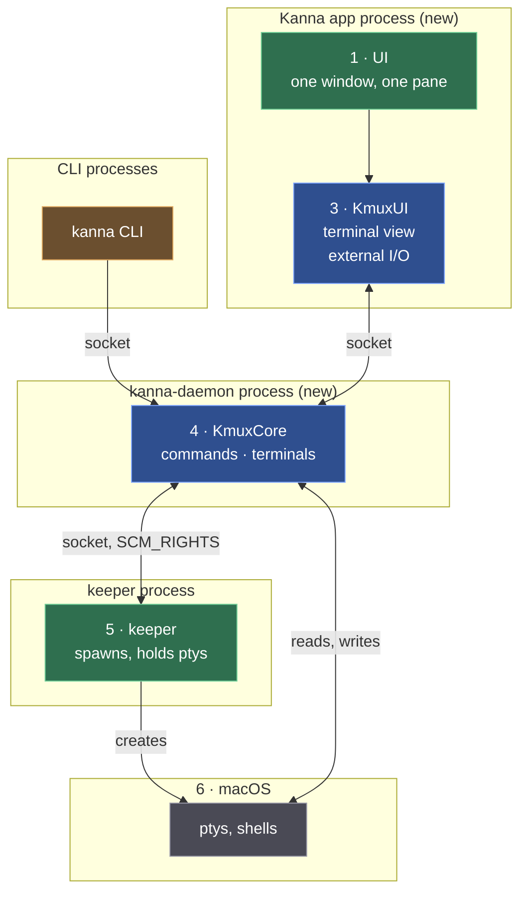

# Building Kanna's mux: plan

> 2026-10-09. Plan for building [the mux architecture](../research/mux-architecture.md). Integration first: every box and every line in the architecture exists and works end to end in milestone 0, mostly as stubs; later milestones make the boxes real, one behaviour at a time, across all of them at once.

## Contents

1. [In short](#1-in-short)
2. [The reference: what "done" looks like](#2-the-reference-what-done-looks-like)
3. [Milestones](#3-milestones)
4. [M0 · Walking skeleton](#4-m0--walking-skeleton)
5. [M1 · The app can quit](#5-m1--the-app-can-quit)
6. [M2 · The daemon can restart](#6-m2--the-daemon-can-restart)
7. [M3 · Web, markdown and iOS panes](#7-m3--web-markdown-and-ios-panes)
8. [Clean-up](#8-clean-up)
9. [Decisions](#9-decisions)
10. [How we work](#10-how-we-work)
11. [Glossary](#11-glossary)

---

## 1. In short

| Milestone | You can… | Repos |
|---|---|---|
| **M0 · Walking skeleton** | open Kanna.app (its own app now, not branded kmux), type into a terminal that the daemon runs on a pty from the keeper, and drive it with the `kanna` CLI | kmux, kanna-v4 |
| **M1 · The app can quit** | quit or crash Kanna.app, reopen it, and find every terminal still running with its screen exactly as it was | kanna-v4 (+ Ghostty fork) |
| **M2 · The daemon can restart** | kill or upgrade the daemon and lose nothing | kanna-v4 |
| **M3 · Web, markdown, iOS** | use every pane kmux has, with `kanna` commands passed to the app | kmux, kanna-v4 |

After M3 Kanna's own layers (Desk and Shelf, tasks, agents) are built on top; they're not in this plan.

---

## 2. The reference: what "done" looks like

The reference is a set of **scenarios**, written first as a script (`scripts/e2e-kanna.sh`) that fails, and kept passing from then on. Each one runs against a private Kanna instance in the background, never your own.

| # | Scenario | Passes in |
|---|---|---|
| S1 | `kanna open term`, type `echo hi`, `kanna read` shows `hi` | M0 |
| S2 | typing in the app's terminal reaches the shell, its output is drawn | M0 |
| S3 | `kanna list` and `kanna read` work with the app closed | M1 |
| S4 | run `top`; quit the app; relaunch: the same `top`, same PID, screen identical (compared as text) | M1 |
| S5 | the layout (splits, which pane where) comes back after a relaunch | M1 |
| S6 | kill the daemon; it comes back; shells have the same PIDs; output written meanwhile isn't lost | M2 |
| S7 | `exit 3` in a terminal; `kanna list` shows exit code 3 | M2 |
| S8 | web, markdown and iOS panes open, are restored after a relaunch, and answer `web.*`, `navigate`, iOS commands | M3 |

kmux's own `scripts/e2e-kmux.sh` must keep passing at every step: vanilla kmux doesn't change behaviour.

---

## 3. Milestones

Each step below is one commit (or a few), with its tests, and leaves everything working.

---

## 4. M0 · Walking skeleton

Every box of the architecture, connected; the daemon and the app start as stubs and get real in the steps below.

| Step | Repo | What | Done when |
|---|---|---|---|
| **0.1** | kanna-v4 | `scripts/e2e-kanna.sh` with scenarios S1–S8, all failing (skipped by milestone) | it runs and reports |
| **0.2** | kmux | **Library products.** Move the pane views (terminal, web, markdown, iOS), `GhosttyRuntime` and the split and tab views out of the `Kmux` app target into a `KmuxUI` library; export `KmuxCore` and `KmuxUI` as products. No behaviour change. | kmux builds, its e2e passes |
| **0.3** | kmux | **The seams.** `TerminalBackend` (from the spike) in KmuxUI, public; `PtyTerminalBackend` stays kmux's. A `KMUX_GHOSTTYKIT` build setting that points the GhosttyKit binary target at another build. | kmux unchanged; a test build uses another GhosttyKit |
| **0.4** | kmux | **Commands split from layout.** In KmuxCore, the commands that touch terminals vs those that touch the layout, behind a `LayoutHost` the app implements. kmux's app answers both, as today. | kmux unchanged; KmuxCore tests cover both kinds |
| **0.5** | kanna-v4 | **Kanna.app as its own app.** `apps/kanna`: a SwiftPM app depending on `../kmux`'s KmuxUI, built against the Ghostty fork. One window, one terminal pane, a stub backend that echoes. `build-kanna.sh` builds it instead of branded kmux. | Kanna.app opens and echoes typing |
| **0.6** | kanna-v4 | **kanna-daemon.** A Swift executable on KmuxCore, on Kanna's socket. Stub: it spawns the pty itself. The app's external-I/O backend attaches to it. The `kanna` CLI already speaks the protocol. | S1, S2 pass |
| **0.7** | kanna-v4 | **The keeper.** Trim `feat/keeper` to what the architecture needs: spawn a shell on a pty, keep a copy, hand the pty over (`SCM_RIGHTS`), report exits. The daemon asks it for ptys. | S1, S2 pass through the keeper |

---

## 5. M1 · The app can quit

| Step | Repo | What | Done when |
|---|---|---|---|
| **1.1** | kanna-v4 | The daemon keeps a libghostty-vt screen per terminal, fed from the pty. `kanna read` answers from it. | S3 passes |
| **1.2** | kanna-v4 | On attach the daemon sends the screen as a snapshot; the app loads it (`load_snapshot` in the Ghostty fork), then live output. | S4 passes |
| **1.3** | kanna-v4 + kmux | The app saves its layout (kmux's state file, in Kanna's folder), panes pointing at terminals by ID; reopens it on launch. | S5 passes |
| **1.4** | kanna-v4 | The CLI starts the app when a layout command needs it, or fails clearly. | `kanna open --split` with the app closed works |

---

## 6. M2 · The daemon can restart

| Step | Repo | What | Done when |
|---|---|---|---|
| **2.1** | kanna-v4 | The daemon writes terminals and screen snapshots to disk as they change. | snapshots on disk match the screens |
| **2.2** | kanna-v4 | On start, the daemon adopts every live pty from the keeper, reloads screens, sends `SIGWINCH`. The app reconnects. | S6 passes |
| **2.3** | kanna-v4 | Exit codes from the keeper (it's the parent), not through `login(1)`, which always reports 0. | S7 passes |

---

## 7. M3 · Web, markdown and iOS panes

| Step | Repo | What | Done when |
|---|---|---|---|
| **3.1** | kanna-v4 | The app hosts KmuxUI's web, markdown and iOS views; their state (URL and history, file, device and app) is layout state. | they open and come back after a relaunch |
| **3.2** | kanna-v4 | The daemon passes non-terminal commands (`web.*`, `navigate`, iOS, pixel snapshots) to the app and returns the answer. | S8 passes |

---

## 8. Clean-up

| What | Where | When |
|---|---|---|
| Remove the terminal-wrapper hook and `KMUX_RESTORED` (commit 1f05ccb) | kmux | with 0.5, once Kanna no longer builds branded kmux |
| Fix kmux's own exit codes (`login(1)` always reports 0) | kmux | any time; separate from Kanna |
| Merge `spike/ghostty-external-io`'s seam into 0.3; retire the branch | kmux | with 0.3 |
| Remove Claude co-author lines from the Ghostty fork's 5 commits, then push `kmux-external-io` | jemdiggity/ghostty | before 0.5 needs it |
| Retire `feat/keeper` once 0.7 has taken what it needs | kanna-v4 | after 0.7 |
| Delete the kanna-mux fork (no longer needed) | GitHub | only when you say so |

---

## 9. Decisions

Recommendations, to confirm before the step that needs them:

| Decision | Recommendation | Why | Needed by |
|---|---|---|---|
| Daemon's language | **Swift** | it's built on KmuxCore, which is Swift; libghostty-vt has a C API Swift calls directly | 0.6 |
| Keeper's language | **Rust**, from `feat/keeper` | already written and tested (spawn, environment, limits); it's a separate process, so the language doesn't leak | 0.7 |
| Where Kanna.app's code lives | **kanna-v4/apps/kanna**, depending on `../kmux` by path | Kanna's layers 1 and 2 are Kanna's; kmux stays a clean library | 0.5 |
| How Kanna gets the forked Ghostty | **`KMUX_GHOSTTYKIT`** pointing at the fork's build | kmux stays on upstream; no kmux fork | 0.3 |

---

## 10. How we work

- **Integration first, then baby steps.** M0 connects everything; each later step makes one behaviour real across every box it touches.
- **One commit per step**, tests included; kmux's e2e and Kanna's scenarios stay green.
- **Never touch your running Kanna or kmux.** Tests run private instances in the background, on their own sockets, stopped by PID.
- **Worktrees** in `<repo>/.worktrees/<name>`.
- **kmux stays vanilla:** nothing Kanna-specific goes into kmux; only general seams (library products, `TerminalBackend`, `LayoutHost`, `KMUX_GHOSTTYKIT`).

---

## 11. Glossary

| Term | Meaning |
|---|---|
| **Scenario** | One behaviour of the finished system, as a script step that passes or fails. Together they're the reference. |
| **Walking skeleton** | The whole system connected end to end with the thinnest possible pieces, built before any piece is finished. |
| **Stub** | A stand-in that behaves just enough to connect (an echoing backend, a daemon that spawns its own pty). |
| **KmuxCore / KmuxUI** | kmux's libraries: the CLI shape (layer 4) and the mux UI (layer 3). |
| **LayoutHost** | The seam in KmuxCore through which layout commands reach whatever owns the layout: kmux's app, or Kanna's. |
| **TerminalBackend** | The seam in KmuxUI between a terminal view and where its bytes come from: its own pty (kmux) or Kanna's daemon. |
| **`KMUX_GHOSTTYKIT`** | A build setting that points kmux's libraries at another GhosttyKit build (Kanna: the external-I/O fork). |
| **External I/O** | The Ghostty fork's mode where a surface has no pty: output is pushed in, keystrokes come out through a callback. |
| **libghostty-vt** | Ghostty's terminal engine as a library, with no drawing: the daemon's copy of each screen. |
| **Snapshot** | A terminal's whole screen state, sent to the app on attach and saved to disk for daemon restarts. |
| **SCM_RIGHTS** | Passing open file descriptors (pty masters) between processes over a Unix socket. |
