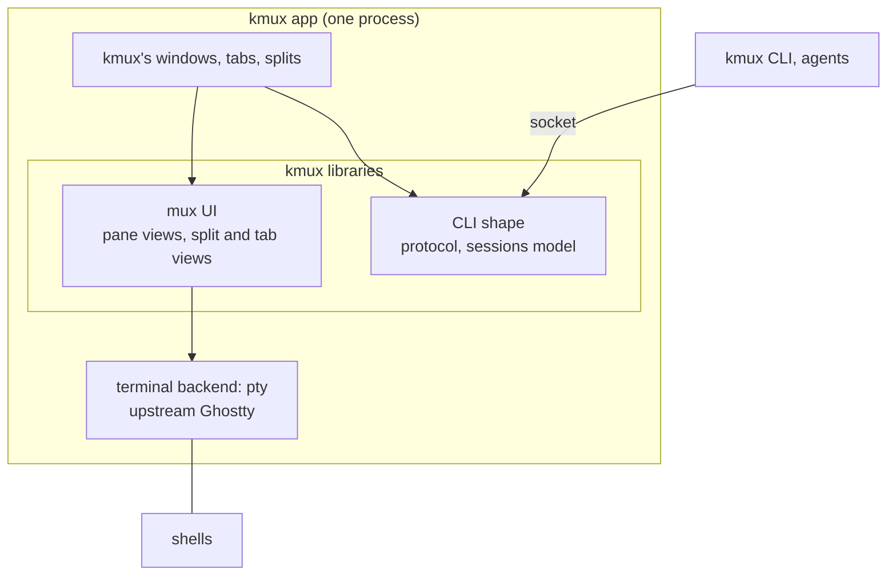
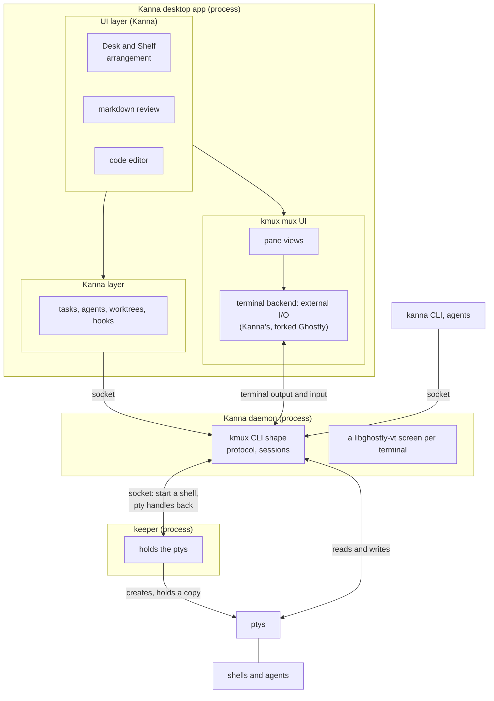
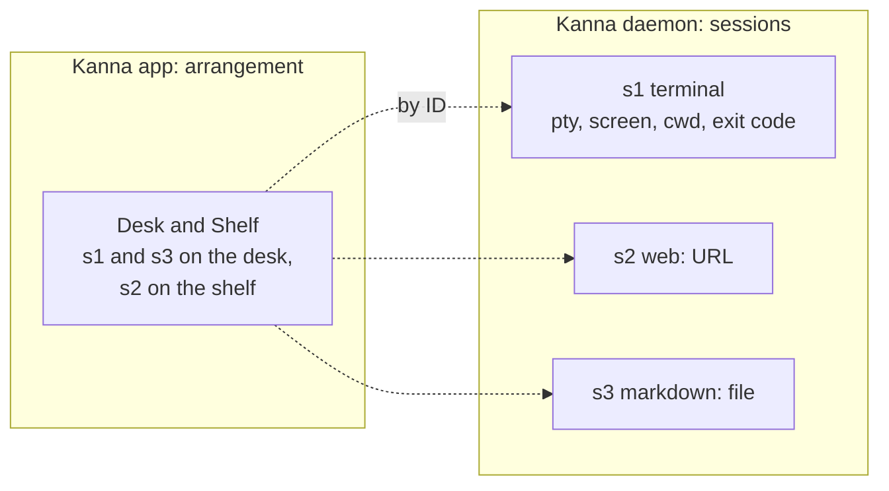
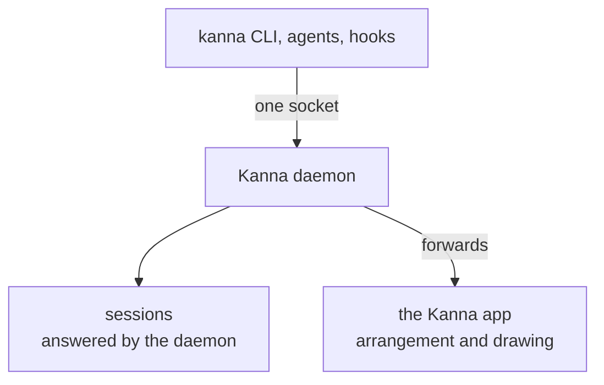
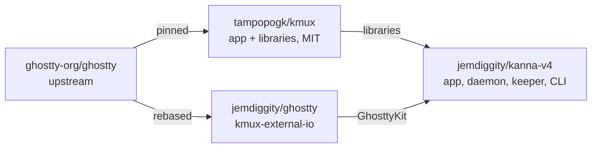
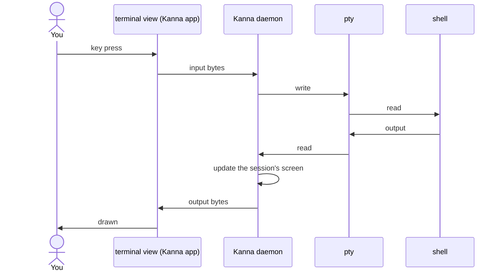
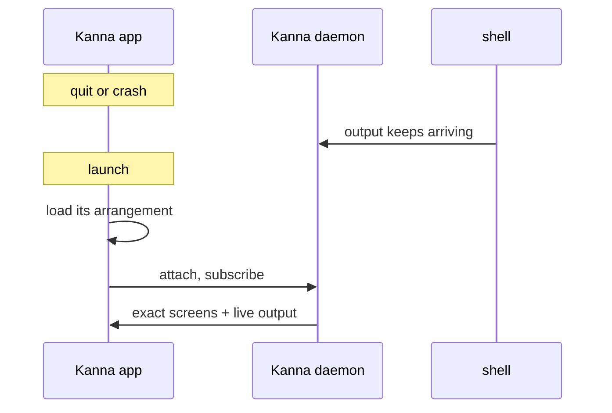
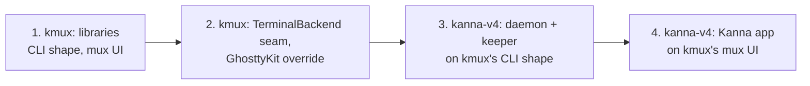

# Kanna's mux: architecture

> 2026-10-09. Proposed. kmux stays an app and also ships libraries. Kanna builds its daemon, keeper and desktop app from two of kmux's layers, the **CLI shape** and the **mux UI**, and its terminals live in its daemon so they survive the app quitting, the way kanna-v3 did.

## Contents

1. [In short](#1-in-short)
2. [kmux: an app and its libraries](#2-kmux-an-app-and-its-libraries)
3. [Kanna: what it builds from kmux](#3-kanna-what-it-builds-from-kmux)
4. [Sessions and arrangement](#4-sessions-and-arrangement)
5. [How the kanna CLI fits](#5-how-the-kanna-cli-fits)
6. [The repos](#6-the-repos)
7. [Typing and output](#7-typing-and-output)
8. [Restarting the app](#8-restarting-the-app)
9. [Restarting the daemon](#9-restarting-the-daemon)
10. [Compared with kanna-v3](#10-compared-with-kanna-v3)
11. [Build order](#11-build-order)
12. [Glossary](#12-glossary)

---

## 1. In short

| | kmux | Kanna |
|---|---|---|
| What it is | an app, plus libraries | a desktop app, a daemon, a keeper and a CLI |
| Processes | one: the app | three: the app, the daemon, the keeper |
| Terminals live in | the app (Ghostty's own ptys) | the daemon (ptys held by the keeper) |
| After a restart | the layout comes back, terminals are new | everything comes back exactly |
| Ghostty | upstream | the fork (external I/O) |

**Kanna uses two layers of kmux:**
1. **The CLI shape:** the protocol and the sessions model (`open`, `list`, `send`, `navigate`, `close`, …). Kanna's daemon runs it, so `kanna` and `kmux` look alike.
2. **The mux UI:** the pane views (terminal, web, markdown, iOS) and, if wanted, the split and tab views. The Kanna app draws with them.

---

## 2. kmux: an app and its libraries

| Library | Layer | What's in it |
|---|---|---|
| **KmuxCore** | CLI shape | the protocol, the sessions model and command handling; no UI |
| **KmuxUI** | mux UI | the pane views, the split and tab views, and the `TerminalBackend` seam |
| **KmuxClient** | CLI shape | the Rust client the CLIs use (it exists today as `kmux-client`) |

kmux itself doesn't change shape: one app, terminals with their own ptys, the same CLI. The work is drawing clean lines between these libraries and the app around them, so another app can take them. kmux has **no daemon**.

---

## 3. Kanna: what it builds from kmux

| Kanna piece | Built from |
|---|---|
| **Kanna daemon** | kmux's CLI shape (KmuxCore) + a libghostty-vt screen per terminal + snapshots on disk |
| **Keeper** | the `feat/keeper` branch and v3's keeper |
| **Kanna app** | Kanna's UI and Kanna layer + kmux's mux UI (KmuxUI) + Kanna's external-I/O terminal backend |
| **`kanna` CLI** | kmux's client (kmux-client), pointed at Kanna's daemon |

The keeper creates each pty and keeps a copy, so shells outlive a daemon restart; the daemon reads and writes them directly.

---

## 4. Sessions and arrangement

| | What it is | Owned and saved by |
|---|---|---|
| **Session** | a terminal (pty, screen, scrollback, cwd, exit code), or a pane's content (a web URL, a markdown file, an iOS app) | Kanna's daemon |
| **Arrangement** | where sessions appear | the Kanna app (Desk and Shelf) |

In the kmux app both live in the one process, as today: the sessions model and its windows, tabs and splits.

---

## 5. How the kanna CLI fits

| Command | Touches | Answered by | With the app closed |
|---|---|---|---|
| `list`, `send`, `read`, `wait`, `close`, `restart` | sessions | daemon | works |
| `navigate`, `snapshot --text` | session content | daemon | works |
| `open term --cmd …` | creates a session | daemon | works: created, shown when the app opens |
| `open … --split right`, `arrange`, `focus` | arrangement | forwarded to the app | fails clearly, or the CLI starts the app first |
| pixel snapshots, web page text | the drawn view | forwarded to the app | fails clearly |
| later: `kanna task …`, "put this on the desk" | the Kanna layer | the app | needs the app |

The `kmux` CLI is unchanged: it talks to the kmux app, which answers everything itself.

---

## 6. The repos

| Repo | What it holds |
|---|---|
| kmux | the kmux app and its libraries; upstream Ghostty |
| jemdiggity/ghostty | Ghostty with external I/O (9 files, +598/−38) |
| kanna-v4 | the Kanna app, daemon, keeper and CLI; builds kmux's libraries against the forked GhosttyKit |

kmux only needs to let a build supply its own GhosttyKit. With that, **the kanna-mux fork isn't needed** and can be deleted.

---

## 7. Typing and output

The keeper isn't in the path of any byte.

---

## 8. Restarting the app

---

## 9. Restarting the daemon

---

## 10. Compared with kanna-v3

| | kanna-v3 | Now |
|---|---|---|
| Processes | keeper + kanna3d + app | keeper + daemon + app: **the same** |
| What the daemon owns | terminals and layout | **sessions**; the app owns its arrangement |
| Daemon's protocol | its own | **kmux's CLI shape** |
| App's panes | terminals only, its own views | **kmux's mux UI**: terminals, web, markdown, iOS |
| Screen state | libghostty-vt from the fork | libghostty-vt from **upstream** |
| App terminals | fork, external I/O | the same fork, rebased |

---

## 11. Build order

1. **kmux:** split the code into the libraries (KmuxCore for the CLI shape, KmuxUI for the mux UI) and the app around them, with sessions separate from kmux's arrangement. Reference model and shared cases first.
2. **kmux:** the `TerminalBackend` seam, and a way for a build to supply its own GhosttyKit.
3. **kanna-v4:** the daemon (KmuxCore + libghostty-vt + snapshots) and the keeper. Persistent terminals arrive here.
4. **kanna-v4:** the Kanna app on KmuxUI, with the external-I/O terminal backend; Desk and Shelf owns its arrangement.

Clean-up: kmux's terminal-wrapper hook and `KMUX_RESTORED` are removed; the kanna-mux fork is deleted.

---

## 12. Glossary

| Term | Meaning |
|---|---|
| **CLI shape** | kmux's protocol and sessions model: the commands and what they mean. Kanna's daemon runs it, so the `kanna` CLI matches `kmux`. |
| **Mux UI** | kmux's views: the pane views (terminal, web, markdown, iOS) and the split and tab views. |
| **Session** | One thing a pane shows: a terminal (pty, screen, cwd, exit code), or a web URL, a markdown file, an iOS app. |
| **Arrangement** | Where sessions appear. kmux: windows, tabs, splits. Kanna: Desk and Shelf. |
| **Kanna daemon** | Kanna's background process that owns the sessions. It outlives the Kanna app. kmux has none. |
| **Keeper** | A tiny background process that only creates and holds the ptys, so shells outlive the daemon too. |
| **TerminalBackend** | The seam in the mux UI between a terminal view and where its bytes come from: its own pty (kmux) or Kanna's daemon. |
| **External I/O** | A Ghostty surface mode from the fork: no pty; output is pushed in, keystrokes come out through a callback. |
| **libghostty-vt** | Ghostty's terminal engine as a library, without drawing: keeps a screen, formats it, makes snapshots. |
| **pty** | Pseudo-terminal: what a shell talks to as if it were a real terminal. |
| **SCM_RIGHTS** | Sending open file descriptors, such as pty masters, to another process over a Unix socket. |
| **Snapshot** | A terminal's whole screen state, used to restore it exactly. |
