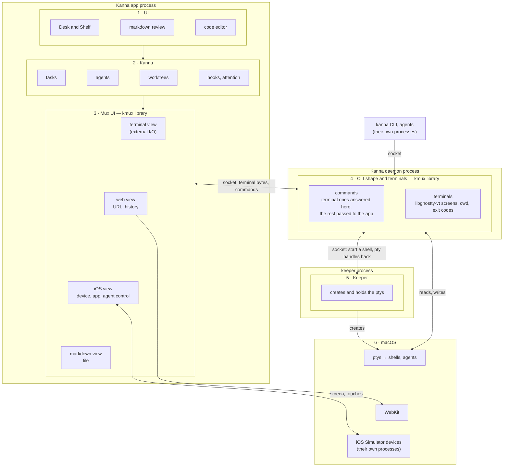
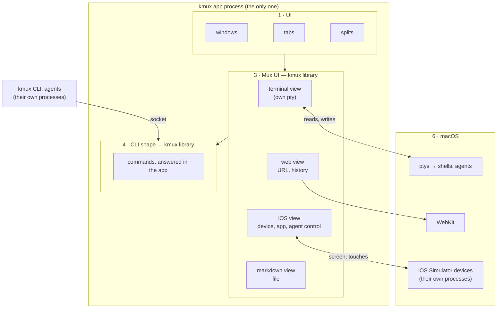
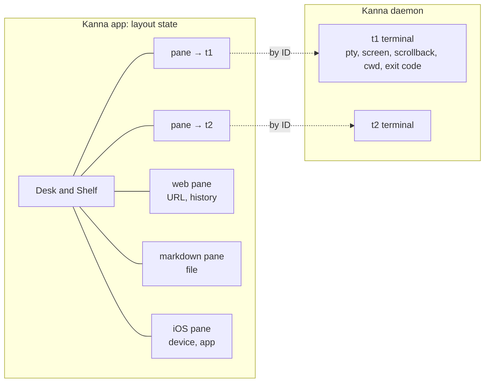
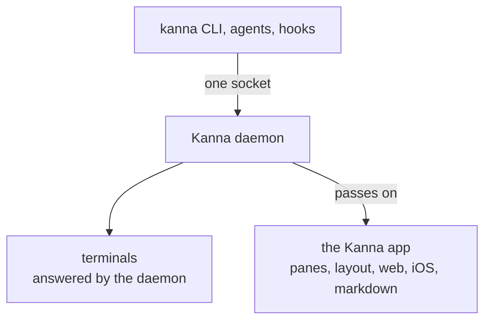
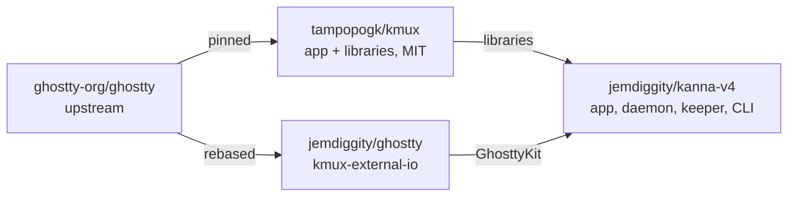
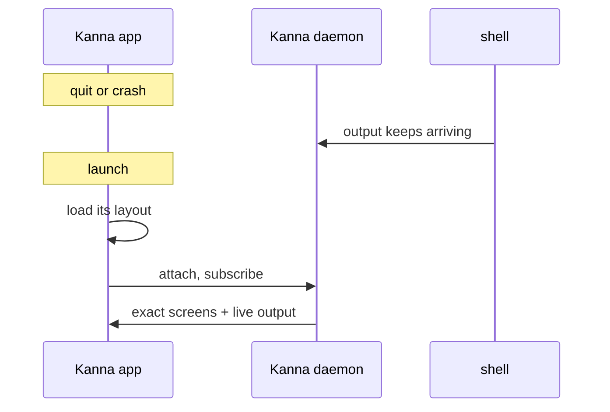
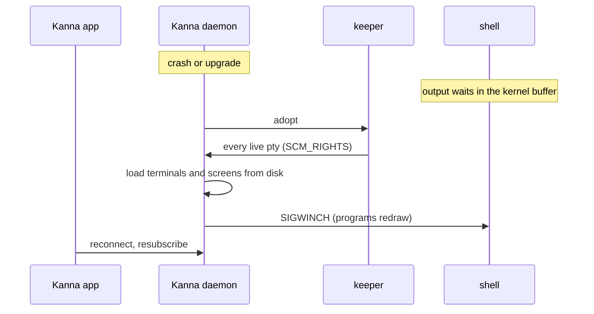
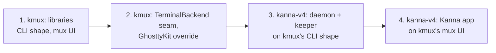

# Kanna's mux: architecture

> 2026-10-09. Proposed. kmux stays an app and also ships libraries. Kanna builds its daemon, keeper and desktop app from two of kmux's layers, the **CLI shape** and the **mux UI**, and its terminals live in its daemon so they survive the app quitting, the way kanna-v3 did.

## Contents

1. [In short](#1-in-short)
2. [Layers and processes](#2-layers-and-processes)
3. [What the daemon keeps and what the app keeps](#3-what-the-daemon-keeps-and-what-the-app-keeps)
4. [How the kanna CLI fits](#4-how-the-kanna-cli-fits)
5. [The repos](#5-the-repos)
6. [Typing and output](#6-typing-and-output)
7. [Restarting the app](#7-restarting-the-app)
8. [Restarting the daemon](#8-restarting-the-daemon)
9. [Compared with kanna-v3](#9-compared-with-kanna-v3)
10. [Build order](#10-build-order)
11. [Glossary](#11-glossary)

---

## 1. In short

| | kmux | Kanna |
|---|---|---|
| What it is | an app, plus libraries | a desktop app, a daemon, a keeper and a CLI |
| Processes | one: the app | three: the app, the daemon, the keeper |
| Terminals live in | the app (Ghostty's own ptys) | the daemon (ptys held by the keeper) |
| After a restart | the layout comes back, terminals are new | the layout comes back, terminals are exactly as they were |
| Ghostty | upstream | the fork (external I/O) |

**Kanna uses two layers of kmux** (see [layers and processes](#2-layers-and-processes)):
- **Layer 3, the mux UI:** the pane views (terminal, web, markdown, iOS). The Kanna app draws with them.
- **Layer 4, the CLI shape:** the protocol (`open`, `list`, `send`, `read`, `close`, …) and terminal sessions. Kanna's daemon runs it, so `kanna` and `kmux` look alike.

**Only terminals live in the daemon.** Everything else a pane shows (a web page's URL and history, a markdown file, an iOS device and app) is layout state, kept and saved by the app with the rest of the layout.

---

## 2. Layers and processes

Read each stack top to bottom, like the OSI model: each layer uses the ones below it. The outer boxes are processes. Kanna takes layers 3 and 4 from kmux and adds 1, 2 and 5 of its own.

kmux has the same layers without 2 and 5, in one process:

| Layer | Kanna | kmux | Kanna process |
|---|---|---|---|
| 1 · UI | Desk and Shelf, markdown review, code editor | windows, tabs, splits | app |
| 2 · Kanna | tasks, agents, worktrees, hooks | — | app |
| 3 · Mux UI | **kmux library** (KmuxUI): pane views and their layout state | the same | app |
| 4 · CLI shape and terminals | **kmux library** (KmuxCore) + libghostty-vt screens | KmuxCore; terminals are the views' own | daemon |
| 5 · Keeper | creates and holds the ptys | — | keeper |
| 6 · macOS | ptys, WebKit, simulator devices | the same | — |

| Kanna piece | Layers | Built from |
|---|---|---|
| **Kanna app** | 1, 2, 3 | Kanna's UI and Kanna layer + KmuxUI + Kanna's external-I/O terminal backend (forked Ghostty) |
| **Kanna daemon** | 4 | KmuxCore + a libghostty-vt screen per terminal + snapshots on disk |
| **Keeper** | 5 | the `feat/keeper` branch and v3's keeper |
| **`kanna` CLI** | — | KmuxClient (today's `kmux-client`), pointed at Kanna's daemon |

- **Why terminals cross into the daemon and nothing else does:** a terminal is a running program, which must not die with the app. A web page, a markdown file or an iOS pane is just state to reopen: a URL, a path, a device. The page itself has to be in the app anyway (WebKit can't draw from another process), and simulator devices already outlive everything.
- **The keeper isn't in the path of any byte:** it creates each pty and keeps a copy, so shells outlive a daemon restart; the daemon reads and writes them itself.

---

## 3. What the daemon keeps and what the app keeps

| | What it is | Kept and saved by | After the app restarts |
|---|---|---|---|
| **Terminal** | a pty, its screen and scrollback, cwd, exit code | the daemon | exactly as it was, still running |
| **Layout state** | where panes are, and what each non-terminal pane shows: a web URL and history, a markdown file, an iOS device and app | the app | reopened: the page reloads at its URL (cookies and logins stay on disk), the file reopens, the simulator was never stopped |

In kmux both are in the one app, as today.

---

## 4. How the kanna CLI fits

| Command | Touches | Answered by | With the app closed |
|---|---|---|---|
| `list` (terminals), `send`, `read`, `wait`, `close`, `restart` on a terminal | terminals | daemon | works |
| `open term --cmd …` | creates a terminal | daemon | works: shown when the app opens |
| `open … --split right`, `arrange`, `focus`, opening web, markdown or iOS panes | layout | passed to the app | fails clearly, or the CLI starts the app first |
| `navigate`, all `web.*` commands, page text | web panes | passed to the app | the same |
| iOS `tap`, `swipe`, `type`, accessibility tree, screenshots | iOS panes | passed to the app | the same |
| pixel snapshots of any pane | the drawn view | passed to the app | the same |
| later: `kanna task …`, "put this on the desk" | the Kanna layer | the app | needs the app |

The `kmux` CLI is unchanged: it talks to the kmux app, which answers everything itself.

---

## 5. The repos

| Repo | What it holds |
|---|---|
| kmux | the kmux app and its libraries; upstream Ghostty |
| jemdiggity/ghostty | Ghostty with external I/O (9 files, +598/−38) |
| kanna-v4 | the Kanna app, daemon, keeper and CLI; builds kmux's libraries against the forked GhosttyKit |

kmux only needs to let a build supply its own GhosttyKit. With that, **the kanna-mux fork isn't needed** and can be deleted.

---

## 6. Typing and output

The keeper isn't in the path of any byte.

---

## 7. Restarting the app

---

## 8. Restarting the daemon

---

## 9. Compared with kanna-v3

| | kanna-v3 | Now |
|---|---|---|
| Processes | keeper + kanna3d + app | keeper + daemon + app: **the same** |
| What the daemon owns | terminals and layout | **terminals only**; the app owns the layout |
| Daemon's protocol | its own | **kmux's CLI shape** |
| App's panes | terminals only, its own views | **kmux's mux UI**: terminals, web, markdown, iOS |
| Screen state | libghostty-vt from the fork | libghostty-vt from **upstream** |
| App terminals | fork, external I/O | the same fork, rebased |

---

## 10. Build order

1. **kmux:** split the code into the libraries (KmuxCore for the CLI shape, KmuxUI for the mux UI) and the app around them, with terminals separate from kmux's layout. Reference model and shared cases first.
2. **kmux:** the `TerminalBackend` seam, and a way for a build to supply its own GhosttyKit.
3. **kanna-v4:** the daemon (KmuxCore + libghostty-vt + snapshots) and the keeper. Persistent terminals arrive here.
4. **kanna-v4:** the Kanna app on KmuxUI, with the external-I/O terminal backend; Desk and Shelf owns the layout.

Clean-up: kmux's terminal-wrapper hook and `KMUX_RESTORED` are removed; the kanna-mux fork is deleted.

---

## 11. Glossary

| Term | Meaning |
|---|---|
| **CLI shape** | kmux's protocol: the commands and what they mean (layer 4). Kanna's daemon runs it, so the `kanna` CLI matches `kmux`. |
| **Mux UI** | kmux's pane views (terminal, web, markdown, iOS) and their layout state (layer 3). |
| **Layout state** | Where panes are and what each non-terminal pane shows (a web URL and history, a markdown file, an iOS device and app). Kept by the app. |
| **SimulatorKit / CoreSimulator** | Xcode's private frameworks for drawing a simulator device's screen and sending it touches; kmux uses them today. |
| **Layers** | The stack in [section 2](#2-layers-and-processes), read top to bottom like the OSI model. |
| **Kanna daemon** | Kanna's background process that owns the terminals. It outlives the Kanna app. kmux has none. |
| **Keeper** | A tiny background process that only creates and holds the ptys, so shells outlive the daemon too. |
| **TerminalBackend** | The seam in the mux UI between a terminal view and where its bytes come from: its own pty (kmux) or Kanna's daemon. |
| **External I/O** | A Ghostty surface mode from the fork: no pty; output is pushed in, keystrokes come out through a callback. |
| **libghostty-vt** | Ghostty's terminal engine as a library, without drawing: keeps a screen, formats it, makes snapshots. |
| **pty** | Pseudo-terminal: what a shell talks to as if it were a real terminal. |
| **SCM_RIGHTS** | Sending open file descriptors, such as pty masters, to another process over a Unix socket. |
| **Snapshot** | A terminal's whole screen state, used to restore it exactly. |
