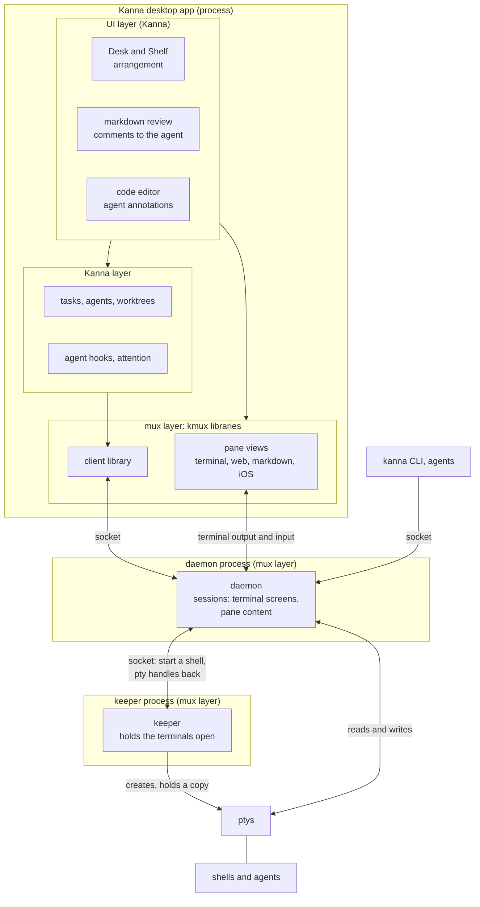
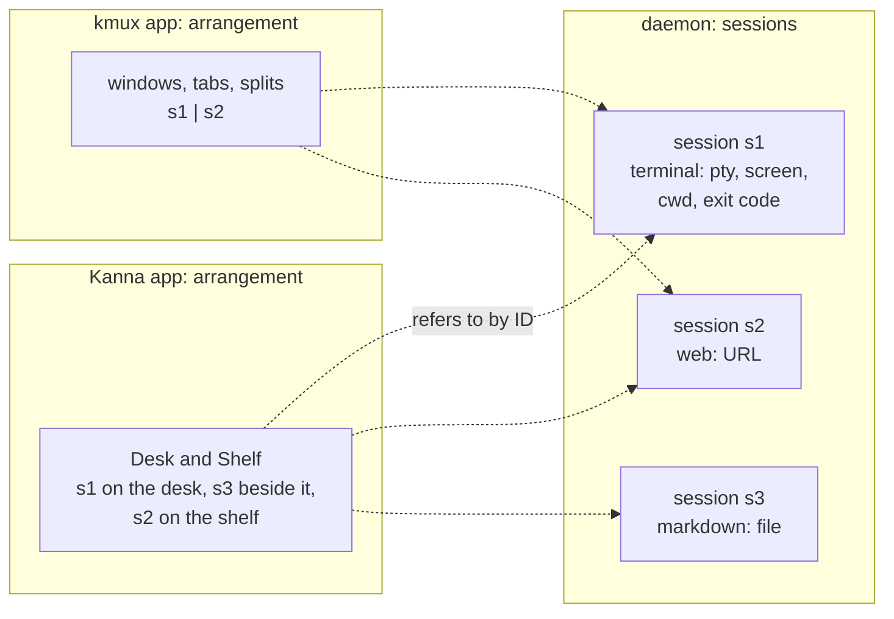
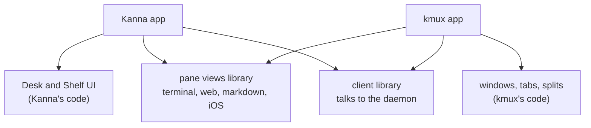
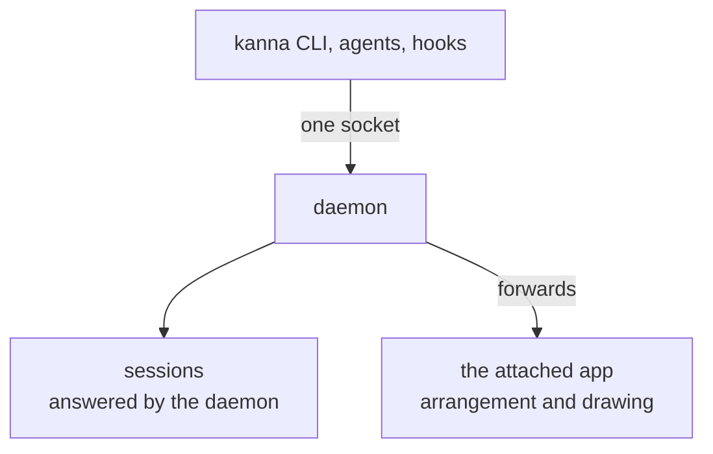
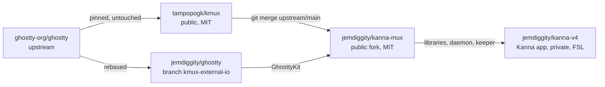
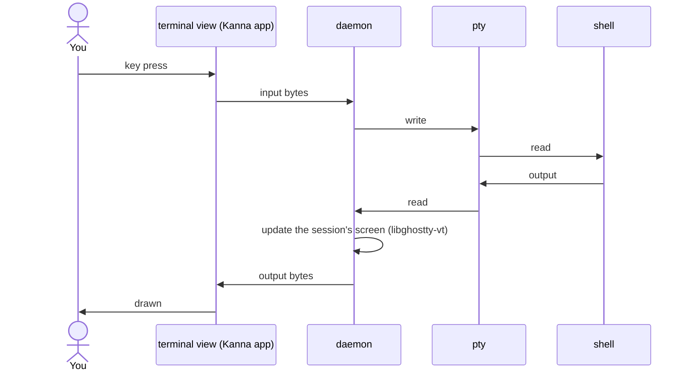
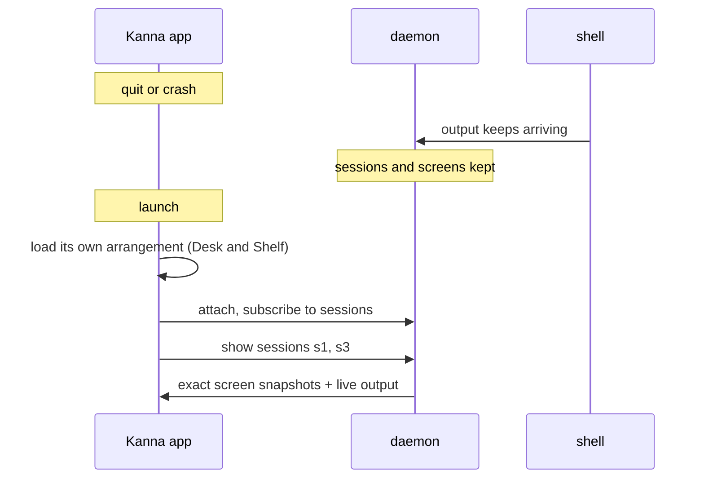
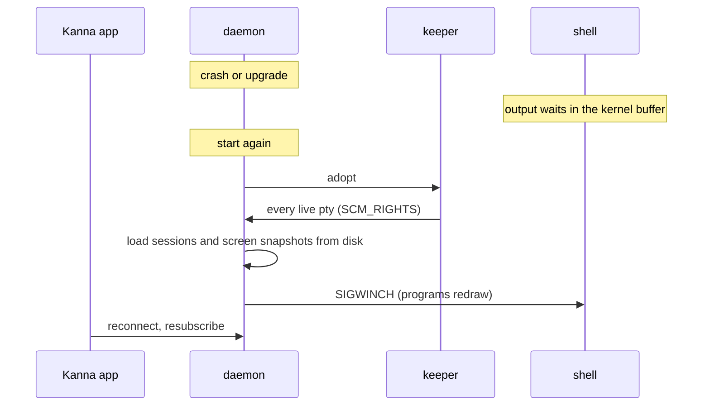
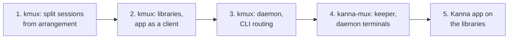

# Kanna's mux: architecture

> 2026-10-09. Proposed. kmux becomes a set of libraries plus a daemon; the Kanna desktop app is built on them; terminals live in the daemon and survive the app quitting, the way kanna-v3 did.

## Contents

1. [In short](#1-in-short)
2. [The Kanna desktop app's layers](#2-the-kanna-desktop-apps-layers)
3. [Sessions and arrangement](#3-sessions-and-arrangement)
4. [kmux as libraries](#4-kmux-as-libraries)
5. [How the CLI fits](#5-how-the-cli-fits)
6. [The repos](#6-the-repos)
7. [Typing and output](#7-typing-and-output)
8. [Restarting the app](#8-restarting-the-app)
9. [Restarting the daemon](#9-restarting-the-daemon)
10. [Compared with kanna-v3](#10-compared-with-kanna-v3)
11. [Build order](#11-build-order)
12. [Glossary](#12-glossary)

---

## 1. In short

| Piece | Kind | Owns |
|---|---|---|
| **Kanna desktop app** | a process | the UI (Desk and Shelf) and the Kanna layer (tasks, agents) |
| **kmux libraries** | code inside each app | pane views (terminal, web, markdown, iOS) and the client |
| **daemon** | a process | **sessions**: every terminal's screen and each pane's content |
| **keeper** | a process | the ptys, so shells outlive the daemon |
| **`kanna` CLI, agents** | clients | nothing; they talk to the daemon |

- The **mux layer** is the kmux libraries plus the daemon and keeper. Kanna sits on top of it.
- The daemon owns **sessions**, not layout. **Arrangement** (where things appear) belongs to each app's UI.
- The CLI has **one socket**: the daemon. It answers session commands itself and forwards arrangement to the attached app.

---

## 2. The Kanna desktop app's layers

- **UI layer:** what you see, and where everything is placed.
- **Kanna layer:** what Kanna knows about work. It never draws a terminal itself.
- **Mux layer:** kmux's libraries inside the app, plus the daemon and keeper outside it.
- **The ptys:** the keeper creates them and keeps a copy of each. The daemon reads and writes them directly; no byte goes through the keeper.

---

## 3. Sessions and arrangement

| | What it is | Owned by | Saved by |
|---|---|---|---|
| **Session** | a terminal (pty, screen, scrollback, cwd, exit code), or a pane's content (a web URL, a markdown file, an iOS app) | the daemon | the daemon |
| **Arrangement** | where sessions appear | each app's UI | each app |

- A pane and its terminal are one record: the session. A UI only refers to it by ID, so nothing can disagree.
- Kanna's arrangement never has to fit kmux's windows, tabs and splits, and kmux doesn't know Desk and Shelf exists.
- Two apps, say a Mac and an iPad, can show the same sessions in different arrangements.

---

## 4. kmux as libraries

### What each app is built from

| Library | What's in it | Used by |
|---|---|---|
| **KmuxSessions** | the sessions model and its protocol (no UI) | the daemon; vanilla kmux in-process |
| **KmuxClient** | requests and subscriptions | every app |
| **KmuxPanes** | the pane views, and the `TerminalBackend` seam | every app |
| **KmuxDaemon** | the headless server around KmuxSessions | Kanna; kmux's daemon mode |
| **KmuxApp** | kmux's own UI: windows, tabs, splits (its arrangement) | only the kmux app |

### Vanilla kmux

Vanilla kmux keeps working as it does today: everything can run in one process, terminals use upstream Ghostty with their own ptys, and a restart brings back the layout with **new** terminals. It can also run its sessions in a daemon, which lets agents work with no window and other clients attach; only Kanna's build keeps terminals alive across a restart (section 6).

---

## 5. How the CLI fits

| Command | Touches | Answered by | With no app open |
|---|---|---|---|
| `list`, `send`, `read`, `wait`, `close`, `restart` | sessions | daemon | works |
| `navigate`, `snapshot --text` | session content | daemon | works |
| `open term --cmd …` | creates a session | daemon | works: created, not shown anywhere yet |
| `open … --split right --size 1/3`, `arrange`, `focus`, `resize` | arrangement | forwarded to the app | fails clearly, or the CLI starts the app first |
| pixel snapshots, web page text | the drawn view | forwarded to the app | fails clearly |
| later: `kanna task …`, "put this on the desk" | the Kanna layer | the Kanna app | needs Kanna running |

`kanna open web localhost:3000 --split right` is two steps behind one command: the daemon creates the session, then asks the attached app to place it. Apps register with the daemon when they attach ("I show sessions; I can place and draw"). With several apps attached, a placement goes to the focused one, or the one named with `--app`.

---

## 6. The repos

| Repo | Adds | Ghostty |
|---|---|---|
| kmux | the libraries, the daemon, the kmux app | upstream, untouched |
| kanna-mux | the keeper; terminals drawn from the daemon (external I/O); a libghostty-vt terminal per session | the fork |
| kanna-v4 | the Kanna app (UI layer, Kanna layer) and the `kanna` CLI | none of its own |

Almost all mux work lands in kmux; kanna-mux merges it and keeps its own diff small. Once kmux has its seams, kanna-mux's pieces may move into kanna-v4 as plug-ins and the fork could go away.

---

## 7. Typing and output

The keeper isn't in the path of any byte.

---

## 8. Restarting the app

Nothing is replayed: the daemon already has the exact screens.

---

## 9. Restarting the daemon

This is why the keeper is separate: the daemon is big and changes often; the keeper is small and almost never does.

---

## 10. Compared with kanna-v3

| | kanna-v3 | Now |
|---|---|---|
| Processes | keeper + kanna3d + app | keeper + daemon + app: **the same** |
| What the daemon owns | terminals **and** layout (model.json) | **sessions only**; each UI owns its arrangement |
| Screen state | libghostty-vt from the fork | libghostty-vt from **upstream** |
| App terminals | fork, external I/O | the same fork, rebased onto current Ghostty |
| Agent detection | in kanna3d | in the Kanna layer, above the mux |
| Pane types | terminals | terminals, web, markdown, iOS |
| Shared with a public mux | no | kmux uses the same libraries and daemon |

---

## 11. Build order

1. **kmux:** split KmuxCore into the sessions model and kmux's arrangement (windows, tabs, splits). Reference model and shared cases first.
2. **kmux:** package the libraries (KmuxSessions, KmuxClient, KmuxPanes, KmuxApp); the app becomes a client over subscriptions; the `TerminalBackend` seam.
3. **kmux:** KmuxDaemon; the CLI's one socket, with arrangement forwarded to the attached app.
4. **kanna-mux:** the keeper, terminals drawn from the daemon through external I/O, libghostty-vt sessions, snapshots on disk. Persistent terminals arrive here.
5. **kanna-v4:** the Kanna app on the libraries; Desk and Shelf owns its arrangement.

Clean-up along the way: kmux's terminal-wrapper hook and `KMUX_RESTORED` are removed.

---

## 12. Glossary

| Term | Meaning |
|---|---|
| **Mux layer** | kmux's libraries plus the daemon and keeper: everything that provides sessions and draws panes. Kanna sits on top of it. |
| **Session** | One thing the mux provides: a terminal (pty, screen, cwd, exit code) or a pane's content (a web URL, a markdown file, an iOS app). Owned by the daemon. |
| **Arrangement** | Where sessions appear. kmux: windows, tabs, splits. Kanna: Desk and Shelf. Owned by each app's UI. |
| **Daemon** | The background process that owns the sessions. It outlives the app. |
| **Keeper** | A tiny background process that only creates and holds the ptys, so shells outlive the daemon too. |
| **Client** | Anything that talks to the daemon: an app, the CLI, an agent. |
| **Subscription** | A client asks the daemon to send every change to the sessions, so it can follow along without polling. |
| **TerminalBackend** | The seam in the pane views between a terminal pane and where its bytes come from: its own pty (kmux) or the daemon (kanna-mux). |
| **External I/O** | A Ghostty surface mode from the fork: no pty; output is pushed in, keystrokes come out through a callback. |
| **libghostty-vt** | Ghostty's terminal engine as a library, without drawing: keeps a screen, formats it, makes snapshots. |
| **pty** | Pseudo-terminal: what a shell talks to as if it were a real terminal. |
| **SCM_RIGHTS** | Sending open file descriptors, such as pty masters, to another process over a Unix socket. |
| **Snapshot** | A terminal's whole screen state, used to restore it exactly. |
