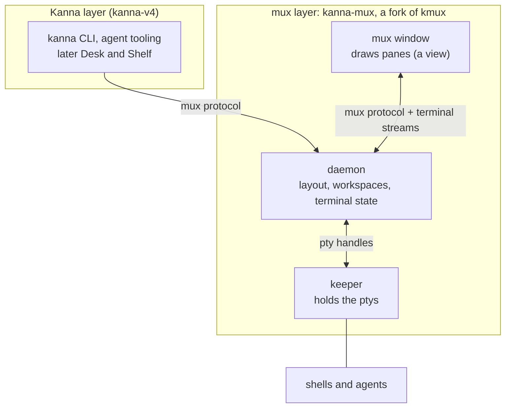
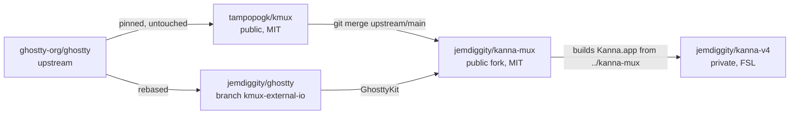
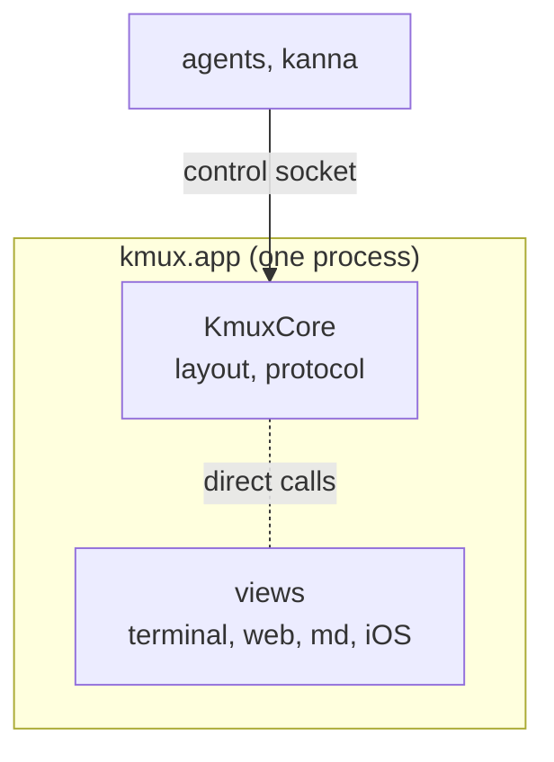
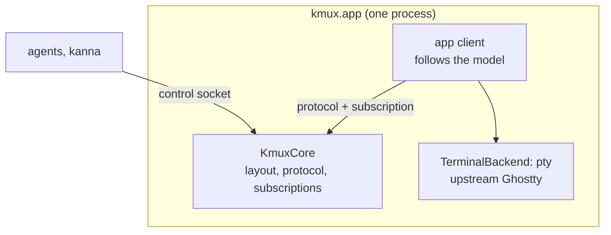
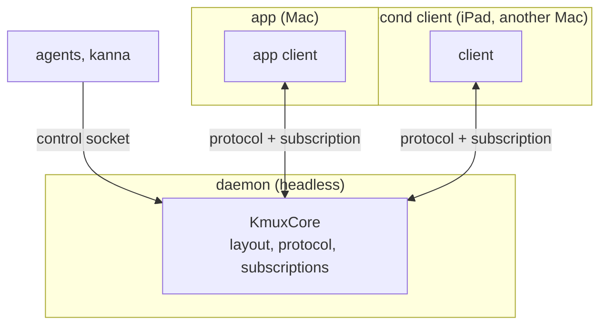
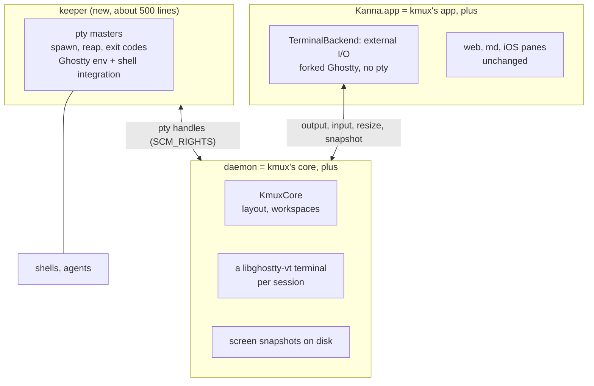
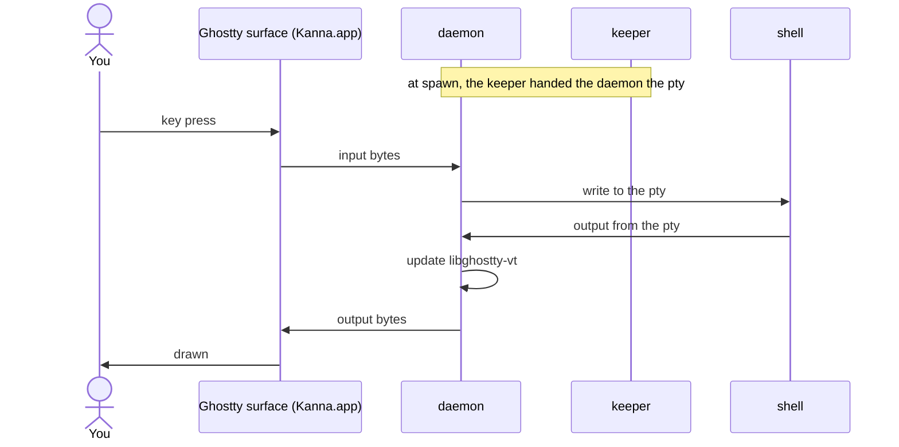
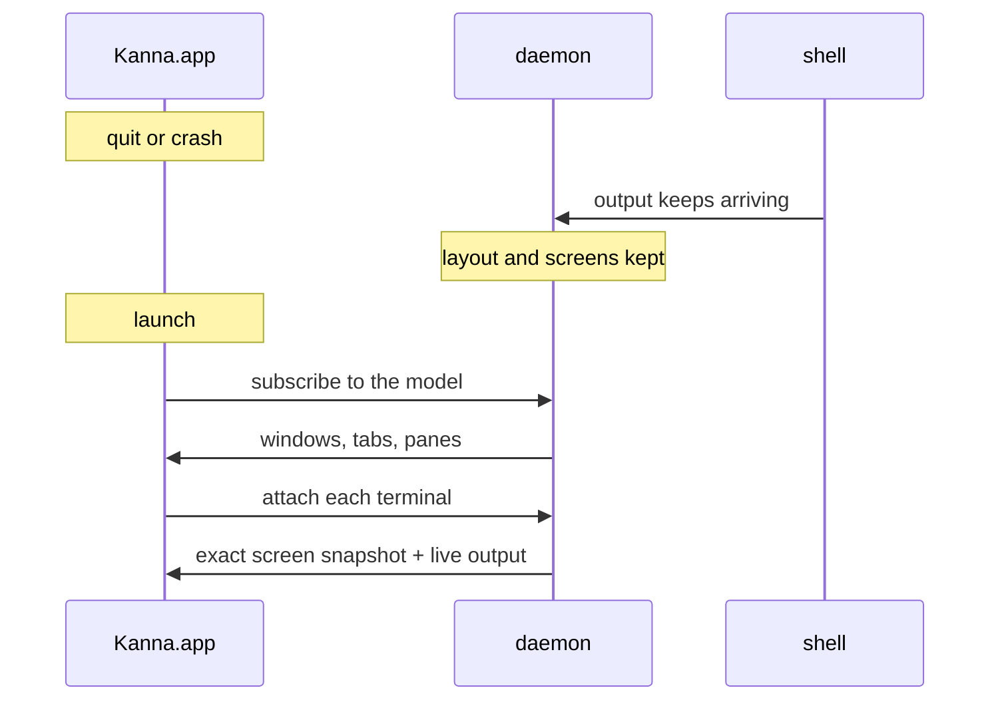
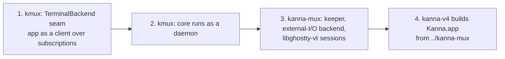

# Kanna's mux: architecture

> 2026-10-09. Proposed. How kmux is restructured so its mux layer lends itself to Kanna, and how Kanna's fork of it (kanna-mux) keeps terminals alive across restarts, the way kanna-v3 did.

## Contents

1. [The plan in one picture](#1-the-plan-in-one-picture)
2. [The repos](#2-the-repos)
3. [kmux, restructured](#3-kmux-restructured)
4. [kanna-mux: what the fork adds](#4-kanna-mux-what-the-fork-adds)
5. [Typing and output](#5-typing-and-output)
6. [Restarting the app](#6-restarting-the-app)
7. [Restarting the daemon](#7-restarting-the-daemon)
8. [Compared with kanna-v3](#8-compared-with-kanna-v3)
9. [Build order](#9-build-order)
10. [Glossary](#10-glossary)

---

## 1. The plan in one picture

- **The Kanna layer** (the `kanna` CLI and agent tooling now, Desk and Shelf later) sits on top and only speaks the mux protocol. The mux is a layer of its own.
- **The daemon** owns everything: the layout, the workspaces, and each terminal's screen.
- **The keeper** only holds the ptys, so shells survive both a window restart and a daemon restart.
- **The mux window** is only a view. Today it ships as the app bundle named Kanna.app; in the rest of this doc "the app" means this window, not the Kanna layer.

---

## 2. The repos

| Repo | What it is | Ghostty |
|---|---|---|
| kmux | The mux, client/server, terminals in the app | upstream, untouched |
| kanna-mux | kmux + keeper + terminals in the daemon | the fork, with external I/O |
| kanna-v4 | Kanna: the `kanna` CLI, and later Desk and Shelf | none of its own |

Almost all work lands in kmux, and kanna-mux merges it. The fork's own diff stays small (section 4).

---

## 3. kmux, restructured

Today the app *is* the mux: the core, the views and the terminals all live in one process. After the restructure, **the app is a client of the core**, even when they share a process, and the core can also run on its own.

### Today

### Restructured: the core in the app (vanilla kmux's default)

### Restructured: the core as a daemon (kmux's option, kanna-mux's default)

What changes in kmux:

| Change | Why |
|---|---|
| The app follows the model through the protocol and a **subscription**, not direct calls | One API for people and agents; any client can do what the app does |
| **KmuxCore runs in the app or as a headless daemon**, chosen at launch | Agents work with no window open; a crashed window loses nothing; extra clients become possible |
| A **TerminalBackend** seam between hosting a pane and how its terminal gets bytes | kmux ships the pty backend; kanna-mux plugs in its external-I/O backend |
| Requests that need a view (web page text, pixel snapshots) are **forwarded** from the core to an attached app | The daemon owns the state; only an app can draw. With no app attached they fail clearly |

In vanilla kmux, terminals still live in the app (upstream Ghostty, own ptys), so they're still new after an app restart. Only kanna-mux keeps them.

---

## 4. kanna-mux: what the fork adds

| kanna-mux adds | From |
|---|---|
| keeper | the `feat/keeper` branch (spawn, reap, env, shell integration, limits) and v3's keeper |
| libghostty-vt sessions and snapshots in the daemon | v3's `kanna3-term`, built on **upstream** libghostty-vt |
| external-I/O terminal backend | the Ghostty spike (`spike/ghostty-external-io`) |
| GhosttyKit from `jemdiggity/ghostty` `kmux-external-io` | the fork: 9 files, +598/−38 |
| Kanna's name, icon and sockets | kmux's brand setting |

Everything else comes from kmux by merging.

---

## 5. Typing and output

The keeper isn't in the path of any byte. It holds a copy of each pty only so it outlives the daemon.

---

## 6. Restarting the app

Nothing is replayed: the daemon already has the exact screen.

---

## 7. Restarting the daemon

This is why the keeper is separate: the daemon is big and changes often, and the keeper is small and almost never does.

---

## 8. Compared with kanna-v3

| | kanna-v3 | kanna-mux |
|---|---|---|
| Shape | keeper + kanna3d + app | keeper + daemon + app: **the same** |
| Layout and workspaces | in kanna3d | in the daemon (KmuxCore): **the same** |
| Screen state | libghostty-vt from the fork | libghostty-vt from **upstream** |
| App terminals | fork, external I/O | the same fork, rebased onto current Ghostty |
| Agent detection | in kanna3d | in Kanna, above the mux (the mux reports facts) |
| Panes | terminals | terminals, web, markdown, iOS (kmux's) |
| Shared with a public mux | no | kmux gets the client/server structure too |

---

## 9. Build order

Each step works on its own and is built the usual way: the reference model and shared cases first, then the app, tests and spec. Persistent terminals arrive with step 3. Clean-up along the way: kmux's terminal-wrapper hook and `KMUX_RESTORED` are removed, since nothing uses them.

---

## 10. Glossary

| Term | Meaning |
|---|---|
| **Mux layer** | The part that owns panes, layouts and terminals and speaks the mux protocol. Kanna sits on top of it. |
| **Daemon** | The background process that owns the mux state: layout, workspaces and terminal screens. It outlives the app. |
| **Keeper** | A tiny background process that only holds the ptys, so shells outlive the daemon too. |
| **Client** | Anything that shows or drives the mux through the protocol: the app, an iPad, an agent. |
| **Subscription** | A client asks the core to send it every change to the model, so it can follow along without polling. |
| **TerminalBackend** | The seam in the app between a terminal pane and where its bytes come from: its own pty (kmux) or the daemon (kanna-mux). |
| **External I/O** | A Ghostty surface mode from the fork: no pty; output is pushed in, keystrokes come out through a callback. |
| **libghostty-vt** | Ghostty's terminal engine as a library, without drawing. It keeps a screen, formats it and makes snapshots. |
| **pty** | Pseudo-terminal: what a shell talks to as if it were a real terminal. The **master** end is held by the terminal app (here, the keeper and daemon). |
| **SCM_RIGHTS** | Sending open file descriptors, such as pty masters, to another process over a Unix socket. |
| **Snapshot** | A terminal's whole screen state, used to restore it exactly. |
