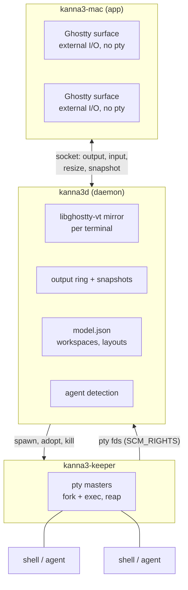
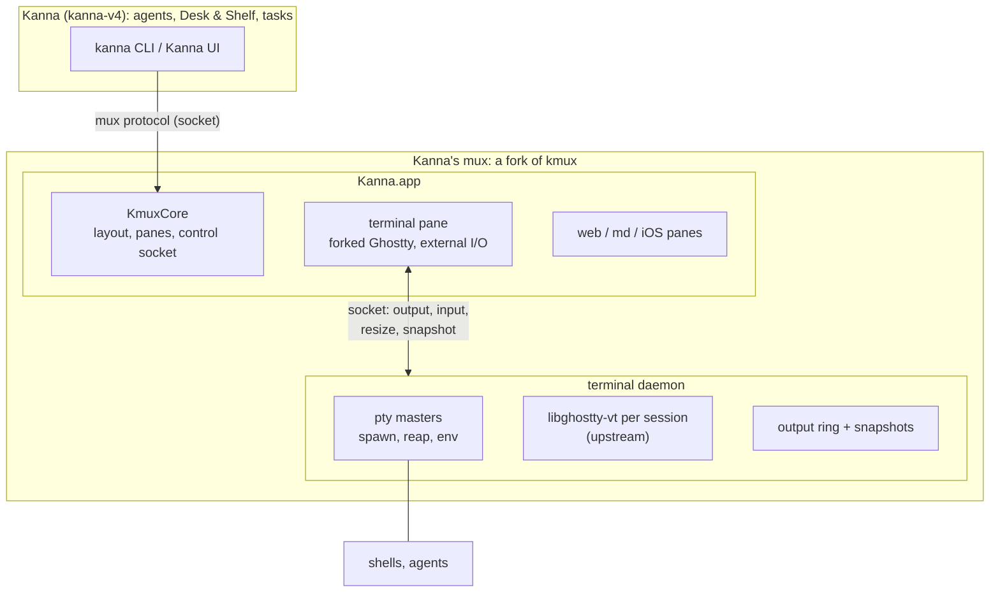
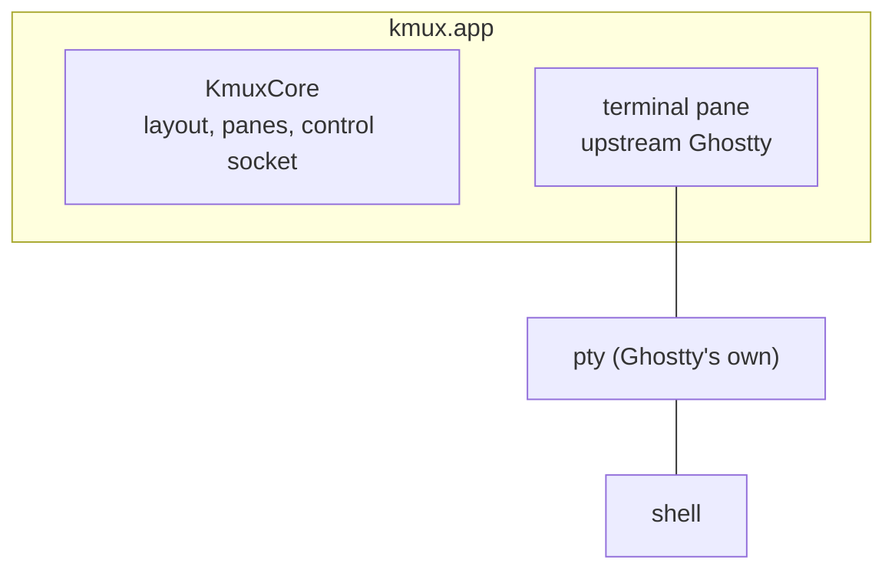
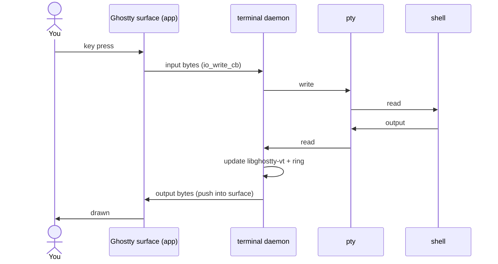
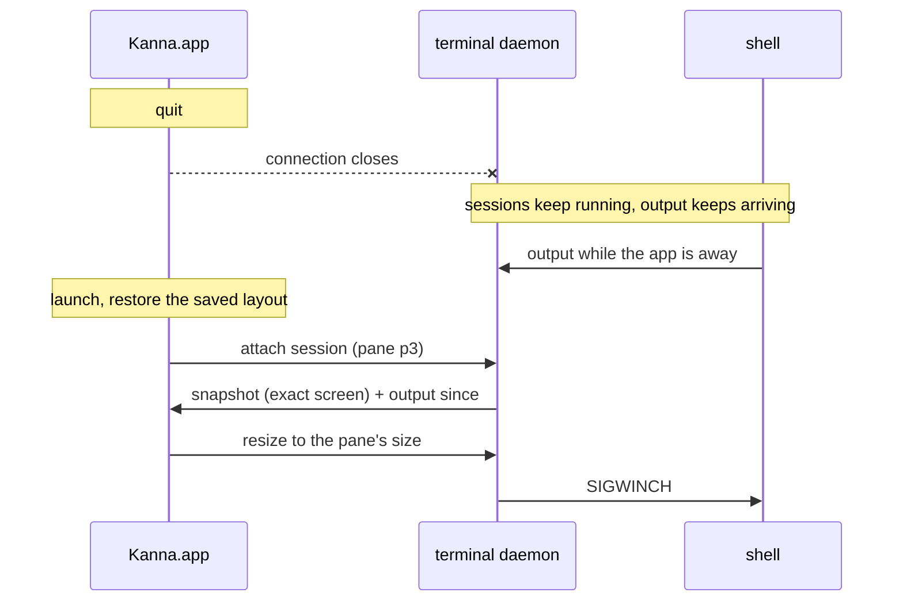
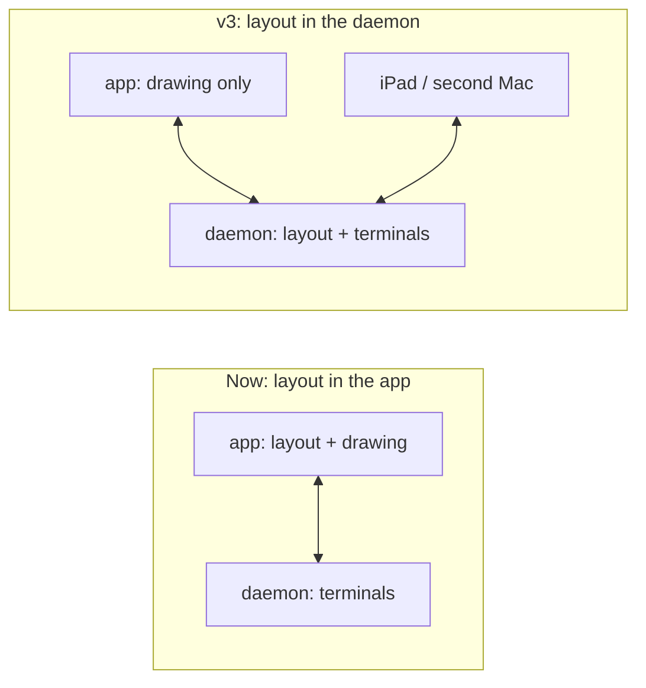

# Kanna's mux: architecture

> 2026-10-09. How Kanna's mux will keep terminals alive across app restarts, compared with kanna-v3 and with vanilla kmux. The design is v3's, rebuilt on the kmux code base.

## Contents

1. [At a glance](#1-at-a-glance)
2. [kanna-v3](#2-kanna-v3)
3. [Kanna's mux (proposed)](#3-kannas-mux-proposed)
4. [Vanilla kmux, for comparison](#4-vanilla-kmux-for-comparison)
5. [Typing and output](#5-typing-and-output)
6. [Restarting the app](#6-restarting-the-app)
7. [Differences from v3](#7-differences-from-v3)
8. [Open choice: who owns the layout](#8-open-choice-who-owns-the-layout)
9. [Glossary](#9-glossary)

---

## 1. At a glance

| | kanna-v3 | Kanna's mux (proposed) | Vanilla kmux |
|---|---|---|---|
| Who owns the ptys | `kanna3-keeper` | the terminal daemon | the app (Ghostty spawns them) |
| Who keeps the screen state | `kanna3d` (libghostty-vt) | the terminal daemon (libghostty-vt) | the app (Ghostty) |
| How the app draws a terminal | forked Ghostty, **external I/O** (no pty in the app) | the same, rebased onto current Ghostty | upstream Ghostty with its own pty |
| Terminals survive an app restart | yes, screen exact | yes, screen exact | no: new terminals in the saved layout |
| Ghostty | fork (`jemdiggity/ghostty`, `kanna3`) | same fork, branch `kmux-external-io` | upstream, untouched |

**Same architecture as v3:** a daemon owns the terminals and the app only draws them. The pieces are rebuilt in kmux's code base, and the mux is its own layer under Kanna.

---

## 2. kanna-v3

- **The keeper** only holds ptys. It never reads them, so the daemon can crash or be upgraded without killing a shell.
- **kanna3d** reads every pty, keeps each terminal's screen in libghostty-vt, owns the workspace model, and serves the app.
- **The app** has no ptys. Its Ghostty surfaces draw what the daemon streams to them.

---

## 3. Kanna's mux (proposed)

- **Kanna** sits on top and only speaks the mux protocol. The mux is a layer of its own.
- **The mux** is a private fork of kmux. It pulls kmux's improvements with `git merge upstream/main`.
- **The terminal daemon** comes from the keeper work. Each session has its pty, a headless Ghostty terminal (upstream libghostty-vt) and an output ring.
- **Kanna.app's terminal panes** draw from the daemon through external I/O. Web, markdown and iOS panes are unchanged.

---

## 4. Vanilla kmux, for comparison

No daemon and no fork. After a restart the layout comes back with **new** terminals.

---

## 5. Typing and output

Each byte is parsed twice: once by the daemon's headless terminal (the true state) and once by the surface that draws it. v3 worked the same way.

---

## 6. Restarting the app

The screen comes back exactly: the daemon sends its headless terminal's snapshot, not a replay of recent output.

---

## 7. Differences from v3

| | kanna-v3 | Kanna's mux | Why |
|---|---|---|---|
| Processes | keeper + kanna3d | one terminal daemon to start with | Simpler. Splitting off a pty-only keeper later lets the daemon be upgraded without killing shells; v3's fd-passing code is ready for it. |
| Layout and workspaces | in the daemon (model.json) | in the app (KmuxCore, the saved state file) | See [section 8](#8-open-choice-who-owns-the-layout). |
| Agent detection | in kanna3d | in Kanna, above the mux | The mux is its own layer. It reports facts (output, exits, attention); Kanna decides what they mean. |
| Headless terminal | libghostty-rs, built from the fork | libghostty-vt from **upstream** Ghostty | Upstream now has the VT formatter and snapshots; only the app needs the fork. |
| Ghostty fork | `kanna3` | `kmux-external-io`, rebased onto kmux's pin | The patch is 9 files, +598/−38. A trial merge onto upstream main was clean. |
| App | kanna3-mac | kmux's app (fork), branded Kanna | Reuses kmux's panes, layout, protocol and tests. |

---

## 8. Open choice: who owns the layout

- **In the app** (kmux today): fewer changes. Layouts come back from the state file, and terminals come back from the daemon.
- **In the daemon** (v3, and the client/server paper's direction): the app becomes a pure client. A second client, such as an iPad or another Mac, sees the same workspaces, and agents can work with the layout while no window is open. KmuxCore has no AppKit, so the daemon could be a headless Swift process that runs KmuxCore and libghostty-vt.

The second is the better architecture and v3's. The first is a step on the way there.

---

## 9. Glossary

| Term | Meaning |
|---|---|
| **pty** | Pseudo-terminal: the pair of endpoints a shell talks to as if it were a real terminal. |
| **pty master** | The end a terminal app holds: reading gives the shell's output, writing types into it. |
| **External I/O** | A Ghostty surface mode from the fork: it has no pty, output is pushed in, and keystrokes come out through a callback. |
| **libghostty-vt** | Ghostty's terminal engine as a library, without drawing. It keeps a terminal's screen, formats it as VT text and makes snapshots. |
| **Snapshot** | A terminal's whole screen state, used to restore it exactly. |
| **Terminal daemon** | The background process that owns the ptys and their screen state. It outlives the app. |
| **SCM_RIGHTS** | A way to send open file descriptors (here, pty masters) to another process over a Unix socket. |
| **Fork (of kmux)** | A private copy of kmux's repo that pulls kmux's changes and adds Kanna's mux work. |
