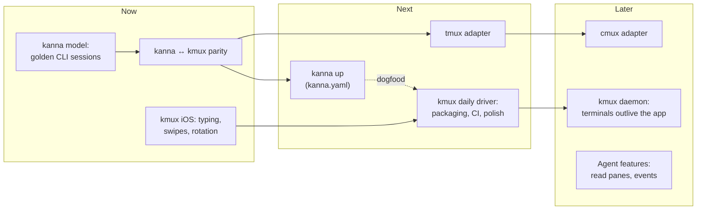

# Kanna and kmux — Roadmap

> **Status:** Draft v0.1 · **Last updated:** 2026-10-09
>
> What to build next for **kanna** (the CLI, this repo) and **kmux** (the desktop mux, [its own repo](../../kmux)), in order. There are no dates: each step is done when its checks pass. Items marked **[Decide]** need your call and are collected in [Decisions Needed](#5-decisions-needed).
>
> **Related:** [kanna spec](kanna-spec.md) · [kmux spec](../../kmux/docs/kmux-spec.md)

## Table of Contents

1. [Where We Are](#1-where-we-are)
2. [The Plan at a Glance](#2-the-plan-at-a-glance)
3. [kanna](#3-kanna)
4. [kmux](#4-kmux)
5. [Decisions Needed](#5-decisions-needed)
6. [Glossary](#6-glossary)

---

## 1. Where We Are

| | kmux | kanna |
|---|------|-------|
| **Reference model** | ✅ Interactive mockup; 26 protocol cases shared with the app | ❌ None yet |
| **Spec** | ✅ v0.6, no open questions | Draft v0.3, five open questions |
| **Built** | Windows, tabs, splits; terminal, web and iOS panes; all 14 protocol commands; drag and drop; menus and Ghostty shortcuts; instances; `kmux` CLI | `open`, `list`, `close`, `mux` against kmux only |
| **Missing** | iOS typing and edge swipes; packaging; CI | Most commands, `--app`/`--device`/URL in `open`, layout expressions, `kanna up`, tmux and cmux |
| **Tests** | Unit, shared protocol cases, end to end (pixels), `kmux-bench` | None |

In short: kmux is close to something you can use every day; kanna is a stub. kmux's own CLI already does most of what kanna's spec describes, but only for kmux.

---

## 2. The Plan at a Glance

| Order | kanna | kmux |
|-------|-------|------|
| **Now** | A reference model for kanna; then every command working against kmux | Finish the iOS pane |
| **Next** | `kanna up`; the tmux adapter | Make kmux installable and run its tests in CI |
| **Later** | The cmux adapter | A daemon so terminals survive restarts; agent features |

The two columns can move in parallel. kanna's work depends on kmux's protocol, which is already complete.

---

## 3. kanna

### 3.1 Now: a reference model

Following reference-driven design, kanna needs a model before more code. For a CLI, the closest thing to the kmux mockup is a set of **golden sessions**: short scripts of `kanna` commands with the exact output and resulting layout each should produce, written from the spec's examples.

- One file per scenario (open with sizes, arrange, errors and exit codes, JSON output).
- A runner plays them against a real kmux (in the background, `--bg`) and against each future adapter.
- Where a backend can't do something, the session says what kanna must print instead (exit 5 with a hint).

**Done when:** the spec's example session (§7) and every row of its error table (§8) is a golden session, and they run (failing) against today's kanna.

**[Decide]** Golden sessions, or a Python prototype of kanna as the model? See [D4](#5-decisions-needed).

### 3.2 Now: parity with kmux

Make every command in the kanna spec work against kmux, reusing what the `kmux` CLI already does.

| Step | What |
|------|------|
| 1 | `open term/web/ios` with every option, including `--app`, `--device` and the web URL (today they're dropped). |
| 2 | `focus`, `restart`, `send`, `navigate`, `resize`. |
| 3 | The **layout expression parser** (`a:2/3 \| (b / c)`) and `arrange`. kmux's CLI already prints this syntax; kanna needs to read it. |
| 4 | Help, `--json` and exit codes to the same standard as the `kmux` CLI, then a cold run by a fresh agent. |
| 5 | An **adapter interface** (spec §4.3) with kmux as its first implementation, so tmux slots in later. |

**Done when:** every golden session passes against kmux.

### 3.3 Next: `kanna up`

Open a whole dev setup from `kanna.yaml` with one command (goal G4): server terminal, web preview, iOS app, arranged.

- Check every pane type is supported before opening anything.
- Dogfood it: a `kanna.yaml` for working on kmux itself (build output, the model in a web pane, the app's e2e log).

**[Decide]** What should `kanna up` do when the setup is already open: nothing, reopen what's missing, or restart everything?

### 3.4 Next: tmux

The first second backend: terminal panes only, fractions as percentages (spec §6.4), names stored as pane options.

- Golden sessions run against tmux too; web and iOS sessions expect exit 5.
- This is the point to decide whether kanna also runs on Linux.

### 3.5 Later: cmux

Research what cmux's API supports (spec open question 2), then write the adapter.

**[Decide]** Are tmux and cmux still wanted? If kanna is mainly the front door to kmux, both could wait indefinitely. See [D2](#5-decisions-needed).

---

## 4. kmux

### 4.1 Now: finish the iOS pane

| Item | Notes |
|------|-------|
| Typing | `IndigoHIDMessageForKeyboardNSEvent` sits next to the touch function used today. |
| Edge swipes | Swipe up to go home doesn't work yet; Simulator.app sends edge gestures through a separate input path. ⇧⌘H works meanwhile. |
| Rotation and scrolling | Rotation needs the surface-changed callback; trackpad scrolling has its own Indigo message. |
| Rebuild loop | After rebuilding your app, `restart` should reinstall it, not just relaunch the old build. |

**Done when:** you can use an app in a pane without reaching for Simulator.app.

### 4.2 Next: a daily driver

| Area | What |
|------|------|
| Packaging | A signed, notarized `kmux.app` and an install of the `kmux` CLI (e.g. a Homebrew tap). **[Decide]** who it's for: just you, or others too ([D3](#5-decisions-needed)). |
| CI | Unit, protocol and model tests on GitHub's macOS runners. The pixel e2e and benchmark need a real display: the Mac Studio could run them as a self-hosted runner. |
| Ghostty | A routine for moving the pinned Ghostty forward (today pinned, needing Zig 0.16 exactly). |
| Polish | Found by using it: open a short "papercuts" list and fix as you go. |

### 4.3 Later

| Item | Why |
|------|-----|
| **Daemon** | Terminals keep running when the app quits or crashes (the kanna-v3 design). Persistence of layouts stays out for now (decided). |
| **Agent features** | An official way to read a pane's contents (`debug.text` exists already) and, if polling gets painful, events (decided: none for now). This also answers kanna's open question 4. |
| **Performance** | Tighten `kmux-bench` targets once real numbers settle; count web pane memory. |

---

## 5. Decisions Needed

| # | Question | Why it matters |
|---|----------|----------------|
| D1 | **What comes first:** kanna parity, finishing iOS in kmux, or making kmux installable? | Sets the order of "Now". |
| D2 | **Are tmux and cmux still wanted** as kanna backends? | If not, kanna becomes kmux's front door and §3.4–3.5 drop out. |
| D3 | **Who is kmux for** in the near term: you, or other people too? | Decides how much packaging, signing and docs are needed. |
| D4 | **kanna's reference model:** golden CLI sessions, or a Python prototype? | rdd needs one before more kanna code. |
| D5 | **kanna's spec questions 1, 3 and 5:** fallbacks for unsupported panes, mixed backends in one file, and how to target a window or tab. | Needed before `kanna up` and tmux. |
| D6 | **The `kmux` CLI and kanna overlap.** Keep both (kmux-specific vs. any mux), or fold one into the other? | Avoids building the same commands twice. |

---

## 6. Glossary

| Term | Meaning |
|------|---------|
| **Adapter** | The part of kanna that talks to one mux (kmux, tmux or cmux). |
| **Golden session** | A recorded script of commands and their exact expected output, replayed as a test. |
| **Dogfood** | Using your own tool for your own daily work, to find problems early. |
| **Daemon** | A background process that keeps running when the app quits. |
| **Notarized** | Checked by Apple so macOS opens the app without warnings. |
| **Self-hosted runner** | Your own machine running CI jobs for GitHub. |
| **rdd** | Reference-driven design: build from a living model, integrate first, small steps. |
