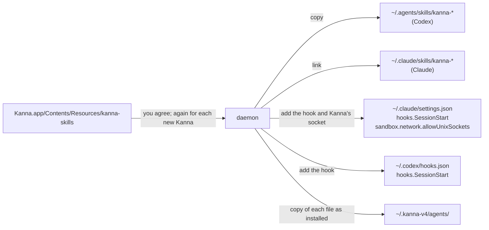

# Agent Setup

**Status:** built · **Part of:** [tasks](tasks.md)

Kanna's skills teach an agent how to work in Kanna: name its task, plan, answer review comments. They live in this repo (`.agents/kanna-skills`), so today only agents working on Kanna itself have them. **Agent setup** puts them where Claude and Codex find them in any repo, once you agree.

**Done when** an agent that Kanna starts as a task in another repo names its task, with Claude and with Codex.

## Contents

1. [What it does](#1-what-it-does)
2. [How an agent knows to use a skill](#2-how-an-agent-knows-to-use-a-skill)
3. [Asking](#3-asking)
4. [Updates and your files](#4-updates-and-your-files)
5. [CLI](#5-cli)
6. [How it's built](#6-how-its-built)

## 1. What it does



- **The skills:** `kanna-tasks`, `kanna-planning`, `kanna-new-project`, `kanna-markup`, `kanna-explain`, copied to `~/.agents/skills/` and linked from `~/.claude/skills/` (`../../.agents/skills/NAME`), the layout `install.sh --global` uses.
- **The socket entry** lets an agent in Claude's sandbox run `kanna`. That lets it control Kanna's terminals, which run outside the sandbox, as the kmux socket entry in a repo's own settings did; the prompt says so. The rest of `settings.json` stays as it was, keys in their order and its permissions kept. A `settings.json` Kanna had to make is deleted again by remove.
- **The hook** is a `SessionStart` hook in `~/.claude/settings.json` and `~/.codex/hooks.json` (Codex has hooks on by default since 0.162). Its command ends `# kanna agents setup`, so Kanna finds its own and leaves yours.
- **Nothing else.** No environment variables, no flags on the agent's command line.

## 2. How an agent knows to use a skill

An agent picks a skill by its description, from what's in its context: its folder, the platform, git status, not its environment. So it can't tell it's in Kanna by itself. The hook tells it: it runs as the session starts, and what it prints goes into the agent's context.

| In the terminal | The hook prints |
|---|---|
| `$KANNA_PLANNER` set | You're running in Kanna, as a window's planning agent: use the kanna-planning skill now. |
| `$KANNA_PANE` set | You're running in Kanna, as a task's agent (pane p9): use the kanna-tasks skill as soon as you know what the work is. |
| neither | nothing |

- **Codex runs the hook only in its own process.** Interactive Codex normally runs sessions in one shared background server, whose environment has no `$KANNA_PANE`, so Kanna starts a Codex task with `--no-daemon` ([tasks](tasks.md#7-how-its-built)). Codex you start yourself, as in the planning terminal, needs `codex --no-daemon` for the hook to see Kanna.
- **Codex asks you to trust the hook** the first time it sees it, and again whenever a new Kanna changes it.

## 3. Asking

- **On first launch, the planning terminal asks.** Before its getting-started text, it runs `kanna agents setup --ask`, which says Kanna needs its skills and what that installs:

  ```
  Kanna needs its skills installed to work properly: they're how Claude and
  Codex, in any repo, know to name their task, plan with you and answer your
  review comments.

    ~/.agents/skills/kanna-*      the skills (Codex)
    ~/.claude/skills/kanna-*      links to them (Claude)
    hooks in ~/.claude/settings.json and ~/.codex/hooks.json
                                  that tell an agent it's in Kanna
    ~/.claude/settings.json       Kanna's socket in Claude's sandbox, which lets
                                  sandboxed agents control Kanna's terminals

  Kanna keeps them up to date and never changes a file you've edited.
  Undo it any time with kanna agents remove.

  Install Kanna's skills? [Y/n]
  ```

- **Once.** Either answer is remembered, and the planning terminal never asks again. Nothing is written until you answer yes.
- **Without them Kanna still runs,** but its agents don't name their tasks, plan or answer comments; `kanna agents` says so.
- **`kanna agents setup` and `kanna agents remove`** change your mind later; `kanna agents` says where things stand.

## 4. Updates and your files

- **A new Kanna asks before it updates.** When its skills differ from the ones you have, the planning terminal runs `kanna agents update --ask` before its getting-started text, which lists what changed and asks:

  ```
  This Kanna has newer skills.

    kanna-tasks         updated
    kanna-markup        updated, merged with your changes
    kanna-planning      updated; your changes conflict, kept yours
    kanna-explain       new

  Update Kanna's skills? [Y]es, [n]ot now, [s]kip this version: y
  kanna-planning/SKILL.md: your changes conflict with Kanna's.
  Open it in your merge editor (opendiff)? [Y/n]
  ```

- **Your changes are merged in.** Kanna keeps a copy of each file as it installed it (`~/.kanna-v4/agents/`). A file you've edited since is merged three ways: the copy Kanna installed, yours, and the new one. A clean merge is written. For a conflict, it offers to open your merge editor (git's `merge.tool`, else FileMerge's `opendiff`) on the three; what you save is your file. Said no, it's left as yours, and `kanna agents update` offers again (`--force` takes Kanna's).
- **Not now** asks again at the next launch. **Skip this version** doesn't ask again until a newer Kanna brings newer skills. `kanna agents update` updates any time.
- **A file that was there before setup** is yours and never touched; a file identical to Kanna's is adopted.
- **Running agents** keep what they started with.
- **Remove** takes back only the files that still match what Kanna installed, its hooks and its socket entry.

## 5. CLI

| Command | Does |
|---|---|
| `kanna agents [status]` | Whether your agents are set up, and what setup installs |
| `kanna agents setup [--ask]` | Install the skills, the hook and the socket entry (`--ask`: say what and ask first) |
| `kanna agents update [--ask] [--force]` | Bring the skills up to this Kanna's, merging your changes (`--force`: Kanna's over yours) |
| `kanna agents remove` | Take back what Kanna put there |

## 6. How it's built

- **The daemon does it** (`agents` command, `crates/kanna-daemon/src/agents.rs`): it plans each update file by file against the copy it installed, merges with `git merge-file`, and writes. Each launch it only keeps its hooks and this instance's socket entry in place, once you've agreed; skills change only when you say yes.
- **The planning terminal asks** by running `kanna agents setup --ask; kanna agents update --ask` before its getting-started text, with the `kanna` beside the daemon (Kanna.app carries it in `Contents/Helpers`). Each asks at most once per launch, in the first planning terminal that opens, and says nothing when there's nothing to ask.
- **The merge editor runs in that terminal:** `kanna` makes a scratch git repo with the three versions as a real merge conflict and runs `git mergetool` on it, so any tool git knows works; what you save is copied over your file.
- **The skills come from the app bundle,** copied there from `.agents/kanna-skills` by `scripts/build-kanna-app.sh`.
- **For tests only:** `KANNA_AGENTS_HOME` stands in for your home folder and `KANNA_AGENT_SKILLS` for the bundle's skills; unset, Kanna uses yours. The end-to-end tests (S10, S45) set both, so they never touch your home; the app passes `KANNA_AGENTS_HOME` on to the daemon it starts.
