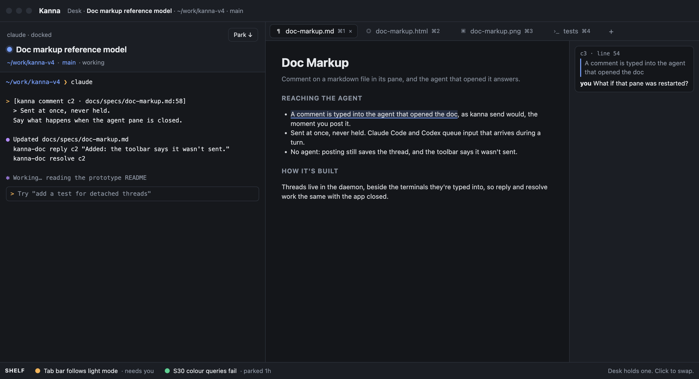
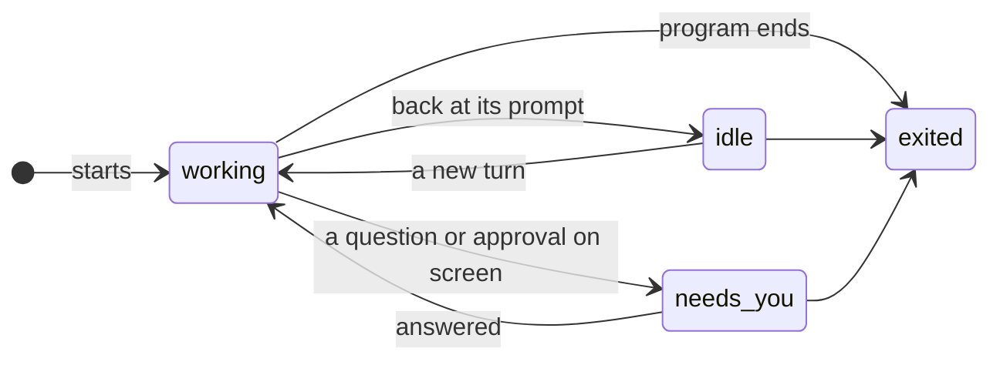
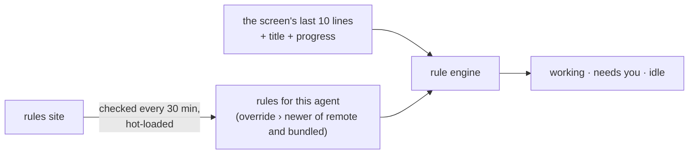

# Agent Status

**Status:** proposed · **Used by:** [Desk](desk.md) (the agent header and the Shelf) · **Mockup:** the Desk's ([`docs/mockups/desk.html`](../mockups/desk.html)), the dots beside each task · **From:** kanna v2/v3's detection rules (`kanna3-detect`) and herdr's agent-detection manifests

**Agent status** tells you at a glance whether an agent is busy, waiting for you, or done, so you can leave it running and come back when it needs you. Kanna reads the bottom of the agent's screen and matches it against **rules**: patterns for each agent, kept as data that Kanna updates on its own, so a new Claude Code or Codex release never needs a new Kanna.

## Contents

1. [States](#1-states)
2. [Rules](#2-rules)
3. [Detection rules](#3-detection-rules)
4. [CLI](#4-cli)
5. [How it's built](#5-how-its-built)
6. [Glossary](#6-glossary)

## 1. States

| Status | When |
|---|---|
| working | a busy rule matches (spinner, "esc to interrupt", a busy title or progress) |
| needs you | a waiting rule matches: an approval, a question or a trust prompt is on screen |
| idle | the agent is at its prompt, or no rule matches |
| exited | the program has ended (the pane is `exited`) |

## 2. Rules

- **Known agents only:** a terminal whose foreground program is an agent Kanna has rules for (Claude Code, Codex, …) has a status; other terminals show only `exited`.
- **Needs you is strict:** it shows only when the screen matches a known question or approval. A prompt Kanna hasn't learned shows as idle, never as needs you by guesswork.
- **Settled screens only:** Kanna judges a screen once it stops changing mid-frame, so a half-drawn repaint never flips the status.
- **Screen only:** the bell and the agents' own notifications (OSC 9, OSC 777) aren't used. They depend on each agent's settings and, for Codex, on focus reports ([evidence](../research/agent-status-signals.md)); the screen doesn't.
- **Shown in Kanna only:** status is the dots in Kanna's windows; it doesn't badge the Dock icon or post macOS notifications.
- **Same for every agent:** each agent differs only in its rule file.
- **Rules are data: they can't choose what Kanna runs.** Which programs are agents is Kanna's own code; Kanna never runs anything to judge status: the agent's version comes from its install's files (Claude Code's `versions/<version>` file, an npm `package.json`, Codex's release folder), found from the executable the OS reports, read-only and size-capped.
- **Unread is separate:** an agent that goes from working to idle while you aren't looking at it is **unread** until you do. Unread is the app's mark of what you've seen, not an agent status: the status stays idle, and the dot shows both.

## 3. Detection rules

- **One file per agent**, in JSON: a `version`, and rules each with a status, a priority, the agent versions it applies to, and a test. The highest-priority match wins.
- **What a test reads:** the screen's last 10 lines by default (or another region: last non-empty lines, lines below a divider), the terminal title and progress reports. It checks with `contains`, `regex`, and `all`/`any`/`not`.
- **Agent versions:** Kanna reads each agent's version from its install, without running it; an unknown version uses only rules for every version. So a team on different releases is each judged right.
- **Hot-loaded, three sources:**
  1. **Bundled** in Kanna.
  2. **Remote:** Kanna checks the rules site, verifies each file's hash against the site's index, and swaps the newer rules in without a restart.
  3. **Local override** in `~/.config/kanna/agent-rules/<agent>.json`, reloaded when it changes, which always wins.
- **Every rule file is checked whole before it's used**, wherever it came from: at most 256 KiB, 256 rules, 64 vocabulary lists and tests nested 24 deep; patterns capped and compiled with size limits; regions at most 200 lines; known statuses, tests, regions and agents only. One that fails is refused and logged, and the rules in use stay. From the site, an entry must name a known agent (`a-z`, `0-9`, `-`), its file must be on the site's own host (redirects too) and match the index's hash before it's read, and a file no newer than the one Kanna has is ignored.
- **Proved on a corpus:** recorded screens from real Claude Code and Codex, driven by a mock model so no tokens are spent, each labeled with its status. A rule change ships only when the whole corpus passes.

## 4. CLI

| Command | Does |
|---|---|
| `kanna list` | Adds a STATUS column for agent panes |
| `kanna list --json` | Adds `status` to each agent pane |
| `kanna status explain PANE` | The agent, its version, the rules file and its source, the matching rule and the text it matched |
| `kanna status explain --file SCREEN --agent claude` | The same for a saved screen, for writing rules |
| `kanna status update` | Check the rules site now |

## 5. How it's built

- **In the daemon**, which already keeps every terminal's screen ([4.5](../kanna-spec.md#45-the-app-link)), so status works with the app closed and `list` reads it directly. The daemon knows each terminal's foreground program, which picks the agent.
- **The app** gets status changes like the other pane events, to draw the dots.
- **Rules site:** the repo's GitHub Pages: the rule files and an `index.json` (agent, URL, version, hash), published from the repo's `agent-rules/` with the corpus test as the gate.
- **The corpus and harness:** `tools/agent-harness` (the mock model, from v3's characterization tools) records sessions; a tool samples their screens into `agent-rules/corpus/`.
- **Seeded** from v3's rules (the user's own, via v2); herdr (Apache-2.0) is a reference for behaviour only, and none of its rule text is copied.

## 6. Glossary

| Term | Meaning |
|---|---|
| **Unread** | An idle agent you haven't looked at since it finished; kept by the app, apart from the status |
| **Rule** | A pattern on an agent's screen, title or progress that means one status |
| **Rules site** | Where Kanna fetches updated rule files from |
| **Corpus** | Recorded agent screens, each labeled with its true status, that every rule change is tested against |
| **Mock model** | A local stand-in for the AI provider that drives real Claude Code and Codex without spending tokens |
| **OSC 9;4** | The escape sequence a program uses to report progress to its terminal |
