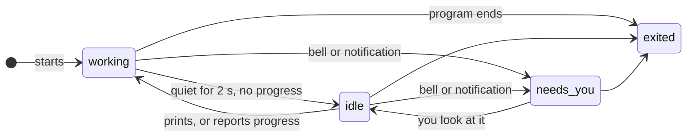

# Agent Status

**Status:** proposed · **Used by:** [Desk](desk.md) (the agent header and the Shelf) · **Mockup:** the Desk's ([`docs/mockups/desk.html`](../mockups/desk.html)), the dots beside each task

**Agent status** tells you at a glance whether an agent is busy, waiting for you, or done, so you can leave it running and come back when it needs you. It works the same for every agent, from what its terminal already reports; nothing reads or parses the agent's screen or prompt.

## Contents

1. [States](#1-states)
2. [Rules](#2-rules)
3. [CLI](#3-cli)
4. [How it's built](#4-how-its-built)
5. [Open questions](#5-open-questions)
6. [Glossary](#6-glossary)

## 1. States

| Status | When |
|---|---|
| working | the terminal printed in the last 2 s, or reports progress (OSC 9;4) |
| needs you | it rang the bell or posted a notification (OSC 9, OSC 777) since you last looked |
| idle | neither |
| exited | the program has ended (the pane is `exited`) |

## 2. Rules

- **Any terminal pane has a status;** the Desk shows its agent's.
- **Looking clears needs you:** the pane is on screen in the key window. Typing into it does too.
- **Needs you wins over working:** an agent that asks and keeps printing still shows needs you until you look.
- **Same for every agent:** Claude Code and Codex ring the bell or notify when they want input (each has a setting for it); anything else that does the same gets the same status.

## 3. CLI

| Command | Does |
|---|---|
| `kanna list` | Adds a STATUS column for terminal panes |
| `kanna list --json` | Adds `status` to each terminal pane |

## 4. How it's built

- **In the app**, from the terminal events it already gets: output (the daemon's output stream), progress, bell and notifications (Ghostty's actions), and exit (the daemon's `exited`). No new protocol.
- **`list`** asks the app for it, like the other things only the app knows; with the app closed it reports `working`/`idle` from the daemon's last output time and `exited`, and never `needs you`.

## 5. Open questions

1. Is 2 s of quiet right for idle, or should it be longer for agents that think silently?
2. Should a needs-you agent also badge the Dock icon and post a macOS notification when Kanna isn't frontmost?

## 6. Glossary

| Term | Meaning |
|---|---|
| **OSC 9;4** | The escape sequence a program uses to report progress to its terminal |
| **OSC 9 / OSC 777** | Escape sequences a program uses to post a desktop notification |
| **Bell** | The terminal's alert character (BEL) |
