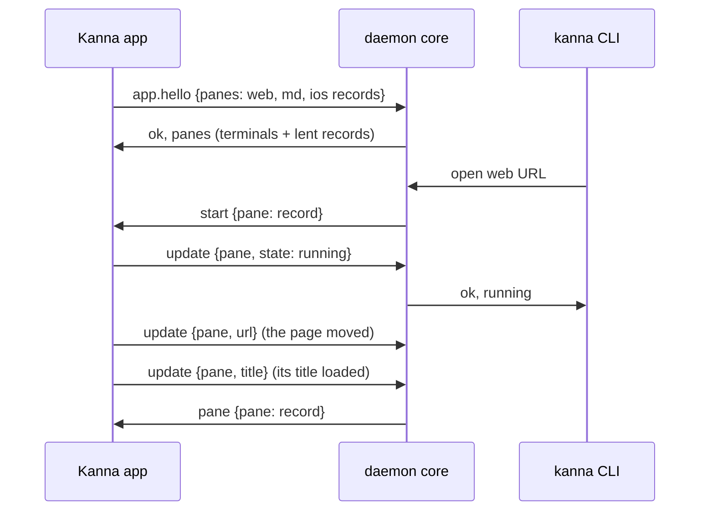

# Web, Markdown and iOS Panes

**Status:** built ([plan](../plans/mux-build.md) M3) · **Builds on:** [the app link](app-link.md), [layout](layout.md) · **Related:** [code viewer](code-viewer.md), [doc markup](doc-markup.md)

A web, markdown or iOS pane is a view in the app and a record in its layout: a web pane's URL (and whether it keeps history), a markdown pane's file and zoom, whether either is open for comments (`kanna markup`), the agent pane that opened a doc for comments ([doc markup](doc-markup.md)), an iOS pane's app and device, saved in `layout.json`. The daemon runs none of them, but its `kanna-mux` core still gives them their IDs, checks and answers every command about them as kmux does (`open`, `navigate` with its history, `close`, `restart`, `list`), and passes them to the app to show. A markdown file's front matter (the `---` block at its top) shows as a YAML code block on the same lines.

## 1. The app's panes are lent to the daemon while it's attached

The app owns the records and saves them; on hello it hands them to the daemon, whose core holds them beside its terminals for as long as the link lasts, so kmux's core logic runs unchanged on one pane table; when the app goes, so do they. Every change to a record goes through the daemon's core and comes back to the app, so there is one writer.

Why not keep them in the daemon: they'd outlive the app with nothing to show them, and `list` would report pages no view has. Why not answer their commands in the app: the core (IDs, names, history, errors) would be split in two.

## 2. Messages

| Message (app link) | From | What it says |
|---|---|---|
| `app.hello {pid, panes}` | app | the app's web, markdown and iOS records, with each view's `state`. The daemon takes each whose ID and name no terminal has (the others are dropped and logged), continues its pane counter past them, and lists them in the reply |
| pane tables (`panes` in the hello reply and every `layout` step) | daemon | records: `{id, name, type}` plus the state file's fields (`url`, `history`; `path`, `zoom`, `agent`; `app`, `device`; `cmd`, `cwd` for terminals) |
| `start {pane: record}` | daemon | show this pane (`open`, `restart`, `navigate`, `debug.restoreState`), replacing any view it had |
| `stop {pane}` | daemon | the pane closed, or is about to start again |
| `update {pane, state?, error?, url?, title?, device?, zoom?}` | app | the view is `running` or `failed` (with `error`); the page moved (`url`, applied as kmux's page moves, history included); the page's title changed (`title`, `""` for none: it names the pane's tab, [tab names](windows.md#4-tab-names)); the simulator chosen; the markdown zoom |
| `pane {pane: record}` | daemon | the record after an `update`, for the app's layout |
| requests (`{id, cmd, args}`) | app | `navigate` from the views (the URL editor, a markdown link, back and forward), answered as any client's |
| `debug.web`, `debug.md`, `debug.ios` (with an `id`) | daemon | kmux's commands for these panes (the page's URL and text; the rendered markdown; a tap or Home on the simulator), passed on like `debug.text` |

## 3. Rules

- **Starting:** a web pane reports `running` as soon as its view loads the URL (a server that isn't up yet shows a notice and is retried, as kmux); a markdown pane once the file is read (`failed`: "No such file"); an iOS pane once the simulator is booted, the app launched and the screen attached (up to 180 s). `open` waits for that, as kmux.
- **With the app closed** the daemon knows only terminals: `list` shows terminals and `windows: []`. `open web|md|ios` fails with `no_app` (the CLI starts the app, [layout](layout.md#5-the-cli-starts-the-app)); so does any command naming a pane the daemon doesn't know, except `send`, `send-key` and `read`, which only work on terminals and answer `not_found`. `navigate` and `debug.web|md|ios` reach the app or fail with `no_app`.
- **When the app goes away** its panes leave the daemon's table; an `open` still waiting for one fails (`start_failed`, "Kanna.app went away").
- **After a relaunch** the app reads `layout.json`, says hello with its panes and shows them: pages load at their URL (cookies and logins stay in WebKit's store; back and forward lists aren't kept, as kmux), files reopen at their zoom, iOS panes find their device (still booted) and attach to its screen, launching the app only if it isn't running. After a daemon restart the views are untouched: the hello hands the same records back.
- **kmux's commands are kmux's:** there is no `web.*` namespace; `debug.web`, `debug.md` and `debug.ios` are kmux's, and Kanna follows them.
- **The iOS screen** comes straight from the simulator (Xcode's private CoreSimulator and SimulatorKit frameworks, as kmux); `simctl` boots, installs and launches. Kanna never shuts a simulator down.

## 4. Checked by

All of kmux's protocol cases also pass through the daemon and the app link (the test app reports every pane running at once). `crates/kanna-daemon/tests/panes.rs` checks lending, clashes, updates, the app's requests, an app that goes away and the answers with no app; `web_md_ios_panes` of `scripts/e2e-kanna.sh` checks the real views: a page and a markdown file open, `navigate` with history, `list` and `no_app` (exit 6) with the app closed, both back after a relaunch and untouched by a daemon restart, and, when an iPhone simulator is already booted, an iOS pane running and reattached after a relaunch.
