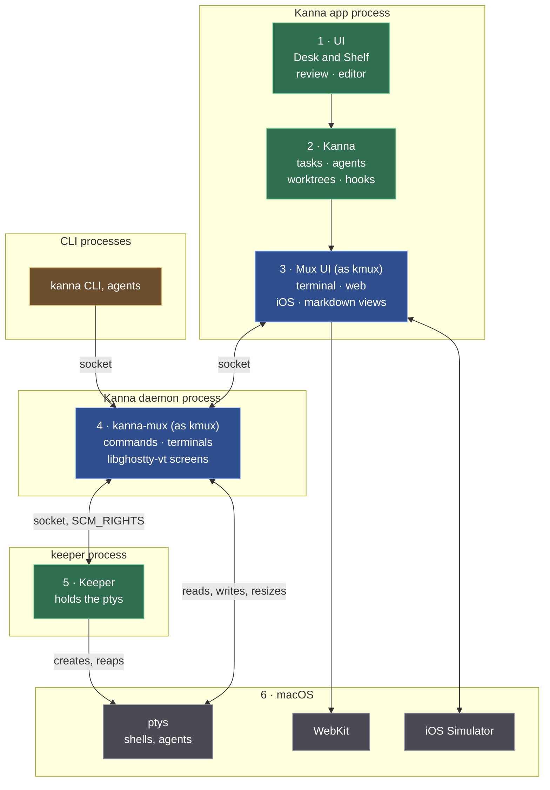
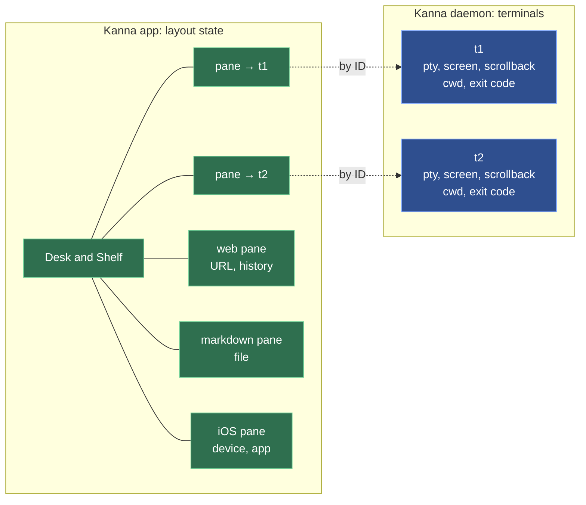
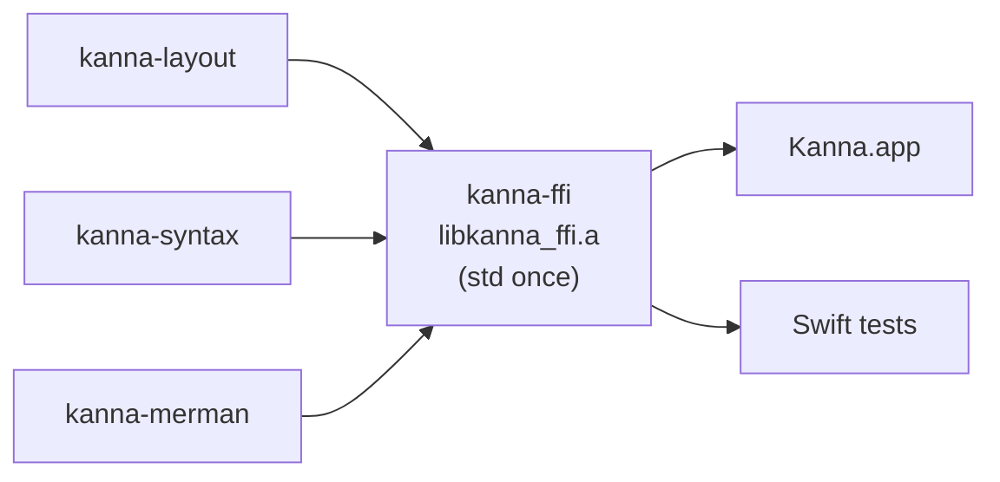

# Architecture: Layers and Processes

**Status:** built (milestones M0–M4: [the build plan](../plans/mux-build.md), [the architecture research](../research/mux-architecture.md)) · **Reference:** [kmux](kmux-reference.md)

Kanna.app is kanna's own mux: a desktop app, a background **daemon** and a **keeper**. Terminals live in the daemon, so quitting or crashing the app loses nothing, and the keeper holds the terminals open, so even restarting the daemon loses nothing. It shows the same panes as kmux (terminal, web, markdown, iOS) and answers the same commands.

## Contents

1. [The stack](#1-the-stack)
2. [What the daemon keeps, what the app keeps](#2-what-the-daemon-keeps-what-the-app-keeps)
3. [Languages and platforms](#3-languages-and-platforms)
4. [Glossary](#4-glossary)

## 1. The stack

Read top to bottom, like the OSI model: each layer uses the ones below it. The outer boxes are processes. Green is Kanna's own, blue is Kanna's code that follows kmux, grey is macOS, orange is the CLIs.

| Layer | What's in it | Process |
|---|---|---|
| 1 · UI | Desk and Shelf, markdown review, code editor | app |
| 2 · Kanna | tasks, agents, worktrees, hooks | app |
| 3 · Mux UI | the pane views and their layout state; Swift, started from kmux's views | app |
| 4 · kanna-mux | the commands (kmux's protocol) and the terminals, each screen kept by libghostty-vt; Rust | daemon |
| 5 · Keeper | creates the ptys and holds a copy of each; Rust | keeper |
| 6 · macOS | ptys and shells, WebKit, iOS Simulator devices | — |

- **The CLI is a client, not a layer:** like the app, it calls down into the daemon ([app link](app-link.md), [CLI](cli.md)). Neither serves the other.
- **The keeper isn't in the path of any byte:** it hands each pty to the daemon, which reads and writes it.
- **How a terminal starts:** the daemon asks the keeper of its state folder (`keeper.sock`, started as `$KANNA_KEEPER` or the `kanna-keeper` beside the daemon if none runs) to spawn the program; the keeper answers with the pid and the pty's master (`SCM_RIGHTS`), and later with the exit code, which the daemon records and acknowledges. `close` and `restart` end the program through the keeper; the daemon sets the size itself (`TIOCSWINSZ`). If the keeper goes away the daemon logs it and stops ([keeper](../keeper.md)). Stopping or crashing the daemon ends no terminal: the next daemon takes them back ([restarting the daemon](daemon-restart.md)).
- **A terminal's environment is the session's**, not whoever started the keeper. The keeper keeps only session-wide variables from its own environment (`HOME`, `USER`, `LOGNAME`, `SHELL`, `TMPDIR`, `LANG`, `LC_*`, `__CF_USER_TEXT_ENCODING`, `SSH_AUTH_SOCK`, and on Linux `DISPLAY`, `WAYLAND_DISPLAY`, `XDG_RUNTIME_DIR`, `XDG_SESSION_TYPE`, `DBUS_SESSION_BUS_ADDRESS`), sets `PATH` to the login default (`/usr/bin:/bin:/usr/sbin:/sbin`), and adds Ghostty's variables (`TERM=xterm-ghostty`, `TERMINFO`, `COLORTERM`, shell integration) and the daemon's (`KANNA_SOCKET`, `KANNA_PANE`, `KANNA_INSTANCE`). The shell is a login and interactive one, so the user's profile and rc files build the rest, as when Ghostty or kmux is opened from the Dock. Why: the first daemon may have been started from a terminal, whose variables would otherwise leak into every pane for as long as the keeper lives (`EDITOR=nvim` alone puts zsh in vi mode, where Ctrl-A and Ctrl-K insert themselves).
- **The shell and commands:** the shell is `$SHELL`, else the account's login shell, else `/bin/sh` (Ghostty's order). A command (`open --cmd`, a task's agent) runs in an interactive login shell: [the shell a command runs in](command-shell.md).
- **The app draws terminals from the daemon** through a forked Ghostty whose surfaces take their output from outside instead of a pty ("external I/O"; [terminal behaviour](terminal.md)).

## 2. What the daemon keeps, what the app keeps

**Only terminals live in the daemon.** Everything else a pane shows is layout state, kept and saved by the app. Planned: that layout state gets a workspace per task, which windows show ([workspaces](workspaces.md)).

| | What it is | Kept by | After the app restarts |
|---|---|---|---|
| **Terminal** | a pty, its screen and scrollback, cwd, exit code | the daemon | exactly as it was, still running |
| **Layout state** | where panes are; a web pane's URL and history, a markdown pane's file, an iOS pane's device and app | the app ([layout](layout.md), [app panes](app-panes.md)) | reopened: pages reload at their URL, files reopen, simulators never stopped |

Terminal commands (`list`, `send`, `send-key`, `read`, `close`, `restart`, and `open` without a placement) work with the app closed. Layout, web, markdown and iOS commands go to the app; with the app closed, kanna starts it or fails clearly ([layout](layout.md#4-with-the-app-closed)).

## 3. Languages and platforms

| Part | Language | Runs on |
|---|---|---|
| Kanna.app (layers 1–3) | Swift (AppKit) | macOS |
| Daemon and `kanna-mux` (layer 4) | Rust | macOS and Linux |
| Keeper (layer 5) | Rust | macOS and Linux |
| `kanna` CLI | Rust | macOS and Linux |

The daemon has to run on Linux too, so everything below the app is Rust. A Linux UI would be its own, on the same daemon. Kanna.app, kmux and iOS panes need macOS; kanna with tmux on Linux is **[Assumption]**. The chosen mux (Kanna.app, kmux, tmux or cmux) must be installed ([backends](backends.md)).

**The app's Rust is one static library, `crates/kanna-ffi`.** The app calls three Rust crates through C headers: `kanna-layout` (the layout), `kanna-syntax` (code highlighting) and `kanna-merman` (diagrams). Each is an rlib, and `kanna-ffi` links them into `libkanna_ffi.a`, the only Rust library the app and its Swift tests link. Each Rust static library carries its own copy of Rust's std, so linking two can fail with duplicate symbols (`rust_eh_personality`), as the Swift test bundle did; one library links std once. Each crate keeps its own C header and Swift module (`KannaLayoutC`, `KannaSyntaxC`, `KannaMerman`). What macOS they're built for: [deployment target](deployment-target.md).

## 4. Glossary

| Term | Meaning |
|---|---|
| **Daemon** | Kanna's background process that keeps the terminals; it outlives the app. |
| **Keeper** | A tiny background process that creates the ptys and holds them open, so shells outlive the daemon too. |
| **kanna-mux** | Kanna's mux core (Rust): kmux's protocol and the terminals, in the daemon. |
| **Layout state** | Where panes are and what each non-terminal pane shows; kept by the app. |
| **External I/O** | A mode of Kanna's forked Ghostty where a terminal view draws output it's given instead of running its own pty. |
| **libghostty-vt** | Ghostty's terminal engine as a library, without drawing; the daemon's copy of each screen. |
| **pty** | Pseudo-terminal: what a shell talks to as if it were a real terminal. |
