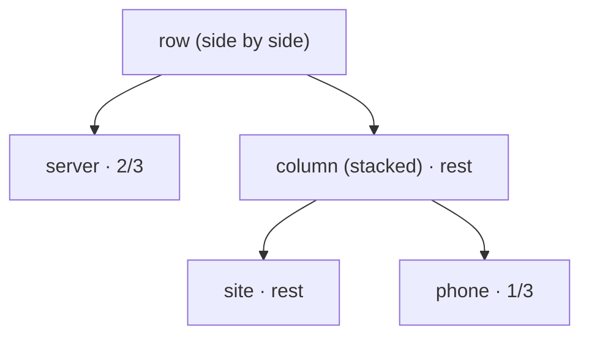

# Sizing and Arranging Panes

**Status:** `--split`, `--size` and `resize` built; the layout expression and `kanna up` planned (`arrange` takes kmux's JSON tree today) · **Part of:** [commands](commands.md) · **Related:** [backends](backends.md)

Sizes are **fractions** like `1/2`, `1/3` or `2/3`, never pixels. You only add detail when you care about it.

| Level | You write | You get |
|:-:|---|---|
| 0 | `kanna open web URL` | Splits the focused pane in half along its longer side. |
| 1 | `--split right` or `--split down` | You choose the direction. The pane is still half-size. |
| 2 | `--split right --size 1/3` | The new pane gets 1/3 and the old pane keeps 2/3. |
| 3 | `kanna arrange 'server \| (site / phone)'` | Arranges several panes at once. |
| 4 | `kanna up` | Opens and arranges a whole setup from a file. |

## 1. One pane at a time

`--size` is the new pane's share of the space being split. The existing pane gets the rest.

```text
kanna open web URL          --split right            --split down --size 1/3
┌──────────┬──────────┐     ┌──────────┬──────────┐  ┌─────────────────────┐
│          │          │     │          │          │  │       focused       │
│ focused  │   new    │     │ focused  │   new    │  │        (2/3)        │
│          │          │     │          │          │  ├─────────────────────┤
└──────────┴──────────┘     └──────────┴──────────┘  │     new (1/3)       │
 (wide pane → side by side)                          └─────────────────────┘
```

`kanna resize PANE 1/4` changes an existing pane's share of its split. Its neighbours share the difference.

## 2. The layout expression

`kanna arrange` takes a short expression describing several named panes:

| Symbol | Meaning | Example |
|---|---|---|
| `\|` | Side by side (left to right) | `a \| b` |
| `/` | Stacked (top to bottom) | `a / b` |
| `( )` | Group | `a \| (b / c)` |
| `:FRACTION` | Size within its group | `a:1/4 \| b` |

1. **No sizes means equal shares.** `a | b | c` gives each pane 1/3.
2. **Panes without a size share whatever is left.** `a:1/4 | b:1/2 | c` gives `c` the remaining 1/4.
3. **Sizes in a group can't add up to more than 1.** If they do, kanna rejects the expression and explains why.
4. **`/` binds tighter than `|`.** So `a | b / c` means `a | (b / c)`.

```sh
kanna arrange 'server | site | phone'              # three equal columns
kanna arrange 'site:1/4 | server:1/2 | phone'       # 1/4, 1/2, 1/4
kanna arrange 'server:2/3 | (site / phone:1/3)'     # big terminal, web over a small sim
```

kanna parses the expression into a tree itself, so every adapter receives the same tree. The last example:

```text
┌─────────────────────────────┬──────────────┐
│                             │     site     │
│        server (2/3)         │    (2/3)     │
│                             ├──────────────┤
│                             │ phone (1/3)  │
└─────────────────────────────┴──────────────┘
```



## 3. Layout files

A `kanna.yaml` file defines the panes and uses the same layout expression:

```yaml
mux: kmux            # optional; otherwise the usual selection rules apply
layout: "server:2/3 | (site / phone:1/3)"
panes:
  server: { type: term, cmd: "npm run dev", cwd: "~/code/myapp" }
  site:   { type: web,  url: "http://localhost:3000" }
  phone:  { type: ios,  app: "./build/MyApp.app", device: "iPhone 16" }
```

`kanna up` opens the panes in the order listed and then applies the layout. If the backend can't show one of the pane types, kanna stops before opening anything.

## 4. How sizes map to each backend

| Backend | How a fraction is applied |
|---|---|
| kmux | Stored as-is. Proportions stay the same when the window is resized. |
| tmux | Converted to a percentage (`split-window -l 33%`, `resize-pane`). |
| cmux | **[Assumption]** Converted to whatever its API accepts, rounded if needed. |

## 5. Glossary

| Term | Meaning |
|---|---|
| **Split** | Dividing a space into panes side by side or stacked. |
| **Layout expression** | kanna's short notation for arranging panes, e.g. `a:2/3 \| (b / c)`. |
| **Layout tree** | The parsed form of a layout expression that kanna passes to adapters. |
