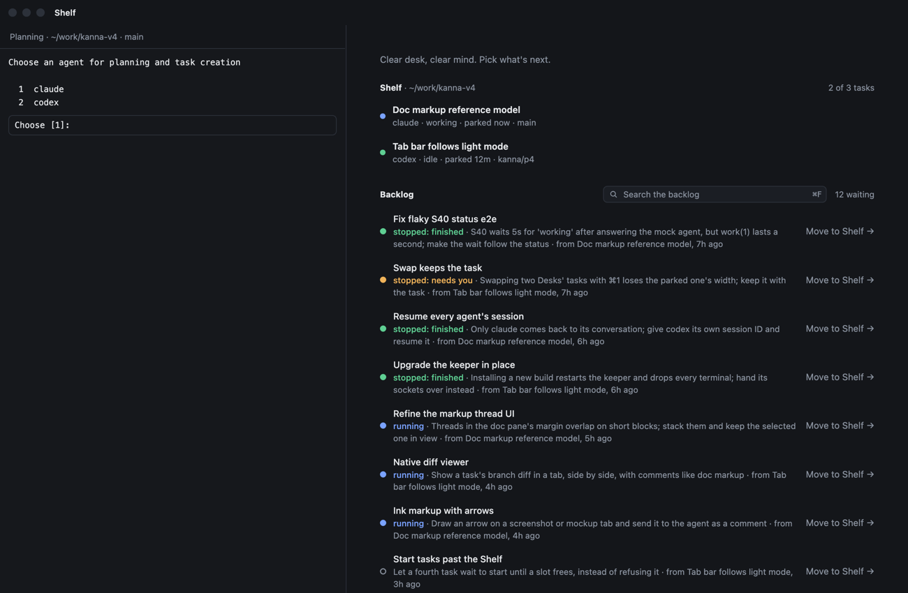
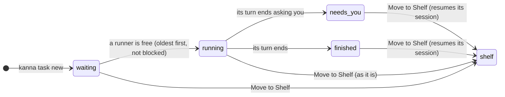

# Backlog runners

**Status:** built · **Tested:** e2e S68, `cargo test -p kanna-detect` (turn, quit files), `-p kanna-daemon` (settings) · **Mockup:** [`references/mockups/desk.html`](../../references/mockups/desk.html) (Simulate: the backlog runs tasks; backlog.runners cycles 3, 1, 0; or `#runs`) · **Builds on:** [tasks](tasks.md), [blocked tasks](task-dependencies.md), [agent status](agent-status.md), [which agents resume](tasks.md#which-agents-resume)

Backlog tasks start by themselves, a few at a time, and work until they're blocked or done, then stop. By the time you move one to the Shelf, it has already done something, and it resumes there.

## Contents

1. [What runs](#1-what-runs)
2. [How it's built](#2-how-its-built)
3. [Open questions](#3-open-questions)
4. [Glossary](#4-glossary)

## 1. What runs

- **Runners:** `backlog.runners` ([settings](settings.md#3-keys), default 3, the repo's file over yours) of a repo's backlog tasks run at once. 0 turns it off: nothing starts or stops by itself.
- **Oldest first,** skipping a [blocked](task-dependencies.md) task until what it waits for is Done.
- **Every backlog task runs.** A task that needs you (a mockup to discuss, a question) runs until it asks.
- **A runner frees when a turn ends:** the agent's [status](agent-status.md) goes from working to needs you or idle and stays there 3s. Kanna quits the agent, keeps its session, and starts the next.
- **Rows show only state:** running, stopped: needs you, stopped: finished (`kanna task list` too). The Shelf isn't re-sorted.
- **Resume on the Shelf:** Move to Shelf (or `kanna task start`) resumes a stopped task's session where it stopped.

## 2. How it's built

- **The runners are the daemon's** (`Backlog::tick` in `backlog.rs`): every 2s, and whenever a task is made, edited, done or stops, it starts each repo's oldest waiting tasks (never started, not blocked) until `backlog.runners` of them run. Tasks you start in the backlog, or move there running, count too.
- **A turn's end is code, not the agent's judgement:** `Turn` (`kanna-detect`) watches a running backlog task's agent status and says its turn is over when, after working, it stays needs you or idle for 3s (the status tracker already holds idle 300 ms).
- **3s is tested against the corpus:** `kanna-corpus --turns` replays `tools/agent-harness` recordings through the rules and the tracker. Across 27 claude and codex recordings, no turn was judged over while its agent still worked, from 0.5s up; 3s leaves room for a real agent's pauses between tool calls.
- **Each agent says how it quits and where its session is**, in `agent-rules/quit/AGENT.json` beside its rules: the keys that quit it, and a pattern that finds its session ID in what it prints as it exits.

| Agent | Quit with | Its session |
|---|---|---|
| codex | `ctrl+c ctrl+c` | `codex resume ID`, printed as it exits |
| claude | its terminal hung up | Kanna's, given at start (`--session-id`) |
| any other | its terminal hung up | as it [resumes](tasks.md#which-agents-resume) |

- **Stopping one:** Kanna closes the task's tabs, sends the keys, hangs up after 5s if it hasn't quit, reads the session from its screen, and saves the task stopped, with why (`stopped` and `why` in its events).
- **The quit files are bundled only:** the rules site and your overrides can't change which keys Kanna types into an agent.
- **Tested** by e2e S68 with the mock agent as codex: with runners 0 nothing runs; with 3, five tasks run three at a time in order, skipping a blocked one until its blocker is Done; one that asks stops as needs you, its session read from what it said as it quit; Move to Shelf resumes it there; moved back to the backlog idle, it stops as finished.

## 3. Open questions

1. **A task moved to the backlog running counts as a runner** and stops when its turn ends, idle when it arrives included. Moving a task back to the backlog to keep it running there, outside the Shelf, would need a way to say so.

## 4. Glossary

| Term | Meaning |
|---|---|
| **Runner** | One of `backlog.runners` places in which a repo's backlog tasks run by themselves |
| **Turn** | An agent's work from your message (or its first) until it stops to wait for you |
