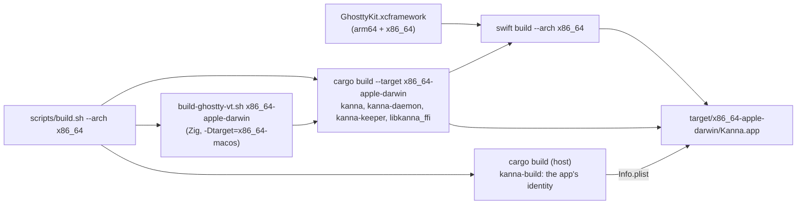

# Build Architectures

**Status:** built · **Builds on:** [build speed](build-speed.md) · **Why:** Kanna ships one DMG per architecture (arm64 and x86_64), like Kanna v2, so one Mac has to build both

`scripts/build.sh [channel] --arch arm64|x86_64` (and `scripts/build-kanna-app.sh`) builds a whole Kanna.app for one architecture: the Swift app (`swift build --arch`), the Rust helpers (`cargo --target`) and libghostty-vt (Zig). Without `--arch` it builds for this Mac. Each architecture gets its own app, never a universal binary. The channel is chosen separately ([build channels](build-channels.md)).

## Where each build goes

| `--arch` on an arm64 Mac | Rust | Swift build | libghostty-vt | App |
|---|---|---|---|---|
| left out, or `arm64` | `target/release` | `target/kanna-build` | `target/ghostty-vt/aarch64-apple-darwin` | `target/Kanna.app` |
| `x86_64` | `target/x86_64-apple-darwin/release` | `target/x86_64-apple-darwin/kanna-build` | `target/ghostty-vt/x86_64-apple-darwin` | `target/x86_64-apple-darwin/Kanna.app` |

- **The native build stays where it was;** another architecture's goes in `target/<rust triple>/`, beside cargo's own output for it, so building one never cleans or overwrites the other.
- **GhosttyKit is shared:** Ghostty's xcframework already holds arm64 and x86_64, and SwiftPM links the slice it needs.
- **The identity comes from the host:** the Info.plist is written from `target/release/kanna-build`, built for this Mac, since the other architecture's binaries may not run here.
- **Borrowing in a worktree is per architecture:** cargo's dependencies come from the main checkout's `target/<triple>/release` when it has one; Ghostty and the Swift packages are borrowed as for a native build ([build speed](build-speed.md)).
- **The Rust target** is added with `rustup target add` the first time it's needed.
- **A non-native dev build** is for checking that it builds: its CLI still opens `target/Kanna.app`.
