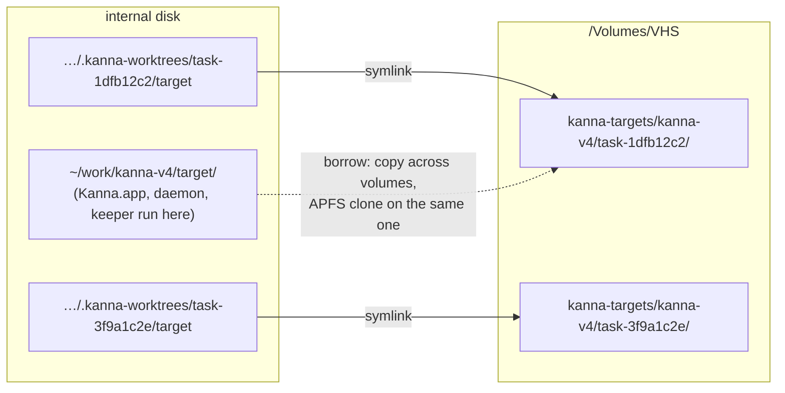

# Build Targets

**Status:** built · **Builds on:** [build speed](build-speed.md), [settings](settings.md) · **Why:** each task worktree's `target/` grows to 10 GB, and 57 of them filled the internal disk until a task stopped

A task worktree's build outputs can live on another volume, such as an external SSD, while its sources stay where they are.

## Contents

1. [Where `target/` lives](#1-where-target-lives)
2. [Rules](#2-rules)
3. [Removing a task](#3-removing-a-task)

## 1. Where `target/` lives

Set `build.targets` in your `~/.kanna-v4/config.json` ([settings](settings.md#3-keys)) to a folder on that volume.

```json
{ "build": { "targets": "/Volumes/VHS/kanna-targets" } }
```



## 2. Rules

- **Only worktrees move.** A worktree's `target/` becomes a symlink to `ROOT/REPO/WORKTREE` (the main checkout's folder name, then the worktree's). Its sources stay in `.kanna-worktrees`.
- **The main checkout's `target/` stays on the internal disk.** Kanna.app, its daemon and keeper run from it; on a drive that gets unplugged, the keeper and every terminal would die with it.
- **Unset, nothing changes:** `target/` is a folder in the worktree.
- **Set by `kanna_targets`** in `scripts/env.sh`, which `build.sh` and each `build-*.sh` run first. It reads only your file (`$KANNA_AGENTS_HOME/.kanna-v4/config.json` when that's set): the drive belongs to this Mac, not the repo, so a repo's `.kanna/config.json` can't set it.
- **A missing volume falls back to the internal disk.** When the root is under `/Volumes/NAME` and `NAME` isn't mounted (absent, or an empty folder left on the internal disk), the build says so and builds in a real `target/` in the worktree, replacing a link that points at the missing volume. A root that isn't an absolute path falls back the same way.
- **The next build with the volume moves it there.** A worktree with a real `target/` moves it over (`mv` to `DEST.moving`, rename, link), keeping what it built. If the volume still has an older copy from before it was unplugged, the moved one replaces it. A link to another root moves the same way.
- **Borrowing copies across volumes.** `cp -c` can't clone across volumes, so `kanna_borrow_cargo` and `kanna_borrow_swiftpm` fall back to `cp -R -p`: ~850 MB over the USB SSD instead of an instant clone. On one volume they still clone. Measured on a USB SSD: a fresh worktree builds in **31s** (20.7s on the internal disk, [build speed](build-speed.md#3-measured) case (a)); a no-op rebuild in 2s.
- **Everything reads it through the link:** cargo, SwiftPM (its `workspace-state.json` paths and module cache keep the worktree's `target/` path), Zig's `--cache-dir`s, `e2e-kanna.sh`, and `--bg` instances launched from the worktree's `target/Kanna.app`. Launch Services runs the app from the volume's real path, so `e2e-kanna.sh` matches either path when it stops an app. `.gitignore` ignores `/target` as well as `target/`, since git doesn't count a symlink as a folder.

## 3. Removing a task

`git worktree remove` and `rm -rf target` remove only the link. Whatever removes a done task's build folders (the backlog task *Task setup and teardown scripts*) also removes the folder the link points to, skips it when its volume isn't mounted, and never touches anything under the main checkout's `target/`.
