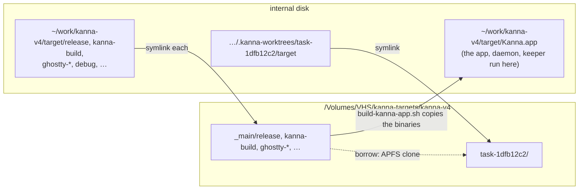

# Build Targets

**Status:** built · **Builds on:** [build speed](build-speed.md), [settings](settings.md) · **Why:** each checkout's `target/` grows to 10 GB, and 57 task worktrees filled the internal disk until a task stopped

Build outputs can live on another volume, such as an external SSD: every task worktree's, and all of the main checkout's except the app it runs. Sources stay where they are.

## Contents

1. [Where `target/` lives](#1-where-target-lives)
2. [Rules](#2-rules)
3. [Removing a task](#3-removing-a-task)

## 1. Where `target/` lives

Set `build.targets` in your `~/.kanna-v4/config.json` ([settings](settings.md#3-keys)) to a folder on that volume.

```json
{ "build": { "targets": "/Volumes/VHS/kanna-targets" } }
```



## 2. Rules

- **A worktree's whole `target/`** becomes a symlink to `ROOT/REPO/WORKTREE` (the main checkout's folder name, then the worktree's).
- **The main checkout keeps `target/` and its `*.app` bundles on the internal disk;** every other folder in it becomes a symlink to `ROOT/REPO/_main/NAME`, including ones a later build makes. `build-kanna-app.sh` already builds `target/Kanna.app` by copying the binaries out of `release/`, so the app, daemon and keeper always run from the internal disk, and unplugging the drive never takes the keeper and its terminals with it.
- **The `kanna` on your PATH** should be `target/Kanna.app/Contents/Helpers/kanna`, not `target/release/kanna`, which is on the volume.
- **Unset, nothing changes:** `target/` is a folder in each checkout.
- **Set by `kanna_targets`** in `scripts/env.sh`, which `build.sh` and each `build-*.sh` run first. It reads only your file (`$KANNA_AGENTS_HOME/.kanna-v4/config.json` when that's set): the drive belongs to this Mac, not the repo, so a repo's `.kanna/config.json` can't set it.
- **A missing volume falls back to the internal disk,** in the main checkout too. When the root is under `/Volumes/NAME` and `NAME` isn't mounted (absent, or an empty folder left on the internal disk), the build says so, removes the links that point at the missing volume, and builds in real folders. The main checkout's fallback is a cold build of ~10 GB, which fits once the build outputs are off the internal disk. A root that isn't an absolute path falls back the same way.
- **The next build with the volume moves them there.** A real folder moves over (`mv` to `DEST.moving`, rename, link), keeping what it built. If the volume still has an older copy from before it was unplugged, the moved one replaces it. A link to another root moves the same way.
- **Borrowing clones on the volume.** With main's `release/` on the same volume, `kanna_borrow_cargo` clones it (0.2s for 830 MB, against 6.5s to copy it from the internal disk), and the clone shares disk blocks with main's. It resolves main's link first, since `cp -R` copies a symlink named on its command line instead of following it. When the two sides are on different volumes (one fell back), `kanna_clone` copies with `cp -R -p`. A fresh worktree copying from the internal disk built in 31s (20.7s with everything internal, [build speed](build-speed.md#3-measured) case (a)); a no-op rebuild in 2s.
- **Everything reads it through the link:** cargo, SwiftPM (its `workspace-state.json` paths and module cache keep the worktree's `target/` path), Zig's `--cache-dir`s, `e2e-kanna.sh`, and `--bg` instances launched from the worktree's `target/Kanna.app`. Launch Services runs the app from the volume's real path, so `e2e-kanna.sh` matches either path when it stops an app. `.gitignore` ignores `/target` as well as `target/`, since git doesn't count a symlink as a folder.

## 3. Removing a task

`git worktree remove` and `rm -rf target` remove only the link. Whatever removes a done task's build folders (the backlog task *Task setup and teardown scripts*) also removes the folder the link points to, skips it when its volume isn't mounted, and never touches the main checkout's `target/` or `_main/`.
