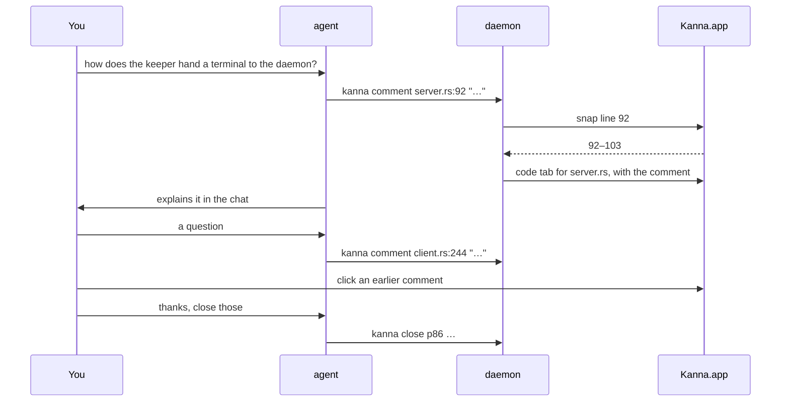
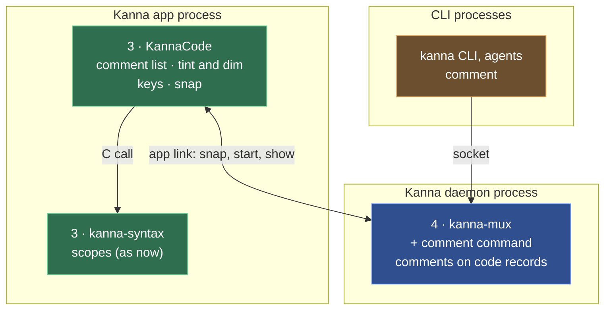

# Code Tour

**Status:** proposed · **Mockup:** [`references/mockups/code-tour.html`](../../references/mockups/code-tour.html) · **Builds on:** the [code viewer](code-viewer.md)

A **code tour** is the agent commenting on code while it explains it, so you keep a mental model of how it works, whether you're a vibe coder, an engineer or not technical at all. As it talks, the agent comments on the part it's talking about: the file opens in a code tab, those lines are tinted and the rest dimmed, and the comment is listed beside the code. You ask questions as it goes; it comments on whatever answers them. The agent pitches its words to whoever it's talking to; there's no level to choose.

Kanna gives the agent one command, `kanna comment`; how to give a good tour is a skill (`kanna-tour`), not a feature.

## Contents

1. [The loop](#1-the-loop)
2. [Rules](#2-rules)
3. [Keys and mouse](#3-keys-and-mouse)
4. [CLI](#4-cli)
5. [The skill](#5-the-skill)
6. [How it's built](#6-how-its-built)
7. [Glossary](#7-glossary)

## 1. The loop

## 2. Rules

- **A comment** is on some lines of a file. `kanna comment FILE:LINE "text"` opens the file in a code tab, as `kanna open code` does (with no placement, a tab on the task's Desk), or selects the code tab in that window that already shows it, and adds the comment there.
- **The newest comment is shown.** Its lines are tinted, with a bar in the gutter, and the rest of the file is dimmed; the tab scrolls to it. Beside the code, the tab lists its file's comments in the order they were made, each with the first line of code it's on and its lines; only the shown one has its text, outlined, and the others fold, so a new comment folds the one before it. Clicking a folded one shows it.
- **Each tab has its own comments**, for its own file.
- **A line snaps to its scope.** `FILE:LINE` becomes the scope that opens on that line (a function, a type, a loop, a block), or else the smallest scope the line is in, from the viewer's tree-sitter scopes, so `client.rs:244` covers the loop it's in, 242–259. `FILE:FIRST-LAST` is kept as written, for a few lines inside a long function. A file without scopes takes the line alone.
- **Comments keep their lines.** A comment is snapped once, when it's made; if the file changes afterwards, it stays on the same line numbers.

- **The tabs stay until closed.** You close them when you're done, or ask the agent to (`kanna close`); a tab's comments go with it.
- **They come back after a relaunch.**
- **Light and dark** follow the system.

- **Problems:** a missing file fails with "No such file: …", as `open code` does; a line past the end fails with "… has N lines"; with no app attached it fails with "Kanna.app isn't running".

## 3. Keys and mouse

| You | Does |
|---|---|
| Click a folded comment | shows it |
| ‹ › beside the comments, ⌥↓ ⌥↑ | the next, previous comment |
| Everything else | as in the [code viewer](code-viewer.md#3-keys-and-mouse) |

## 4. CLI

| Command | Does |
|---|---|
| `kanna comment FILE:LINE[-LAST] TEXT... [placement]` | comments on those lines; placement options as `open`, for a file that isn't open yet. Answers `p87 · fdpass.rs:20–48`, with `opened` when it opened a tab |
| `kanna list` | shows how many comments a code pane has |
| `kanna raw '{"cmd":"debug.code","args":{"pane":"p86"}}'` | for tests: also the comments, the shown one, and which lines are tinted and dimmed |

## 5. The skill

`kanna-tour` (in `.agents/kanna-skills`) tells the agent when to give a tour and how:

- **When:** the user asks how something works, wants to understand code the agent wrote or changed, or seems to be losing track of the code.
- **Comment as you explain, one at a time.** Run `kanna comment` as you talk about a part, not all at once up front; explain in the chat, and keep the comment to the one thing to remember about it.
- **Plain words, pitched to the user.** A non-technical user gets what the code does and why; an engineer gets how. No jargon the user hasn't used.
- **Follow the questions.** Answer by commenting on the code that answers it. Check in every few comments.
- **Small parts.** A function or a block; `FILE:FIRST-LAST` for a few lines inside a long one.
- **Close the tabs** when the user asks.

## 6. How it's built

Read top to bottom, as the [code viewer's](code-viewer.md#5-how-its-built) layers; only what's new is named.

| Piece | Where | What's new |
|---|---|---|
| CLI | `crates/kanna` | `comment`, completing source files |
| Comment command | `crates/kanna-mux` (daemon) | `comment` finds or opens the file's code pane (the same-file rule), asks the app to snap, and adds the comment to the pane's record; showing an earlier one sets which is shown |
| Comments in the pane | `apps/kanna/Sources/KannaCode` | the list beside the code, tint and dim, ⌥↓ ⌥↑ |
| Snap | `apps/kanna/Sources/Kanna` | answers the daemon's `code.snap` (path, line) with the snapped lines, from `kanna-syntax`'s scopes |
| Contents | `apps/kanna/Sources/Kanna/Panes` | passes a code pane its comments, sends a click on a folded comment to the daemon, keeps scroll across a pane's restart |

- **Comments live on the code pane's record**, `comments: [{path, first, last, text}]` and `shown`, so `layout.json` keeps them and they go when the pane closes. A pane shows the comments on the file it's showing.
- **Snapping is the app's**, since tree-sitter is compiled into the app only (it costs about 18 MB, so the daemon doesn't link it too): the daemon asks the app over the app link, as it already asks it for the layout, and stores the lines it answers.
- **A new or shown comment restarts the pane**, as `navigate` does, at the comment's first line.
- **Dimming** is drawn over the text view (the background colour, partly transparent, over the lines outside the comment), so the highlighting keeps its colours.
- **Checks:** `crates/kanna-daemon/tests/panes.rs` for `comment` (opening, reusing a tab, a range, showing an earlier one, the records); KannaCode's snapping against fixture scopes; an e2e scenario that comments on three files, reads `debug.code`, shows an earlier comment, closes the tabs and relaunches.

## 7. Glossary

| Term | Meaning |
|---|---|
| **tour** | The agent explaining code while commenting on it |
| **comment** | A note the agent puts on some lines of a file |
| **snapping** | Widening a comment's line to the scope it opens or sits in |
