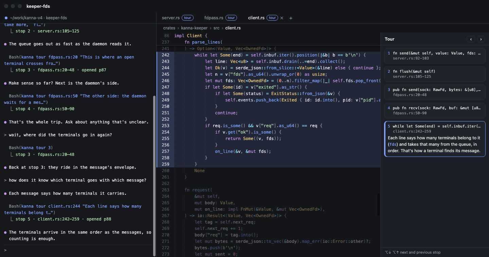
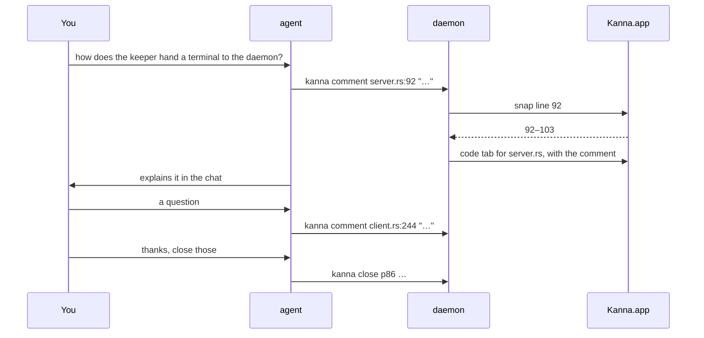
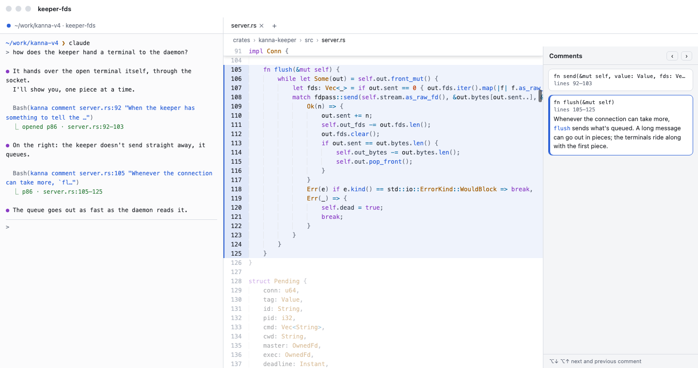
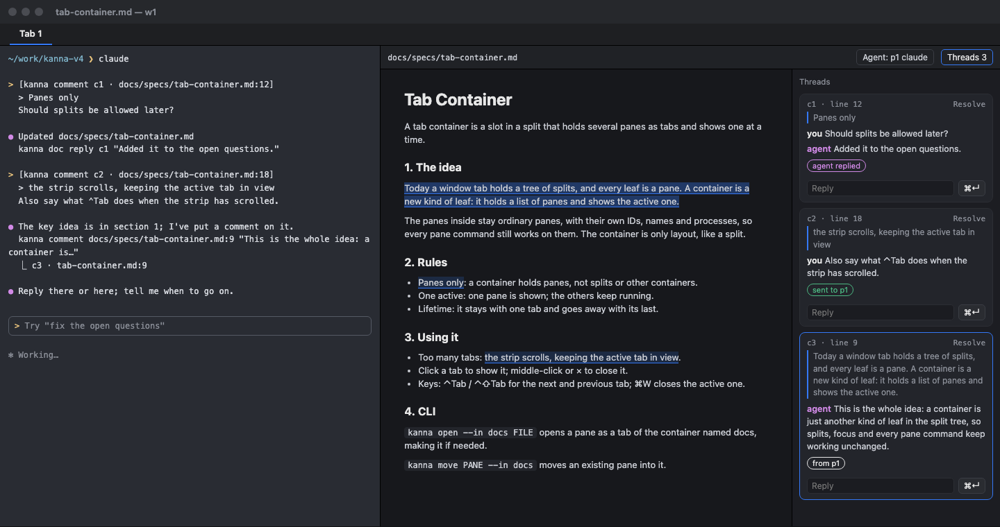
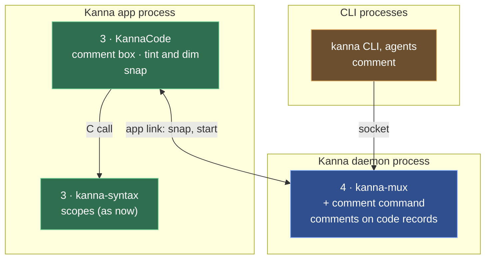

# Code Tour

**Status:** proposed · **Mockup:** [`references/mockups/code-tour.html`](../../references/mockups/code-tour.html) · **Builds on:** the [code viewer](code-viewer.md)

A **code tour** is the agent commenting on code while it explains it, so you keep a mental model of how it works, whether you're a vibe coder, an engineer or not technical at all. As it talks, the agent comments on the part it's talking about: the file opens in a code tab, those lines are tinted and the rest dimmed, and the comment shows just above them. You ask questions as it goes; it comments on whatever answers them.

Kanna gives the agent one command, `kanna comment`; how to explain code is a skill (`kanna-explain`), not a feature, and comments are one of its ways, beside markdown docs with diagrams.

## Contents

1. [The loop](#1-the-loop)
2. [Rules](#2-rules)
3. [CLI](#3-cli)
4. [The skill](#4-the-skill)
5. [How it's built](#5-how-its-built)
6. [Glossary](#6-glossary)

## 1. The loop

## 2. Rules

- **A comment** is on some lines of a file. `kanna comment FILE:LINE "text"` opens the file in a code tab, as `kanna open code` does (with no placement, a tab on the task's Desk), or selects the code tab in that window that already shows it, and adds the comment there.
- **Only the newest comment shows.** Its lines are tinted, with a bar in the gutter, the rest of the file is dimmed, and the comment shows in a box just above its first line, with the lines it's on; the tab scrolls to it. A new comment in the same tab replaces it. **[Later, its own task]** ⌃− and ⌃⇧− go back and forward through the comments, across tabs, as in VS Code.
- **A line snaps to its scope.** `FILE:LINE` becomes the scope that opens on that line (a function, a type, a loop, a block), or else the smallest scope the line is in, from the viewer's tree-sitter scopes, so `client.rs:244` covers the loop it's in, 242–259. `FILE:FIRST-LAST` is kept as written, for a few lines inside a long function. A file without scopes takes the line alone.
- **Comments keep their lines.** A comment is snapped once, when it's made; if the file changes afterwards, it stays on the same line numbers.

- **Each tab has its own comment.** The tabs stay until closed: you close them when you're done, or ask the agent to (`kanna close`); a tab's comment goes with it.
- **They come back after a relaunch.**
- **Light and dark** follow the system.

- **On a markdown file it's a thread.** `kanna comment DOC.md:LINE "text"` opens the doc with comments on, as `kanna markup DOC.md` does (or turns them on in the markdown tab that already shows it), and starts a [doc markup](doc-markup.md) thread there, written by the agent, on the block the line is in (a paragraph, a list item, a heading). The thread stays in the list beside the doc, like any other; your reply in it is sent to the agent, as a comment of yours would be. Good for explaining architecture from a doc with diagrams.

- **Problems:** a missing file fails with "No such file: …", as `open code` does; a line past the end fails with "… has N lines"; with no app attached it fails with "Kanna.app isn't running".

## 3. CLI

| Command | Does |
|---|---|
| `kanna comment FILE:LINE[-LAST] TEXT... [placement]` | comments on those lines; placement options as `open`, for a file that isn't open yet. Answers `p87 · fdpass.rs:20–48`, with `opened` when it opened a tab |
| `kanna list` | shows a code pane's comment |
| `kanna raw '{"cmd":"debug.code","args":{"pane":"p86"}}'` | for tests: also the comment, and which lines are tinted and dimmed |

## 4. The skill

`kanna-explain` (in `.agents/kanna-skills`) tells the agent when and how to explain code so the user keeps a mental model of it:

- **When:** the user asks how something works, wants to understand code the agent wrote or changed, or seems to be losing track of the code.
- **Pick the way that fits.** Comments on the code (`kanna comment FILE:LINE`) for how a part works; a markdown doc with diagrams, such as a sequence or a layer diagram, for how the parts fit together, commented on the same way (`kanna comment DOC.md:LINE`); often both, the doc first and the code after.
- **One comment at a time.** Comment on one part, explain it in the chat, keep the comment to the one thing to remember about it, and stop: ask the user to tell you when to go on. Never comment on several parts in one turn.
- **Follow the questions.** Answer by commenting on the code that answers it.
- **Small parts.** A function or a block; `FILE:FIRST-LAST` for a few lines inside a long one.
- **At the end, offer to leave the tabs open or close them** (`kanna close`), and do what the user picks.

## 5. How it's built

Read top to bottom, as the [code viewer's](code-viewer.md#5-how-its-built) layers; only what's new is named.

| Piece | Where | What's new |
|---|---|---|
| CLI | `crates/kanna` | `comment`, completing source files |
| Markdown | `crates/kanna` (`threads.rs`) | `comment` on a `.md` file adds a thread, written by the agent, to the doc's thread file, quoting the block at that line, then opens the doc for comments as `markup` does; the pane picks the thread up as it does a reply |
| Comment command | `crates/kanna-mux` (daemon) | `comment` finds or opens the file's code pane (the same-file rule), asks the app to snap, and puts the comment on the pane's record |
| Comment in the pane | `apps/kanna/Sources/KannaCode` | the comment box above its lines, tint and dim |
| Snap | `apps/kanna/Sources/Kanna` | answers the daemon's `code.snap` (path, line) with the snapped lines, from `kanna-syntax`'s scopes |
| Contents | `apps/kanna/Sources/Kanna/Panes` | passes a code pane its comment |

- **The comment lives on the code pane's record**, `comment: {path, first, last, text}`, so `layout.json` keeps it and it goes when the pane closes. A pane shows it while it shows that file.
- **Snapping is the app's**, since tree-sitter is compiled into the app only (it costs about 18 MB, so the daemon doesn't link it too): the daemon asks the app over the app link, as it already asks it for the layout, and stores the lines it answers.
- **A new comment restarts the pane**, as `navigate` does, at the comment's first line.
- **The box** is a view laid into the text view's space above the comment's first line (as a gap in the line layout), so the code below it moves down and the line numbers stay with their lines.
- **Dimming** is drawn over the text view (the background colour, partly transparent, over the lines outside the comment), so the highlighting keeps its colours.
- **Checks:** `crates/kanna-daemon/tests/panes.rs` for `comment` (opening, reusing a tab, a range, a new comment replacing the last, the records); KannaCode's snapping against fixture scopes; an e2e scenario that comments on three files, reads `debug.code`, comments again in one, closes a tab and relaunches.

## 6. Glossary

| Term | Meaning |
|---|---|
| **tour** | The agent explaining code while commenting on it |
| **`kanna-explain`** | The skill for explaining code: comments, markdown docs with diagrams |
| **comment** | A note the agent puts on some lines of a file, shown above them |
| **snapping** | Widening a comment's line to the scope it opens or sits in |
