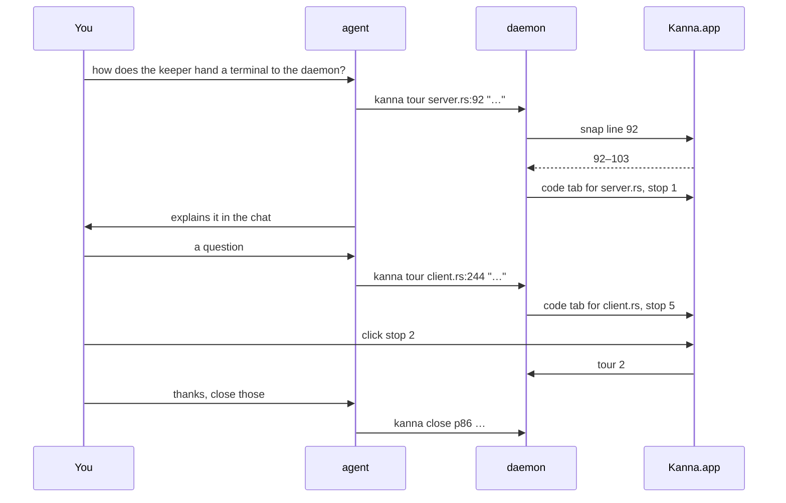
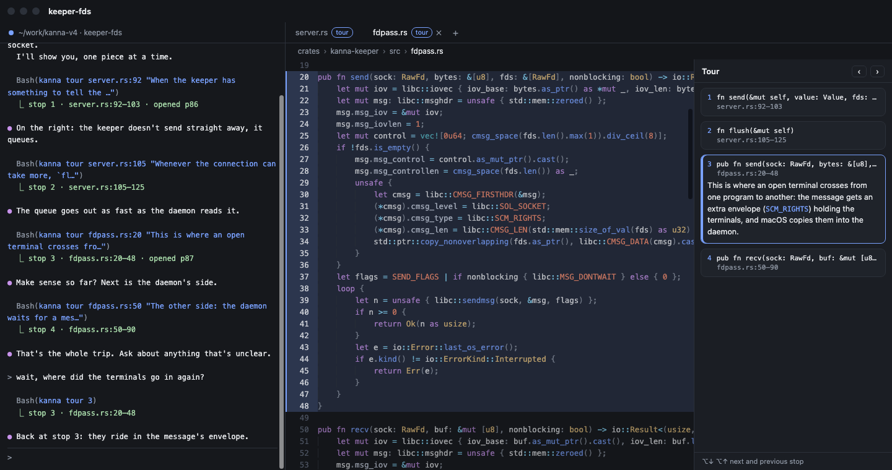
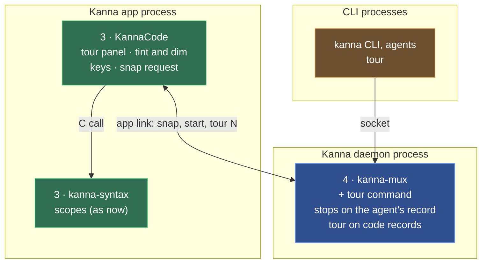

# Code Tour

**Status:** proposed · **Mockup:** [`references/mockups/code-tour.html`](../../references/mockups/code-tour.html) · **Builds on:** the [code viewer](code-viewer.md)

A **code tour** is the agent showing you code while it explains it, one part at a time, so you keep a mental model of how it works, whether you're a vibe coder, an engineer or not technical at all. As it talks, the agent opens files in code tabs and marks the part it's talking about: tinted, the rest of the file dimmed, with a one-line comment that joins the tour beside the code. You ask questions as it goes; it shows you whatever answers them. The agent pitches its words to whoever it's talking to; there's no level to choose.

Kanna gives the agent two commands; how to run a good tour is a skill (`kanna-tour`), not a feature.

## Contents

1. [The loop](#1-the-loop)
2. [Rules](#2-rules)
3. [Keys and mouse](#3-keys-and-mouse)
4. [CLI](#4-cli)
5. [The skill](#5-the-skill)
6. [How it's built](#6-how-its-built)
7. [Glossary](#7-glossary)

## 1. The loop

## 2. Rules

- **A stop** is a part of a file and a comment. `kanna tour FILE:LINE "comment"` adds one to the agent's tour and makes it the current stop; `kanna tour N` goes back to stop N.
- **The agent's tour.** Each agent (its terminal) has one tour: the stops it has shown, in order, across every code tab it opened for them. A stop in a file that isn't open opens it in a code tab, as `kanna open code` does (with no placement, a tab on the task's Desk); a file already open in a code tab in that window is used as it is. Going to a stop selects its file's tab and scrolls to it.
- **The current stop** is tinted, with a bar in the gutter, and the rest of its file is dimmed. A tour tab shows a "tour" tag, and the tour's stops beside the code, with ‹ ›: each stop's number, its first line of code, and its file and lines. Only the current stop shows its comment, outlined; the others fold to their first line, so a new stop folds the one before it, and clicking one opens its comment again.
- **A line snaps to its scope.** `FILE:LINE` becomes the scope that opens on that line (a function, a type, a loop, a block), or else the smallest scope the line is in, from the viewer's tree-sitter scopes, so `client.rs:244` shows the loop it's in, 242–259. `FILE:FIRST-LAST` is kept as written, for a few lines inside a long function. A file without scopes shows the line alone.
- **Stops keep their lines.** A stop is snapped once, when it's added; if the file changes afterwards, it stays on the same line numbers.

- **The tabs stay until closed.** You close them when you're done, or ask the agent to (`kanna close`). A stop whose tab you closed stays in the tour; going to it opens its file again. When all of a tour's tabs are closed, the tour is over: the agent's next `kanna tour FILE:LINE` starts a new one at stop 1.
- **It comes back after a relaunch**, with its stops and its current stop.
- **Light and dark** follow the system.

- **Problems:** a missing file fails `kanna tour` with "No such file: …", as `open code` does, and adds no stop; a line past the end of the file fails with "… has N lines"; `kanna tour N` with no such stop fails with "the tour has M stops"; `kanna tour` from outside a terminal fails with "a tour belongs to an agent's terminal".

## 3. Keys and mouse

| You | Does |
|---|---|
| Click a stop | goes to it, in its file's tab |
| ‹ › in the panel, ⌥↓ ⌥↑ | next, previous stop |
| Everything else | as in the [code viewer](code-viewer.md#3-keys-and-mouse) |

## 4. CLI

| Command | Does |
|---|---|
| `kanna tour FILE:LINE[-LAST] COMMENT... [placement]` | adds a stop and goes to it; placement options as `open`, for a file that isn't open yet. Answers `stop 3 · fdpass.rs:20–48`, with `opened p87` when it opened a tab |
| `kanna tour N` | goes to stop N |
| `kanna tour` | lists the tour: each stop's number, file, lines and comment, the current one marked |
| `kanna list` | shows which agent's tour a code pane is in |
| `kanna raw '{"cmd":"debug.code","args":{"pane":"p86"}}'` | for tests: also the tour's stops, the current one, and which lines are tinted and dimmed |

## 5. The skill

`kanna-tour` (in `.agents/kanna-skills`) tells the agent when to give a tour and how:

- **When:** the user asks how something works, wants to understand code the agent wrote or changed, or seems to be losing track of the code.
- **One stop at a time, while explaining.** Run `kanna tour` as you talk about a part, not all at once up front; explain in the chat, and keep the comment to the one thing to remember about it.
- **Plain words, pitched to the user.** A non-technical user gets what the code does and why; an engineer gets how. No jargon the user hasn't used.
- **Follow the questions.** Answer by showing the code that answers it, or `kanna tour N` to go back. Check in every few stops.
- **Small stops.** A function or a block; use `FILE:FIRST-LAST` for a few lines inside a long one.
- **Close the tabs** when the user asks.

## 6. How it's built

Read top to bottom, as the [code viewer's](code-viewer.md#5-how-its-built) layers; only what's new is named.

| Piece | Where | What's new |
|---|---|---|
| CLI | `crates/kanna` | `tour`, completion of source files and stop numbers |
| Tour command | `crates/kanna-mux` (daemon) | `tour` adds a stop (asking the app to snap it), opens or reuses the file's code pane, and goes to a stop; the stops and the current one on the agent's record, the agent on each tour code pane's record |
| Tour in the pane | `apps/kanna/Sources/KannaCode` | the panel, tint and dim, ⌥↓ ⌥↑ |
| Snap | `apps/kanna/Sources/Kanna` | answers the daemon's `code.snap` (path, line) with the snapped lines, from `kanna-syntax`'s scopes |
| Contents | `apps/kanna/Sources/Kanna/Panes` | passes a tour pane its stops, sends a click on a stop as `tour`, keeps scroll across a pane's restart |

- **The daemon owns the tour**, on the agent's terminal record as `tour: {stops: [{path, first, last, comment}], stop}`, so `layout.json` keeps it; each code pane it opened or reused records `tour: AGENT`. A code pane's start carries a copy of its tour's stops, so the app only draws.
- **Snapping is the app's**, since tree-sitter is compiled into the app only (it costs about 18 MB, so the daemon doesn't link it too): adding a stop asks the app over the app link, as the daemon already asks it for the layout, and stores the answer. Without the app attached, `kanna tour` fails with "Kanna.app isn't running".
- **A stop change restarts the tour's panes**, as `navigate` does; a pane whose file and line didn't change keeps its scroll, so only the stop's tab moves.
- **Dimming** is drawn over the text view (the background colour, partly transparent, over the lines outside the stop), so the highlighting keeps its colours.
- **Checks:** `crates/kanna-daemon/tests/panes.rs` for `tour` (adding, reusing a tab, going back, a closed tab reopened, a new tour after all tabs close, the records); KannaCode's snapping against fixture scopes; an e2e scenario that adds stops in three files, reads `debug.code`, goes back to a stop in another file, closes the tabs and relaunches.

## 7. Glossary

| Term | Meaning |
|---|---|
| **tour** | The stops an agent has shown you, in order |
| **stop** | One part of a file and a one-line comment |
| **snapping** | Widening a stop's line to the scope it opens or sits in |
