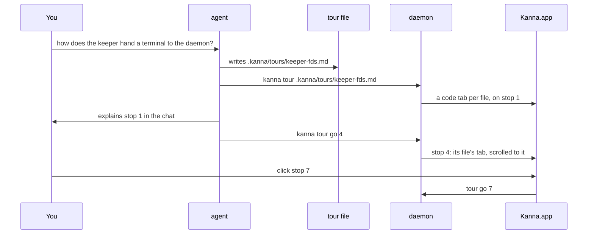
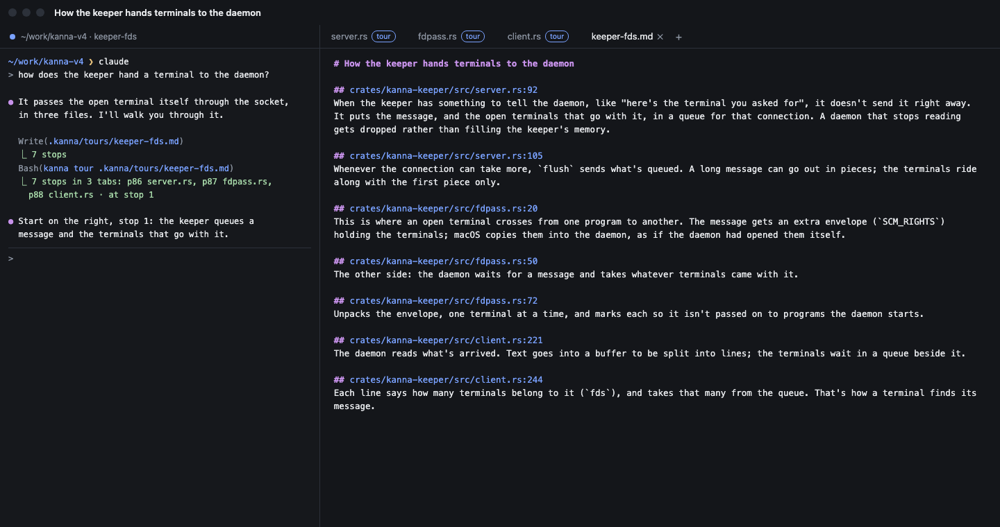
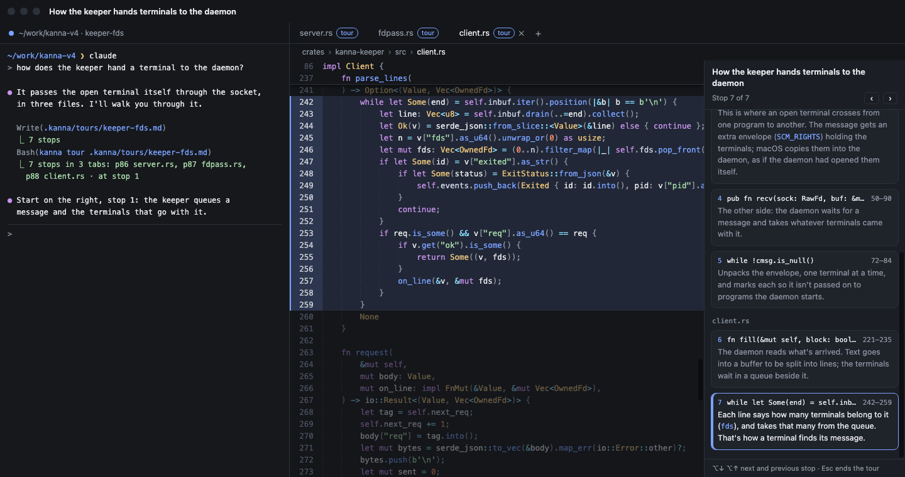
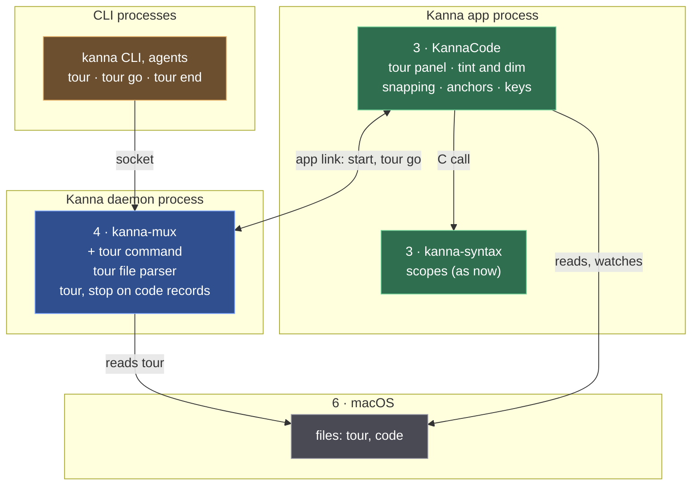

# Code Tour

**Status:** proposed · **Mockup:** [`references/mockups/code-tour.html`](../../references/mockups/code-tour.html) · **Builds on:** the [code viewer](code-viewer.md)

A **code tour** is the agent walking you through code, one stop at a time, so you keep a mental model of how it works, whether you're a vibe coder, an engineer or not technical at all. Each stop is a part of the code, tinted while the rest is dimmed, with one plain explanation beside it. The agent pitches the explanations to whoever it's talking to; there's no level to choose.

## Contents

1. [The loop](#1-the-loop)
2. [The tour file](#2-the-tour-file)
3. [Rules](#3-rules)
4. [Keys and mouse](#4-keys-and-mouse)
5. [CLI](#5-cli)
6. [How it's built](#6-how-its-built)
7. [Glossary](#7-glossary)

## 1. The loop

## 2. The tour file

The agent writes a tour as markdown, with its own tools, in `<repo>/.kanna/tours/NAME.md`: a `#` title, then one `##` heading per stop naming `FILE:LINE` (or `FILE:FIRST-LAST`) and one plain explanation under it.

- **Paths** are relative to the repo: the folder holding `.kanna/`, or the tour file's own folder if it isn't in one.
- **The pane follows the file.** When the agent edits the tour, every tab of it shows the change; to add a file, it runs `kanna tour` again.
- **Not committed.** As with doc markup's threads, Kanna doesn't commit `.kanna/` or change `.gitignore`.

## 3. Rules

- **One tab per file**, in the order the stops first name them, each with the tour's stop list beside the code. A file already open in a code tab in that window is used as it is. Going to a stop in another file selects that file's tab; if you closed it, it opens again.
- **The stop** is tinted, with a bar in the gutter; everything else in the file is dimmed. The panel shows the tour's title, "Stop N of M", ‹ › buttons, and every stop grouped under its file: its number, its first line of code, its lines and its explanation. The current stop is outlined.
- **A line snaps to its scope.** `FILE:LINE` becomes the scope that opens on that line (a function, a type, a loop, a block), or else the smallest scope the line is in, from the viewer's tree-sitter scopes. `FILE:FIRST-LAST` is shown as written, for a few lines inside a long function. A file without scopes (plain text) shows the line alone.

- **Stops follow the code.** When the tour opens, each stop remembers its scope's first line. When the agent edits the file and that line moves, the stop moves with it, so it stays on the same function. If the line is gone, the stop stays at its line number.
- **One current stop per tour**, kept by the daemon, so the agent and you move the same tour, and it comes back after a relaunch.
- **Ending a tour** (Esc, or `kanna tour end`) takes off the tint, the dimming and the panel; the tabs stay open as plain code tabs.
- **Light and dark** follow the system.

- **Problems:** a stop whose file is missing shows its tab's "No such file: …" and stays in the list; a heading that isn't `FILE:LINE` or `FILE:FIRST-LAST` fails `kanna tour` with the heading's line in the tour file; a tour with no stops fails with "… has no stops".

## 4. Keys and mouse

| You | Does |
|---|---|
| Click a stop | goes to it, in its file's tab |
| ‹ › in the panel, ⌥↓ ⌥↑ | next, previous stop |
| Esc | closes the find bar if it's open, otherwise ends the tour |
| Everything else | as in the [code viewer](code-viewer.md#3-keys-and-mouse) |

## 5. CLI

| Command | Does |
|---|---|
| `kanna tour FILE.md [placement]` | opens the tour: a code tab per file, on stop 1 (placement options as `open`; with none, tabs on the task's Desk) |
| `kanna tour go N [--tour FILE.md]` | goes to stop N |
| `kanna tour end [--tour FILE.md]` | ends the tour |
| `kanna list` | shows a code pane's tour and stop |
| `kanna raw '{"cmd":"debug.code","args":{"pane":"p86"}}'` | for tests: also the tour, the current stop and each stop's lines after snapping |

Without `--tour`, `go` and `end` act on the tour in the caller's window (the task's Desk), the one opened last if there are several.

## 6. How it's built

Read top to bottom, as the [code viewer's](code-viewer.md#5-how-its-built) layers; only what's new is named.

| Piece | Where | What's new |
|---|---|---|
| CLI | `crates/kanna` | `tour`, `tour go`, `tour end`; completion of `.kanna/tours/*.md` |
| Tour command | `crates/kanna-mux` (daemon) | the tour file parser; `tour` opens a code pane per file (the same-file rule), sets `tour` and `stop` on their records, and on `go` sets the stop and focuses its file's pane; `end` clears them |
| Tour in the pane | `apps/kanna/Sources/KannaCode` | the tour model (the file parsed and watched), the panel, tint and dim, snapping to the pane's scopes, anchors, keys |
| Contents | `apps/kanna/Sources/Kanna/Panes` | passes the record's tour and stop to the pane, sends a click on a stop as `tour go`, keeps anchors and scroll across a pane's restart |

- **The daemon owns which stop**, on each code pane's record as `tour` (the tour file) and `stop`, so `kanna tour go` and a click in any tab move the same tour, and `layout.json` keeps it. It parses the tour file only for the stops' files, to know which pane a stop is in.
- **The app owns where a stop is.** Snapping needs the syntax tree, which only the pane has; so the record keeps the stop as written and the pane draws it snapped.
- **Anchors** are kept by the app per tour and stop: the snapped scope's first line and its text. On a reload, if that line no longer has that text, the stop moves to the nearest line that does, and snaps again. **[Assumption]** They're kept in memory: after a relaunch, stops snap again from the tour file as written.
- **A stop change restarts the tour's panes** as `navigate` does; a pane whose line didn't change keeps its scroll, so only the stop's tab moves.
- **Dimming** is drawn over the text view (the background colour, partly transparent, over the lines outside the stop), so the highlighting's colours stay as they are.
- **Checks:** the parser's unit tests (stops, ranges, bad headings, paths); `crates/kanna-daemon/tests/panes.rs` for `tour`, `go`, `end` and the records; KannaCode's snapping and anchoring against fixture scopes; an e2e scenario that opens a three-file tour, reads `debug.code`, goes to a stop in another file, edits a file above a stop and sees it follow, ends the tour and relaunches.

## 7. Glossary

| Term | Meaning |
|---|---|
| **tour** | A markdown file of stops the agent walks you through |
| **stop** | One part of the code with one explanation |
| **snapping** | Widening a stop's line to the scope it opens or sits in |
| **anchor** | A stop's scope's first line and its text, so the stop follows the code when it moves |
