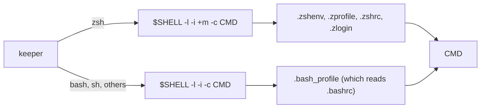

# The Shell a Command Runs In

**Status:** built

A command Kanna runs in a pane (`kanna open --cmd`, a task's agent) starts with the same setup as a terminal tab: the user's login shell reads their profile **and** their rc files, then runs the command. Without the rc files, anything set up in `~/.zshrc` is missing: nvm puts `node` and `codex` on `PATH` there, so a Codex task failed with `zsh:1: command not found: codex` while `codex` worked in a tab.

## Contents

1. [How a command starts](#1-how-a-command-starts)
2. [Rules](#2-rules)
3. [What it changes](#3-what-it-changes)
4. [Glossary](#4-glossary)

## 1. How a command starts

The keeper builds the argv (`command_argv` in `crates/kanna-keeper/src/pty.rs`) from `$SHELL`, else the account's shell, else `/bin/sh`.

## 2. Rules

| Rule | Why |
|---|---|
| **`-i` for every shell.** | zsh with `-c` is non-interactive and skips `.zshrc`. Many `.bashrc` files start with "return unless interactive", above where nvm adds itself. |
| **zsh gets `+m`** (no job control). | `-i` turns job control on, which puts each program of a compound command in a process group of its own. With `+m` the command runs as it did before `-i`: one process group, `SIGWINCH` reaching the shell's traps, no job notices. bash ignores `+m` on its command line, so bash commands have job control. |
| **zsh still `exec`s a lone command.** | The agent is the pane's process, so status detection and `close` see it directly. |
| **Closing a pane ends its whole session.** | The keeper sends `SIGHUP` to every process group in the pty's session, and `SIGKILL` after the grace period ([keeper spec](../keeper.md)). Under bash's job control a background job has a group of its own, and a script ignoring `SIGHUP` would otherwise leave it running. Tabs get the same. |
| **A planning terminal's command reads them too.** | Its [planner script](new-desk.md) looks for the agents your shell finds (nvm's codex) and starts one, so it needs them; it reads them again when it hands over to your shell. The keeper still takes `"rc": false` (`-l -c`) from an older daemon. |
| **A restored pane knows its command** from argv `[shell, -l, (-i), (+m), -c, CMD]`. | A keeper from an older build still holds `-l -c` panes. |

## 3. What it changes

- **Whatever the rc files print shows in the pane** before the command starts. One that asks a question (an update prompt) waits for an answer there, as in a tab. Agents clear the screen when they start.
- **bash says `logout`** when the command ends with the `exit` builtin, and prints job notices (`[1] 1234`) for `&`, as in a tab.
- **bash waits at exit until its last output is read.** The daemon always reads, so this only shows while no daemon runs: the exit is reported once the next daemon takes the pane back.

Checked by the keeper's unit and integration tests, e2e S63 (a test `ZDOTDIR` whose `.zshrc` alone puts a mock `codex` on `PATH`; a `--cmd` pane sees its variable and a `--agent codex` task starts), and S65 (a planning terminal finds codex the way your shell does).

## 4. Glossary

| Term | Meaning |
|---|---|
| **Login shell** (`-l`) | Reads the profile: `.zprofile`, `.bash_profile`. |
| **Interactive shell** (`-i`) | Reads the rc file: `.zshrc`, or `.bashrc` past its "interactive only" guard. |
| **Job control** (`-m`, monitor) | The shell puts each job in a process group of its own and hands it the terminal. |
| **Session** | The processes started under one pty; the shell Kanna starts leads it. |
