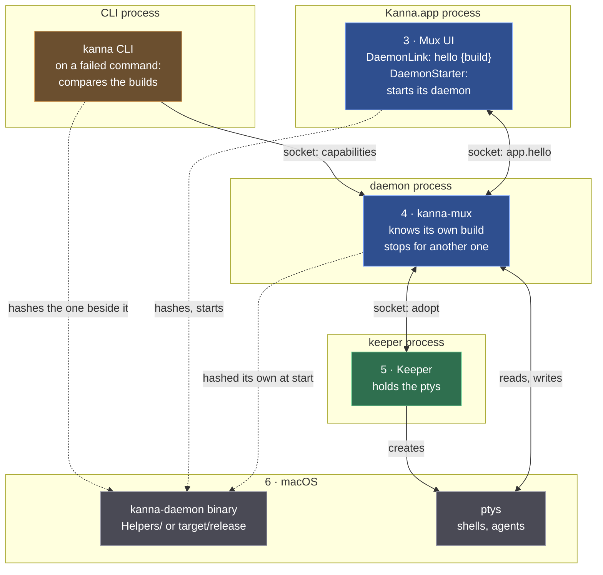
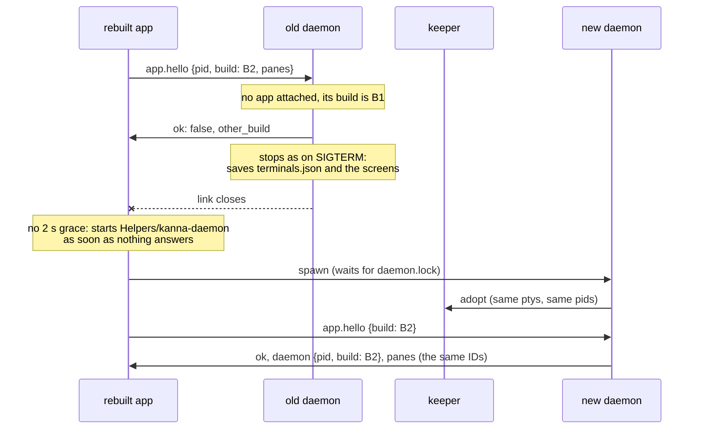

# The Daemon Follows the App's Build

**Status:** built · **Builds on:** [the app link](../kanna-spec.md#45-the-app-link), [restarting the daemon](../kanna-spec.md#48-restarting-the-daemon) · **Why:** quitting the app leaves the daemon running, so a rebuilt app used to attach to the old daemon and run against its old commands until someone killed it by hand

A relaunched app whose bundled daemon differs from the one running replaces it. Nothing is lost: the keeper holds the ptys, and the next daemon adopts them.

## 1. The build ID

The **build ID** is the SHA-256 of the `kanna-daemon` binary, in hex.

| Who | Hashes | When |
|---|---|---|
| the daemon | its own executable | at start, before a rebuild can replace the file |
| the app | `Contents/Helpers/kanna-daemon`, the daemon it would start | once, at its first hello |
| the CLI | the `kanna-daemon` beside it (in the bundle, or `target/release`) | only when a command fails |

- **Why the binary and not the version and commit:** a dev rebuild with uncommitted changes has the same commit and different code, and a commit that doesn't touch the daemon needn't replace it. The hash changes exactly when the daemon does; an app-only rebuild keeps its daemon.
- **Why not a stamp per build:** every rebuild would replace a daemon that hadn't changed.

## 2. Where it lives

Layers numbered as in [4.1](../kanna-spec.md#41-layers-and-processes); 1 and 2 take no part.



Green: Kanna's code · blue: kmux's, as Kanna's · grey: macOS · brown: clients. Dashed: reads a file.

| Layer | What it does with the build | Process |
|---|---|---|
| CLI (a client) | hashes the `kanna-daemon` beside it and asks the daemon's (`capabilities`), only after a command fails | CLI |
| 3 · Mux UI | hashes `Helpers/kanna-daemon`, sends it in `app.hello`; on `other_build` starts that daemon at once | app |
| 4 · kanna-mux | hashes its own binary at start; refuses a hello of another build when no app is attached, and stops | daemon |
| 5 · Keeper | nothing: it keeps the ptys while one daemon stops and the next adopts them | keeper |
| 6 · macOS | the binary on disk, and the ptys | — |

## 3. Hello from another build



- **Only with no app attached.** A second app gets `app_attached` as before, whatever its build, so two running apps of different builds can't take turns stopping each other's daemon.
- **A hello without `build`** (an older app, the test apps) is accepted, as before.
- **The app** answers `other_build` by retrying at once rather than backing off, and starts its daemon without the grace it gives a daemon restarted on purpose; at most one start every 10 s still holds, so an app whose bundle changed under it can't loop.

## 4. The CLI meets another build

The CLI never stops a daemon: the app attached to it may be the old build too. It talks to it as before, and when a command fails it asks the daemon its build (`capabilities` answers `build`) and, if it differs from its own, adds a line:

```text
$ kanna send nosuch x
kanna: no pane "nosuch" [not_found]
(the daemon on this socket is from another build than this kanna (a4cb40a16617 here, c9e6b91e5a5d there); quit and relaunch Kanna.app to replace it)
```

## 5. Checked by

`crates/kanna-daemon/tests/restart.rs` (a hello of the same build is accepted with the build in the reply; one of another build is refused with `other_build`, the daemon stops, the shell lives, and the next daemon has it with the same ID and pid), `crates/kanna-build` (the ID is the binary's SHA-256), and S61 of `scripts/e2e-kanna.sh`: a daemon re-signed as an older build, a terminal opened on it, the CLI's note; the app launched, the old daemon stops, the app's daemon takes over with the terminal's pid and screen, and the note is gone.
