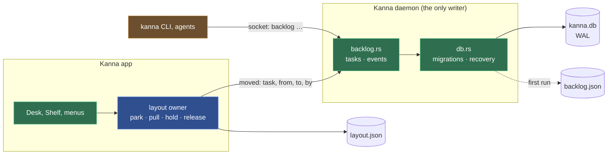
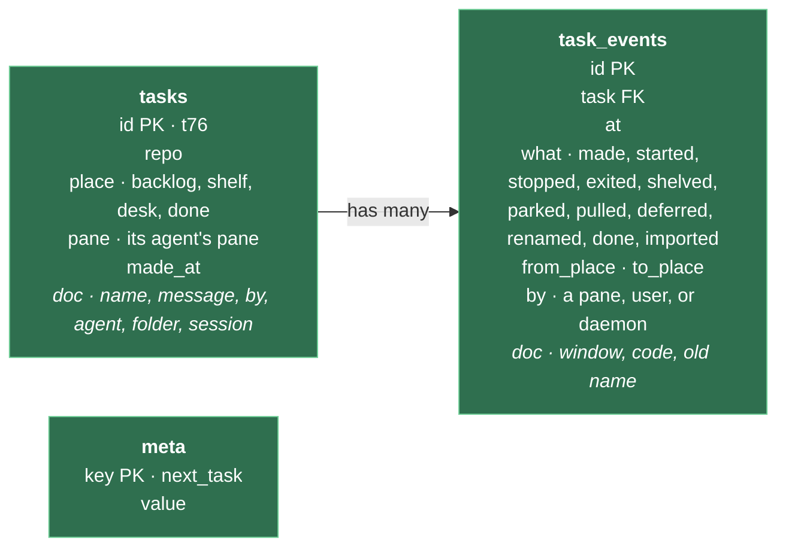

# The Database

**Status:** built · **Builds on:** [Tasks](tasks.md)

**The daemon keeps Kanna's records in one SQLite file, `kanna.db`, in its state folder; nothing else opens it.** Tasks move into it from `backlog.json`, and every change to a task's place or state is written as an event, so Kanna can show what happened over time (the Shelf's history first).

- **SQLite through `rusqlite` with its bundled SQLite** (`features = ["bundled"]`): one C file compiled by `cc` like the tree-sitter grammars, built for the app's macOS ([kanna spec 4.21](../kanna-spec.md#421-the-build)), no server and no system library. WAL mode, `synchronous = NORMAL`, a busy timeout, foreign keys on; file mode 0600 as the rest of the state folder.
- **Columns for what's queried, a JSON doc for the rest.** A table's columns are what Kanna sorts, filters or joins on (a task's ID, repo, place and pane; an event's task, time, kind, places and who); everything else is a JSON `doc` (a task's name, first message, agent, worktree, session; an event's window or exit code). A new field is a new doc key, with no migration; a key the daemon doesn't know is kept when it updates the row (`json_patch`), so an older Kanna doesn't drop a newer one's fields. A doc field becomes a column, by a migration, when something starts to query it.
- **The daemon is the only writer.** The CLI and agents keep asking the daemon (`backlog …` on its socket), and so does the app. Tests and people read it with `sqlite3 -readonly`.
- **Migrations by a number:** `PRAGMA user_version` is the schema's version; on open the daemon runs each step above it in one transaction. A db from a newer Kanna (a higher version) isn't touched: the daemon moves it aside as `kanna.db.newer` and says so in its log, as settings files from a newer Kanna are skipped.
- **One row per task, for its whole life.** A task keeps its `t` ID from made to done, on the backlog, the Shelf or a Desk: `place` and `pane` say where it is and which pane is its agent (`p152`). `kanna task done` sets `place = done` instead of deleting the row, so its events keep their task. The next ID is in `meta`, written in the same transaction as the task, so an ID is never handed out twice.
- **Every change of place or state writes an event,** in the same transaction as the change. The daemon writes the ones it makes: made, started, stopped, shelved, deferred and done from `backlog` commands; exited when an agent's terminal ends without a stop; renamed and done when it sees a task's pane renamed or closed (`kanna task name`, `kanna task done` on the Shelf, ⌘W). `by` is the pane the CLI ran in (`$KANNA_PANE`), else `user`; `daemon` for what it noticed itself. The app's layout owner, the one place a task moves between a Desk and the Shelf (park, pull, closing a Desk window), returns what moved with each change; the app sends those to the daemon (`backlog moved`), with `by: user` for its own menus and keys, and for a CLI `park` or `pull` the daemon records them from the reply it forwarded, with the asking pane as `by`.
- **A task the daemon didn't make** (an agent docked by hand) gets a `t` ID the first time it's moved, as it does when it's moved to the backlog.
- **Reading it:** `backlog events TASK` (a `t` ID or the agent's pane) answers the task's events, oldest first; the Shelf's history builds on it.
- **On first run** the daemon imports `backlog.json` (tasks, the running list, the counter) in one transaction, with a `made` event for each task at its `madeAt`, then renames the file `backlog.json.imported` and never reads it again.
- **Recovery.** On open the daemon runs `PRAGMA quick_check`. A file it can't open or that fails the check is moved aside as `kanna.db.bad-TIME`, with its `-wal`; the daemon then restores the last good copy (`kanna.db.bak`, written with SQLite's backup API at each start once the db checks out) and logs what it did and that changes since that start are lost. With no good copy it imports `backlog.json.imported` if there is one, else starts empty, and says which in its log. A missing `kanna.db` with a `kanna.db.bak` or `backlog.json.imported` beside it is restored the same way. A `backlog.json` found beside a working db (written by an older Kanna run since) adds the tasks the db lacks. A write that fails is logged and the command fails; one after the change has happened (an agent already started) still fails the command, and memory keeps what happened. A db file that can't be made at all is logged and the tasks are kept in memory until the daemon restarts.

**What stays where it is.** `layout.json` stays the app's, in kmux's state file format, so kmux can read it and the reference model stays the reference ([kanna spec 4.7](../kanna-spec.md#47-the-layout)). Doc threads stay beside their docs ([doc markup](doc-markup.md)), where an agent reads them. Settings stay JSON files people edit.

**Later candidates,** not built: quiz rounds and answers ([quiz](quiz.md)); agent session IDs per task over time; agent status history (how long a task waited on you); build timings.

**Checked by** `db.rs`'s tests (a real `backlog.json` imported with every task and the counter; a held task; a change and its event together; unknown doc keys kept; a corrupt, missing or newer db; a `backlog.json` beside the db), the layout owner's tests (park and pull, a swap, report their moves) and e2e S58 (import, every event of a task's life with who did it, the app's park, a corrupt db at restart).

**Why not JSON files and an `events.jsonl`.** Both would work for the first table and one log. The db wins once anything reads history back: the Shelf's history is a query by repo and time, "how long did it wait on me" a join of status changes, and a JSON log means reading the whole file and writing its indexes by hand. A change to a task and its event are one transaction, so they can't disagree after a crash; with two files they can. `backlog.json` is rewritten whole on every change (71 KB today, growing with every first message); a row update is a page or two. Migrations have a number and run in a transaction rather than being guessed from what keys a file has. The cost is one C dependency, compiled in, and a file people can't open in an editor, which the CLI covers. Moving away from JSON is cheap now and dearer with every table.

| | `backlog.json` + `events.jsonl` | `kanna.db` |
|---|---|---|
| Task and its event agree after a crash | no: two files | yes: one transaction |
| Write on each change | the whole backlog | the changed rows |
| Shelf history, waiting times | read every line, index by hand | a query with an index |
| Schema changes | infer from keys | numbered migrations |
| Dependency | none | `rusqlite` (bundled SQLite) |
| Readable by hand | any editor | `sqlite3`, `kanna task list` |

A document store (PoloDB, or redb with indexes of our own) was the other option weighed: as flexible as the JSON doc, but younger engines with less crash testing, and Shelf history would mean secondary indexes kept by hand.
