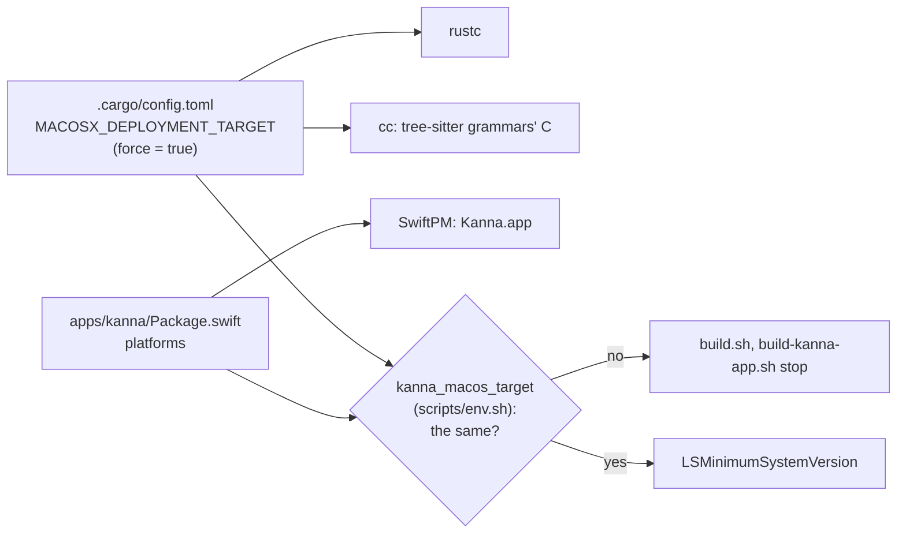

# The macOS Deployment Target

**Status:** built · **Related:** [build speed](build-speed.md), [build architectures](build-architectures.md), [architecture](architecture.md#3-languages-and-platforms)

**What Kanna compiles is built for the app's macOS, set in one place; nothing it links is built for a newer one.** Without it, rustc builds for macOS 11 and the `cc` crate for the SDK's version (26.5), and linking the app warns, for every such object, that it was built for a newer macOS than the app.

| Piece | Built by | Minimum macOS |
|---|---|---|
| `libkanna_ffi.a`, daemon, keeper, CLI | cargo (rustc, `cc`) | the app's (15.0) |
| Kanna.app | SwiftPM | the app's (15.0) |
| GhosttyKit, libghostty-vt | Zig, in Ghostty's build | 13.0, Ghostty's own floor |
| Rust's std, `compiler_builtins` (in `libkanna_ffi.a`) | prebuilt, shipped with the toolchain | 11.0, Rust's default |

## Rules

- **One place:** `MACOSX_DEPLOYMENT_TARGET` in `.cargo/config.toml`, with `force = true` so a shell's own value can't override it; every cargo build reads it. `apps/kanna/Package.swift`'s `platforms` must say the same version; `kanna_macos_target` in `scripts/env.sh` reads both, and `scripts/build.sh` and `scripts/build-kanna-app.sh` stop if they differ. The app's `LSMinimumSystemVersion` comes from it too.
- **Lower is safe, higher is the bug.** Ghostty's `build.zig` sets its own minimum (13.0) and ignores the environment, and Rust's std comes prebuilt (rebuilding it needs nightly `-Zbuild-std`). A lower minimum than the app's is safe to link: those objects use nothing newer than their own minimum. A higher one is what the warning reports.
- **Changing it needs a clean cargo build.** Cargo reruns the `cc` build scripts when the `[env]` value changes, but doesn't recompile pure Rust crates, so their objects keep the old version. `kanna_cargo_release_for` (`scripts/env.sh`) keeps the version `target/release` was built for in `target/release/macos-deployment-target` and cleans `target/release` when it differs or is missing; the build scripts call it before cargo.
- **Ghostty's builds are reused by commit** (`ghostty.rev`, borrowed by worktrees through `kanna_borrow_built`), so a change to how Ghostty is built goes in the fork and the pinned commit, and the new pin makes every checkout rebuild them.
