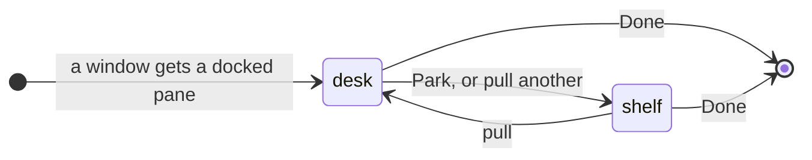
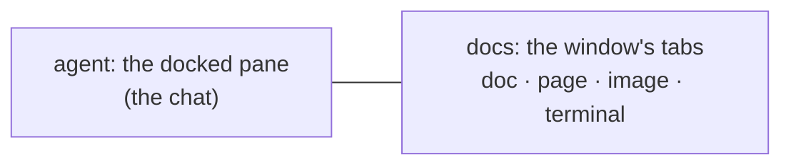
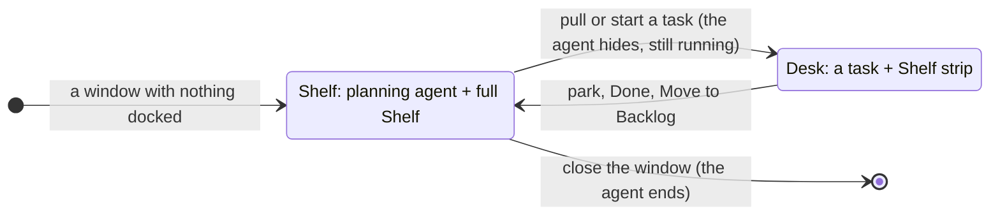
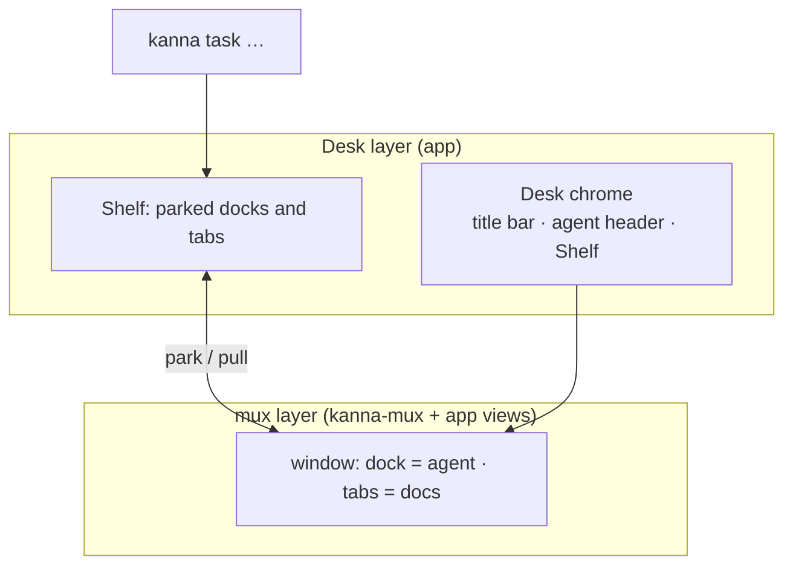

# Desk

**Status:** built · **Mockup:** [`references/mockups/desk.html`](../../references/mockups/desk.html) · **Builds on:** [docked pane](docked-pane.md), [agent status](agent-status.md), [doc markup](doc-markup.md) · **From:** kanna v3's Desk and Shelf (its look), laid out like a chat app's work view: one conversation, tabbed documents beside it

The **Desk** is Kanna's window for working with an agent. It shows one **task**: the agent's terminal docked on the left as the single chat, and everything the task opens (docs, pages, images, other terminals) as tabs on the right. The **Shelf** along the bottom holds every other task, their agents still running, and swaps one in with a click. With no task on it, the Desk belongs to the window's **planning agent**: it's docked on the left, beside the full Shelf, and you make and manage tasks by talking to it.

## Contents

1. [Tasks](#1-tasks)
2. [The Desk](#2-the-desk)
3. [The Shelf](#3-the-shelf)
4. [The planning agent](#4-the-planning-agent)
5. [CLI](#5-cli)
6. [How it's built](#6-how-its-built)
7. [Rejected](#7-rejected)
8. [Open questions](#8-open-questions)
9. [Glossary](#9-glossary)

## 1. Tasks

A task is what a Desk holds: an agent in the window's [docked pane](docked-pane.md), and the window's tabs.

- **A window with a docked pane is a Desk**; its contents are its task. Make one with `kanna open --dock --cmd claude`, then open tabs. A UI for starting tasks comes later.
- **Its name** is the docked pane's name, else its terminal's title. **Its folder and branch** are the docked pane's working directory and that folder's git branch, shown, never changed.
- **Done** closes the task's panes, ending its agent and terminals.
- **A task belongs to a project**: the git repository its folder is in (else the folder), and a Desk's Shelf shows its project's tasks. Making and naming tasks: [tasks](tasks.md).

## 2. The Desk

- **One task per Desk.** Pulling a task onto a Desk parks the one it held. If the task you pull is already on another Desk, that window comes to the front and nothing moves. Closing a Desk window parks its task.
- **The agent pane** is the agent's terminal, untouched, under a header with Park (pictured above). The header leaves out the task's name (the title bar shows it) and its [status](agent-status.md) (the agent is in view; the Shelf shows the others'). It's the only chat: you talk to the agent there, and doc comments arrive there ([doc markup](doc-markup.md)). Its width is the task's: it comes back with the task, whichever Desk it's pulled onto.
- **Docs are the window's tabs.** Each is an ordinary tab: markdown (with comments), a web page, an image, video or PDF (shown in a web pane), or a terminal (tests, a server), and a tab can hold splits.
  - **What opens a tab:** the agent running `kanna open md|web FILE` from its pane, a markdown link, or **+**.
  - Opening a file that's already open shows its tab.
- **The title bar** (top) shows only the task's title (or Shelf, with no task on the Desk).
- **With no task on it, the Desk shows the planning agent and the Shelf in full** (pictured above) in place of the strip: the agent docked on the left, and on the right the project's tasks (click one to pull it) and backlog, live, under a short encouraging line that changes each time the Shelf comes up. Tabs opened there (⌘T) show in place of the full Shelf until they're closed.
- **Plain windows stay** exactly as now, so every kmux behaviour is unchanged.

## 3. The Shelf

- **The project's tasks not on a Desk**, latest parked first (a stack), each with its [agent status](agent-status.md) and how long ago it was parked. **Needs you** moves a task to the front.
- **Click to swap:** the clicked task comes onto this Desk and the current one goes to the Shelf, in one step. **⌘1 … ⌘3** swap in the Shelf's 1st … 3rd task the same way. **⇧⌘A** pulls the task that has needed you longest, and **⌘.** parks, or on an empty Desk pulls back the task parked last. They're in the Task menu.
- **At most three tasks per project:** the one on the Desk and two on the Shelf (three on the full Shelf). Starting a fourth is refused until one is Done.
- **Parked means hidden, not stopped.** A parked task's terminals keep running in the daemon, and its tabs, the shown one and scroll positions come back as they were.

## 4. The planning agent

- **One per window.** Each Desk window gets its own the first time it shows no task, and keeps it while tasks come and go: pulling a task hides it, parking brings it back with its conversation as it was. It runs while hidden and survives an app restart like any terminal. Closing the window ends it.
- **It isn't a task.** It's not on the Shelf or in `kanna task list`, doesn't take one of the project's three running slots, can't be parked, pulled or moved, and has no Park button: its header says Planning and its folder.
- **It works in the project's main checkout,** not a worktree: it plans and doesn't write code. It sees the whole project: the running tasks, their status, the backlog.
- **Its agent** is `$KANNA_AGENT`, else `claude`, as for tasks, but it asks permission as usual (it's in your checkout). Its first message says it's this window's planning agent and to use Kanna's planning skills ([tasks](tasks.md#4-naming)): describe what's running and waiting, make backlog tasks, and start or end tasks only when you ask.
- **Getting started is its terminal.** When the project has no tasks running or waiting, the terminal first prints how Kanna works ([`getting-started.md`](../../apps/kanna/Resources/getting-started.md), through `glow` if it's installed, else `cat`), then runs the agent (pictured in [tasks](tasks.md)).
- **When its agent exits,** the terminal says so and waits: Return starts it again, and a claude agent resumes its conversation (Kanna starts it with `--session-id`, then `--resume`s). Other agents start afresh with the first message.
- **The window's project** is its task's while one is docked, else the one it was opened on (`kanna PATH`) or last held a task from, saved with the window. A window with none (Kanna opening with nothing, and no tasks anywhere) gets the project of the latest parked task, else the newest backlog task's, else none: then its planning agent starts in your home folder, asks which folder to work in (making it if it's new), and runs `kanna PATH`, which gives this window that project and starts its planning agent again there.

## 5. CLI

| Command | Does |
|---|---|
| `kanna task list` | Every task: ID, name, where it is (a Desk or the Shelf), status |
| `kanna task pull ID` | Put a task on the key window's Desk |
| `kanna task park [ID]` | Move a task (default: the one on the key Desk) to the Shelf |
| `kanna task done ID` | End a task: close its panes |
| `kanna task new`, `start`, `name` | Make, start and name tasks: [tasks](tasks.md#6-cli) |

A task's ID is its docked pane's ID. Run from a task's terminal, `park` and `done` mean that task, and `kanna open` without a placement opens a new tab on the task's Desk (or, while it's parked, among its parked tabs). `done` leaves its Desk empty.

## 6. How it's built

- **The mux layer does the layout.** A Desk is an ordinary window with a [docked pane](docked-pane.md) and tabs. Nothing in the mux layer knows about tasks.
- **The Desk layer is chrome and the Shelf.** The app keeps parked tasks (their dock with its width, their tabs, and when they were parked), saved with the windows ([4.7](../kanna-spec.md#47-the-layout)). The title bar, agent header and Shelf are app views around the window's content.
- **Parking** moves the task's dock and tabs off the window; the panes keep their IDs, and their terminals never notice.
- **The planning agent is the window's `planner`**: a pane the window holds beside its dock, shown on the left only while the dock is empty. Parking and pulling move the dock and tabs and leave it where it is. The app asks the daemon for one (`backlog` `plan`) when a Desk shows no task and has none; the daemon makes its command and opens it with the `planner` placement.
- **`kanna task` commands** are layout commands: they go to the app like `open --split`, and start it if it's closed.

## 7. Rejected

- **One Shelf window for every project, with one planning agent:** each window stays an independent Desk, so a planning agent belongs to its window and its project.
- **The planning agent as a task** (docked like one, in a worktree): it would take one of the three slots, show on the Shelf, and park away. It plans, so it stays in the main checkout and outside the task rules.
- **Showing the planning agent beside a task** (a third column, or on the strip): the Desk shows one conversation; the Shelf strip stays as it is.
- **A Getting started tab beside a plain terminal** (before): you had to `cd` and start an agent yourself. The planning agent's terminal prints the same instructions and is already running one.
- **Restarting the agent by itself when it exits:** an agent that quits on purpose would come straight back; Return is one key.

## 8. Open questions

1. Making tasks, and what a task is: [tasks](tasks.md).
2. **Opening docs from the planning agent:** `kanna open` from it opens a tab in the key window, as from any terminal that isn't a task's.

## 9. Glossary

| Term | Meaning |
|---|---|
| **Task** | What a Desk holds: an agent in its docked pane, and its tabs |
| **Desk** | A window with a docked pane, showing one task |
| **Shelf** | The strip along a Desk's bottom listing the project's tasks not on a Desk |
| **Pull / Park** | Put a task on a Desk / take it off, to the Shelf |
| **Agent pane** | The docked pane where the task's agent runs: the Desk's one chat |
| **Planning agent** | The window's own agent, docked beside the full Shelf while no task is on the Desk; not a task |
| **Docs** | The task's tabs: everything it has open besides the agent |
