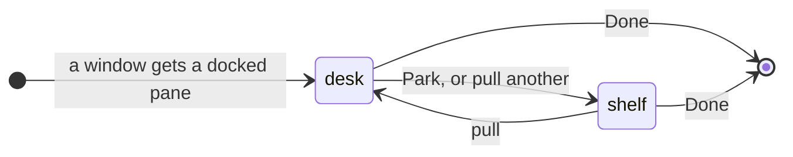
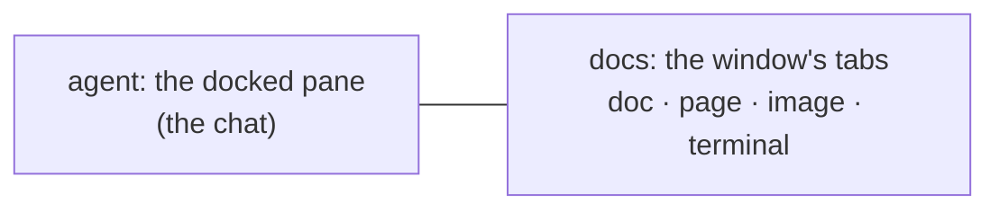
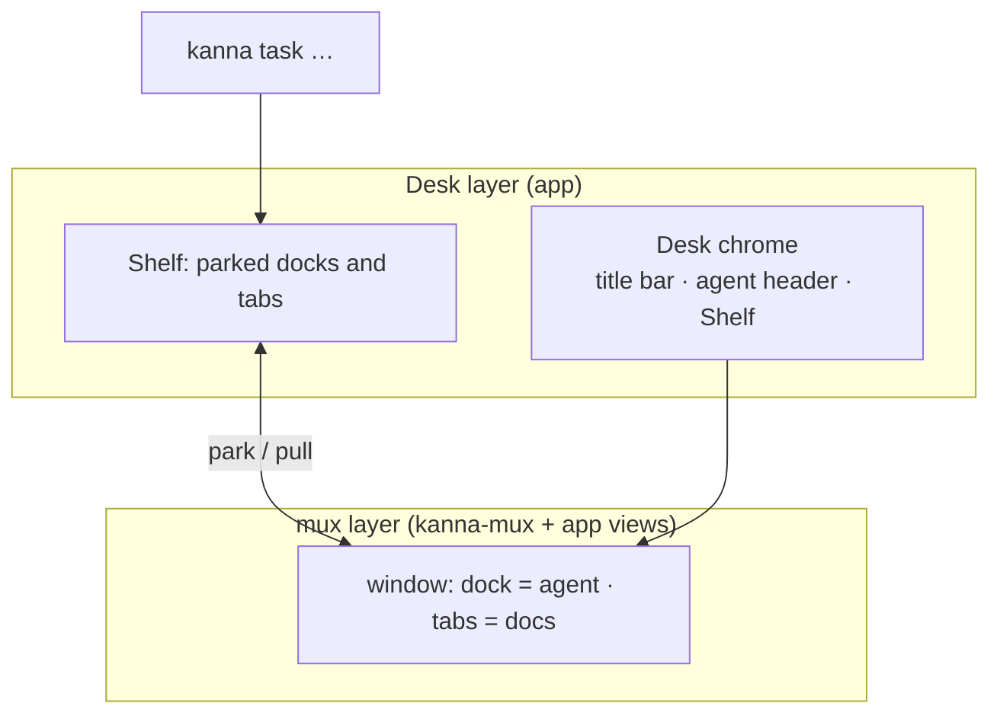

# Desk

**Status:** proposed · **Mockup:** [`references/mockups/desk.html`](../../references/mockups/desk.html) · **Builds on:** [docked pane](docked-pane.md), [agent status](agent-status.md), [doc markup](doc-markup.md) · **From:** kanna v3's Desk and Shelf (its look), laid out like a chat app's work view: one conversation, tabbed documents beside it

The **Desk** is Kanna's window for working with an agent. It shows one **task**: the agent's terminal docked on the left as the single chat, and everything the task opens (docs, pages, images, other terminals) as tabs on the right. The **Shelf** along the bottom holds every other task, their agents still running, and swaps one in with a click.

## Contents

1. [Tasks](#1-tasks)
2. [The Desk](#2-the-desk)
3. [The Shelf](#3-the-shelf)
4. [CLI](#4-cli)
5. [How it's built](#5-how-its-built)
6. [Open questions](#6-open-questions)
7. [Glossary](#7-glossary)

## 1. Tasks

A task is what a Desk holds: an agent in the window's [docked pane](docked-pane.md), and the window's tabs.

- **A window with a docked pane is a Desk**; its contents are its task. Make one with `kanna open --dock --cmd claude`, then open tabs. A UI for starting tasks comes later.
- **Its name** is the docked pane's name, else its terminal's title. **Its folder and branch** are the docked pane's working directory and that folder's git branch, shown, never changed.
- **Done** closes the task's panes, ending its agent and terminals.
- **A task belongs to a project**, and a Shelf shows one project's tasks. This needs a task concept (what a task and a project are, how they're made and kept) before the Shelf can be built; it gets its own spec.

## 2. The Desk

- **One task per Desk.** Pulling a task onto a Desk parks the one it held. If the task you pull is already on another Desk, that window comes to the front and nothing moves. Closing a Desk window parks its task.
- **The agent pane** is the agent's terminal, untouched, under a header with Park (pictured above). The header leaves out the task's name (the title bar shows it) and its [status](agent-status.md) (the agent is in view; the Shelf shows the others'). It's the only chat: you talk to the agent there, and doc comments arrive there ([doc markup](doc-markup.md)). Its width is the task's: it comes back with the task, whichever Desk it's pulled onto.
- **Docs are the window's tabs.** Each is an ordinary tab: markdown (with comments), a web page, an image, video or PDF (shown in a web pane), or a terminal (tests, a server), and a tab can hold splits.
  - **What opens a tab:** the agent running `kanna open md|web FILE` from its pane, a markdown link, or **+**.
  - Opening a file that's already open shows its tab.
- **The title bar** (top) shows only the task's title (or Shelf, with no task on the Desk).
- **With no task on it, the Desk shows the Shelf in full** in place of the strip: the project's tasks (click one to pull it), under a short encouraging line that changes each time the Shelf comes up.
- **Plain windows stay** exactly as now, so every kmux behaviour is unchanged.

## 3. The Shelf

- **The project's tasks not on a Desk**, in the order they were parked, each with its [agent status](agent-status.md) and how long ago it was parked. **Needs you** moves a task to the front.
- **Click to swap:** the clicked task comes onto this Desk and the current one goes to the Shelf, in one step. **⌘1 … ⌘9** swap in the Shelf's 1st … 9th task the same way.
- **Parked means hidden, not stopped.** A parked task's terminals keep running in the daemon, and its tabs, the shown one and scroll positions come back as they were.

## 4. CLI

| Command | Does |
|---|---|
| `kanna task list` | Every task: ID, name, where it is (a Desk or the Shelf), status |
| `kanna task pull ID` | Put a task on the key window's Desk |
| `kanna task park [ID]` | Move a task (default: the one on the key Desk) to the Shelf |
| `kanna task done ID` | End a task: close its panes |

A task's ID is its docked pane's ID. Run from a task's terminal, `park` and `done` mean that task, and `kanna open` without a placement opens a new tab on the task's Desk.

## 5. How it's built

- **The mux layer does the layout.** A Desk is an ordinary window with a [docked pane](docked-pane.md) and tabs. Nothing in the mux layer knows about tasks.
- **The Desk layer is chrome and the Shelf.** The app keeps parked tasks (their dock with its width, their tabs, and when they were parked), saved with the windows ([4.7](../kanna-spec.md#47-the-layout)). The title bar, agent header and Shelf are app views around the window's content.
- **Parking** moves the task's dock and tabs off the window; the panes keep their IDs, and their terminals never notice.
- **`kanna task` commands** are layout commands: they go to the app like `open --split`, and start it if it's closed.

## 6. Open questions

1. Keys: Park, and next/previous task on the Shelf.
2. What is a project (a repo, a folder you choose, …), and how is a task made? For the task-concept spec.

## 7. Glossary

| Term | Meaning |
|---|---|
| **Task** | What a Desk holds: an agent in its docked pane, and its tabs |
| **Desk** | A window with a docked pane, showing one task |
| **Shelf** | The strip along a Desk's bottom listing the project's tasks not on a Desk |
| **Pull / Park** | Put a task on a Desk / take it off, to the Shelf |
| **Agent pane** | The docked pane where the task's agent runs: the Desk's one chat |
| **Docs** | The task's tabs: everything it has open besides the agent |
