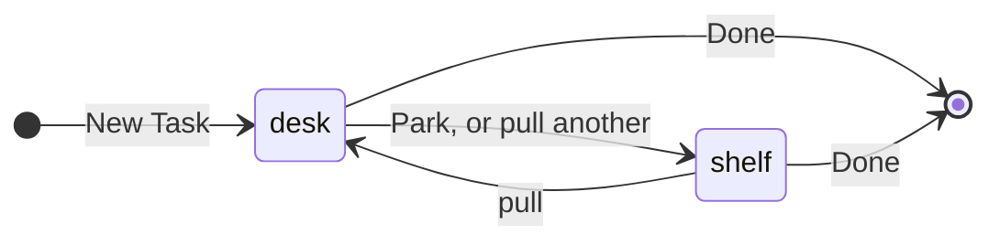
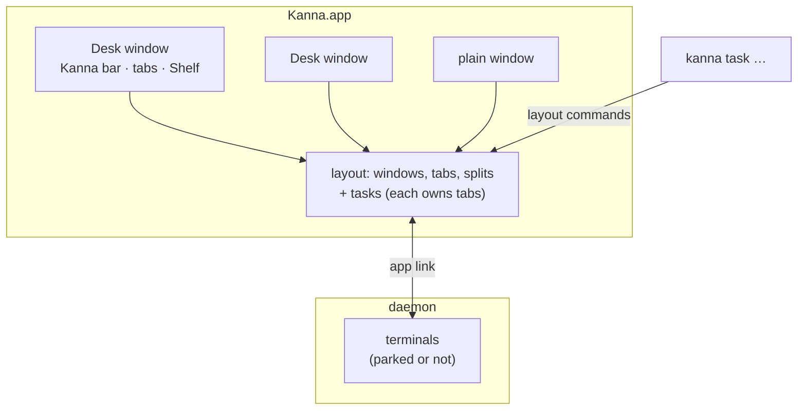

# Desk

**Status:** proposed · **Mockup:** [`docs/mockups/desk.html`](../mockups/desk.html) · **From:** kanna v3 slice 7, "Shelf and Desk" (its look, without Build, Line, Digest or Spec Review)

The **Desk** is Kanna's own window for working with an agent: it shows one **task** (an agent, its folder and its panes), and the **Shelf** along its bottom holds every other task, their agents still running. You keep several pieces of work going without a wall of windows, and swap between them in one click.

## Contents

1. [Tasks](#1-tasks)
2. [The Desk](#2-the-desk)
3. [The Shelf](#3-the-shelf)
4. [Agent status](#4-agent-status)
5. [CLI](#5-cli)
6. [How it's built](#6-how-its-built)
7. [Open questions](#7-open-questions)
8. [Glossary](#8-glossary)

## 1. Tasks

A task is a named piece of work: a title, a folder, an agent, and the tabs and panes you open for it.

- **New Task** asks for a title, a repository and an agent (`claude`, `codex`, or a shell). The task's ID is the title as a slug (`doc-markup`).
- **Its own worktree** (on by default for a git repository): `<repo>/.kanna/worktrees/<id>` on a new branch `task/<id>`, so tasks don't edit each other's files. Off: the task works in the repository itself.
- **The agent** starts in that folder in the task's first pane, the **agent pane**. A doc it opens with `kanna open md` sends its comments to it ([doc markup](doc-markup.md)).
- **Done** closes the task's panes, ending its agent and terminals. The worktree and branch are kept; Kanna never deletes your work.

## 2. The Desk

- **One task per Desk.** Pulling a task onto a Desk parks the one it held. A task is on at most one Desk: pulling one that's on another Desk brings that window forward instead.
- **Several Desks.** Each Desk is a window; New Desk opens another, empty. Closing a Desk window parks its task.
- **The Desk shows the task's own tabs.** The tab bar, splits and panes are the mux UI's as today; a task is the set of tabs it holds. New tabs and panes opened on a Desk belong to its task.
- **The agent pane** has a header above the terminal: the title, repository, branch, agent status and **Park ↓**. The terminal below is the agent's own, untouched.
- **The Kanna bar** (top) names the Desk and its task, and has **+ New Task**.
- **Empty Desk:** the parked tasks grouped by repository, each with **Pull →**, and **+ New Task**.
- **Plain windows stay.** Windows that hold no task work exactly as now, so every kmux behaviour is unchanged.

## 3. The Shelf

- **Every task not on a Desk**, in the order they were parked, each with its agent status and how long ago it was parked.
- **Click to swap:** the clicked task comes onto this Desk and the current one goes to the Shelf, in one step.
- **Parked means hidden, not stopped.** A parked task's terminals keep running in the daemon, and its tabs, splits, scroll positions and docs come back as they were.
- **Needs you** moves a task to the front of the Shelf, so a waiting agent is hard to miss.

## 4. Agent status

The dot beside a task, on the Desk and the Shelf:

| Status | When |
|---|---|
| working | the agent's terminal has printed in the last 2 s, or it reports progress (OSC 9;4) |
| needs you | it rang the bell or posted a notification since you last looked at the task |
| idle | neither |
| exited | the agent's program has ended |

These come from what the terminal already reports to Kanna, the same for every agent; nothing reads the agent's prompt. Looking at the task (it's on a Desk and its window is focused) clears **needs you**.

## 5. CLI

| Command | Does |
|---|---|
| `kanna task new TITLE [--repo DIR] [--agent CMD] [--no-worktree]` | Start a task and put it on the key window's Desk |
| `kanna task list` | Every task: ID, title, where it is (a Desk or the Shelf), status |
| `kanna task pull ID` | Put a task on the key window's Desk |
| `kanna task park [ID]` | Move a task (default: the one on the key Desk) to the Shelf |
| `kanna task done ID` | End a task: close its panes; the worktree is kept |

Run from a task's terminal, `kanna task park` and `done` mean that task. An agent can start its own follow-up work with `kanna task new`.

## 6. How it's built

- **Tasks are layout.** The app owns them, as it owns windows and tabs ([4.7](../kanna-spec.md#47-the-layout)): a task is a record (ID, title, folder, worktree, agent pane, status, park time) and the tabs it holds. Parking moves the task's tabs off the window; the panes keep their IDs, and their terminals never notice. Saved with the layout.
- **`kanna task` commands** are layout commands: they go to the app like `open --split`, and start it if it's closed.
- **The worktree** is made with `git worktree add` when the task starts; nothing else in Kanna touches git.
- **Status** is worked out in the app from the terminal events it already gets (output, progress, bell, notifications, exit).

## 7. Open questions

1. Keys: New Task, New Desk, Park, and next/previous task on the Shelf.
2. Should Done offer to remove the worktree when the branch is merged?
3. Should the Shelf show tasks from every repository, or only the Desk's?

## 8. Glossary

| Term | Meaning |
|---|---|
| **Task** | A piece of work: an agent, its folder, and the tabs and panes opened for it |
| **Desk** | A window that shows one task |
| **Shelf** | The strip along a Desk's bottom listing every task not on a Desk |
| **Pull / Park** | Put a task on a Desk / take it off, to the Shelf |
| **Agent pane** | A task's first pane, where its agent runs, with the task's header above it |
| **Worktree** | A second checkout of a git repository on its own branch (`git worktree`) |
