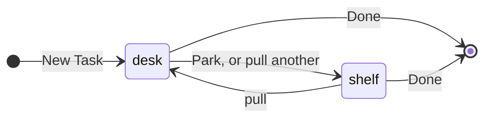
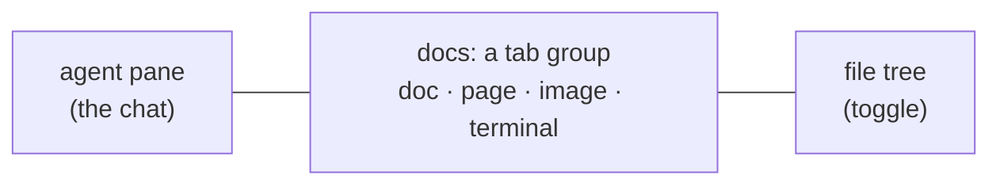
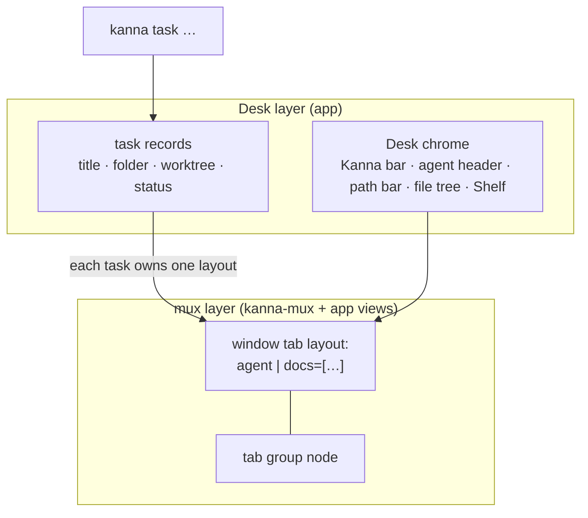

# Desk

**Status:** proposed · **Mockup:** [`docs/mockups/desk.html`](../mockups/desk.html) · **Builds on:** [tab groups](tab-groups.md), [doc markup](doc-markup.md) · **From:** kanna v3's Desk and Shelf (its look), laid out like a chat app's work view: one conversation, tabbed documents beside it

The **Desk** is Kanna's window for working with an agent. It shows one **task**: the agent's terminal on the left as the single chat, and everything the task opens (docs, pages, images, other terminals) as tabs on the right. The **Shelf** along the bottom holds every other task, their agents still running, and swaps one in with a click.

## Contents

1. [Tasks](#1-tasks)
2. [The Desk](#2-the-desk)
3. [The Shelf](#3-the-shelf)
4. [Agent status](#4-agent-status)
5. [CLI](#5-cli)
6. [How it's built](#6-how-its-built)
7. [Open questions](#7-open-questions)
8. [Glossary](#8-glossary)

## 1. Tasks

A task is a named piece of work: a title, a folder, an agent, and the docs it has open.

- **New Task** asks for a title, a repository and an agent (`claude`, `codex`, or a shell). The task's ID is the title as a slug (`doc-markup`).
- **Its own worktree** (on by default for a git repository): `<repo>/.kanna/worktrees/<id>` on a new branch `task/<id>`, so tasks don't edit each other's files. Off: the task works in the repository itself.
- **Done** closes the task's panes, ending its agent and terminals. The worktree and branch are kept; Kanna never deletes your work.

## 2. The Desk

- **One task per Desk.** Pulling a task onto a Desk parks the one it held; a task on another Desk brings that window forward instead. Several Desks are several windows; closing one parks its task.
- **The agent pane** is the task's agent in its terminal, untouched, with a header: title, repository, branch, status and **Park ↓**. It's the only chat: you talk to the agent there, and doc comments arrive there ([doc markup](doc-markup.md)).
- **Docs** are a [tab group](tab-groups.md) named `docs`. Each tab is an ordinary pane: markdown (with comments), a web page, an image, video or PDF (shown in a web pane), or another terminal (tests, a server).
  - **What opens a tab:** the agent running `kanna open md|web FILE` from its pane, clicking a file in the tree, a markdown link, or **+**.
  - **⌘1 … ⌘9** show the 1st … 9th tab. Opening a file that's already open shows its tab.
  - **The path bar** shows where the shown tab's file is, with **Open ▾** (in its default app, in Finder, copy path) and the file tree toggle.
- **The file tree** lists the task's folder; open files are marked, the shown one highlighted. Filter by typing.
- **The Kanna bar** (top) names the Desk and its task, and has **+ New Task**.
- **Empty Desk:** the parked tasks grouped by repository, each with **Pull →**, and **+ New Task**.
- **Plain windows stay** exactly as now, so every kmux behaviour is unchanged.

## 3. The Shelf

- **Every task not on a Desk**, in the order they were parked, each with its agent status and how long ago it was parked. **Needs you** moves a task to the front.
- **Click to swap:** the clicked task comes onto this Desk and the current one goes to the Shelf, in one step.
- **Parked means hidden, not stopped.** A parked task's terminals keep running in the daemon, and its tabs, shown doc and scroll positions come back as they were.

## 4. Agent status

| Status | When |
|---|---|
| working | the agent's terminal printed in the last 2 s, or reports progress (OSC 9;4) |
| needs you | it rang the bell or posted a notification since you last looked at the task |
| idle | neither |
| exited | the agent's program has ended |

These come from what the terminal already reports to Kanna, the same for every agent; nothing reads the agent's prompt. Looking at the task (on a Desk, window focused) clears **needs you**.

## 5. CLI

| Command | Does |
|---|---|
| `kanna task new TITLE [--repo DIR] [--agent CMD] [--no-worktree]` | Start a task and put it on the key window's Desk |
| `kanna task list` | Every task: ID, title, where it is (a Desk or the Shelf), status |
| `kanna task pull ID` | Put a task on the key window's Desk |
| `kanna task park [ID]` | Move a task (default: the one on the key Desk) to the Shelf |
| `kanna task done ID` | End a task: close its panes; the worktree is kept |

Run from a task's terminal, `park` and `done` mean that task, and `kanna open` without a placement opens into the task's `docs`.

## 6. How it's built

- **The mux layer does the layout.** A task's layout is an ordinary window-tab layout, `agent:2/5 | docs=[…]`, built from a split and a [tab group](tab-groups.md). Nothing in the mux layer knows about tasks.
- **The Desk layer is chrome and records.** The app keeps each task as a record (ID, title, folder, worktree, agent pane, status, park time) plus the layout it owns, saved with the windows ([4.7](../kanna-spec.md#47-the-layout)). The Kanna bar, agent header, path bar, file tree and Shelf are app views around that layout.
- **Parking** moves the task's layout off the window; the panes keep their IDs, and their terminals never notice.
- **`kanna task` commands** are layout commands: they go to the app like `open --split`, and start it if it's closed.
- **The worktree** is made with `git worktree add` when the task starts; nothing else in Kanna touches git.
- **Status** is worked out in the app from the terminal events it already gets (output, progress, bell, notifications, exit).

## 7. Open questions

1. Keys: New Task, New Desk, Park, next/previous task on the Shelf.
2. Should Done offer to remove the worktree when the branch is merged?
3. Should the Shelf show tasks from every repository, or only the Desk's?
4. Is the agent pane's width fixed (2/5) or draggable and remembered per task?

## 8. Glossary

| Term | Meaning |
|---|---|
| **Task** | A piece of work: an agent, its folder, and the docs it has open |
| **Desk** | A window that shows one task |
| **Shelf** | The strip along a Desk's bottom listing every task not on a Desk |
| **Pull / Park** | Put a task on a Desk / take it off, to the Shelf |
| **Agent pane** | Where the task's agent runs: the Desk's one chat |
| **Docs** | The task's tab group: everything it has open besides the agent |
| **Worktree** | A second checkout of a git repository on its own branch (`git worktree`) |
