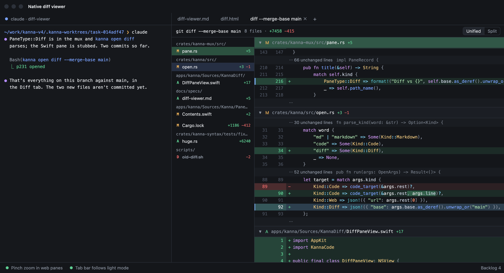
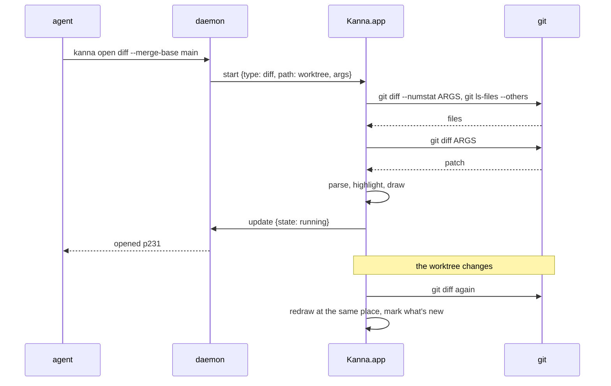
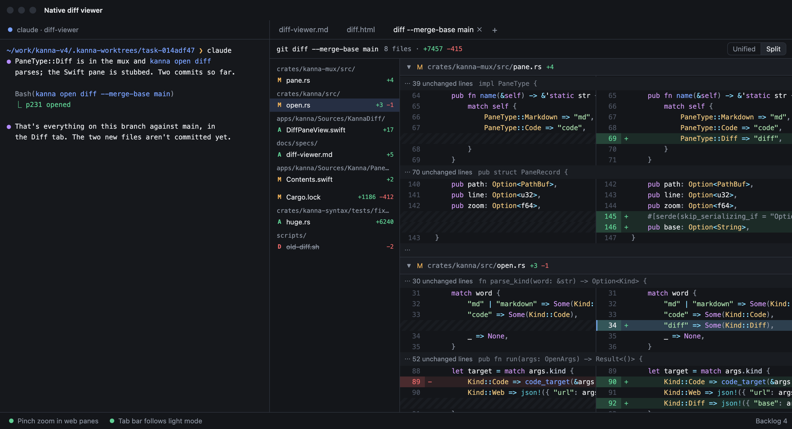
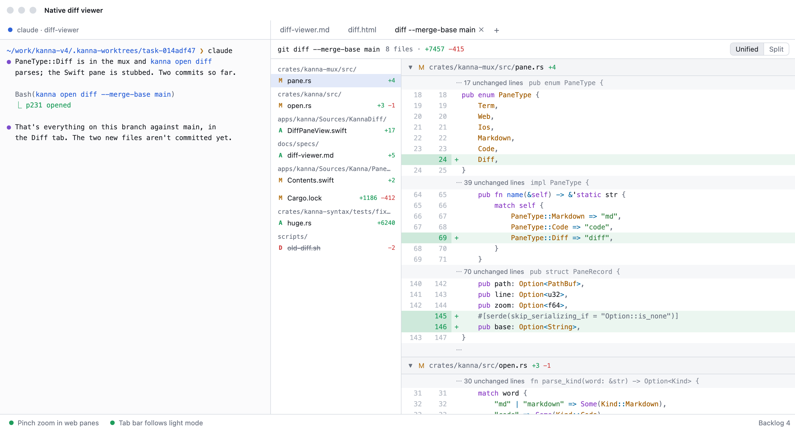
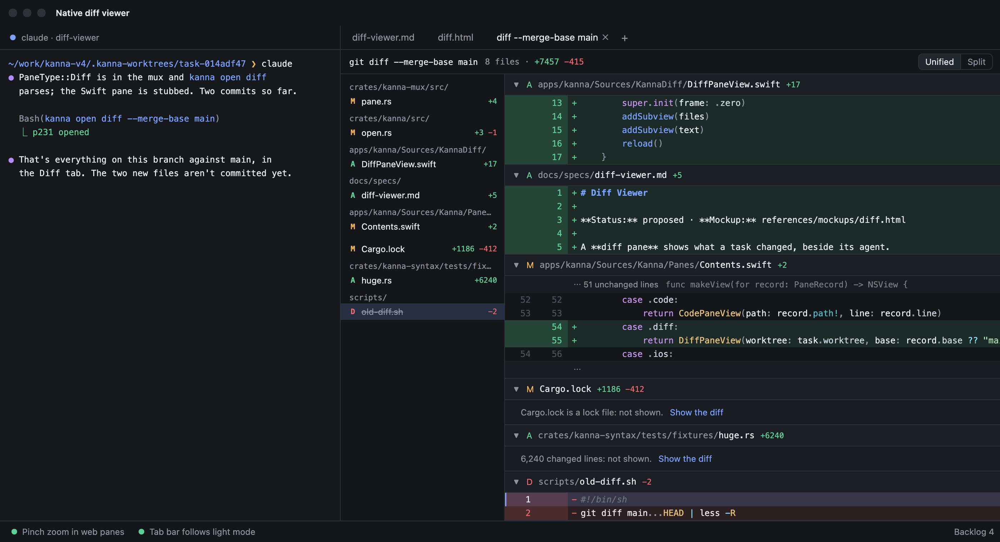
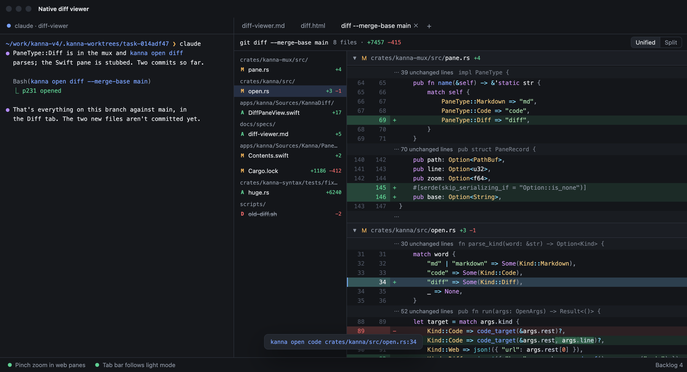
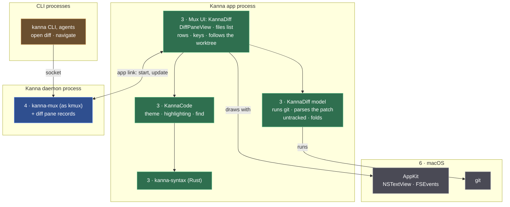

# Diff Viewer

**Status:** proposed · **Mockup:** [`references/mockups/diff.html`](../../references/mockups/diff.html) · **Builds on:** [code viewer](code-viewer.md), [app panes](app-panes.md)

A **diff pane** shows what `git diff` shows, natively, as a tab beside the agent. You review what a task's agent changed without leaving Kanna: file by file, highlighted, following the worktree as the agent works. It's read-only: you read, select, copy, and open a line in a code pane.

## Contents

1. [Opening a diff](#1-opening-a-diff)
2. [Rules](#2-rules)
3. [Keys and mouse](#3-keys-and-mouse)
4. [CLI](#4-cli)
5. [How it's built](#5-how-its-built)
6. [Glossary](#6-glossary)

## 1. Opening a diff

- **`kanna open diff [ARGS]` shows `git diff [ARGS]`**, run in the folder it's opened from (the task's worktree), with git's own arguments:

| You run | Shows |
|---|---|
| `kanna open diff` | what isn't staged |
| `kanna open diff --merge-base main` | everything the task changed since it left `main`, committed or not |
| `kanna open diff --staged` | what's staged |
| `kanna open diff main...HEAD` | the branch's commits only |
| `kanna open diff -- crates/kanna` | any of these, for some paths only |

- **Plus untracked files.** When the diff's new side is the worktree (no `--staged` or `--cached`, and at most one commit named), files git doesn't track yet and doesn't ignore are shown too, as added. An agent's new files are often most of its work, and plain `git diff` leaves them out.
- It takes `open`'s placement options; with none, from a task's terminal it opens a tab on the task's Desk, as `open code` does. Kanna reads its own options (`--tab`, `--split`, `--size`, `--dock`, `--window`, `--name`) and passes everything else to git.
- The tab is named after the command (`diff --merge-base main`); the header shows the git command, the files and the lines added and removed.

## 2. Rules

- **It follows the worktree.** When a file in the worktree or git's state (the index, a commit, a branch moving) changes, the pane runs `git diff` again, keeps your place, and marks what's new: the changed file flashes in the list and its new lines get a bar until the next change. While a re-diff takes a moment the header says **updating**. If git fails (the folder is gone, an argument is wrong) the pane shows git's error, not an old diff.
- **Unified, or Split** (old and new side by side), a switch in the header or `s`; kept with the pane.

- **Files list** on the left, grouped by folder: each file's status (`M` modified, `A` added or untracked, `D` deleted, `R` renamed) and its lines added and removed. Clicking one scrolls to it; it follows the current line.
- **Each file has a header** that stays at the top while you're in it, with its path, status and counts. Clicking it folds the file; ⌥-click folds or unfolds them all.
- **Unchanged lines between changes** fold to one row naming how many and the function or block the next change is in, as git's hunk header names it.
- **Highlighting** as in the code pane, by file extension, in light and dark; the words that changed in a changed line are marked more strongly.

- **Big diffs are folded**, not dropped: a lock file (`Cargo.lock`, `package-lock.json`, `yarn.lock`, `pnpm-lock.yaml`, `Gemfile.lock`, `poetry.lock`, `go.sum`), a file `.gitattributes` marks `linguist-generated`, or a file with more than 2,000 changed lines shows its header and **Show the diff**. A binary file shows "Binary file changed" with its old and new sizes.

- **Read-only.** You select and copy (⌘A, ⌘C); ↩ on a line opens it in a code pane on the same Desk (`kanna open code FILE:LINE`). A removed line isn't in the file any more, so it opens nothing.

- **Nothing to show:** "No changes", with the command.
- **Zoom** (⌘= ⌘− ⌘0), 9 to 32 pt, kept with the pane, as in a code pane.

## 3. Keys and mouse

| You | Does |
|---|---|
| `j` `k`, ↓ ↑ | next, previous line |
| `n` `p` | next, previous change |
| `]` `[` | next, previous file |
| `g` `G` | first, last line |
| `s` | Unified or Split |
| ↩ | open the line in a code pane |
| Click a line | makes it the current line |
| Click a file in the list | goes to it |
| Click, ⌥-click a file's header | folds it, folds or unfolds every file |
| ⌘F, ⌘G, ⇧⌘G, Esc | find, as in a code pane |
| ⌘= ⌘− ⌘0 | font size |

## 4. CLI

| Command | Does |
|---|---|
| `kanna open diff [GIT-DIFF-ARGS] [placement]` | opens a diff pane on `git diff` with those arguments, in the current folder |
| `kanna navigate PANE diff [GIT-DIFF-ARGS]` | shows another diff in the same pane |
| `kanna list` | shows a diff pane's folder and arguments |
| `kanna capabilities` | lists `diff` among the pane types |
| `kanna raw '{"cmd":"debug.diff","args":{"pane":"p231"}}'` | for tests: the command, the files (path, status, counts, folded), the rows (kind, old and new line, text), the current line, the mode, whether it's updating; `keys: "nn"` presses keys |

The pane's record in `layout.json` is `{type: "diff", path, args, view, zoom}`: `path` is the folder git runs in, `args` git's arguments, `view` `unified` or `split`. It comes back after a relaunch where it was.

## 5. How it's built

| Piece | Where | What's new |
|---|---|---|
| CLI | `crates/kanna` | the `diff` kind of `open`, git's arguments passed through, `navigate` with arguments |
| Pane records | `crates/kanna-mux` | `PaneType::Diff` with `path`, `args`, `view`, `zoom`; `debug.diff` passed to the app |
| Model | `apps/kanna/Sources/KannaDiff` (new target) | runs git, parses its patch, adds untracked files, decides what folds |
| Pane | the same target | the view, files list, rows, keys, following the worktree |
| Highlighting, theme, find | `KannaCode`, `kanna-syntax` | shared with the code pane, not copied |

- **Git is the truth.** The app runs the `git` on the user's `PATH` with the pane's arguments (adding `--no-color --no-ext-diff`, so a user's pager, colours or external diff tool don't change what's parsed), never its own diff. That's how "follow how git works" holds: whatever `git diff ARGS` means, the pane means.
- **Why the `git` binary, not a git library** (libgit2, gitoxide):

| | `git` binary | libgit2 (git2) | gitoxide (gix) |
|---|---|---|---|
| `git diff ARGS` means what it means in a terminal | yes, it is `git diff` | no: its command line rebuilt on the library | the same |
| User's config, `.gitattributes`, new repo formats (sparse index, sha256) | always | lags git | lags git; diff still young |
| Already in Kanna | yes: worktrees, branches, tasks | no | no |
| Cost per refresh | two processes, milliseconds | in-process | in-process |

  A library would be worth it for something git's command line can't answer cheaply, such as a diff per keystroke or blame; not here.
- **The app runs git, not the daemon**, as the code pane reads its file itself: the daemon keeps the record and answers commands ([app panes](app-panes.md)); what the pane shows is the app's business.
- **Off the main thread.** `git diff --numstat -z` gives the files list first, so it shows at once; the patch for files that aren't folded comes next and is parsed and highlighted on a background queue, then swapped in at the same place.
- **Following the worktree, without polling:** FSEvents on the folder and on its git directory (for a worktree, its own `.git/worktrees/NAME` and the shared refs); git runs only when something there changes, at most once every 200 ms. Changes to files git ignores (a build's `target/`) are dropped (`git check-ignore`). git runs with `GIT_OPTIONAL_LOCKS=0`, so a diff never refreshes the index: its own run can't set off another, and it never holds the lock the agent's git needs.
- **Parsing git's output**, only formats made for it: `--numstat -z` and `ls-files -z` are NUL-separated lists for scripts; the patch is the format `git apply` reads. The pane pins the format so the user's config can't change it: `--no-color --no-ext-diff --no-textconv --src-prefix=a/ --dst-prefix=b/` and `-c core.quotepath=false`.
- **The line a change is in** (the "⋯ 17 unchanged lines `pub enum PaneType {`" row) is git's own hunk header context, as `git diff` prints it.
- **Highlighting** is `kanna-syntax` on each side of each change (its context, removed and added lines, as old and new text), coloured by the code pane's theme. **[Assumption]** Highlighting a change's lines alone is close enough; if it colours wrongly, highlight the whole old and new file instead.
- **Not in kmux**, as the code pane isn't: `open diff` is Kanna's.
- **Checks:** unit tests for the parser and the folds (`KannaDiffTests`); `crates/kanna-daemon/tests/panes.rs` for the record and `open diff`; `crates/kanna/tests/cli.rs` for passing git's arguments through; an e2e scenario (`diff_pane`) that opens a diff in a scratch repo, reads `debug.diff`, edits a file and adds an untracked one and sees both arrive, switches to Split and relaunches.

## 6. Glossary

| Term | Meaning |
|---|---|
| **patch** | git's text form of a diff: each file's header and its hunks |
| **hunk** | one change and the unchanged lines around it, starting at a line in the old and new file |
| **untracked file** | a file in the worktree git doesn't track and doesn't ignore |
| **merge base** | the last commit a branch shares with another: where the task's branch left `main` |
