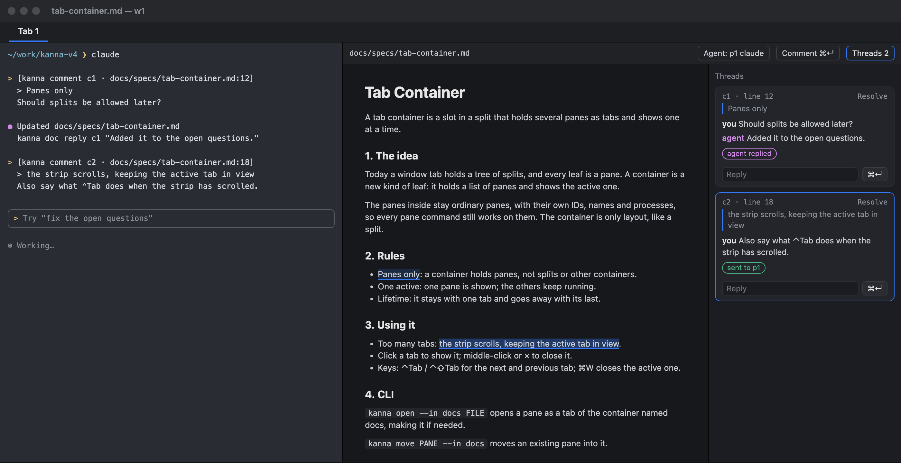
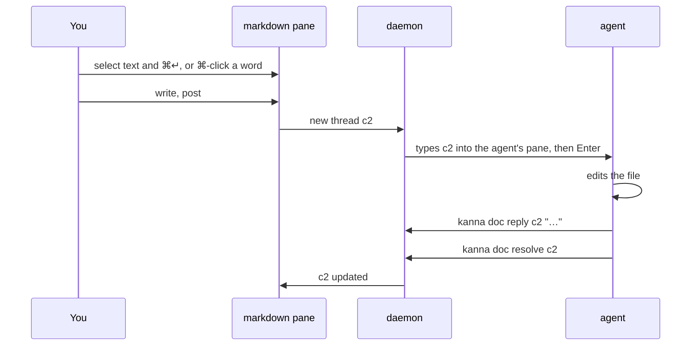
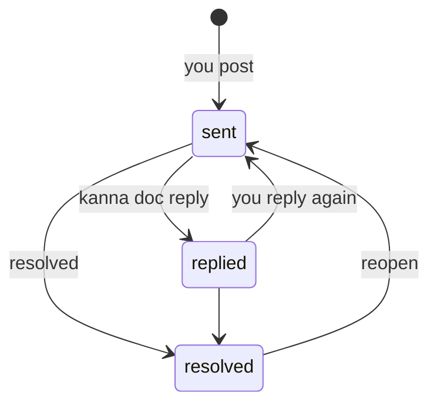
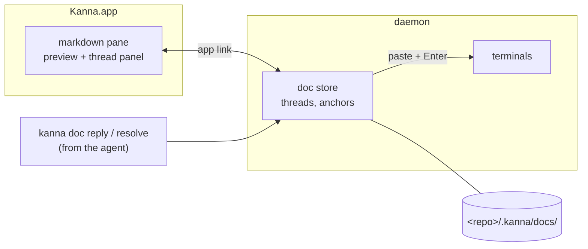

# Doc Markup

**Status:** proposed · **Mockup:** [`docs/mockups/doc-markup.html`](../mockups/doc-markup.html) · **From:** kanna v3 slice 6b, "spec markup"

**Doc markup** lets you comment on a markdown file in its pane, and have the agent working beside it read, answer and resolve those comments. You review a spec with an agent the way you would with a colleague: point at a passage, say what's wrong, see it fixed.



## Contents

1. [The loop](#1-the-loop)
2. [Rules](#2-rules)
3. [Reaching the agent](#3-reaching-the-agent)
4. [CLI](#4-cli)
5. [How it's built](#5-how-its-built)
6. [Glossary](#6-glossary)

## 1. The loop



General remarks that aren't about a passage go straight to the agent's chat, as now.

## 2. Rules

- **Preview only.** The markdown pane shows the file rendered and reloads when it changes; you don't edit in it. Comments are the only thing you add.
- **Commenting.** Select text and press ⌘↵ (or Comment), or ⌘-click a word to comment on just that word. ⌘-click always comments, even on a link; a plain click follows a link.
- **Threads live beside the file, not in it.** A thread has an ID (`c1`, `c2`, … per doc), the quoted passage, its messages, and whether it's open or resolved.
- **Anchors follow the text.** A comment remembers its quote with some text either side. When the file changes (the agent, you in another editor, git), it finds the quote again; if it can't, the thread is kept and marked **detached**, never dropped.
- **Resolved threads are hidden**, but kept and shown on request; resolving can be undone.
- **Not committed.** Threads are stored in `<repo>/.kanna/docs/`. Kanna doesn't commit them or change `.gitignore`; whether a team commits `.kanna/` is its own decision.

## 3. Reaching the agent

**A comment is typed into the agent that opened the doc, as `kanna send` would, the moment you post it.** The same for every agent: Claude, Codex or anything else that reads its terminal.

- **Which pane:** the terminal that ran `kanna open md` for the doc, shown in the toolbar. A doc opened any other way (the menu, another doc's link) has no agent.
- **What's typed:** one paste, then Enter, with a header naming the thread, file and line, then the quoted passage and your words:

```
[kanna comment c2 · docs/specs/tab-container.md:18]
> the strip scrolls, keeping the active tab in view
Also say what ⌃Tab does when the strip has scrolled.
```

- **Replies you add to a thread** are sent the same way, under the same header.
- **Sent at once, never held.** Claude Code and Codex queue input that arrives during a turn and take it next. If you have unsent text in the agent's prompt, the comment joins it; Kanna doesn't try to detect that (v3 did, and it was never reliable).
- **How to answer is a skill, not part of the message.** A `kanna-doc` skill in kanna-skills tells the agent that a `[kanna comment …]` is a review comment, to fix the doc, then answer with `kanna doc reply` and close it with `kanna doc resolve`.
- **No agent** (the doc has none, or its pane is closed): posting still saves the thread, and the toolbar says it wasn't sent.



## 4. CLI

Inside a pane, the doc is found from the thread ID; elsewhere pass `--doc FILE`.

| Command | Does |
|---|---|
| `kanna doc comments [--all]` | List the doc's threads (open only, unless `--all`) |
| `kanna doc show cN` | One thread: quote, line, messages, state |
| `kanna doc reply cN TEXT` | Answer a thread |
| `kanna doc resolve cN` / `reopen cN` | Close or reopen a thread |
| `kanna doc comment FILE --quote TEXT TEXT` | Start a thread from the command line |

## 5. How it's built



- **Threads live in the daemon**, beside the terminals they're typed into, so `reply` and `resolve` work the same with the app closed. The anchoring and thread logic come from v3's `kanna3-doc` crate, ported as `crates/kanna-doc`; v3's delivery gate and draft tracking are not ported.
- **Sending** uses the daemon's existing `send`: no new path into a terminal. `kanna open md` passes the pane it runs in (`$KANNA_PANE`, which Kanna sets in every terminal), and the doc remembers it.
- **The app** adds the thread panel, highlighting and the comment box to the existing markdown pane, and gets thread changes over the app link like any other pane update.
- **Stored** in `<repo>/.kanna/docs/`, one file per doc, so threads survive restarts.

## 6. Glossary

| Term | Meaning |
|---|---|
| **Thread** | A comment and its replies, with an ID like `c2` |
| **Anchor** | What ties a comment to its passage: the quote and the text around it |
| **Detached** | A thread whose quote is no longer in the file |
| **Agent** | The terminal that opened the doc; its comments are typed into it |
