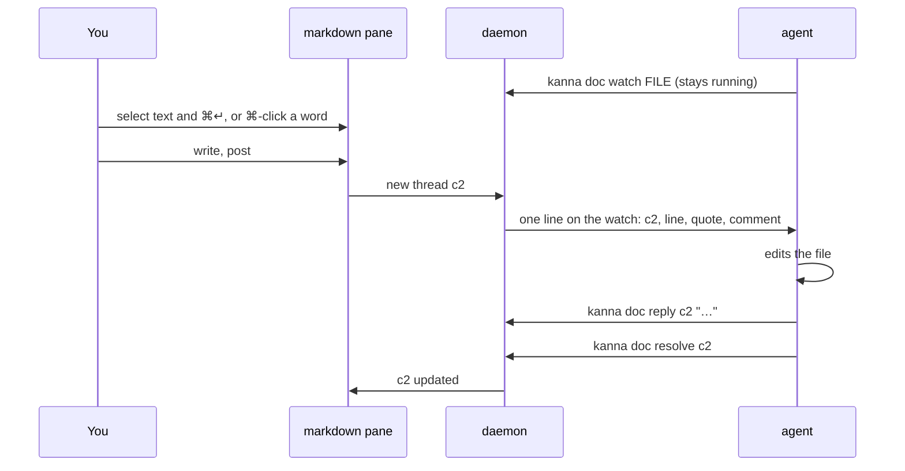
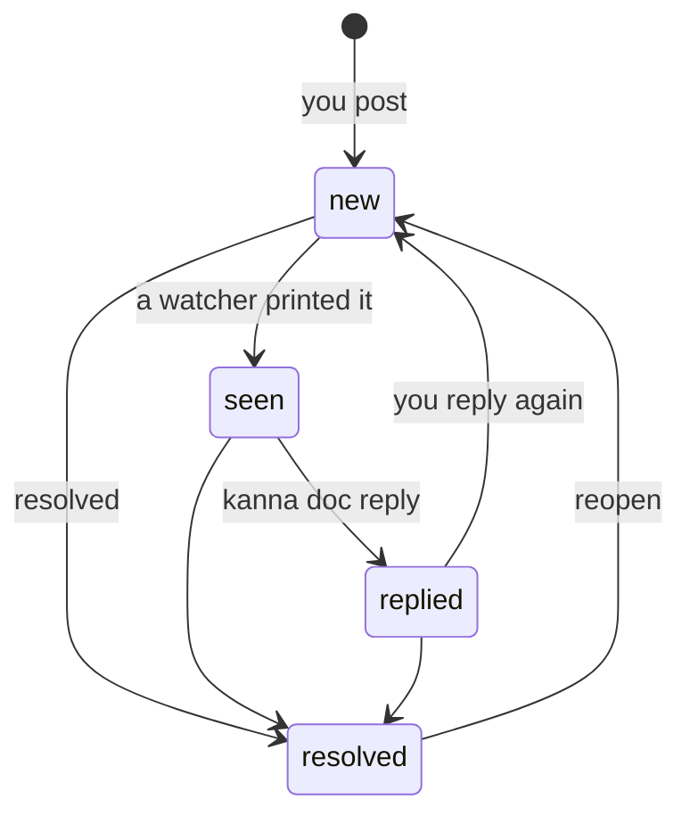
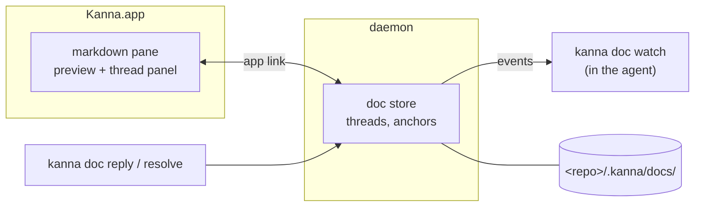

# Doc Markup

**Status:** proposed · **Mockup:** [`docs/mockups/doc-markup.html`](../mockups/doc-markup.html) · **From:** kanna v3 slice 6b, "spec markup"

**Doc markup** lets you comment on a markdown file in its pane, and have the agent working beside it read, answer and resolve those comments. You review a spec with an agent the way you would with a colleague: point at a passage, say what's wrong, see it fixed.

## Contents

1. [The loop](#1-the-loop)
2. [Rules](#2-rules)
3. [Reaching the agent](#3-reaching-the-agent)
4. [Moving around](#4-moving-around)
5. [CLI](#5-cli)
6. [How it's built](#6-how-its-built)
7. [Open questions](#7-open-questions)
8. [Glossary](#8-glossary)

## 1. The loop

General remarks that aren't about a passage go straight to the agent's chat, as now.

## 2. Rules

- **Preview only.** The markdown pane shows the file rendered and reloads when it changes; you don't edit in it. Comments are the only thing you add.
- **Commenting.** Select text and press ⌘↵ (or Comment), or ⌘-click a word to comment on just that word. ⌘-click always comments, even on a link; a plain click follows a link.
- **Threads live beside the file, not in it.** A thread has an ID (`c1`, `c2`, … per doc), the quoted passage, its messages, and whether it's open or resolved.
- **Anchors follow the text.** A comment remembers its quote with some text either side. When the file changes (the agent, you in another editor, git), it finds the quote again; if it can't, the thread is kept and marked **detached**, never dropped.
- **Resolved threads are hidden**, but kept and shown on request; resolving can be undone.
- **Not committed.** Threads are stored in `<repo>/.kanna/docs/`. Kanna doesn't commit them or change `.gitignore`; whether a team commits `.kanna/` is its own decision.

## 3. Reaching the agent

**The agent asks for comments; Kanna never types into its terminal.** `kanna doc watch FILE` is a command that stays running and prints one line per new comment or reply from you. An agent that can watch a command's output gets each line as an event, at a moment of its own choosing, so it never lands on your half-typed prompt or interrupts a turn.

- **Claude Code** runs `kanna doc watch` with its Monitor tool. A `kanna-doc` skill (in kanna-skills) tells it to do so when you open a doc for review together, and `kanna open md` run from an agent's pane prints the same hint.
- **No watcher.** The pane shows that no agent is watching and how many comments are waiting, with **Send to PANE**: one click types a short request ("answer comments c2, c3 on FILE") into that terminal. You press it, so you know the prompt is clear.
- **Why not type comments into the terminal?** That needs Kanna to know when the agent is idle and whether you've typed a draft into its prompt. Kanna v3 did this, and draft detection was never reliable.

| Agent | How it gets comments |
|---|---|
| Claude Code | `kanna doc watch` under Monitor |
| Codex | Send to PANE for now; its app-server would need Kanna to host the conversation ([7](#7-open-questions)) |
| anything else | Send to PANE, or `kanna doc comments` when asked |

## 4. Moving around

With the markdown pane focused, Vim's scrolling keys work:

| Keys | Move |
|---|---|
| `j` `k`, `⌃e` `⌃y` | a line down, up |
| `⌃d` `⌃u` | half a screen down, up |
| `⌃f` `⌃b` | a screen down, up |
| `gg` `G` | top, bottom |
| `}` `{` | next, previous paragraph |
| `/` `?`, `n` `N` | find forward, back; next, previous match |

## 5. CLI

Inside a pane, the doc is found from the thread ID; elsewhere pass `--doc FILE`.

| Command | Does |
|---|---|
| `kanna doc watch FILE` | Stay running; print a line for each new comment or reply from you, starting with those not yet seen |
| `kanna doc comments [--all]` | List the doc's threads (open only, unless `--all`) |
| `kanna doc show cN` | One thread: quote, line, messages, state |
| `kanna doc reply cN TEXT` | Answer a thread |
| `kanna doc resolve cN` / `reopen cN` | Close or reopen a thread |
| `kanna doc comment FILE --quote TEXT TEXT` | Start a thread from the command line |

## 6. How it's built

- **Threads live in the daemon**, so the agent's `watch`, `reply` and `resolve` work the same with the app closed, and the daemon knows which pane is watching (for "p1 claude is watching" and Send to PANE). The anchoring and thread logic come from v3's `kanna3-doc` crate, ported as `crates/kanna-doc`; v3's delivery gate and draft tracking are not ported.
- **The app** adds the thread panel, highlighting, the comment box and the Vim keys to the existing markdown pane, and gets thread changes over the app link like any other pane update.
- **Stored** in `<repo>/.kanna/docs/`, one file per doc, so threads survive restarts.

## 7. Open questions

1. Codex: is there a way for Codex running in a terminal to take events, or is Send to PANE enough until Kanna hosts agent chats itself?
2. Several agents watching one doc: should all of them get every comment, or should you pick one?
3. Keyboard-only commenting: a visual mode (`v` and motions, then ⌘↵) to select without the mouse?

## 8. Glossary

| Term | Meaning |
|---|---|
| **Thread** | A comment and its replies, with an ID like `c2` |
| **Anchor** | What ties a comment to its passage: the quote and the text around it |
| **Detached** | A thread whose quote is no longer in the file |
| **Watcher** | An agent running `kanna doc watch` on the doc |
| **Monitor** | Claude Code's tool for running a command and getting each line it prints as an event |
