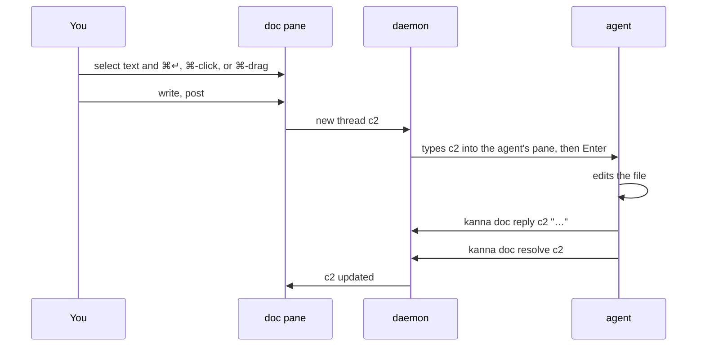
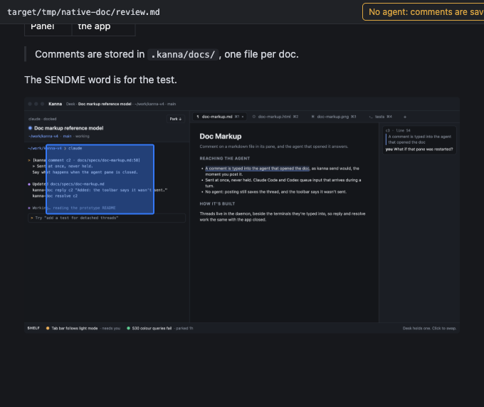
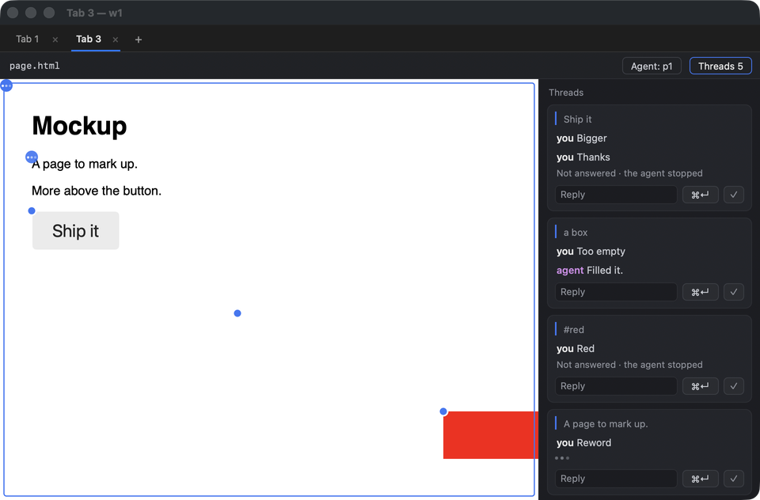
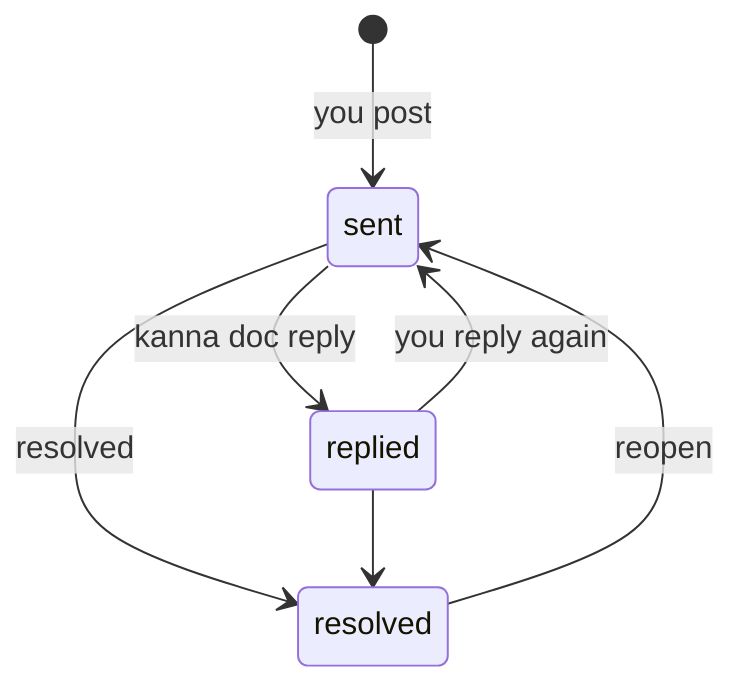
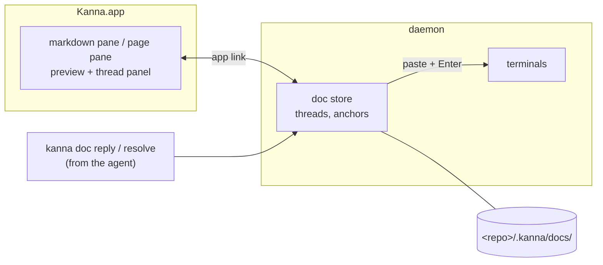

# Doc Markup

**Status:** proposed · **Mockup:** [`docs/mockups/doc-markup.html`](../mockups/doc-markup.html) · **Reference model:** [`prototypes/doc-markup`](../../prototypes/doc-markup/README.md) · **From:** kanna v3 slice 6b, "spec markup"

**Doc markup** lets you comment on a doc in Kanna, a markdown file or an HTML page (a mockup), and have the agent working beside it read, answer and resolve those comments. You review a spec or a mockup with an agent the way you would with a colleague: point at something, say what's wrong, see it fixed.


## Contents

1. [The loop](#1-the-loop)
2. [Rules](#2-rules)
3. [Reaching the agent](#3-reaching-the-agent)
4. [CLI](#4-cli)
5. [How it's built](#5-how-its-built)
6. [Glossary](#6-glossary)

## 1. The loop



General remarks that aren't about something in the doc go straight to the agent's chat, as now.

## 2. Rules

Every doc works the same way; only what you can point at differs.

- **Two kinds of doc.** A markdown file, opened with `kanna open md FILE`, and an HTML page, opened with `kanna markup FILE.html`. (`kanna open web` shows a page without comments.)
- **Preview only.** The pane shows the file and reloads when it changes; you don't edit in it. Comments are the only thing you add.
- **Commenting.** Select text and press ⌘↵ (or **Comment**), in either kind. ⌘ adds what the kind offers:

| You | In a markdown file | In a page |
|---|---|---|
| Select text, ⌘↵ | that passage | that text |
| ⌘-click | a word (even on a link) | the part of the page under it; holding ⌘ outlines it first |
| ⌘-drag | a box on an image | a box anywhere on the page |
| ⌘-click an image | the whole image | the image, as a part |
| Plain click | follows a link, or opens a thread's mark | uses the page, or opens a thread's mark |





- **Marks stay on what you pointed at.** A passage or selected text is found again by its words and the text around them; a part of a page by its place in the page and its text; a box by where it is on the image or page. They follow edits, reloads and zoom. Anything that can't be found again is kept and marked **detached**, never dropped.
- **A page's view.** A thread on a page remembers which view of it it was on (the part of the URL after `#`), shows its mark only there, and takes you there when you open it from the list.
- **Threads live beside the file, not in it.** A thread has an ID (`c1`, `c2`, … per doc), what it points at, its messages, and whether it's open or resolved.
- **Resolved threads stay marked**, more faintly than open ones, and clicking the mark opens the thread to read or reopen it. The list beside the doc hides them until you ask; resolving can be undone.
- **The thread list** sits on the pane's right; in a pane narrower than twice its width it hides until you press **Threads**.
- **Not committed.** Threads, and the marked-up copies sent to the agent, are stored in `<repo>/.kanna/docs/`. Kanna doesn't commit them or change `.gitignore`; whether a team commits `.kanna/` is its own decision.

## 3. Reaching the agent

**A comment is typed into the agent that opened the doc, as `kanna send` would, the moment you post it.** The same for every agent: Claude, Codex or anything else that reads its terminal.

- **Which pane:** the terminal that ran `kanna open md` or `kanna markup` for the doc, shown in the toolbar. A doc opened any other way (the menu, another doc's link) has no agent.
- **What's typed:** one paste, then Enter: a header naming the thread, file and line; what you pointed at, as `>` lines; then your words. For a passage that's the passage:

```
[kanna comment c2 · docs/specs/tab-container.md:18]
> the strip scrolls, keeping the active tab in view
Also say what ⌃Tab does when the strip has scrolled.
```

- **Anything you can't quote** (a box, a part of a page, selected text on a page) is named, and comes with a marked-up copy, saved beside the threads, for the agent to look at: the image with the box drawn on it, or a screenshot of the page with the part, text or box boxed in red. On an image:

```
[kanna comment c4 · docs/specs/desk.md:9]
> image desk.png, the box from 5%,20% to 30%,50% (left,top to right,bottom)
> marked up: .kanna/docs/marks/docs__specs__desk.md-c4.png
The agent header needs the branch.
```

- On a page: the view, then the part (its CSS path and text), the selected text (`the text "…" in PATH`) or `a box`, then where it is in page pixels:

```
[kanna comment c1 · docs/mockups/desk.html:149]
> the page at #picture,needs, element #win > div:nth-of-type(1) "Kanna Desk · Doc markup reference model"
> box 0,0 to 1220,44 px in a 1220×816 view, scrolled to 0,0
> marked up: .kanna/docs/marks/docs__mockups__desk.html-c1.png
Make the title bar quieter.
```

- **Replies you add to a thread** are sent the same way, under the same header.
- **Sent at once, never held.** Claude Code and Codex queue input that arrives during a turn and take it next. If you have unsent text in the agent's prompt, the comment joins it; Kanna doesn't try to detect that (v3 did, and it was never reliable).
- **How to answer is a skill, not part of the message.** A `kanna-doc` skill in kanna-skills tells the agent that a `[kanna comment …]` is a review comment, to fix the doc, then answer with `kanna doc reply` and close it with `kanna doc resolve`.
- **No agent** (the doc has none, or its pane is closed): posting still saves the thread, and the toolbar says it wasn't sent.



## 4. CLI

Inside a pane, the doc is found from the thread ID; elsewhere pass `--doc FILE`.

| Command | Does |
|---|---|
| `kanna doc comments [--all]` | List the doc's threads (open only, unless `--all`) |
| `kanna doc show cN` | One thread: quote, line, messages, state |
| `kanna doc reply cN TEXT` | Answer a thread |
| `kanna doc resolve cN` / `reopen cN` | Close or reopen a thread |
| `kanna doc comment FILE --quote TEXT TEXT` | Start a thread from the command line |

## 5. How it's built



- **Threads live in the daemon**, beside the terminals they're typed into, so `reply` and `resolve` work the same with the app closed. The anchoring and thread logic come from v3's `kanna3-doc` crate, ported as `crates/kanna-doc`; v3's delivery gate and draft tracking are not ported.
- **Sending** uses the daemon's existing `send`, wrapped as a bracketed paste so a multi-line comment arrives whole (plain `send` would submit it at its first newline). `kanna open md` passes the pane it runs in (`$KANNA_PANE`, which Kanna sets in every terminal), and the doc remembers it.
- **The app** adds the thread panel, marks and the comment box to the markdown pane and to a web pane opened with `kanna markup`, one shared set of views (`KannaDocs`), and gets thread changes over the app link like any other pane update. A page is worked from a script world of its own (`WKContentWorld`), which the page's scripts can't see or call; its marked-up copy is the web view's own screenshot.
- **Stored** in `<repo>/.kanna/docs/`, one file per doc, so threads survive restarts.
- **Built so far:** both panes have the native comment UI, matching the reference model (e2e S37 drives the markdown pane, S39 a page, and both screenshot it). Until the daemon's doc store lands, the app reads and writes the reference model's files directly, so the prototype's `kanna-doc reply` and `resolve` (and the skill) work with it unchanged.

## 6. Glossary

| Term | Meaning |
|---|---|
| **Thread** | A comment and its replies, with an ID like `c2` |
| **Doc** | A markdown file or an HTML page shown with its comments |
| **Mark** | What a thread points at, drawn in the doc: a passage, selected text, a part of a page, or a box |
| **Anchor** | What ties a mark to the doc: the quote and the text around it, a part's place and text, or a box's position |
| **Detached** | A thread whose mark can no longer be found in the doc |
| **View** | Which state of a page a thread is on: the part of its URL after `#` |
| **Agent** | The terminal that opened the doc; its comments are typed into it |
