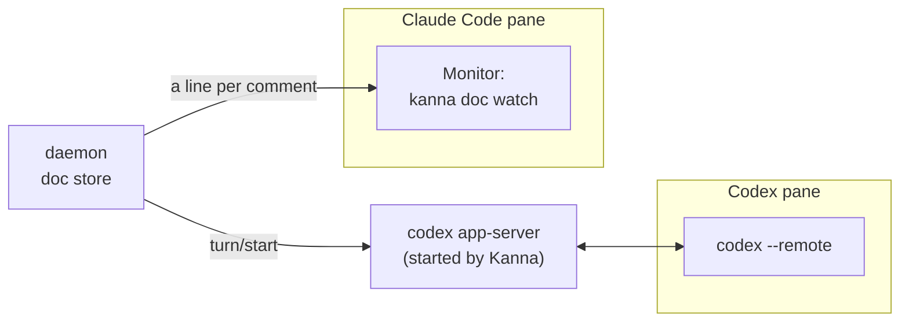
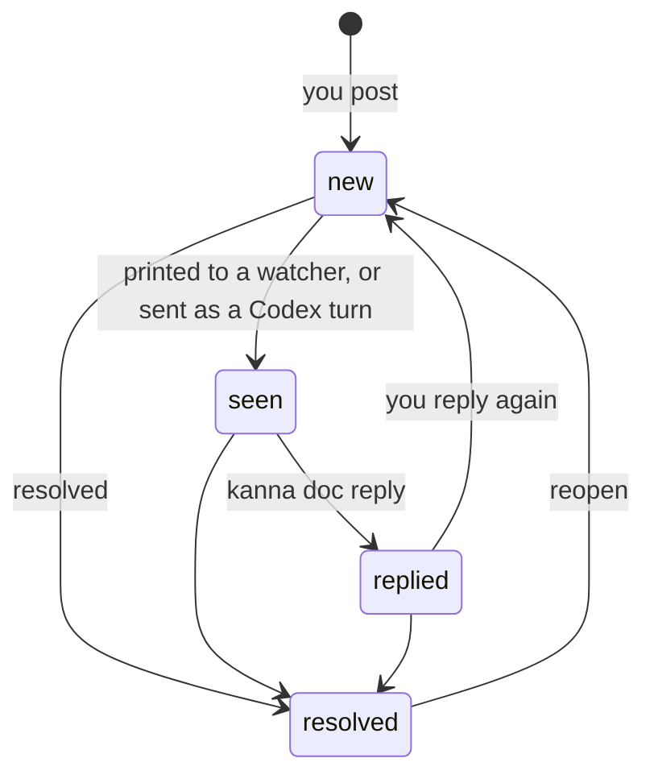
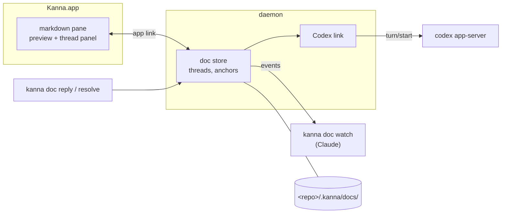

# Doc Markup

**Status:** proposed · **Mockup:** [`docs/mockups/doc-markup.html`](../mockups/doc-markup.html) · **From:** kanna v3 slice 6b, "spec markup"

**Doc markup** lets you comment on a markdown file in its pane, and have the agent working beside it read, answer and resolve those comments. You review a spec with an agent the way you would with a colleague: point at a passage, say what's wrong, see it fixed.

## Contents

1. [The loop](#1-the-loop)
2. [Rules](#2-rules)
3. [Reaching the agent](#3-reaching-the-agent)
4. [CLI](#4-cli)
5. [How it's built](#5-how-its-built)
6. [Open questions](#6-open-questions)
7. [Glossary](#7-glossary)

## 1. The loop

```mermaid
sequenceDiagram
    participant You
    participant Doc as markdown pane
    participant D as daemon
    participant A as agent
    A->>D: connects (Claude: kanna doc watch, Codex: app-server)
    You->>Doc: select text and ⌘↵, or ⌘-click a word
    You->>Doc: write, post
    Doc->>D: new thread c2
    D->>A: c2 with its line, quote and comment, between turns
    A->>A: edits the file
    A->>D: kanna doc reply c2 "…"
    A->>D: kanna doc resolve c2
    D->>Doc: c2 updated
```

General remarks that aren't about a passage go straight to the agent's chat, as now.

## 2. Rules

- **Preview only.** The markdown pane shows the file rendered and reloads when it changes; you don't edit in it. Comments are the only thing you add.
- **Commenting.** Select text and press ⌘↵ (or Comment), or ⌘-click a word to comment on just that word. ⌘-click always comments, even on a link; a plain click follows a link.
- **Threads live beside the file, not in it.** A thread has an ID (`c1`, `c2`, … per doc), the quoted passage, its messages, and whether it's open or resolved.
- **Anchors follow the text.** A comment remembers its quote with some text either side. When the file changes (the agent, you in another editor, git), it finds the quote again; if it can't, the thread is kept and marked **detached**, never dropped.
- **Resolved threads are hidden**, but kept and shown on request; resolving can be undone.
- **Not committed.** Threads are stored in `<repo>/.kanna/docs/`. Kanna doesn't commit them or change `.gitignore`; whether a team commits `.kanna/` is its own decision.

## 3. Reaching the agent

**Kanna never types comments into the agent's terminal.** That would need Kanna to know when the agent is idle and whether you've typed a draft into its prompt; Kanna v3 did this, and draft detection was never reliable. Instead each agent gets comments through its own way of taking input from outside, which queues them between turns and leaves your prompt alone.

- **Claude Code pulls.** `kanna doc watch FILE` stays running and prints one line per new comment or reply from you. Claude runs it with its Monitor tool and gets each line as an event, at a moment of its own choosing. A `kanna-doc` skill (in kanna-skills) tells it to start watching when you review a doc together, and `kanna open md` run from Claude's pane prints the same hint.
- **Codex is pushed to, through its app-server.** Kanna starts `codex app-server --listen ws://127.0.0.1:PORT` and runs Codex in the pane as `codex --remote` against it, so the pane is the usual Codex TUI. The daemon is a second client of the same app-server: it subscribes to the pane's thread, knows from `thread/status/changed` and `turn/completed` whether a turn is running, and sends comments as a new turn (`turn/start`) once the current one ends. The TUI shows that turn like any other; text you're typing in its prompt is untouched.
- **Anything else, or no agent connected.** The pane shows that no agent is listening and how many comments are waiting, with **Send to PANE**: one click types a short request ("answer comments c2, c3 on FILE") into that terminal. You press it, so you know the prompt is clear.

| Agent | How it gets comments | Kanna knows it's connected by |
|---|---|---|
| Claude Code | pulls: `kanna doc watch` under Monitor | a `watch` running from its pane |
| Codex | pushed: `turn/start` on its app-server | the pane's Codex runs against Kanna's app-server |
| anything else | Send to PANE | (never) |

## 4. CLI

Inside a pane, the doc is found from the thread ID; elsewhere pass `--doc FILE`.

| Command | Does |
|---|---|
| `kanna doc watch FILE` | Stay running; print a line for each new comment or reply from you, starting with those not yet seen |
| `kanna doc comments [--all]` | List the doc's threads (open only, unless `--all`) |
| `kanna doc show cN` | One thread: quote, line, messages, state |
| `kanna doc reply cN TEXT` | Answer a thread |
| `kanna doc resolve cN` / `reopen cN` | Close or reopen a thread |
| `kanna doc comment FILE --quote TEXT TEXT` | Start a thread from the command line |

## 5. How it's built

- **Threads live in the daemon**, so `watch`, `reply`, `resolve` and the Codex link work the same with the app closed, and the daemon knows which pane is listening (for "p1 claude is watching" and Send to PANE). The anchoring and thread logic come from v3's `kanna3-doc` crate, ported as `crates/kanna-doc`; v3's delivery gate and draft tracking are not ported.
- **The Codex link** is a JSON-RPC client in the daemon. One app-server per Codex pane, started by the daemon beside the pane's program, so it outlives the app like the terminal does.
- **The app** adds the thread panel, highlighting and the comment box to the existing markdown pane, and gets thread changes over the app link like any other pane update.
- **Stored** in `<repo>/.kanna/docs/`, one file per doc, so threads survive restarts.

## 6. Open questions

1. Starting Codex: how does `codex` typed in a pane end up as `codex --remote` against Kanna's app-server? A `kanna` shim on the pane's `PATH`, or only when you start it with `kanna open --agent codex`?
2. A comment that arrives mid-turn: wait for the turn to end (as above), or add it to the running turn with `turn/steer`?
3. Several agents listening to one doc: should all of them get every comment, or should you pick one?

## 7. Glossary

| Term | Meaning |
|---|---|
| **Thread** | A comment and its replies, with an ID like `c2` |
| **Anchor** | What ties a comment to its passage: the quote and the text around it |
| **Detached** | A thread whose quote is no longer in the file |
| **Watcher** | An agent running `kanna doc watch` on the doc |
| **App-server** | Codex's JSON-RPC server; the TUI and other clients share its conversations |
| **Monitor** | Claude Code's tool for running a command and getting each line it prints as an event |
