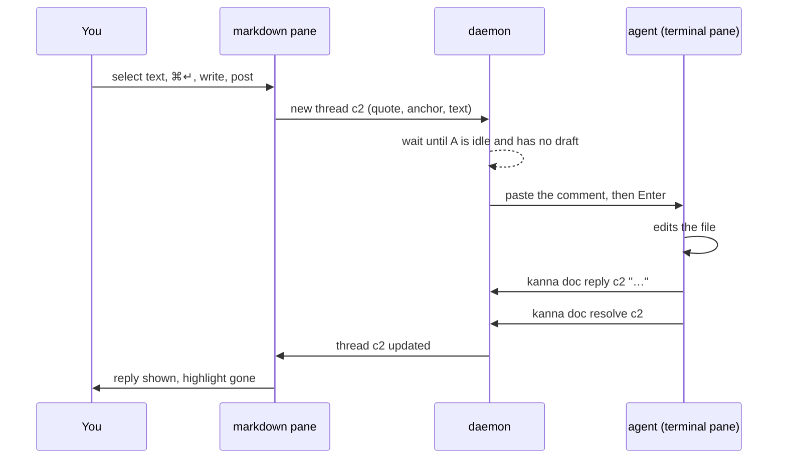
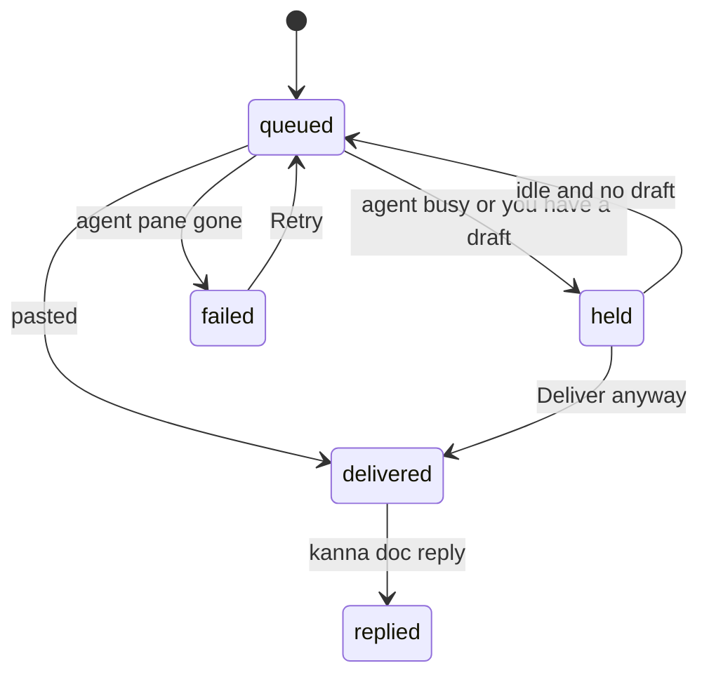
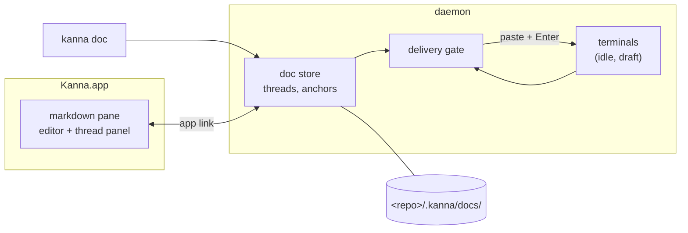

# Doc Markup

**Status:** proposed · **Mockup:** [`docs/mockups/doc-markup.html`](../mockups/doc-markup.html) · **From:** kanna v3 slice 6b, "spec markup"

**Doc markup** lets you comment on a markdown file in its pane, and have the agent working beside it read, answer and resolve those comments. It turns the markdown pane from a viewer into the place where you and an agent review a spec together.


## Contents

1. [The loop](#1-the-loop)
2. [Rules](#2-rules)
3. [Delivery](#3-delivery)
4. [CLI](#4-cli)
5. [How it's built](#5-how-its-built)
6. [Open questions](#6-open-questions)
7. [Glossary](#7-glossary)

## 1. The loop



You can also write `/agent …` on a line of its own to send the agent a message about the whole doc instead of a passage.

## 2. Rules

- **The file is the doc.** The pane edits the markdown file itself and saves as you type. Markers show only on the line you're editing.
- **Threads live beside the file, not in it.** A thread has an ID (`c1`, `c2`, … per doc), a kind (comment on a passage, or message about the doc), its messages, and whether it's open or resolved.
- **Anchors follow the text.** A comment remembers its quote with some text either side. When the file changes (you, the agent, git), it finds the quote again; if it can't, the thread is kept and marked **detached**, never dropped.
- **Edits don't clobber.** If the file changes on disk while you have unsaved edits, the two are merged; a clash is kept in the file with both versions and a note.
- **One agent per doc.** The doc sends to one terminal pane, chosen from Agent ▾. It defaults to the terminal that opened the doc (`kanna open md` from that pane).
- **Resolved threads are hidden**, but kept and shown on request; resolving can be undone.

## 3. Delivery

A comment is typed into the agent's terminal as one paste followed by Enter, so it must never land on top of something you're typing or on an agent mid-answer.



- One at a time per terminal, oldest first.
- **Idle** means the agent's screen has been still for a moment and it's waiting at its prompt. **Draft** means text you typed into that prompt and haven't sent.
- What's pasted names the thread, the file and line, the quote and your words, and says how to answer:

```
[kanna comment c2 · docs/specs/tab-container.md:18]
> the strip scrolls, keeping the active tab in view
you: Also say what ⌃Tab does when the strip has scrolled.
Reply: kanna doc reply c2 "…"   Resolve: kanna doc resolve c2
```

## 4. CLI

Inside a pane, `kanna doc` finds the doc from the pasted thread ID; elsewhere pass `--doc FILE`.

| Command | Does |
|---|---|
| `kanna doc comments [--all]` | List the doc's threads (open only, unless `--all`) |
| `kanna doc show cN` | One thread: quote, line, messages, state |
| `kanna doc reply cN TEXT` | Answer a thread |
| `kanna doc resolve cN` / `reopen cN` | Close or reopen a thread |
| `kanna doc comment FILE --quote TEXT TEXT` | Start a thread from the command line |
| `kanna doc agent FILE PANE` | Choose the doc's agent |

## 5. How it's built



- **Threads and delivery live in the daemon**, because delivery needs the terminals' state and must keep working with the app closed; `kanna doc reply` works the same either way. The anchoring, merging and thread logic come from v3's `kanna3-doc` crate, ported as `crates/kanna-doc`.
- **Draft tracking** is new to the daemon: it watches what you type into a terminal and what the program echoes back to know whether the prompt holds unsent text.
- **The app** turns the markdown pane into an editor with the thread panel, and gets thread changes over the app link like any other pane update.
- **Stored** in `<repo>/.kanna/docs/`, one file per doc, so threads survive restarts and can be committed if you want them shared.

## 6. Open questions

1. Should the markdown pane always be editable, or only once you start marking up?
2. How far to port v3's draft tracking: per-agent prompt rules (Claude, Codex), or only "screen still and cursor at the last line"?
3. Commit the threads with the repo by default, or keep `.kanna/` ignored?
4. Should `/agent` messages be threads too (v3 did), or just sent?

## 7. Glossary

| Term | Meaning |
|---|---|
| **Thread** | A comment or message and its replies, with an ID like `c2` |
| **Anchor** | What ties a comment to its passage: the quote and the text around it |
| **Detached** | A thread whose quote is no longer in the file |
| **Draft** | Text typed into the agent's prompt but not sent |
| **Delivery gate** | The part of the daemon that decides when a comment can be pasted |
