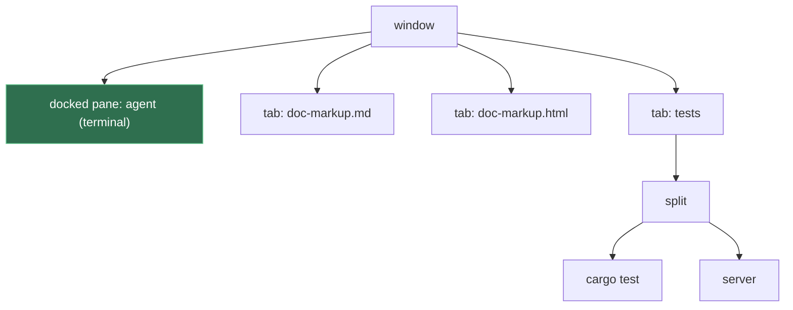

# Docked Pane

**Status:** proposed · **Used by:** [Desk](desk.md) · **Mockup:** the Desk's ([`docs/mockups/desk.html`](../mockups/desk.html)), whose agent is a docked pane

A **docked pane** belongs to a window, not to any of its tabs: it sits along the window's left or right edge and stays put while you switch tabs, with the tab bar and the tabs beside it. It's a mux-layer primitive, so any window can have one; the Desk uses it for the agent, with the task's docs as the window's tabs.

## Contents

1. [The window](#1-the-window)
2. [Rules](#2-rules)
3. [Keys and mouse](#3-keys-and-mouse)
4. [CLI](#4-cli)
5. [How it's built](#5-how-its-built)
6. [Glossary](#6-glossary)

## 1. The window

Today every pane is a leaf of some tab's split tree. A docked pane is the one pane that isn't: the window holds it directly, beside its tabs.

The right side needs nothing new: the window's own tabs already are a group of tabs, with renaming, reordering, dragging between windows and every tab command, and a tab can still hold splits.

## 2. Rules

- **One per window**, on the left edge (the default) or the right.
- **Any pane kind:** terminal, web, markdown or iOS. It's an ordinary pane with its ID and name, so `send`, `read`, `navigate` and `restart` work on it unchanged.
- **Width** is a fraction of the window, dragged at its divider and saved with the window. Default 2/5.
- **Always shown:** switching tabs leaves it alone. The tab bar spans only the tabs' side.
- **It closes only with its window.** Close Pane (⌘W) and `kanna close` don't close it: ⌘W in the docked pane does nothing, and `kanna close` on it fails with `docked: it closes with its window`. If its program exits, it stays on screen as `exited`, and Restart (⌘R) starts it again. Closing the window's last tab leaves the window with just its docked pane.
- **Stays with its window:** moving or dragging a tab to another window leaves the docked pane where it is.
- **Focus:** Next/Previous Pane go from the docked pane into the shown tab's panes and back. Zoom on a tab's pane fills the tabs' side; zoom on the docked pane fills the window.

## 3. Keys and mouse

| Action | Does |
|---|---|
| ⌘1 … ⌘9 | Show the window's 1st … 9th tab (a Kanna addition, for every window) |
| drag the divider | Resize |

## 4. CLI

| Command | Does |
|---|---|
| `kanna open … --dock [left\|right]` | Open the pane as the key window's docked pane, on that edge (default left; a docked one already there moves to a new tab) |
| `kanna move PANE --dock [left\|right]` | Dock an existing pane, or move the docked pane to the other edge |
| `kanna move PANE --tab` | Undock it into a new tab (kmux's own `move`, now also accepting the docked pane) |
| `kanna list` | Shows the window's docked pane on its own line: `dock: p1 (agent)` |

`kanna arrange` arranges the shown tab, as now; the docked pane isn't part of the expression.

## 5. How it's built

- **Built in kmux first.** kmux is the reference for the mux layer, so docked panes go into kmux (its core, protocol, CLI, views and state file), with new protocol cases for them; Kanna then takes them like everything else from kmux, and passes the same cases.
- **The core** (kmux's, then `kanna-mux`) gains a field: a window's `dock {pane, edge, width}`, beside its tabs, with its layout steps (`window.dock`, `window.undock`, `window.dock_width`) sent to the app like a tab's.
- **The app** splits the window's content view: the docked pane's view on its edge, the tab bar and the shown tab beside it.
- **Saved** in `layout.json` on the window; a file without one loads as before.
- **kmux parity** holds: both have docked panes, and a window without one behaves as before in both.

## 6. Glossary

| Term | Meaning |
|---|---|
| **Docked pane** | A window's one pane outside its tabs, along its left or right edge |
| **Tabs' side** | The rest of the window: the tab bar and the shown tab |
