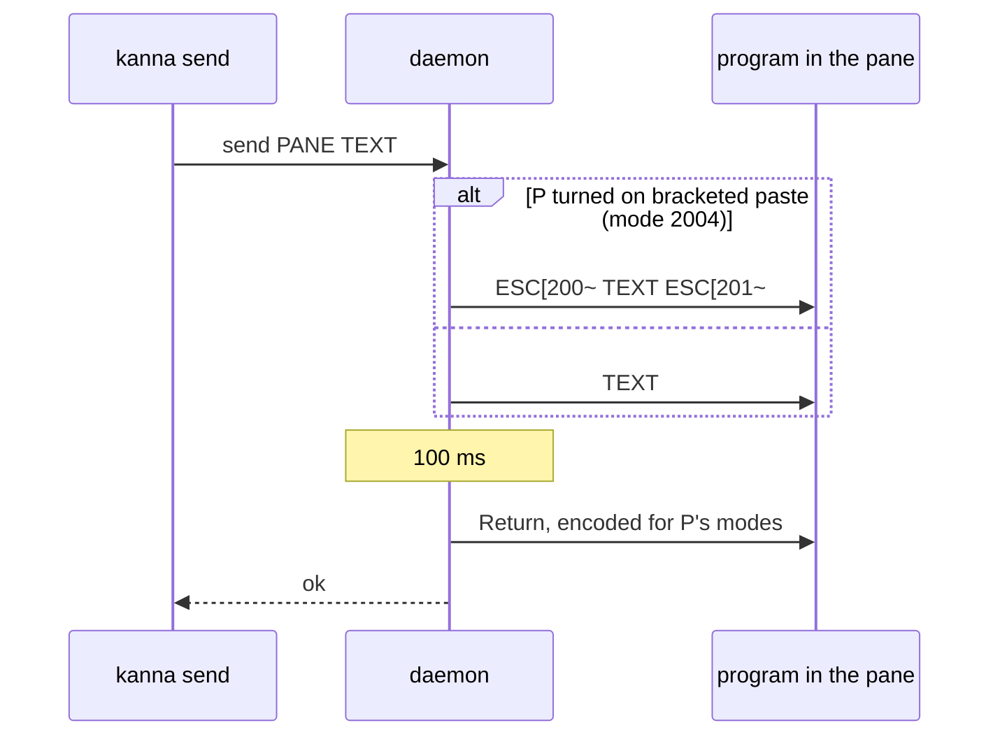

# kanna send presses Return on its own

**Status:** built

`kanna send PANE TEXT` types TEXT into a terminal pane and presses Return. The daemon writes TEXT first, as a bracketed paste when the program asked for one, then presses Return as a key of its own 100 ms later. It answers once Return is written, so one send's Return always lands before the next send's text, and a `read` after it sees it.

## Why

TUI agents (Claude Code, Codex) read keys that arrive together as a paste, and a Return inside a paste is a newline, not a submit. Written as one burst (`TEXT\r`), a message sat in the agent's prompt until someone pressed Enter.

| Written | Claude Code 2.1, long TEXT | Codex 0.162 |
|---|---|---|
| `TEXT\r` in one write | stays in the prompt | stays in the composer |
| TEXT, then `\r` with no pause | | stays in the composer |
| TEXT, 50 ms, `\r` | | sent |
| bracketed TEXT, 100 ms, Return | sent, idle or busy | sent, idle or busy |

- **The paste marks where TEXT ends.** A busy agent may read TEXT and the Return in one go however long the pause; with `ESC[201~` before it, the Return is still a key press. Markers inside TEXT are dropped.
- **The pause covers programs without bracketed paste**, which tell a paste from typing by timing only. A program that doesn't ask for it (`cat`, a line reader) gets TEXT as typed.
- **Return goes through the key encoder**, as `kanna send-key return` does, so a program using the kitty keyboard protocol gets the Return it expects.
- **Empty TEXT** presses only Return.

## Shells

zsh and bash turn on bracketed paste at their prompt, so a multi-line TEXT goes into the line editor whole and all of it runs at the Return, as when you paste it into Ghostty, rather than line by line as it's typed. A one-line TEXT runs as before.

## The limit

A program that isn't reading its input yet, such as an agent still starting up, gets TEXT and Return together when it first reads them, and before it turns on bracketed paste nothing marks where TEXT ends. Send once it's at its prompt. A task's first message doesn't go through `send`: it's the agent's argument.

## Like kmux

kmux's app does the same through Ghostty's surface: `ghostty_surface_text` (the paste path, bracketed when the program asks), then a Return key event. Kanna's daemon has no surface, so it decides the paste from the mode on its own screen (libghostty-vt), and waits 100 ms before Return. **[Decided difference from kmux]**

## Code

`Terminals::send` in `crates/kanna-daemon/src/terminals.rs` (`ENTER_GAP`, `Line`), `Feed::paste` and `Feed::enter` in `crates/kanna-daemon/src/reader.rs`. `PaneHost::send` takes a `Responder`, as `send_keys` does. Doc markup sends comments through it unwrapped.

**Tested** by e2e `send_submits`: zsh, bash and `cat` run the line, and twenty long messages each to the real Claude Code and Codex (`$KANNA_E2E_CODEX`) against the mock model, half while idle and half while busy with the one before, all reach the model. `real_agent_tasks` gives each agent its next message with a single `kanna send`.
