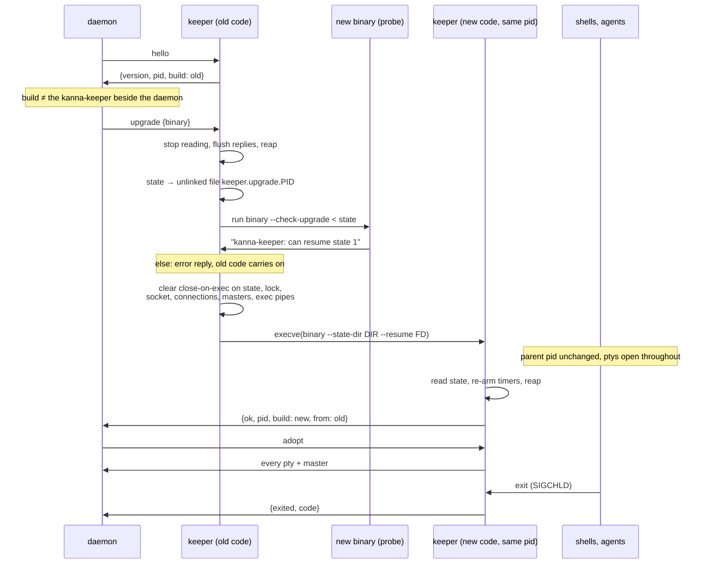

# Upgrading the Keeper

**Status:** built · **Related:** [the keeper](../keeper.md), [mux architecture §8](../research/mux-architecture.md#8-restarting-the-daemon)

The keeper holds every terminal so they outlive a daemon restart, but it couldn't be upgraded itself: running new keeper code meant stopping it, which killed every shell and agent. Now a newly built Kanna upgrades its keeper by itself, and every terminal keeps running.

## Contents

1. [How](#1-how)
2. [Why re-exec, not a handoff](#2-why-re-exec-not-a-handoff)
3. [What crosses](#3-what-crosses)
4. [Versions](#4-versions)
5. [Who triggers it](#5-who-triggers-it)
6. [An interrupted upgrade](#6-an-interrupted-upgrade)
7. [Testing](#7-testing)
8. [Glossary](#8-glossary)

## 1. How

The keeper **re-execs itself in place**: it `execve`s the new binary, and its state and every descriptor it holds cross the exec. The pid stays, so the shells and agents stay its children: it still reaps them and reports their exit codes, and `keeper.pid` doesn't change. The listening socket and the lock cross too, so nobody ever finds the keeper gone, and so do the connections: a daemon connected through the upgrade carries on.

## 2. Why re-exec, not a handoff

A handoff to a new process (the old keeper sending its masters and table over `SCM_RIGHTS`) would leave the children with a dead parent: they'd be reparented to launchd, and their exit codes would be lost. Re-exec keeps the parent, and nothing rules it out: `execve` keeps the pid, the children, zombies not yet reaped, descriptors without close-on-exec, the `flock` (it belongs to the open file, which the descriptor keeps), the signal mask and the ignored dispositions.

## 3. What crosses

The state is one JSON object (`"state": 1`), written to a file in DIR that's unlinked as soon as it's open, so only its descriptor names it:

| Carried | How |
|---|---|
| ptys: id, pid, cmd, cwd, master, exit not yet acknowledged | the master's descriptor number; the pid is still the keeper's child |
| spawns still waiting for their exec: id, pid, cmd, cwd, master, exec pipe, the requester's serial and `req`, time left, an exit already reaped | the master's and the pipe's descriptors; the new code answers the spawn |
| closed processes not yet gone: pid, time left before SIGKILL | |
| connections: serial, socket, any unread request lines | their replies are flushed before the exec (up to 2 s; one that won't take them is dropped) |
| the upgrade's requester: serial and `req` | the new code sends the reply |
| the listening socket, `keeper.lock` | their descriptors; the socket file is never unlinked |
| the next connection serial, the original `RLIMIT_NOFILE` | spawned processes still get the original limit back |

Not carried, rebuilt by the new code: the signal pipe, the spawn environment (looked up again, so Ghostty's resources are the new binary's), `build`, the idle timer. Exits that happen during the exec wait as zombies; the new code reaps once it has its handlers. SIGCHLD, SIGTERM and SIGINT are blocked across the exec, so a SIGTERM sent then stops the new code instead of killing it half-started.

## 4. Versions

The upgrade request and the state are versioned apart from the protocol:

- **The state** has `"state": N`. A keeper resumes every state up to its own; each new state version keeps reading the old ones. Before it execs, the old keeper runs the new binary with `--check-upgrade`, giving it the very state it's about to hand over: the new code parses it exactly as `--resume` will and answers with one line, within 5 s. Anything else (a state too new for it, a binary that isn't a keeper, one that doesn't run, a timeout) is an error reply and the **old code keeps running**, nothing lost. A downgrade works the same way: it goes ahead only if the older binary reads the state.
- **The protocol** stays 1: `build` and `upgrade` are additions an old daemon ignores. A keeper that changes the protocol incompatibly must still speak the old one to connections that cross the exec.

## 5. Who triggers it

- **The daemon, at start.** After `hello` it compares the keeper's `build` with the SHA-256 of the `kanna-keeper` it would start (the one beside it in `Contents/Helpers`, or `$KANNA_KEEPER`). If they differ, or the protocol versions do, it asks for an upgrade to that binary before `adopt`, then says so in daemon.log (`upgraded the keeper (pid P) from build a1b2c3d4 to e5f6a7b8`). So starting a newly built Kanna upgrades the keeper by itself. If the upgrade fails, a keeper of the same protocol is kept as it is (logged); one of another protocol is refused as before, saying which pid to stop.
- **By hand:** `kanna-keeper --upgrade [--state-dir DIR]` asks the keeper of DIR to become the binary that was run, and prints `upgraded the keeper (pid P) to PATH` or the error.
- **A keeper that predates upgrades** (no `build` in `hello`) can't be upgraded: the daemon logs it and uses it as it is. It gets new code the next time it stops.

## 6. An interrupted upgrade

| What happens | Result |
|---|---|
| The requester disconnects | the upgrade goes on; the reply goes nowhere |
| The probe refuses, fails or times out; the binary is missing; `execve` fails | error reply, close-on-exec restored, the old code carries on as if nothing happened |
| SIGTERM or SIGINT during the upgrade | handled by whichever code runs once the exec is done or abandoned: the keeper stops, as it would anyway |
| The new code can't use the state it accepted, or crashes after the exec | as a keeper crash ([11](../keeper.md#10-known-limitations)): the processes keep running with the daemon's copies, without a parent |
| The keeper is killed | as a keeper crash |

## 7. Testing

- `cargo test -p kanna-keeper`: an upgrade with live sessions (same pid, parent, pty and output; exits after it report codes; a connection crosses it), a spawn waiting for its exec answered by the new code, an exit straight after and one during, a binary that refuses leaves the old code running, `--upgrade` by hand, a state too new refused.
- `scripts/e2e-kanna.sh S68`: a claude agent on the Desk, a shell in a tab and a parked task under a keeper of another build; a new daemon upgrades it, takes every terminal back, claude carries on its conversation, and the shell's `exit 7` reports 7.

## 8. Glossary

| Term | Meaning |
|---|---|
| **Re-exec** | A process running a new program with `execve`, keeping its pid, children and open descriptors. |
| **Probe** | The new binary run with `--check-upgrade` on the state, before the keeper commits to it. |
| **Build** | The SHA-256 of the keeper's binary, read when it starts. |
