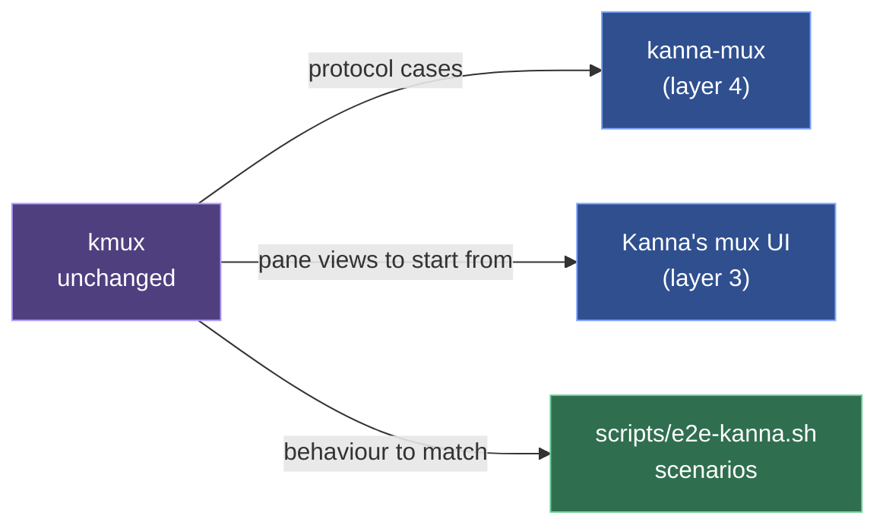

# kmux Is the Reference Model

**Status:** decided · **Detail:** [the kmux subtree](kmux-subtree.md) · **kmux's own spec:** [kmux-spec.md](https://github.com/tampopogk/kmux/blob/main/docs/kmux-spec.md)

kmux stays as it is. It's the model Kanna's mux is checked against, not a library Kanna builds on. Where Kanna and kmux behave differently, Kanna is wrong unless we decided otherwise, and nothing changes in kmux for Kanna's sake.

Layers as in [the architecture](architecture.md#1-the-stack).

## Rules

- **What kmux is the reference for:** the mux core and its control protocol, the CLI ([CLI](cli.md)), and the mux UI (windows, tabs, splits, pane views; [windows](windows.md)). Kanna's own layers on top (Desk and Shelf, tasks, agents) have no kmux counterpart.
- **kmux's source and tests live in `references/kmux`**, a git subtree of kmux (squashed). `kanna-mux` and the daemon run kmux's own protocol cases from `references/kmux/tests/kmux-protocol/cases`, except those Kanna decided to differ from, which the runner skips by name and fails on once kmux drops them, and those needing a command Kanna doesn't have (kmux's `workspace`: Kanna's tasks make and move workspaces). It doesn't compare kmux's numbered tab titles (`Tab 2`), since Kanna names tabs after their panes ([tab names](tab-names.md)).
- **Following kmux:** `git subtree pull --prefix=references/kmux https://github.com/tampopogk/kmux.git main --squash`, then port what Kanna should follow until the checks pass. A change to kmux is made in `references/kmux` and pushed upstream as a kmux PR; `cargo test` fails while it isn't ([kmux subtree](kmux-subtree.md)).
- **Building doesn't need kmux; checking does.** Kanna builds from its own sources, including its copies of kmux's socket client (`crates/kanna-client`) and mermaid bridge (`crates/kanna-merman`). The tests that compare Kanna with kmux read `references/kmux` (or `$KMUX_DIR`, to check against another kmux): the protocol cases ([layout](layout.md#6-conformance)), and the CLI check that compiles kmux's `commands.rs` and `output.rs` ([CLI](cli.md#1-a-port-of-kmuxs-cli)). If it's missing they fail and say so, rather than pass without checking.

## Glossary

| Term | Meaning |
|---|---|
| **kmux** | A native macOS mux (MIT, public) showing terminal, web, iOS and markdown panes. |
| **Reference model** | What Kanna's mux is checked against: kmux, unchanged. |
| **Protocol cases** | kmux's request-and-reply tests of its control protocol, run against Kanna too. |
