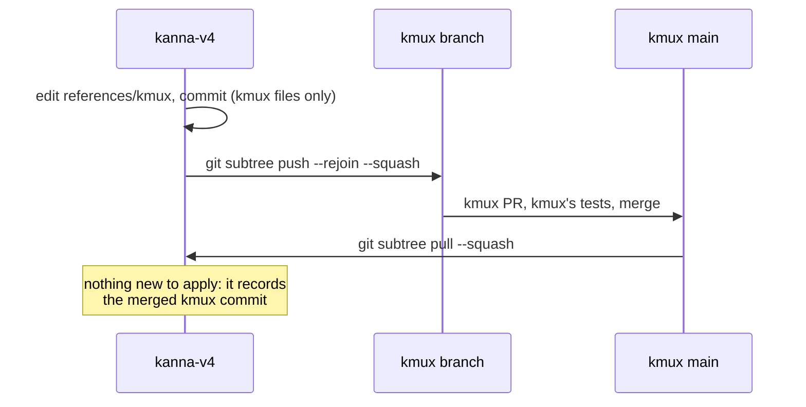
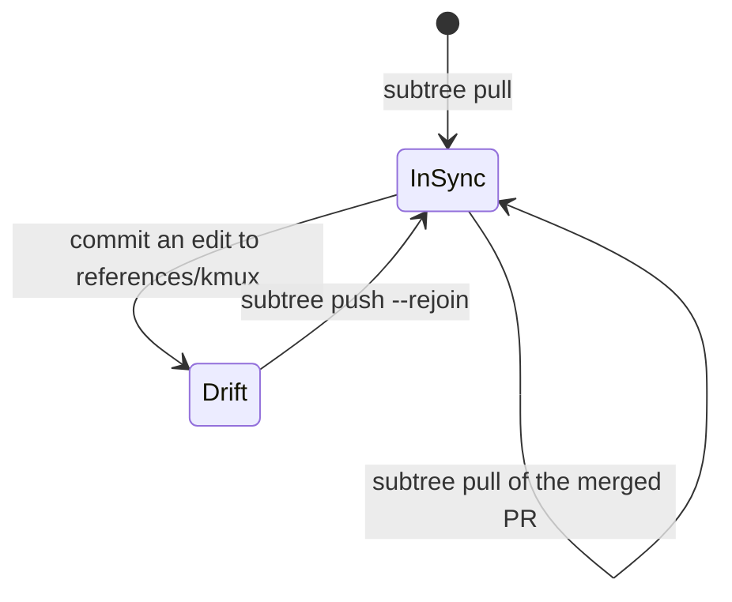

# kmux Subtree

**Status:** decided (2026-10-14) · **Part of:** [kmux Is the Reference Model](../kanna-spec.md#43-kmux-is-the-reference-model)

`references/kmux` is kmux's source, a squashed git subtree of [tampopogk/kmux](https://github.com/tampopogk/kmux). A change to kmux is made there, in kanna-v4, and pushed upstream as a kmux PR, so there's one place to edit and Kanna's checks run against it straight away.

## Contents

1. [The round trip](#1-the-round-trip)
2. [Rules](#2-rules)
3. [The drift check](#3-the-drift-check)
4. [Why](#4-why)

## 1. The round trip



```sh
git subtree push --prefix=references/kmux --rejoin --squash https://github.com/tampopogk/kmux.git BRANCH
git subtree pull --prefix=references/kmux https://github.com/tampopogk/kmux.git main --squash
```

A pull's squash commit holds kmux's tree exactly, and its message names the kmux commit (`git-subtree-split:`). `subtree push` turns the commits that touched `references/kmux` into kmux commits on top of that one and pushes them; `--rejoin` records what it pushed as a squash commit of its own, so the next push starts there.

## 2. Rules

- **kmux files only** in a commit for kmux: its message becomes the kmux commit's, so a commit that's half Kanna puts Kanna's story in kmux's history.
- **Always a branch and a PR** on kmux, never its `main`. Run kmux's tests on the branch (a kmux worktree builds them; `references/kmux` isn't built).
- **Pull when the PR merges**, even if it changed nothing here, so the subtree points at kmux's `main` again.
- **kmux changes for kmux's sake:** a change goes upstream only if kmux should have it. What Kanna decides differently stays in Kanna's code ([4.3](../kanna-spec.md#43-kmux-is-the-reference-model)).

## 3. The drift check

`cargo test` fails when `references/kmux` at HEAD differs from the tree of its last squash commit, the last kmux it was pulled or pushed as (`crates/kanna/tests/kmux_subtree.rs`). Uncommitted edits don't count, so it fails from the commit that changes kmux until that change is pushed with `--rejoin`, and it names the commands.



## 4. Why

The rule was "nothing in `references/kmux` is edited by hand". It was broken once (`--frozen`, 41f5840) with nothing to catch it, so the subtree drifted from kmux and the change had to be ported back by hand (kmux PR #2). Editing here and pushing makes the change once, checked by Kanna's tests and kmux's; the drift check catches what isn't pushed. The cost is that a push carries kanna's pull merges into kmux's history as merge commits with no changes of their own.
