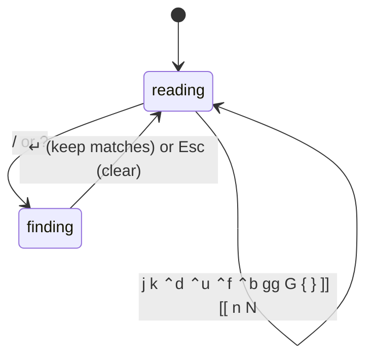

# Markdown Pane Keys

**Status:** proposed

A markdown pane is a preview, so its keys are free for moving around. With the pane focused, Vim's scrolling and search keys work, so you can read a doc without reaching for the mouse.

## Contents

1. [Keys](#1-keys)
2. [Rules](#2-rules)
3. [How it's built](#3-how-its-built)
4. [Open questions](#4-open-questions)

## 1. Keys

| Keys | Move |
|---|---|
| `j` `k`, `⌃e` `⌃y` | a line down, up |
| `⌃d` `⌃u` | half a screen down, up |
| `⌃f` `⌃b` | a screen down, up |
| `gg` `G` | top, bottom |
| `}` `{` | next, previous paragraph |
| `]]` `[[` | next, previous heading |
| `/` `?` | find forward, back |
| `n` `N` | next, previous match |
| `Esc` | stop finding, clear the matches |

## 2. Rules

- **Only when the pane is focused**, and never while you're typing in a text field in it (the find box, a comment).
- **⌘ shortcuts stay the app's.** Only plain and ⌃ keys are taken; menus keep every ⌘ key.
- **A count works** as in Vim: `5j`, `3}`.
- **Scrolling moves the view, not a cursor:** a preview has none. "A line" is one line of body text at the pane's zoom.
- **Find** searches the rendered text, not the markdown source; matches are highlighted and the view scrolls to keep the current one in the middle.

## 3. How it's built

All in the app's markdown view: a key handler on the view, before AppKit's own text keys. The daemon is not involved. Tests drive it with `debug.key`; `debug.md` gains the scroll position and the matches so they can check where it went.

## 4. Open questions

1. Should the same keys work in a web pane when no text field is focused?
2. Visual mode (`v` and moves to select): useful for commenting with the keyboard ([doc markup](doc-markup.md)), or too much?
