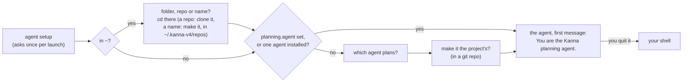

# New Desk

**Status:** opening a Desk is built; its planning terminal starting the planning agent is planned ([2](#2-its-planning-terminal)) · **Mockup:** [`references/mockups/desk.html`](../../references/mockups/desk.html) (Simulate: no tasks, first launch, Installed, Forget the project's planner; ⌘N) · **Part of:** [Desk](desk.md), [planning terminal](planning-agent.md) · **Builds on:** [agent setup](agent-setup.md), [settings](settings.md), [tasks](tasks.md#which-agents-resume)

What happens when a Desk window opens with nothing in it: where it opens, and how its planning terminal gets you to a planning agent, in the right project.

**Done when** a new Desk in `~` asks where, and moves to the folder, clones the repo or makes the named project; a new Desk on a repo asks which agent, starts the agent you pick, and that agent uses the kanna-planning skill, with Claude and with Codex; and a new Desk on a project whose planner is set starts it without asking.

## Contents

1. [When one opens](#1-when-one-opens)
2. [Its planning terminal](#2-its-planning-terminal)
3. [How it's built](#3-how-its-built)
4. [Tests](#4-tests)
5. [Rejected](#5-rejected)

## 1. When one opens

| How | Its folder |
|---|---|
| Kanna opens with nothing | the shell's folder Kanna was started from (`kanna …`, passed as `KANNA_START_DIR`), else `~` (started from Finder), which asks where ([2](#2-its-planning-terminal)) |
| File → New Desk (⌘N) | `~`, as `kanna ~` would, and its planning terminal asks where ([2](#2-its-planning-terminal)) |
| `kanna PATH` | PATH; the window keeps that project across a relaunch, until a task from another project is pulled onto it |

- **It shows the Shelf:** the planning terminal on the left, the full Shelf of the folder's repo on the right ([planning terminal](planning-agent.md#1-when-it-shows)). The title bar says Shelf; there's no folder picker.
- **⌘N always means New Desk.** New Window (a plain terminal window) keeps its menu item, without a shortcut. There's no New Instance: another project is what a Desk is for.

## 2. Its planning terminal

- **It runs Kanna's planner script once:** when the Desk opens, or when its terminal is restarted (`kanna restart`). Each run starts a new conversation.
- **Agent setup first:** `kanna agents setup --ask` and `update --ask` ([agent setup](agent-setup.md#3-asking)).
- **In `~`, it asks where first:** `Folder, repo or name:`, read in this order:
  | You type | It |
  |---|---|
  | a git URL (`https://…`, `git@…`, `ssh://…`) | clones it into `~/.kanna-v4/repos/NAME` (the repo's name), or opens that clone if it's there |
  | an existing folder (`~/work/kmux`, `../app`) | moves there |
  | `owner/repo` that isn't a folder | clones it from GitHub with `gh repo clone`, as above; without `gh`, it says to give the URL |
  | a name (letters, digits, `.`, `-`, `_`) | makes `~/.kanna-v4/repos/NAME`, empty, or opens it if it's there |

  A clone that fails, a missing folder or a `NAME` in `repos` that's another repo is said, and it asks again. Then the terminal moves, the header and Shelf follow, and the agent and the shell you're left in are there. Anywhere else (`kanna PATH`, a shell's folder), it doesn't ask.
- **A clone is a project like any other:** its own `.kanna/config.json` may already set `planning.agent`, and then nothing is asked. It clones with your git and `gh`, so their credentials apply.
- **A new project isn't a repo yet:** Kanna makes only the folder. The planning agent sees an empty folder and, with the kanna-new-project skill, decides with you what it is, then runs `git init` and a first commit when you agree ([tasks](tasks.md#1-what-a-task-is)).
- **The agents to choose from** are the agents Kanna knows that your shell finds, in the `AGENTS` table's order; Return takes the first.
- **No question** when the folder's `planning.agent` is set ([settings](settings.md)) or only one agent is installed. With none, it says so and you're in your shell.
- **Make it the project's:** yes writes `planning.agent` to the repo's `.kanna/config.json`, part of the repo, so every new Desk on the project, yours or anyone's, starts that agent. Not offered outside a git repo (`~`). No saves nothing, and the next Desk asks again.
- **The agent starts as you'd start it,** in the terminal's folder, with `You are the Kanna planning agent.` as its first message, so it answers at once with what's running and waiting (in `~`, which new project). It asks permission as it normally does. Codex runs with `--no-daemon` ([tasks](tasks.md#7-how-its-built)).
- **Quit it and you're in your shell,** with a line giving the command that starts it again as the planner. Anything you start there is yours.

## 3. How it's built

- **The app asks for a planning terminal** (`backlog` `plan`) with the window's folder; `task desk` makes the window, with a folder or none (started from Finder).
- **`planner.sh`, in `Kanna.app/Contents/Resources`,** copied there by `scripts/build-kanna-app.sh`. It replaces `getting-started.md`.
- **The daemon passes it everything** (`planner_command` in `backlog.rs`): the `kanna` beside the daemon,  the folder's `planning.agent` if set, and each agent Kanna knows as a name and the command that starts it with the planner's first message, built from the `AGENTS` table as a task's agent is (its first-message flag, `--no-daemon` for Codex; no session, no skipping permission prompts). The script knows no agent itself.
- **The terminal's command** is the [settings](settings.md) exports, then `planner.sh …`, which ends by starting your login shell (with Kanna's zsh integration put back) in the folder it chose. Moving reports the new folder as the shell would (OSC 7), so the window follows before any prompt. It runs in your interactive login shell, so `command -v` finds what your `.zshrc` sets up (nvm's codex).
- **Writing the setting** uses `plutil` on the repo's `.kanna/config.json` (making it with `"version": 1` if it's missing), keeping its other keys.
- **No marker variable:** the planning terminal has `KANNA_PANE` and `KANNA_SOCKET` like every Kanna terminal, and no `KANNA_PLANNER`; the daemon knows which pane is a window's planner.

## 4. Tests

- **Unit (`backlog.rs`):** the planning terminal's command for each agent; `planner.sh` run with stand-in agents: asks where only in `~`, moves to a folder, clones a URL (a local bare repo) and `owner/repo` (a stand-in `gh`), makes a named project, all under a stand-in `~/.kanna-v4/repos`, refuses a missing folder, asks which agent with two, not with one or with `planning.agent` set, writes the setting on yes and keeps the file's other keys, says so with none.
- **e2e (`scripts/e2e-kanna.sh`):** a new Desk asks, yes makes the agent the project's, and the next new Desk starts it straight away; claude and codex against the mock model (`tools/agent-harness`) each receive `You are the Kanna planning agent.` as their first message.

## 5. Rejected

- **A `kanna plan` command:** it only makes sense inside a planning terminal, not as a general command.
- **Resuming the planner's conversation:** it'd need a session kept per window; the planner reads the Shelf and backlog when it starts, so a new conversation loses little.
- **Telling it in launch instructions** (`claude --append-system-prompt`, `codex -c developer_instructions`): started without a message, an agent waits silently, and each agent needs its own flag.
- **Remembering your answer without asking:** you choose per Desk, and save it for the project only when you say so.
- **Printing getting-started text** (before): the agent itself says what's running and waiting.
- **Guessing a folder** (the latest parked or backlog task's repo) when Kanna starts with none: there's no project concept yet; the folder is where Kanna was started, else your home folder, and you `cd`.
- **A folder picker dialog for New Desk:** the planning terminal takes a folder or a name.
- **Listing your recent projects to choose from:** a path or a name is all it needs.
- **Leaving the folder to you** (`cd` before starting your agent, as before): the script starts the agent at once, so in `~` it asks where first.
- **The agent moving to the project:** an agent can't change its terminal's folder, so the window and the shell you're left in would stay in `~`.
