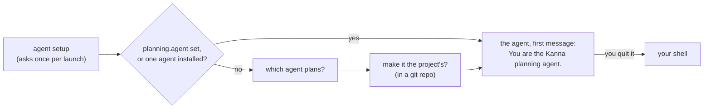

# Planner Script

**Status:** planned · **Mockup:** [`references/mockups/desk.html`](../../references/mockups/desk.html) (Simulate: no tasks, first launch, Installed, Forget the project's planner) · **Part of:** [planning terminal](planning-agent.md) · **Builds on:** [agent setup](agent-setup.md), [settings](settings.md), [tasks](tasks.md#which-agents-resume)

A new Desk's planning terminal runs Kanna's **planner script** once: it asks which agent plans, starts it as the planner, and leaves you in your shell when you quit it.

**Done when** a new Desk on a repo asks, starts the agent you pick, and that agent uses the kanna-planning skill, with Claude and with Codex; and a Desk on a project whose planner is set starts it without asking.

## Contents

1. [What it does](#1-what-it-does)
2. [How it's built](#2-how-its-built)
3. [Tests](#3-tests)
4. [Rejected](#4-rejected)

## 1. What it does

- **Once per planning terminal:** when a new Desk opens one, or when it's restarted (`kanna restart`). Each run starts a new conversation.
- **Agent setup first:** `kanna agents setup --ask` and `update --ask` ([agent setup](agent-setup.md#3-asking)).
- **The choices** are the agents Kanna knows that your shell finds, in the `AGENTS` table's order; Return takes the first.
- **No question** when the folder's `planning.agent` is set ([settings](settings.md)) or only one agent is installed. With none, it says so and you're in your shell.
- **Make it the project's:** yes writes `planning.agent` to the repo's `.kanna/config.json`, part of the repo, so every Desk on the project, yours or anyone's, starts that agent. Not offered outside a git repo (`~`). No saves nothing, and the next Desk asks again.
- **The agent starts as you'd start it,** in the planning terminal's folder, with `You are the Kanna planning agent.` as its first message, so it answers at once with what's running and waiting. It asks permission as it normally does. Codex runs with `--no-daemon` ([tasks](tasks.md#7-how-its-built)).
- **Quit it and you're in your shell,** with a line giving the command that starts it again as the planner. Anything you start there is yours.

## 2. How it's built

- **`planner.sh`, in `Kanna.app/Contents/Resources`,** copied there by `scripts/build-kanna-app.sh`. It replaces `getting-started.md`.
- **The daemon passes it everything** (`backlog` `plan`, `planner_command` in `backlog.rs`): the `kanna` beside the daemon, the folder's `planning.agent` if set, and each agent Kanna knows as a name and the command that starts it with the planner's first message, built from the `AGENTS` table as a task's agent is (its first-message flag, `--no-daemon` for Codex; no session, no skipping permission prompts). The script knows no agent itself.
- **The terminal's command** is the [settings](settings.md) exports, then `planner.sh …`, then your login shell with Kanna's zsh integration put back. It runs in your interactive login shell, so `command -v` finds what your `.zshrc` sets up (nvm's codex).
- **Writing the setting** uses `plutil` on the repo's `.kanna/config.json` (making it with `"version": 1` if it's missing), keeping its other keys.
- **No marker variable:** the planning terminal has `KANNA_PANE` and `KANNA_SOCKET` like every Kanna terminal, and no `KANNA_PLANNER`; the daemon knows which pane is a window's planner.

## 3. Tests

- **Unit (`backlog.rs`):** the planning terminal's command for each agent; `planner.sh` run with stand-in agents: asks with two, not with one or with `planning.agent` set, writes the setting on yes and keeps the file's other keys, says so with none.
- **e2e (`scripts/e2e-kanna.sh`):** a Desk asks, yes makes the agent the project's, and the next Desk starts it straight away; claude and codex against the mock model (`tools/agent-harness`) each receive `You are the Kanna planning agent.` as their first message.

## 4. Rejected

- **A `kanna plan` command:** it only makes sense inside a planning terminal, not as a general command.
- **Resuming the planner's conversation:** it'd need a session kept per window; the planner reads the Shelf and backlog when it starts, so a new conversation loses little.
- **Telling it in launch instructions** (`claude --append-system-prompt`, `codex -c developer_instructions`): started without a message, an agent waits silently, and each agent needs its own flag.
- **Remembering your answer without asking:** you choose per Desk, and save it for the project only when you say so.
- **Printing getting-started text** (before): the agent itself says what's running and waiting.
