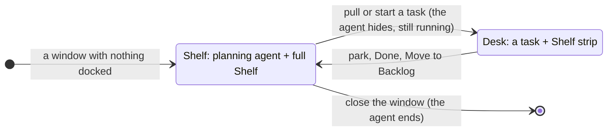
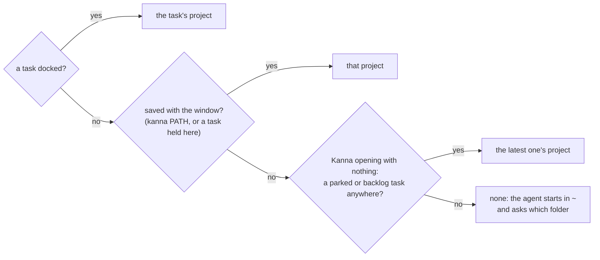
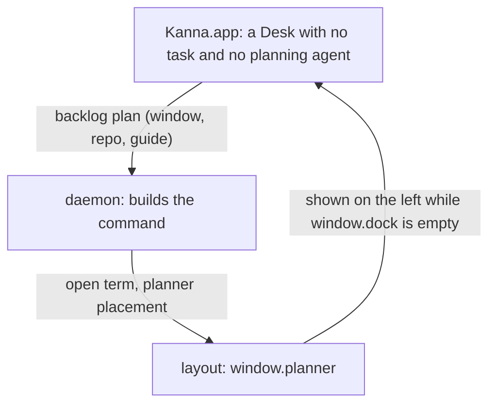

# Planning agent

**Status:** built · **Mockup:** [`references/mockups/desk.html`](../../references/mockups/desk.html) (Park, or Simulate: no tasks; type to the planning agent) · **Builds on:** [Desk](desk.md), [tasks](tasks.md), [docked pane](docked-pane.md) · **Tests:** `scripts/e2e-kanna.sh` S45, S46

Each Desk window has a **planning agent**: a standing agent you make and manage tasks with by talking to it. While no task is on the Desk, it's docked on the left and the full Shelf fills the right. You say "split this into three tasks", "what's waiting?" or "start the login one", and it runs `kanna task …` for you. Its terminal is also how Kanna gets you started.

## Contents

1. [When it shows](#1-when-it-shows)
2. [What it is](#2-what-it-is)
3. [Getting started](#3-getting-started)
4. [The window's project](#4-the-windows-project)
5. [When its agent exits](#5-when-its-agent-exits)
6. [Skills](#6-skills)
7. [CLI](#7-cli)
8. [How it's built](#8-how-its-built)
9. [Rejected](#9-rejected)
10. [Open questions](#10-open-questions)
11. [Glossary](#11-glossary)

## 1. When it shows

- **Only when every task in the window is parked.** With a task on the Desk, the planning agent and the full Shelf are out of sight, and the Shelf strip along the bottom is exactly as before.
- **The right side is the full Shelf,** where tabs would be: the project's running tasks with their status (click to pull) and the backlog (Move to Shelf), live.
- **The Shelf holds no tabs.** New Tab and the splits are off there. A pane opened onto it (`kanna open`, from the planning agent or anywhere) opens in a plain window of its own. A Desk left with tabs but no task (its agent closed or undocked) hands them to a window of their own, or, with no planning agent yet, becomes that plain window.
- **Hidden means still running.** Pulling a task hides the agent; parking brings it back with its conversation as it was. It survives an app restart like any terminal.

## 2. What it is

- **One per window.** A Desk window gets its own the first time it shows no task, and keeps it while tasks come and go. Every window is an independent Desk; there's no shared or cross-window planning agent. Closing the window ends it.
- **Not a task.** It isn't on the Shelf, the strip or in `kanna task list`, doesn't take one of the project's three running slots, can't be parked, pulled, moved or docked elsewhere, and has no Park button. Its header says **Planning** and the project.
- **In the project's main checkout,** not a worktree: it plans and doesn't write code. It sees the whole project: every running task, its status, and the backlog.
- **Its agent** is `$KANNA_AGENT`, else `claude`, as for tasks, but it asks permission as usual, since it's in your checkout.
- **Its first message** says it's this window's planning agent, that it doesn't write code, to use the `kanna-planning` skill (and `kanna-new-project` for an empty folder), and to start by saying what's running and waiting.

## 3. Getting started

- **A window with nothing in it starts here:** when Kanna opens with nothing, in every new Desk window, and on `kanna PATH`.
- **When the project has no tasks running or waiting,** the terminal first prints [`getting-started.md`](../../apps/kanna/Resources/getting-started.md) (through `glow` if it's installed, else `cat`, wrapped by the terminal so it reflows), then runs the agent. Otherwise it runs the agent straight away.
- **There's no Getting started tab** any more, and no "cd to your repo, run claude": the agent is already running, in the project.

## 4. The window's project

- **The planning agent runs in the window's project** (its git root, else the folder), and the window keeps that project across a relaunch.
- **With no project,** it starts in your home folder and asks which folder to work in, making it if it's new. It then runs `kanna PATH`: that gives this window the project and starts its planning agent again there (a short conversation to lose; the new one picks up from the folder).
- **An empty folder, or one that isn't a git repo yet,** is the `kanna-new-project` skill's: decide what the project is, `git init` and a first commit only when you agree, then the first backlog tasks.

## 5. When its agent exits

- **The terminal says so and waits:** "The planning agent stopped. Press Return to start it again."
- **Return starts it again.** A claude agent comes back to its conversation: Kanna starts it with `--session-id UUID` and resumes with `--resume UUID`. Other agents start afresh with the first message.

## 6. Skills

| Skill | For |
|---|---|
| [`kanna-planning`](../../.agents/kanna-skills/skills/kanna-planning/SKILL.md) | The planning agent's role: say what's running and waiting, plan with you, make backlog tasks with first messages that stand alone, start or end tasks only when you ask, never write code |
| [`kanna-new-project`](../../.agents/kanna-skills/skills/kanna-new-project/SKILL.md) | An empty folder or one that isn't a repo: decide what the project is, set it up with your say-so, plan its first tasks |
| [`kanna-tasks`](../../.agents/kanna-skills/skills/kanna-tasks/SKILL.md) | A task's agent; it sends a planning agent to `kanna-planning` and tells it not to name itself |

## 7. CLI

The planning agent uses the [task commands](tasks.md#6-cli) (`list`, `new`, `start`, `pull`, `defer`, `done`) from its terminal, and:

| Command | Does |
|---|---|
| `kanna PATH` | Opens a new Desk on PATH's project; run by the planning agent of a window with no project, gives that window the project instead and restarts its planning agent there |

## 8. How it's built

- **The layout keeps it as the window's `planner`**: a pane beside the window's dock (with its width), shown on the left only while the dock is empty, saved with the window. Parking and pulling move the dock and tabs and leave it in place. `move` refuses it (`planner`).
- **The layout keeps the Shelf free of tabs:** placing a pane in a Desk with no task puts it in a new window instead, and tidying moves any tabs left on one to a window of their own (or makes a Desk with no planning agent a plain window).
- **The app asks for one** (`backlog` `plan`) when a Desk shows no task and has none, passing the project and, for a project with no tasks, the getting-started file. It saves the project on the window.
- **The daemon builds the command:** the getting-started text, the agent with its first message (and a claude session ID), and the wait-for-Return loop. It opens it with the `planner` placement in the project's folder, outside the task limit.
- **`task desk`** takes no project (Kanna opening with nothing), or a window to give one to; from a planning agent whose window has no project, it gives that window the project and the CLI closes the old agent.

## 9. Rejected

- **One Shelf window for every project, with one planning agent:** each window stays an independent Desk, so a planning agent belongs to its window and its project.
- **The planning agent as a task** (docked like one, in a worktree): it would take one of the three slots, show on the Shelf, and park away. It plans, so it stays in the main checkout and outside the task rules.
- **Showing it beside a task** (a third column, or on the strip): the Desk shows one conversation, and the strip stays as it is.
- **A Getting started tab beside a plain terminal** (before): you had to `cd` and start an agent yourself.
- **Restarting the agent by itself when it exits:** an agent that quits on purpose would come straight back; Return is one key.
- **Tabs on the Shelf** (⌘T there, covering the full Shelf until closed): the Shelf is the Shelf; work with tabs belongs to a task.
- **Skipping permission prompts, as tasks do:** a task works in its own worktree; the planning agent is in your checkout.
- **Carrying the no-project conversation into the new folder:** claude resumes a session only in the folder it started in, and the conversation is just "which folder?".

## 10. Open questions

1. **Resuming other agents** after they exit, as claude does (as for tasks, backlog task t15).

## 11. Glossary

| Term | Meaning |
|---|---|
| **Planning agent** | A window's own agent, docked beside the full Shelf while no task is on the Desk; not a task |
| **Full Shelf** | The right side of a Desk with no task: the project's running tasks and backlog |
| **Main checkout** | The repo's own folder, as opposed to a task's worktree |
| **Project** | The git repo (else folder) a window works on |
